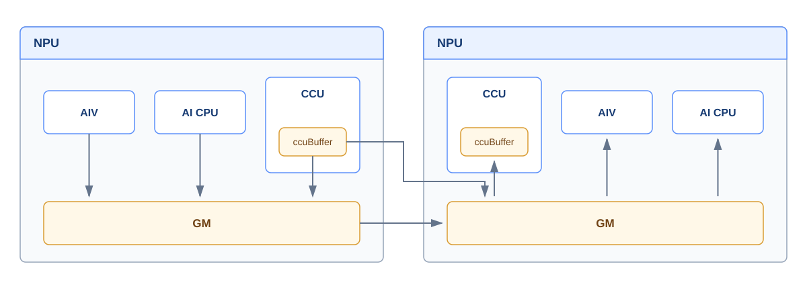

# 抽象硬件架构

本文从通信编程视角抽象参与通信的硬件组件及数据通路，并介绍通信通路由两个NPU扩展至多NPU系统时形成的组网拓扑。

在内容边界上，抽象硬件架构只关注“由哪些硬件组件参与通信”和“数据经过哪些组件”，不展开通信引擎内部的具体搬运单元、互联控制器、端口、协议和物理链路，也不描述通信任务的提交与完成时序、内存注册与远端可见性、Endpoint和Channel等软件对象。相关内容分别由[执行模型](./execution_model.md)、[内存模型](./memory_model.md)和[通信模型](./communication_model.md)介绍。组网部分仅描述NPU及网络设备的连接关系，不展开端口和链路等具体实现。

## 整体架构

参与通信的硬件组件可以抽象为[通信引擎](#通信引擎)和[存储单元](#存储单元)两类。通信引擎包括AIV、AI CPU和CCU；图中展示的存储单元包括每个NPU上的GM，以及CCU内部的ccuBuffer。

**图1** 通信抽象硬件架构图

图1以左侧NPU为本端、右侧NPU为对端。两个NPU具有对称的抽象结构，均包含AIV、AI CPU、CCU和GM，其中CCU内部包含ccuBuffer。图中的纵向连线表示通信引擎与所在NPU存储单元之间的数据关系，横向连线表示跨NPU的数据关系；具体的数据搬运路径统一在[通信通路](#通信通路)中说明。

箭头仅表示从本端到对端的单向数据流示例，不表示未经确认的物理直连或严格执行时序。反向通信使用结构对称、方向相反的通路。图中不展示任务或指令流、同步信号流以及通信任务的调度过程。

## 通信引擎

本节只介绍各通信引擎的执行主体和硬件职责。不同通信引擎的优势、约束和适用场景，请参见[通信方式分类及选择](./communication_pattern_selection.md#通信引擎选择)。

**表1** 通信引擎

| 通信引擎 | 执行主体 | 硬件职责 |
| --- | --- | --- |
| AIV | Vector Core | 执行通信Kernel中的通信算法逻辑，以及数据处理、搬运和归约等操作。 |
| AI CPU | AI CPU | 采用AI CPU+TS执行模式。AI CPU Kernel由STARS调度，并向任务队列提交数据搬运等通信任务，再由调度器交给相应的执行器。 |
| CCU（Collective Communication Unit，集合通信处理器） | 集合通信专用硬件引擎 | 执行预置的通信指令，完成数据搬运、同步和归约等操作。 |

## 存储单元

存储单元可以从使用位置上分为Global Memory和ccuBuffer。

- **Global Memory**：GM是Device侧的全局存储，用于保存通信的输入、输出和中间数据，也是各通信引擎共享通信数据的主要存储空间。
- **ccuBuffer**：ccuBuffer位于CCU内部，是CCU进行数据中转和片上归约时使用的本地片上缓存，底层存储单元为MemorySlice（MS）。它用于暂存待发送的数据、接收远端数据或保存归约过程中的中间结果。本文使用图中的名称“ccuBuffer”表示硬件存储抽象；在CCU编程接口中，对应的资源抽象为CcuBuffer。

## 通信通路

为避免双向箭头交叉影响阅读，图1只绘制一个方向的数据流。实际通信支持沿相同通路双向传输：`↔`表示同一NPU内两个组件之间可以双向传输数据，`→`表示图示的本端到对端方向；数据由对端传向本端时，沿相同组件按相反方向传输。

- **AIV通信通路**：AIV通过所在NPU的GM收发通信数据。本端发送数据时，本端AIV将数据写入本端GM，数据由本端GM传输至对端GM，再由对端AIV从对端GM读取并处理。该通路可表示为：`本端AIV ↔ 本端GM → 对端GM ↔ 对端AIV`。
- **AI CPU通信通路**：AI CPU提交的通信任务驱动本端GM与对端GM之间的数据传输。数据到达对端GM后，可由对端AI CPU读取并继续处理。该通路可表示为：`本端AI CPU ↔ 本端GM → 对端GM ↔ 对端AI CPU`。
- **CCU通信通路**：CCU使用内部ccuBuffer暂存和处理通信数据，ccuBuffer与所在NPU的GM之间支持双向传输。根据本端数据是否经过本端GM，可分为以下两种形式。 经本端GM：数据依次经过本端ccuBuffer、本端GM和对端GM，再进入对端ccuBuffer，即`本端CCU的ccuBuffer ↔ 本端GM → 对端GM ↔ 对端CCU的ccuBuffer`。 直接访问对端GM：本端ccuBuffer直接与对端GM传输数据，不经过本端GM；对端CCU再通过对端GM访问该数据，即`本端CCU的ccuBuffer → 对端GM ↔ 对端CCU的ccuBuffer`。
 ccuBuffer不支持跨NPU直接访问，因此CCU直接访问对端GM并不表示本端与对端的ccuBuffer可以直接互访。

## 组网拓扑

随着模型规模和计算规模不断扩大，单个NPU往往难以独立承载全部计算和数据，需要多个NPU协同处理。图1展示的两个NPU之间的点到点通路，是构建多NPU通信网络的基本连接单元。当系统扩展到多个NPU时，NPU之间不一定都采用两两直连，而是可以通过直接链路、中间节点或交换设备建立连接。物理拓扑描述各NPU及网络设备的组织和连接方式，决定两个NPU之间能否直接通信，或是否需要经过中间节点、一级或多级交换网络到达。根据节点连接方式和扩展方法的不同，常见拓扑如下：

| 拓扑 | 含义 |
| --- | --- |
| Full Mesh | 组内任意两个NPU之间均有直接连接，通信不需要经过其他NPU或交换设备。节点数量增加时，每个节点需要连接的对端也随之增加，适合节点数量相对有限且强调点到点直达能力的组网。 |
| Clos | NPU通过一级或多级交换设备互联，任意两个NPU之间的数据经过交换网络到达。Clos不要求NPU两两直连，可以通过增加交换设备或交换层级扩展组网规模。 |
| nD-Mesh | NPU按照n个维度排列，每个NPU与各维度上的相邻节点直接连接。相邻NPU可以直接通信，非相邻NPU需要经过一个或多个中间节点转发，其中n表示拓扑维度，例如2D-Mesh表示二维网格连接。 |

不同组网拓扑决定NPU之间的连接关系，并约束可用的通信路径，是选择通信方式和设计通信算法时需要考虑的硬件基础。