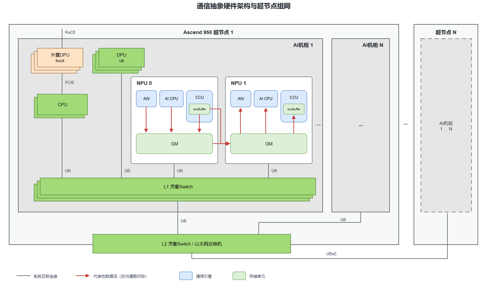
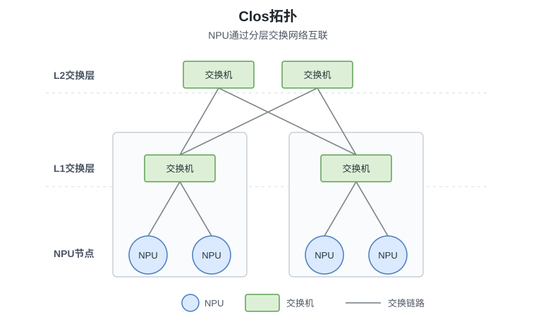
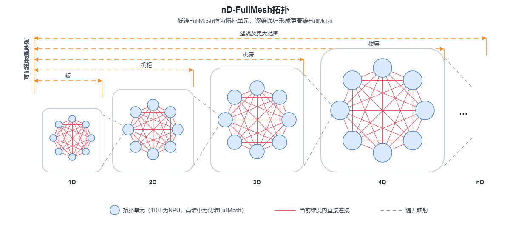
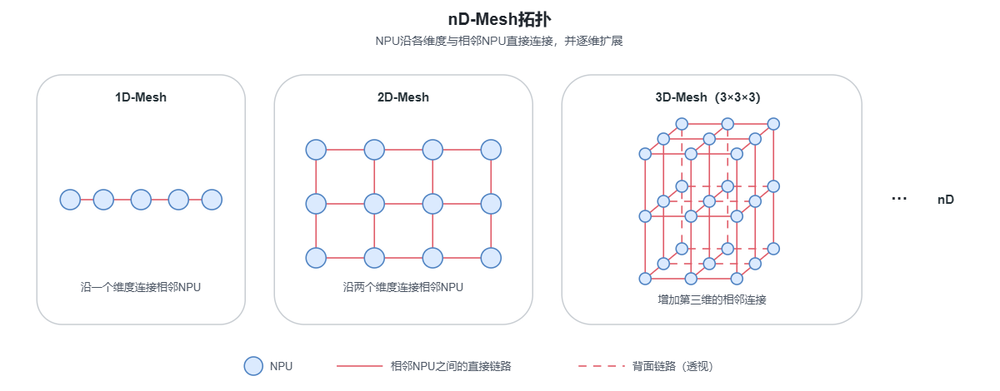

# 抽象硬件架构

本文介绍Ascend 950PR/Ascend 950DT的通信抽象硬件架构。内容按照通信规模由小到大展开：首先介绍单个NPU内参与通信的硬件组件，然后以两个NPU为例说明NPU间通信通路，最后介绍多个NPU如何通过不同的通信连接和组网拓扑构成更大规模的通信网络，为集合通信提供硬件基础。该抽象屏蔽了不必要的底层硬件实现细节，有助于开发者理解通信硬件组件、通信通路与组网架构之间的关系，降低使用Ascend C开发通信算子的门槛。

## 整体架构

NPU内部参与通信的硬件可以抽象为[**通信引擎**](#通信引擎)和[**存储单元**](#存储单元)。NPU间通信时，两端的通信引擎和存储单元通过互联网络协同完成数据传输，由此形成[**通信通路**](#通信通路)。当通信从两个NPU扩展到多个NPU时，还需要利用不同的通信连接和拓扑组织这些NPU，构成[**组网架构**](#组网架构)。图1以Ascend 950超节点为例，展示NPU内部通信硬件如何协同完成数据传输，以及多个NPU如何通过组网实现互联。

**图1** 通信抽象硬件架构图

在单个NPU内部，GM是AIV、AI CPU和CCU交换通信数据的主要存储位置，CCU还可以使用内部ccuBuffer在片上暂存和处理数据。两个NPU通信时，NPU内部的数据路径通过互联端口和交换网络延伸至对端。扩展到多个NPU后，单个NPU内部的组件关系和两个NPU之间的基本通路保持不变，变化的是NPU的组织方式以及通信需要经过的外部链路和转发节点。

图1中的数据流以NPU 0向NPU 1传输为例，反向通信使用相同组件构成的反向通路。图中连接用于表达通信相关硬件之间的可用关系，不表示未经确认的物理直连或严格执行时序。

## 通信硬件

NPU内部参与通信的硬件可以归纳为通信引擎和存储单元：通信引擎负责执行通信算法或提交通信任务，存储单元用于保存和中转通信输入、输出及中间数据。

### 通信引擎

通信引擎是执行通信算法或承接通信任务的硬件主体，各引擎的执行主体和硬件职责如下表。

**表1** 通信引擎

| 通信引擎 | 执行主体 | 主要功能 |
| --- | --- | --- |
| AIV | Vector Core | 执行通信Kernel中的算法逻辑，以及数据处理、搬运和归约等操作。 |
| AI CPU | AI CPU | 采用AI CPU+TS执行模式。AI CPU Kernel由STARS调度，并向任务队列提交数据搬运等通信任务，再由调度器交给相应的执行器。 |
| CCU（Collective Communication Unit，集合通信处理器） | 集合通信专用硬件引擎 | 执行预置通信指令，并使用内部ccuBuffer完成数据暂存、搬运、同步和片上归约等操作。 |

### 存储单元

存储单元可以从使用位置上分为Global Memory和ccuBuffer。

- **Global Memory**：GM是Device侧的全局存储，用于保存通信输入、输出和中间数据，也是各通信引擎共享通信数据的主要存储空间。
- **ccuBuffer**：ccuBuffer位于CCU内部，是CCU进行数据中转和片上归约时使用的本地片上缓存，底层存储单元为MemorySlice（MS）。它可以暂存待发送的数据、接收远端数据或保存归约中间结果，使数据在接收、归约和继续发送之间尽量保留在片上，减少集合通信过程中对GM的重复读写，并为计算任务留出更多GM访问带宽。ccuBuffer属于容量受限的分片缓存，适合分块处理通信数据，不能替代GM保存大规模通信数据。本文使用“ccuBuffer”表示硬件存储抽象；在CCU编程接口中，对应的资源抽象为CcuBuffer。

## 通信通路

图1以从NPU 0到NPU 1的数据传输为例。下文统一将发送侧称为本端、接收侧称为对端，只写出一个传输方向；反向通信沿相同组件按相反方向传输，`↔`表示同一NPU内两个组件之间支持双向数据传输。这些通路描述数据经过的硬件抽象，跨NPU部分仍需由实际互联端口和网络承载。

- **AIV通信通路**：本端AIV处理本端GM中的通信数据，数据传输至对端GM后，再由对端AIV读取和处理，即`本端AIV ↔ 本端GM → 对端GM ↔ 对端AIV`。以GM为数据端点，便于通信直接承接计算结果并将接收数据交给后续计算，路径较短；相应地，通信会占用Vector Core，并在本端和对端产生GM访问，可能与计算任务竞争计算核和GM带宽。
- **AI CPU通信通路**：AI CPU提交通信任务，由调度器将任务交给相应执行器完成本端GM与对端GM之间的数据传输，即`本端AI CPU ↔ 本端GM → 对端GM ↔ 对端AI CPU`。数据不需要经过Vector Core，适合由独立执行器承接较大数据量的搬运；但任务提交和调度会引入固定开销，数据仍需读写两端GM。
- **CCU经本端GM的通信通路**：数据由本端ccuBuffer写入本端GM，再传输至对端GM并进入对端ccuBuffer，即`本端CCU的ccuBuffer ↔ 本端GM → 对端GM ↔ 对端CCU的ccuBuffer`。该通路能够直接衔接已经位于GM中的输入、输出及中间数据，但ccuBuffer数据需要额外经过一次本端GM访问。
- **CCU直接访问对端GM的通信通路**：本端ccuBuffer直接与对端GM传输数据，对端CCU再通过对端GM访问该数据，即`本端CCU的ccuBuffer → 对端GM ↔ 对端CCU的ccuBuffer`。该通路绕过本端GM，可减少本端GM读写，适合使用ccuBuffer进行数据中转或片上归约；可处理的数据规模受ccuBuffer片上资源和单次操作长度约束。

ccuBuffer不支持跨NPU直接互访，因此“本端ccuBuffer直接访问对端GM”表示CCU经互联网络访问对端GM，不表示本端和对端ccuBuffer之间存在物理直连。

## 组网架构

集合通信需要多个NPU协同参与。随着模型规模和计算规模扩大，参与通信的NPU数量随之增加，需要通过组网将点对点连接组织成更大规模的通信网络。图1展示了组网从AI机柜到超节点的逐级扩展关系：超节点1中的AI机柜1展开了NPU、CPU、DPU和交换网络，其余AI机柜以相同结构接入上层交换网络；超节点N省略内部结构，按照与超节点1相同的方式扩展并建立超节点间连接。

组网架构可以从通信连接和组网拓扑两个方面理解：通信连接说明不同设备和组网层级使用何种链路与交换网络建立可达路径，组网拓扑说明这些连接如何组织，并决定通信两端是否具备直连链路、需要经过多少转发节点以及网络的扩展方式。

### 通信连接

按照通信范围，图1中的连接可以分为AI机柜内、超节点内和超节点间三类。三类连接分别承担设备接入、跨机柜汇聚和跨超节点扩展功能，共同构成本端到对端的硬件可达路径：

- **AI机柜内连接**：NPU、CPU及支持UB的DPU接入L1灵衢交换网络，在同一机柜内建立UB连接。外置DPU通过PCIe连接CPU，并提供RoCE通路，使机柜可以接入以太网RDMA网络。
- **超节点内连接**：各AI机柜通过上联链路接入L2灵衢交换机或以太网交换机。上层交换网络汇聚多个AI机柜，跨机柜数据经过接入层和汇聚层到达目标NPU，不要求所有NPU之间建立物理直连。
- **超节点间连接**：UBoE（UB over Ethernet）通过以太网交换网络延伸UB通信，外置DPU提供的RoCE通路也可以连接不同超节点。两种通路对应不同的端口和协议栈，实际使用哪一种取决于部署的端口、交换网络和可达链路。

上述通信连接共同建立本端到对端的硬件可达路径。可用协议由端口类型和实际链路确定，不能脱离组网任意选择；协议能力及对应编程枚举请参见[通信方式分类及选择](./communication_pattern_selection.md#通信协议分类与选择)。

### 组网拓扑

组网拓扑规定NPU、交换设备或局部拓扑单元如何组织和连接。UB组网可采用Clos、nD-FullMesh和nD-Mesh等基础拓扑，也可以在不同组网层级组合使用。

#### Clos

Clos通过分层交换网络连接NPU或局部拓扑单元。底层设备接入L1交换层，L1交换层再连接L2或更高交换层，形成逐级汇聚和转发的网络。

**图2** Clos拓扑

图2以四个NPU和两级交换网络为例。位于不同L1分支的NPU通信时，数据从源NPU进入L1交换层，经L2交换层到达目标NPU所在的L1分支。Clos无需在所有NPU之间建立物理直连，可以通过增加交换端口、交换设备或层级扩展组网规模；跨分支通信需要经过交换网络，实际路径长度和可用带宽取决于交换层级及连接配置。

#### nD-FullMesh

nD-FullMesh以FullMesh为基本单元逐维扩展。1D-FullMesh中，同一组内的NPU两两直接连接；增加维度时，将完整的低维FullMesh作为一个拓扑单元，再沿新维度连接多个低维单元。

**图3** nD-FullMesh拓扑

图3展示低维FullMesh逐维组成更高维拓扑的过程，图中的板、机柜、机房仅表示一种可能的部署映射，并非固定对应关系。该拓扑在每个FullMesh单元内提供两两直连，但不要求整个集群中的所有NPU两两直连；通信两端不在同一局部直连域时，仍需经过其他拓扑单元转发。

#### nD-Mesh

nD-Mesh将NPU按n个逻辑维度排列，每个NPU与各维度上的相邻NPU直接连接。相邻NPU可以直接通信，非相邻NPU需要沿一个或多个维度逐跳转发。作为中间节点的NPU可以通过UB On Chip Switch在IO Die内完成端口间转发，无需将转发数据送入计算Die，也不占用本地DRAM带宽。

**图4** nD-Mesh拓扑

图4以1D、2D和3D为例说明Mesh的逐维扩展方式。3D-Mesh由三个3×3平面组成：每个平面连接两个维度上的相邻NPU，不同平面再连接第三个维度上的对应NPU。图中的虚线表示透视图背面的链路，与实线具有相同的连接语义。与nD-FullMesh相比，nD-Mesh所需的直接链路更少，更容易沿维度扩展，但非相邻NPU之间可能经过更多转发节点。

Clos、nD-FullMesh和nD-Mesh既可以独立组网，也可以分层组合：局部范围使用FullMesh或nD-Mesh提供直接或近邻连接，较大范围使用Clos连接多个局部拓扑。具体组合取决于设备端口和部署规模；开发通信算子时，应根据实际拓扑和可达链路规划数据路径和通信算法，并使用链路对应的通信协议。
