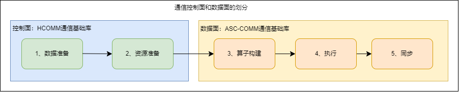

# 概述

## 引言

随着大语言模型向大规模集群部署演进，单个NPU往往难以独立承载全部计算和数据，需要多个NPU协同完成分布式训练和推理。NPU之间的通信由此成为影响系统整体性能的重要环节。

不同业务在模型结构、消息规模和网络拓扑等方面存在差异，预置的通信算法难以在多样化场景中持续保持较优性能；通算融合的发展也对通信算子的编程灵活性提出了更高要求。为支持开发者结合业务特点定制通信算法，Ascend C通信编程提供面向Kernel的通信能力，并将通信平台能力与算子实现解耦，使开发者能够聚焦通信算法本身。

本章以通信算子的开发过程为主线，先介绍控制面与数据面的职责划分和协作范式，再按照“硬件与组网—通信方式—模型机制”的顺序介绍通信编程模型。

## 数据面与控制面的划分

Ascend C通信编程分为控制面和数据面。在本编程体系中，控制面由HCOMM代码库提供，数据面由ASC-COMM代码库提供，具体分工如表1所示。

**表1** 控制面与数据面的职责划分

| 层面 | 代码库 | 运行位置 | 主要职责 | 对应编程阶段 |
| --- | --- | --- | --- | --- |
| 控制面 | HCOMM | Host侧 | 查询拓扑，建立通信关系，注册通信内存，并准备数据传输和同步所需的资源。 | 资源准备 |
| 数据面 | ASC-COMM | Device侧 | 使用控制面准备的通信关系和资源，执行数据读写、同步和归约等通信操作。 | 前同步、通信执行和后同步 |

控制面准备的通信关系、内存信息和同步资源会传递给Device侧Kernel，数据面在Kernel执行期间复用这些资源，不需要在每次数据传输时重新创建。

## Ascend C通信编程范式

从开发者视角看，一次通信过程可以概括为资源准备、前同步、通信执行和后同步四个阶段，如图1所示。

**图1** 通信算子基本流程

1. **资源准备**：根据通信成员、拓扑结构和可用链路建立通信关系，并准备通信内存及同步资源。该阶段主要由HCOMM控制面完成。
2. **前同步**：通信执行前，确认源数据已经生成，相关通信成员和执行单元处于可通信状态。
3. **通信执行**：使用已经准备的通信资源，按照通信算法和所选协议完成数据搬运、同步或归约。
4. **后同步**：确认通信任务达到完成条件后，读取输出数据或复用相关内存和任务资源。

上述阶段描述通信编程的基本逻辑，不表示各项操作必须完全串行执行；开发者可以在满足数据依赖、资源使用和同步要求的前提下，组织通信与计算的并行执行。

## 编程模型概览

后续章节的主要内容如表2所示。

**表2** 后续章节内容

| 内容 | 主要内容 |
| --- | --- |
| [抽象硬件架构](./abstract_hardware_architecture.md) | 介绍参与通信的硬件组件、NPU间数据通路以及多NPU组网方式。 |
| [通信方式分类及选择](./communication_pattern_selection.md) | 介绍驱动模式、通信引擎和通信协议的分类及选择依据。 |
| [通信模型](./communication_model.md) | 介绍通信实体、Endpoint、Channel和通信内存等对象之间的关系。 |
| [内存模型](./memory_model.md) | 介绍通信相关存储资源、通信内存的远端可见性、访问授权和寻址方式。 |
| [执行模型](./execution_model.md) | 介绍通信任务从准备、提交、执行、同步到完成的过程。 |

## 小结

控制面与数据面的分层使通信资源准备和Device侧操作相互解耦，四阶段编程范式进一步串联资源准备、同步和通信执行过程。在此基础上，抽象硬件架构及组网拓扑、通信方式分类及选择以及三种具体模型共同描述通信算子的硬件基础、实现方式和编程机制。

## 支持的产品型号

Ascend 950PR/Ascend 950DT
