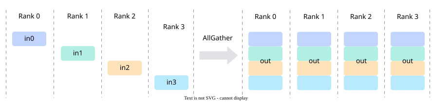

# CCU Communication Operator Development Guide

<!-- md-trans-meta sourceCommit=5ed547c8af0b4fe59c907ddcd1d49348087706f5 translatedAt=2026-11-05T01:35:20.757Z pushedAt=2026-11-09T06:49:19.126Z nl=2 -->

## Overview

This guide describes how to develop CCU communication operators using the [`<<<>>>`](../programming_model/ccu_programming.md#kernel-function) direct call method, covering the entire process of host-side resource preparation, task dispatch, and kernel-side communication execution.

This guide uses AllGather as an example. AllGather is a collective communication operator that concatenates the inputs of all ranks in the communicator in ascending order of **rankId**, and then sends the concatenated result to the output buffers of all ranks, as shown in [Figure 1](#fig-allgather).

**Figure 1** AllGather semantics<a id="fig-allgather"></a>



## Supported Scope

| Item | Description |
| --- | --- |
| Communication protocol | `COMM_PROTOCOL_UB_CTP` |
| Communication engine | `COMM_ENGINE_CCU` |

<!-- npu="950" id1 -->
> [!NOTE] Note
> This sample supports the Ascend 950PR&950DT products and requires CANN version 9.1.0 or later. A single-device environment supports compilation verification only; at least two NPUs are required for actual running.
<!-- end id1 -->

## Overall Process

Taking the [allgather](../../../../examples/ccu/ccu_direct/01_allgather/README.md) sample as an example, the complete implementation process of the CCU AllGather operator is divided into two stages: host-side resource preparation and kernel-side communication execution. Resources are destroyed after communication is completed.

**Host-side resource preparation** (control plane): resource preparation, task dispatch, and resource reclamation required for communication task execution are completed on the host side.

1. Initialize the operating environment: initialize the ACL and HCCL communicators, and obtain the number of NPUs in the current environment.
2. Allocate memory and initialize input data: allocate device memory, initialize the input data, and copy it to the device.
3. Allocate CCU resources: allocate CCU channel and CCU instance resources based on the HCCL communicator.
4. Obtain the memory token and prepare task parameters: obtain the input memory token through `HcommCcuGetMemToken`, and prepare the CCU task parameters.
5. Dispatch the CCU communication task: directly call the CCU kernel through `CcuAllGatherMesh1DMem2MemKernel<<<schd, insHandle, stream>>>`.
6. Destroy resources: destroy the communicator, stream, and device memory.

**Kernel-side communication execution** (data plane): after the task is dispatched to the stream, the CCU hardware completes data transfer and synchronization on the kernel side following the communication programming paradigm of pre-synchronization, operator execution, and post-synchronization.

1. Resource preparation within the kernel: load task parameters and bind the remote variable.
2. Pre-synchronization: write the local communication memory information (output address and token) to the peer with a synchronization signal, and wait for the peer to be ready before performing data transfer.
3. Operator execution: initiate cross-rank data transfer and local copy within the current rank, and wait for all transfers to complete.
4. Post-synchronization: notify the peer that the transfer is complete, and wait for all peers to complete.

The relationship between the host side and the kernel side is reflected as follows: after the host side completes resource preparation, it directly calls the kernel through step 5 "Dispatch the CCU communication task", dispatching the channel handle and task parameters (**taskArgs** and **kernelArg**) to the stream along with the task. The kernel side then loads the task parameters through `ccu::load_arg`, binds the variable through `ccu::get_res_by_channel`, and sequentially performs pre-synchronization, operator execution, and post-synchronization. Among these, pre-synchronization is an extension of resource preparation on the data plane: the communication memory information such as the token prepared on the host side must be exchanged to the peer through pre-synchronization before cross-rank data movement can be initiated.

The subsequent content of this chapter is organized according to this process, and the key code snippets are all taken from the [allgather](../../../../examples/ccu/ccu_direct/01_allgather/README.md) sample.

## Host-Side Resource Preparation

### Initializing the Operating Environment

- Initialize ACL and query the number of devices.

    ```cpp
    // Initialize device resources.
    ACLCHECK(aclInit(NULL));
    // Query the number of devices.
    uint32_t devCount;
    ACLCHECK(aclrtGetDeviceCount(&devCount));
    ```

- Generate the communicator initialization information **rootInfo**.

    ```cpp
    int32_t rootRank = 0;
    ACLCHECK(aclrtSetDevice(rootRank));
    // Generate Root node information. All threads use the same RootInfo.
    void* rootInfoBuf = nullptr;
    ACLCHECK(aclrtMallocHost(&rootInfoBuf, sizeof(HcclRootInfo)));
    HcclRootInfo* rootInfo = (HcclRootInfo*)rootInfoBuf;
    HCCLCHECK(HcclGetRootInfo(rootInfo));
    ```

- Each rank initializes the communicator and creates a stream.

    Before initializing the communicator, each rank first switches to its own device by calling `aclrtSetDevice`, then initializes its communicator based on the same **rootInfo**, and creates a task stream.

    ```cpp
    // Set the device operated by the current rank. device is the device number corresponding to the current rank (0 to devCount-1).
    ACLCHECK(aclrtSetDevice(static_cast<int32_t>(device)));

    // Initialize the collective communicator.
    HcclComm hcclComm;
    HCCLCHECK(HcclCommInitRootInfo(devCount, rootInfo, device, &hcclComm));

    // Create the task stream.
    aclrtStream stream;
    ACLCHECK(aclrtCreateStream(&stream));
    ```

### Allocating Memory and Initializing Input Data

- Allocate device memory for collective communication to store input and output data.

    ```cpp
    ACLCHECK(aclrtMalloc(&sendBuf, sendSize, ACL_MEM_MALLOC_HUGE_ONLY));
    ACLCHECK(aclrtMalloc(&recvBuf, recvSize, ACL_MEM_MALLOC_HUGE_ONLY));
    ```

- Allocate host memory, initialize the input data, and then copy it to the device side.

    ```cpp
    // Allocate host memory to store the input data and initialize it to device ID + 1.
    void* hostBuf = nullptr;
    ACLCHECK(aclrtMallocHost(&hostBuf, sendSize));

    // Copy the input data from the host to the device.
    ACLCHECK(aclrtMemcpy(sendBuf, sendSize, hostBuf, sendSize, ACL_MEMCPY_HOST_TO_DEVICE));
    ACLCHECK(aclrtFreeHost(hostBuf));
    ```

### Allocating CCU Resources

- Query **rankId** and **rankSize**.

    ```cpp
    uint32_t rankId = 0;
    uint32_t rankSize = 0;
    HCCLCHECK(HcclGetRankId(hcclComm, &rankId));
    HCCLCHECK(HcclGetRankSize(hcclComm, &rankSize));
    ```

- Allocate a channel for each peer rank.

    `kernelChannels` is a container that stores channel handles. For each peer rank in the communicator other than the local rank, query the link information, select a UB_CTP protocol link to fill the channel descriptor, and allocate a channel.

    ```cpp
    kernelChannels.resize(rankSize - 1);
    uint32_t channelIndex = 0;
    for (uint32_t remoteRank = 0; remoteRank < rankSize; remoteRank++) {
        if (remoteRank == rankId) {
            continue;
        }
        uint32_t netLayer = 0;
        uint32_t listSize = 0;
        CommLink* linkList = nullptr;
        // Obtain the link information between srcRank and dstRank.
        HCCLCHECK(HcclRankGraphGetLinks(hcclComm, netLayer, rankId, remoteRank, &linkList, &listSize));

        HcclChannelDesc desc;
        HCCLCHECK(HcclChannelDescInit(&desc, 1));
        CommProtocol protocol = CommProtocol::COMM_PROTOCOL_UB_CTP;
        bool protocolExists = false;
        for (uint32_t idx = 0; idx < listSize; idx++) {
            CommLink link = linkList[idx];
            if (link.linkAttr.linkProtocol == protocol) {
                desc.remoteRank = remoteRank;
                desc.notifyNum = CHANNEL_NOTIFY_NUM; // Number of notify slots negotiated on the channel.
                desc.channelProtocol = link.linkAttr.linkProtocol;
                desc.localEndpoint.protocol = link.srcEndpointDesc.protocol;
                desc.localEndpoint.commAddr = link.srcEndpointDesc.commAddr;
                desc.localEndpoint.loc = link.srcEndpointDesc.loc;
                desc.remoteEndpoint.protocol = link.dstEndpointDesc.protocol;
                desc.remoteEndpoint.commAddr = link.dstEndpointDesc.commAddr;
                desc.remoteEndpoint.loc = link.dstEndpointDesc.loc;
                protocolExists = true;
                break;
            }
        }
        if (!protocolExists) {
            return HCCL_E_NOT_FOUND;
        }
        // Allocate a channel on the CCU engine.
        HCCLCHECK(HcclChannelAcquire(hcclComm, CommEngine::COMM_ENGINE_CCU, &desc, 1, &kernelChannels[channelIndex]));
        channelIndex++;
    }
    ```

- Query the die ID.

    When establishing a link for the first time, query the die ID where the local endpoint resides, which serves as the basis for subsequent scheduling configuration.

    ```cpp
    EndpointAttrDieId dieIdValue = 0;
    HCCLCHECK(HcclRankGraphGetEndpointInfo(
        hcclComm, rankId, &desc.localEndpoint, ENDPOINT_ATTR_DIE_ID, sizeof(EndpointAttrDieId), &dieIdValue));
    ```

- Obtain the CCU instance: resources such as the instruction space, registers, and on-chip cache generated by kernel translation are all mounted on the CCU instance.

    The sample queries the CCU instance bound to the communicator through `HcclCommQueryCcuIns`. The public helper function `QueryCcuInstance` encapsulates this call and verifies that the communicator is bound to exactly one instance:

    ```cpp
    void* insHandle{};
    HCCLCHECK(asccomm_examples::QueryCcuInstance(hcclComm, insHandle));
    ```

### Obtaining the Memory Token and Preparing Task Parameters

- Obtaining the memory token

    The CCU hardware does not directly use process virtual addresses to access on-chip memory. You must first call `HcommCcuGetMemToken` to convert `(virtual address, size)` into a 64-bit token issued by the driver, and then pass it to the kernel along with the task parameters.

    ```cpp
    // inputSize is the number of input bytes per rank
    uint64_t token = 0;
    uint64_t baseInputAddr = reinterpret_cast<uint64_t>(sendBuf);
    uint64_t baseOutputAddr = reinterpret_cast<uint64_t>(recvBuf);
    HCCLCHECK(ConvertCcuToHccl(HcommCcuGetMemToken(baseInputAddr, inputSize, &token)));
    ```

    The `asccomm_ccu_*` APIs return `CcuResult`. In the sample, it is converted to `HcclResult` through `ConvertCcuToHccl` and then checked by `HCCLCHECK`.

- Preparing **taskArgs**

    `taskArgs` is the runtime parameter array, which corresponds one-to-one with the SQE parameters of the kernel function. In the AllGather scenario, it contains the input and output addresses, tokens, inter-card offsets, shard sizes, and the split parameters for the local copy:

    ```cpp
    uint64_t taskArgs[CCU_DIRECT_TASK_ARG_NUM] = {  // CCU_DIRECT_TASK_ARG_NUM is the number of parameters, which is 10 in the sample.
        baseInputAddr, baseOutputAddr, token,     0,         inputSize * rankId,
        inputSize,     goSize[0],      goSize[1], goSize[2], goSize[3],
    }; // goSize is the local copy split parameter calculated by CalGoSize: offset, loop parameter, parallel parameter, and residual size.
    ```

- Preparing **kernelArg**

    `kernelArg` is the orchestration context, which holds the channel handle, **rankSize**, **rankId**, and so on:

    ```cpp
    auto kernelArg = std::make_shared<CcuKernelArgAllGatherMesh1DMem2Mem>();
    kernelArg->rankSize = rankSize;
    kernelArg->rankId = rankId;
    kernelArg->channelCount = static_cast<uint32_t>(kernelChannels.size());
    for (uint32_t i = 0; i < kernelChannels.size(); ++i) {
        kernelArg->channels[i] = kernelChannels[i];
    }
    ```

### Dispatching the CCU Communication Task

- Directly call the CCU kernel through `<<<>>>` to dispatch the task to the stream for execution.

    ```cpp
    const uint64_t dieMask = 1ULL << dieId;

    asccomm_ccu_schd schd = {1, 0, dieMask, 0};
    CcuAllGatherMesh1DMem2MemKernel<<<schd, insHandle, stream>>>(
        taskArgs[0], taskArgs[1], taskArgs[2], taskArgs[3], taskArgs[4], taskArgs[5], taskArgs[6], taskArgs[7],
        taskArgs[8], taskArgs[9], kernelArg.get());
    ```

### Destroying Resources

- After communication is complete, destroy the communicator, release the device memory, destroy the stream, and reset the device:

    ```cpp
    HCCLCHECK(HcclCommDestroy(hcclComm)); // Destroy the communicator.
    ACLCHECK(aclrtFree(sendBuf));         // Release the device-side memory.
    ACLCHECK(aclrtFree(recvBuf));
    ACLCHECK(aclrtDestroyStream(stream)); // Destroy the task stream.
    ACLCHECK(aclrtResetDevice(device));   // Reset the device.
    ```

## Kernel-Side Communication Execution

The following uses AllGather as an example to describe task orchestration on the data plane. The kernel entry is as follows:

```cpp
__ccu_host__ void CcuAllGatherMesh1DMem2MemKernel(
    uint64_t sqeArgs1, uint64_t sqeArgs2, ..., uint64_t sqeArgs10, ccu_kernel_arg arg)
{
    auto* kernelArg = static_cast<CcuKernelArgAllGatherMesh1DMem2Mem*>(arg);

    // ctx is the kernel context, which stores programming objects such as input/output/token and split parameters.
    AllGatherMesh1DMem2MemContext ctx;
    ctx.arg = kernelArg;

    // The three phases of pre-synchronization, operator execution, and post-synchronization are expanded in this function.
}
```

### Preparing Resources in the Kernel

Before task orchestration, complete the initialization of programming objects and the loading of task parameters.

- Bind the remote variable unit.

    The output address and token are variables that need to be written from the peer rank. They are bound to the channel through `ccu::get_res_by_channel`. `OUTPUT_VAR_ID` and `TOKEN_VAR_ID` are agreed upon by both communication parties:

    ```cpp
    // OUTPUT_VAR_ID and TOKEN_VAR_ID are the variable unit numbers corresponding to the peer output address and token, respectively.
    ctx.output.resize(ctx.arg->rankSize);
    ctx.token.resize(ctx.arg->rankSize);
    uint32_t channelIdx = 0;
    for (uint64_t peerId = 0; peerId < ctx.arg->rankSize; peerId++) {
        if (peerId != ctx.arg->rankId) {
            // Bind the output address and token of the peer rank through the channel.
            ctx.output[peerId] = ccu::get_res_by_channel<ccu::variable>(ctx.arg->channels[channelIdx], OUTPUT_VAR_ID);
            ctx.token[peerId] = ccu::get_res_by_channel<ccu::variable>(ctx.arg->channels[channelIdx], TOKEN_VAR_ID);
            channelIdx++;
        }
    }
    ```

- Load task parameters.

    `ccu::load_arg` loads the SQE parameters into CCU variables in declaration order. This instruction must be called at the very beginning of the program:

    ```cpp
    uint32_t argId = 0;
    CCU_CHK_VOID_RET(ccu::load_arg(ctx.input, argId++));                        // Input address
    CCU_CHK_VOID_RET(ccu::load_arg(ctx.output[ctx.arg->rankId], argId++));      // Output address of this rank
    CCU_CHK_VOID_RET(ccu::load_arg(ctx.token[ctx.arg->rankId], argId++));       // Memory token
    CCU_CHK_VOID_RET(ccu::load_arg(ctx.currentRankSliceInputOffset, argId++));  // Inter-device input offset
    CCU_CHK_VOID_RET(ccu::load_arg(ctx.currentRankSliceOutputOffset, argId++)); // Inter-device output offset
    CCU_CHK_VOID_RET(ccu::load_arg(ctx.sliceSize, argId++));                    // Shard size
    CCU_CHK_VOID_RET(ccu::load_arg(ctx.goSize.addrOffset, argId++));            // Local copy sharding parameter
    CCU_CHK_VOID_RET(ccu::load_arg(ctx.goSize.loopParam, argId++));
    CCU_CHK_VOID_RET(ccu::load_arg(ctx.goSize.parallelParam, argId++));
    CCU_CHK_VOID_RET(ccu::load_arg(ctx.goSize.residual, argId++));
    ```

- Declare local copy resources.

    The resources required for the local copy, such as `ccu_buffer` and `event`, as well as the source/destination addresses for the transfer, are also declared and assembled at this stage (in the sample, they are encapsulated in `InitGroupCopyResources` and `ExecuteAllGatherTransfer`).

### Pre-Synchronization

- Pre-synchronization ensures that all ranks complete resource preparation and exchange communication memory information before data transfer. Use `ccu::write_variable_with_notify` to write the local output address and token value to the peer, and simultaneously send a synchronization signal to the peer notify unit. Then `ccu::notify_wait` blocks until the synchronization signal from the peer rank arrives:

    ```cpp
    // Write the local output address and token to the peer, and set the corresponding flag of the peer EVENT_IDX_0.
    for (uint32_t i = 0; i < ctx.arg->channelCount; i++) {
        CCU_CHK_VOID_RET(ccu::write_variable_with_notify(
            ctx.arg->channels[i], ctx.output[ctx.arg->rankId], OUTPUT_VAR_ID, EVENT_IDX_0, 1 << OUTPUT_VAR_ID));
        CCU_CHK_VOID_RET(ccu::write_variable_with_notify(
            ctx.arg->channels[i], ctx.token[ctx.arg->rankId], TOKEN_VAR_ID, EVENT_IDX_0, 1 << TOKEN_VAR_ID));
    }
    // Wait for the peer to write the output address and token to the local end.
    uint32_t allBit = (1 << OUTPUT_VAR_ID) | (1 << TOKEN_VAR_ID);
    for (uint32_t i = 0; i < ctx.arg->channelCount; i++) {
        CCU_CHK_VOID_RET(ccu::notify_wait(ctx.arg->channels[i], EVENT_IDX_0, allBit));
    }
    ```

    > [!CAUTION] Caution
    > Do not split "writing the variable" and "notify_record" into two separate calls. The hardware does not guarantee the arrival order of two independent operations. After the peer receives the Notify and reads the variable, there is a risk of reading a stale value. Only `write_variable_with_notify` can guarantee the order of "write the value first, then send the Notify" at the hardware level.

    After pre-synchronization is complete, all ranks hold the peer output address and token, and can assemble the remote address to initiate the transfer.

### Operator Execution

The execution of AllGather consists of two parts: writing the local rank data to other ranks, and placing the local rank data in its local position.

- Assemble the transfer address.

    The remote destination address is composed of the output address synchronized from the peer, the token, and the inter-device offset. The local destination address directly uses the local variable:

    ```cpp
    ccu::local_addr src;
    src.addr_ = ctx.input;
    src.addr_ += ctx.currentRankSliceInputOffset;
    src.token = ctx.token[ctx.arg->rankId];

    for (uint32_t rankIdx = 0; rankIdx < ctx.arg->rankSize; rankIdx++) {
        if (rankIdx == ctx.arg->rankId) {
            localDst.addr_ = ctx.output[rankIdx] + ctx.currentRankSliceOutputOffset;
            localDst.token = ctx.token[rankIdx];
        } else {
            dst[rankIdx].addr_ = ctx.output[rankIdx] + ctx.currentRankSliceOutputOffset;
            dst[rankIdx].token = ctx.token[rankIdx];
        }
    }
    ```

- Submit the cross-rank write task.

    `ccu::write` is an asynchronous operation. When the hardware completes the data transfer, it automatically sets the flag corresponding to the mask in the event:

    ```cpp
    CCU_IF(ctx.sliceSize != 0)
    {
        uint32_t channelId = 0;
        for (uint64_t rankIdx = 0; rankIdx < ctx.arg->rankSize; rankIdx++) {
            const uint16_t mask = 1 << rankIdx;
            if (rankIdx != ctx.arg->rankId) {
                // Write the data of this rank to the peer address.
                CCU_CHK_RET(ccu::write(ctx.arg->channels[channelId], dst[rankIdx], src, ctx.sliceSize, ctx.event, mask));
                channelId++;
            }
        }
    }
    ```

- Locally copy data.

    The data of this rank is transferred between local memory regions through `ccu::local_copy`. When the data volume is large, the transfer is split into multiple shards, relayed through the CCU Buffer, and executed concurrently by multiple loops to fully utilize the bandwidth (see the "Concurrent Execution" section in [CCU Programming](../programming_model/ccu_programming.md); in the sample, this is encapsulated as `GroupCopy`):

    ```cpp
    // Loop execution body: on-chip memory -> CcuBuffer -> on-chip memory, with event_wait used between the two transfers to confirm completion
    ccu::local_copy(ctx.moRes.ccuBuf[bufBase], loopSrc[index], loopLen[index], loopEvt, 1);
    ccu::event_wait(loopEvt, 1);
    ccu::local_copy(loopDst[index], ctx.moRes.ccuBuf[bufBase], loopLen[index], loopEvt, 1);
    ccu::event_wait(loopEvt, 1);
    ```

- Wait for transfer completion.

    After all local and cross-rank transfers are submitted, record the completion event and wait for all transfer branches to complete. The event is automatically set when the hardware transfer completes. Here, `ccu::event_record` supplements the completion flag of the local copy branch, and `ccu::event_wait` waits for the bit masks of all ranks to be set:

    ```cpp
    CCU_CHK_RET(ccu::event_record(ctx.event, 1 << ctx.arg->rankId));
    const uint16_t totalMask = (1 << ctx.arg->rankSize) - 1;
    CCU_CHK_RET(ccu::event_wait(ctx.event, totalMask));
    ```

### Post-Synchronization

- Post-synchronization ensures that AllGather is not considered complete until all ranks have finished receiving data. A transfer completion notification is sent to each peer, and then the completion notifications from all peers are awaited:

    ```cpp
    // Notify the peer that this rank has finished data transfer. POST_SYNC_ID is the notify flag used for post-synchronization.
    for (uint32_t i = 0; i < ctx.arg->channelCount; i++) {
        CCU_CHK_VOID_RET(ccu::notify_record(ctx.arg->channels[i], EVENT_IDX_0, 1 << POST_SYNC_ID));
    }
    // Wait for all peers to finish data transfer.
    for (uint32_t i = 0; i < ctx.arg->channelCount; i++) {
        CCU_CHK_VOID_RET(ccu::notify_wait(ctx.arg->channels[i], EVENT_IDX_0, 1 << POST_SYNC_ID));
    }
    ```

- After post-synchronization is complete, the kernel orchestration ends. The host side detects task completion through `aclrtSynchronizeStream` and can then read the AllGather result in `recvBuf`.

## Precautions

- Running the sample requires at least two NPUs. A single-device environment supports compilation verification only.
- Before running, `HCCL_OP_EXPANSION_MODE=CCU_SCHED` must be set.
- The sample uses the `dav-3510` architecture by default and applies only to the Ascend 950PR&950DT products.
- The sample uses all NPU devices visible in the environment, and the number of devices cannot exceed `CCU_MAX_RANK_SIZE`.
