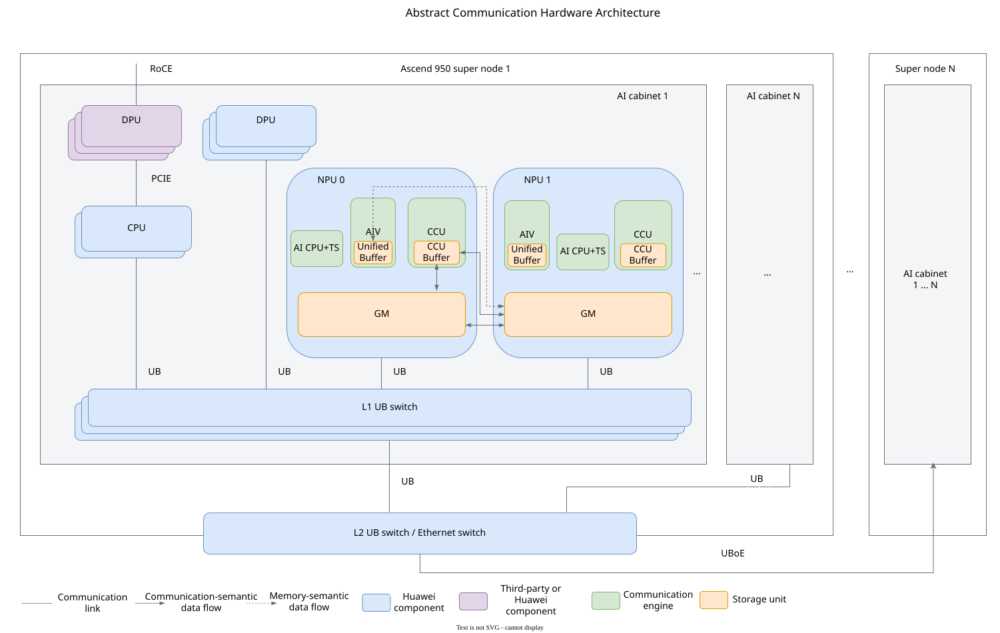
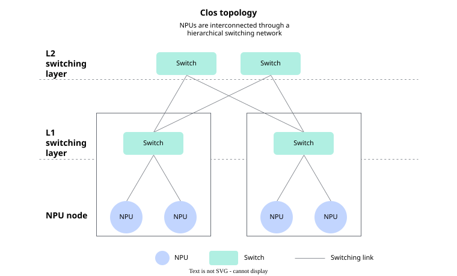
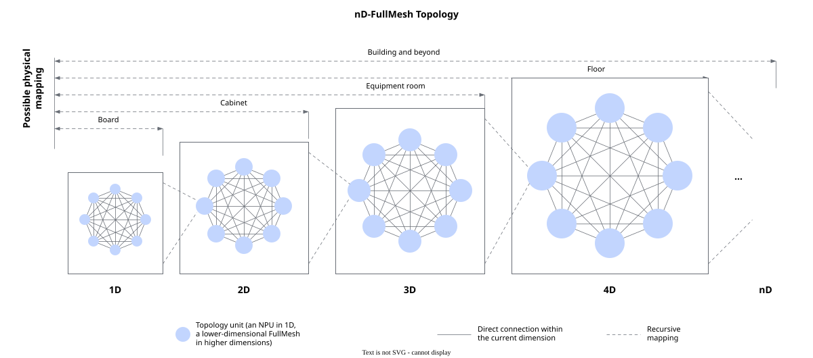
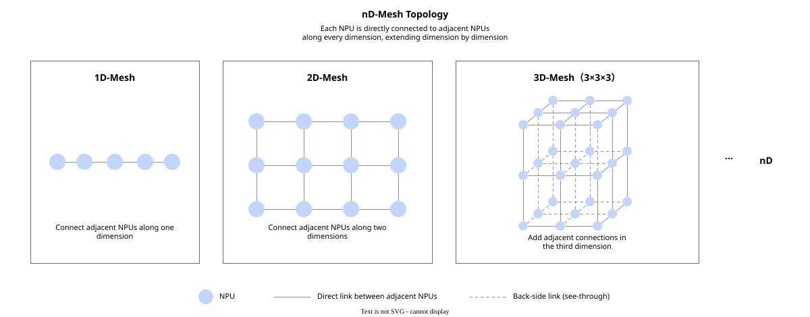

# Abstract Hardware Architecture

<!-- md-trans-meta sourceCommit=5ed547c8af0b4fe59c907ddcd1d49348087706f5 translatedAt=2026-11-05T01:44:09.942Z pushedAt=2026-11-09T06:49:19.129Z nl=2 -->

This document describes the abstract communication hardware architecture of the Ascend 950PR&950DT products. The content is organized by communication scale, from small to large: it first introduces the hardware components involved in communication within a single NPU, then uses two NPUs as an example to explain the communication path between NPUs, and finally describes how multiple NPUs form larger-scale communication networks through different communication links and networking topologies, providing the hardware foundation for collective communication. This abstraction hides unnecessary low-level hardware implementation details, helping developers understand the relationships among communication hardware components, communication paths, and networking architectures, and lowering the barrier to developing communication operators with Ascend C.

## Overall Architecture

The hardware involved in communication within an NPU can be abstracted into a [**Communication Engine**](#communication-engine) and [**Storage Unit**](#storage-unit). During inter-NPU communication, the communication engines and storage units at both ends cooperate through the interconnection network to complete data transfer, thereby forming a [**Communication Path**](#communication-path). When communication is extended from two NPUs to multiple NPUs, different communication links and topologies are required to organize these NPUs into a [**Networking Architecture**](#networking-architecture). [Figure 1](#fig-communication-hardware) shows how the communication hardware within an NPU cooperates to complete data transfer, and how multiple NPUs are interconnected through networking.

**Figure 1** Abstract communication hardware architecture

The networking shown in [Figure 1](#fig-communication-hardware) is a standard networking form recommended for the Ascend 950PR&950DT products, which is built up level by level from AI cabinets and super nodes: a super node contains multiple AI cabinets, and multiple super nodes are further interconnected through the upper-layer network. To illustrate the internal structure of the communication endpoints in the networking, the figure expands AI cabinet 1 within super node 1 and selects NPU 0 and NPU 1 as a pair of communication endpoints, showing the hardware components involved in communication within a single NPU and the point-to-point communication path between the two NPUs; the remaining AI cabinets and super nodes retain only their networking relationships. In the figure, the data paths between the components within NPU 0 are bidirectional arrows, indicating that data can flow in both directions along these paths; the data path between NPU 0 and NPU 1 is drawn using unidirectional transfer from NPU 0 to NPU 1 as an example, while in practice the two NPUs support mutual data transfer along the corresponding paths.

In this network, UB (Unified Bus) provides the interconnection capability among NPUs, DPUs, and UB switches. The UB switches are responsible for data switching and forwarding in the UB network. The DPU (Data Processing Unit) provides network access and data processing capabilities, and an external DPU can also carry RDMA communication over Ethernet through RoCE (RDMA over Converged Ethernet). The devices and interconnection methods described above jointly establish reachable paths between NPUs. The communication hardware and data paths within the endpoints are described in the following sections.

## Communication Hardware

The hardware involved in communication within an NPU can be classified into communication engines and storage units: communication engines are responsible for executing communication algorithms or submitting communication tasks, while storage units are used to store and relay communication input, output, and intermediate data.

### Communication Engine

A communication engine is the hardware entity that executes communication algorithms or undertakes communication tasks. The execution entity and hardware responsibilities of each engine are listed in the following table.

**Table 1** Communication engines

| Communication Engine | Execution Entity | Main Functions |
| --- | --- | --- |
| AIV (AI Vector) | Vector Core | Executes the algorithm logic in the communication kernel, as well as operations such as data processing, data movement, and reduction. |
| AI CPU+TS (Task Scheduler) | AI CPU+TS | Uses the [AI CPU+TS execution mode](./execution_model.md#aicpu_ts-direct-drive-execution-mechanism). STARS is the task scheduler on the device side, responsible for scheduling AI CPU kernels and communication tasks submitted to the task queue. After an AI CPU kernel is scheduled and executed by STARS, it submits communication tasks such as data movement to the task queue, which are then scheduled by STARS to the corresponding executors. |
| CCU (Collective Communication Unit) | Dedicated hardware engine for collective communication | Executes preset communication instructions and uses the internal CCU Buffer to complete operations such as data staging, movement, synchronization, and on-chip reduction. For details about the CCU architecture and internal components, see [CCU Programming](./ccu_programming.md#basic-concepts). |

### Storage Unit

The storage units involved in communication include Global Memory, Unified Buffer, and CCU Buffer.

- **Global Memory**: GM is the global storage on the device side, used to store communication input, output, and intermediate data. It is also the primary storage space where communication engines share communication data.
- **Unified Buffer**: Unified Buffer is the core internal storage unit within the Vector Core (AIV) used by the vector computing unit.
- **CCU Buffer**: CCU Buffer is located inside the CCU and serves as the local on-chip cache used by the CCU for data relay and on-chip reduction. It can stage data to be sent, receive remote data, or store intermediate reduction results, keeping data on-chip as much as possible between reception, reduction, and continued transmission. This reduces repeated reads and writes to GM during collective communication and frees up more GM access bandwidth for computing tasks. CCU Buffer is a capacity-limited sharded cache suitable for processing communication data in blocks, and it cannot replace GM for storing large-scale communication data.

## Communication Path

For ease of description, the following uses NPU 0 in Figure 1 as the local NPU and NPU 1 as the peer NPU to illustrate the communication path from the local end to the peer end. Based on the hardware engines involved in communication, inter-NPU communication paths can be classified into the following three types:

- **AIV communication path**: divided into network semantics and memory semantics
  - Network semantics: `local GM <-> peer GM`
  - Memory semantics: `Unified Buffer of the local AIV <-> peer GM`
- **AI CPU communication path**: `local GM <-> peer GM`
- **CCU communication path**:
  - `CCU Buffer of the local CCU <-> local GM <-> peer GM <-> CCU Buffer of the peer CCU`
  - `CCU Buffer of the local CCU <-> peer GM <-> CCU Buffer of the peer CCU`

## Networking Architecture

As the model scale and computing scale grow, the number of NPUs involved in communication increases accordingly, and networking is required to organize point-to-point connections into a larger-scale communication network. [Figure 1](#fig-communication-hardware) shows the progressive expansion of the network from an AI cabinet to a super node: AI cabinet 1 in super node 1 expands into NPUs, CPUs, DPUs, and a switching network, while the other AI cabinets connect to the upper-layer switching network in the same structure; super node N omits its internal structure and expands in the same way as super node 1, establishing connections between super nodes.

The following describes the networking from two aspects: communication links and networking topologies.

- Communication links describe which links and switching networks are used by different devices and networking layers to establish reachable paths.
- Networking topologies describe how these links are organized and determine whether the two ends of a communication have a direct link, how many forwarding nodes are traversed, and how the network is expanded.

### Communication Links

[Figure 1](#fig-communication-hardware) shows a standard networking form recommended for the Ascend 950PR&950DT products. Based on the communication scope, its links can be classified into three types: within an AI cabinet, within a super node, and between super nodes. The three types of links respectively provide device access, cross-cabinet aggregation, and cross-super-node expansion, jointly forming the hardware-reachable path from the local end to the peer end:

- **Links within an AI cabinet**: NPUs, CPUs, and DPUs that support UB are connected to the L1 UB switching network to establish UB links within the same cabinet. An external DPU connects to the CPU through PCIe and provides a RoCE path, allowing the cabinet to access the Ethernet RDMA network.
- **Links within a super node**: Each AI cabinet is connected to an L2 UB switch or an Ethernet switch through uplinks. The upper-layer switching network aggregates multiple AI cabinets, and cross-cabinet data reaches the target NPU through the access layer and the aggregation layer. Physical direct links are not required between all NPUs.
- **Links between super nodes**: UBoE (UB over Ethernet) extends UB communication through the Ethernet switching network, and the RoCE path provided by the external DPU can also connect different super nodes. The two paths correspond to different ports and protocol stacks. Which one is actually used depends on the deployed ports, the switching network, and the reachable links.

The communication links described above jointly establish the hardware-reachable path from the local end to the peer end. The available protocols are determined by the port types and the actual links, and cannot be selected arbitrarily without considering the networking. For details about protocol capabilities and the corresponding programming enums, see [Communication Pattern Classification and Selection](./communication_pattern_selection.md#communication-protocol-classification-and-selection).

### Networking Topology

The topologies available for UB networking include Clos, nD-FullMesh, and nD-Mesh.

#### Clos

Clos is a topology based on multi-level switching. NPUs or local topology units are connected to lower-level switching devices, which are in turn connected to higher-level switching devices. Cross-branch communication is completed through the switching network.

**Figure 2** Clos topology

#### nD-FullMesh

FullMesh is a fully interconnected topology in which any two NPUs within the same FullMesh are directly connected without forwarding through other NPUs.

nD-FullMesh extends the networking across multiple logical dimensions based on FullMesh. A 1D-FullMesh is formed by directly connecting a group of NPUs to each other in pairs. When extended to a higher dimension, the lower-dimensional FullMesh is replicated into multiple topology units, and the NPUs at corresponding positions in different units are directly connected to each other in pairs along the newly added dimension, progressively forming 2D, 3D, and up to nD-FullMesh. Unlike composing all NPUs into a single FullMesh, nD-FullMesh establishes full interconnection within each dimension and expands the networking scale by adding dimensions.

**Figure 3** nD-FullMesh topology

#### nD-Mesh

nD-Mesh arranges NPUs along n logical dimensions, with each NPU directly connected to its adjacent NPUs in each dimension; data between non-adjacent NPUs is forwarded hop by hop along one or more dimensions.

**Figure 4** nD-Mesh topology

Clos, nD-FullMesh, and nD-Mesh can be used either independently or in hierarchical combinations, depending on the device ports and deployment scale.
