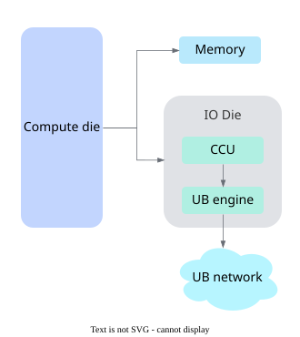
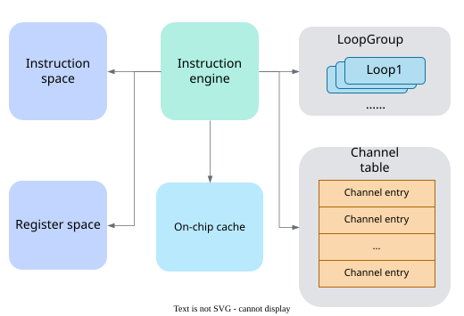
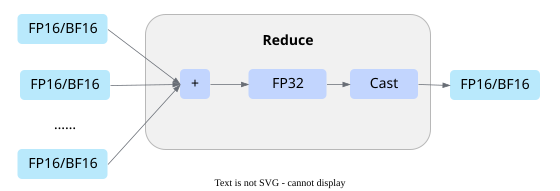
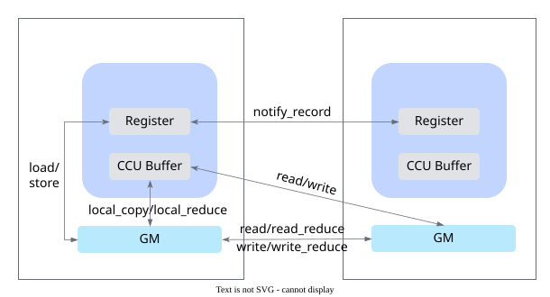
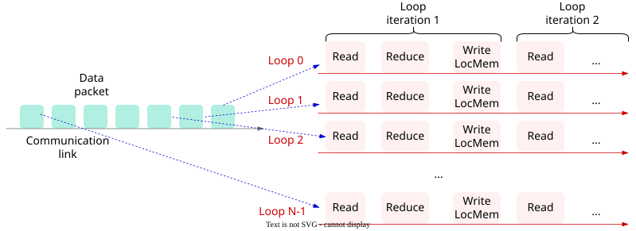
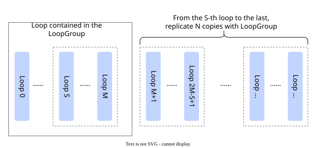

# CCU Programming

<!-- md-trans-meta sourceCommit=5ed547c8af0b4fe59c907ddcd1d49348087706f5 translatedAt=2026-11-05T01:45:52.970Z pushedAt=2026-11-09T06:49:19.131Z nl=2 -->

The CCU is a dedicated hardware engine for collective communication on the Ascend 950PR&950DT products. This document describes the architecture and programming model of the CCU.

## CCU Architecture

### CCU System Architecture

The CCU is a dedicated collective communication coprocessor in the Ascend NPU. As shown in [Figure 1](#fig-ccu-system-architecture), the CCU is located in the IO die of the Ascend 950PR&950DT products.

**Figure 1** CCU system architecture<a id="fig-ccu-system-architecture"></a>



### Basic Concepts

The CCU contains multiple key components that work together to complete collective communication tasks, as shown in [Figure 2](#fig-ccu-architecture).

**Figure 2** CCU architecture<a id="fig-ccu-architecture"></a>



The parameter specifications and responsibilities of the CCU internal components are shown in [Table 1](#tab-ccu-components), where the registers are divided into three types: general-purpose registers, synchronization registers, and address registers.

**Table 1** CCU components and responsibilities<a id="tab-ccu-components"></a>

| Component | Parameter Specification | Responsibility |
| --- | --- | --- |
| On-chip cache | 1536 4 KB slices, 6 MB in total | On-chip data cache that uses 4 KB slices as the basic operation unit and supports on-chip reduction operations across multiple slices. |
| General-purpose register | 3072 registers, 64-bit width | Stores parameters or data during CCU execution (such as length and loop control parameters and `token` information), and supports assignment and addition operations. |
| Synchronization register | 1024 registers, 16-bit width | Implements semaphore-like synchronization operations, supports **Set** and **Wait** operations, and stores instruction dependencies and synchronization states. |
| Address register | 3072 registers, 64-bit width | Stores the memory address of communication operations. It will be removed in the future and replaced by general-purpose registers. |
| Concurrent execution engine | 200 | LoopEngine, which provides the CCU with the capability to execute instructions concurrently and in loops. |
| Instruction space | 32K instructions, 32 bytes each, 1 MB in total | Stores the instruction sequence executed by the CCU. |
| Channel table | 128 entries | Stores channel table entries, each of which contains context information for UB communication. |

## CCU Programming Model

This section introduces the following six aspects:

- [Resource Abstraction](#resource-abstraction): operands of instructions and how to allocate them.
- [Compute Capabilities](#compute-capabilities): register computation and on-chip reduction.
- [Data Movement](#data-movement): data transfer among local memory, CCU Buffer, and remote memory.
- [Synchronization Mechanism](#synchronization-mechanism): establishing ordering relationships for asynchronous operations.
- [Task Scheduling](#task-scheduling): organizing the preceding operations into a complete communication task using flow control and concurrency primitives.
- [Kernel Function](#kernel-function): definition and call of kernel functions.

### Resource Abstraction

The mapping between CCU programming objects and hardware resources is shown in [Table 2](#tab-ccu-programming-resources). This table is intended to illustrate programming responsibilities and does not imply that software objects and physical resources are strictly one-to-one in all implementations. The operands in the subsequent sections are all derived from these programming objects.

**Table 2** Mapping between CCU programming objects and hardware resources<a id="tab-ccu-programming-resources"></a>

| Programming Object | Description | Corresponding Hardware Resource |
| --- | --- | --- |
| `ccu::variable` | Variable | General-purpose register |
| `ccu::address` | Address | Address register |
| `ccu::event` | Event | Synchronization register |
| `ccu::ccu_buffer` | On-chip cache slice | CCU Buffer |
| `ccu::local_addr` | Local address | Contains an address and a `token`, which are stored by `address` and `variable`, respectively |
| `ccu::remote_addr` | Remote address | Contains an address and a `token`, which are stored by `address` and `variable`, respectively |

Resources are created in two ways:

- Single resource creation: Use the default constructor to create a resource directly.
- Batch creation of contiguous resources: use `ccu::array`.

```cpp
// Create a single resource.
ccu::variable var;
ccu::ccu_buffer buf;

// Create resources in batch.
ccu::array<ccu::variable> variables(8);
ccu::array<ccu::event> events(4);
```

> [!NOTE] Note
>
> When resources are created using a native array (for example, `variable` vars\[8\]), resource contiguity is not guaranteed. In [Concurrent Execution](#concurrent-execution), the LoopGroup infers the resources used by each instance by resource ID offset, which requires these resources to be contiguous. Therefore, use `ccu::array` to create them.

### Compute Capabilities

The compute capability of the CCU falls into two categories: register computation, which is performed on general-purpose registers and address registers to prepare parameters such as the address and length required for data movement; and on-chip reduction, which performs reduction computation on communication data in the CCU Buffer.

#### Register Computation

General-purpose registers and address registers support assignment and addition operations, which are used to prepare parameters such as the address and length for data movement and to maintain loop counts.

- Immediate value assignment

    ```cpp
    // General-purpose register
    ccu::variable x; x = 5;

    // Address register
    uint64_t ptr;
    ccu::address addr;
    addr = ptr;
    ```

- Variable assignment

    ```cpp
    ccu::variable x, y;
    ccu::variable v;
    // General-purpose register
    v = x;

    // Address register
    ccu::address addr;
    addr = y;
    ```

- Addition

    ```cpp
    // General-purpose register
    ccu::variable x, y, z;
    x = 5;
    y = 3;
    z = x + y;

    // Address register
    ccu::address addr1, addr2;
    addr1 += x;
    addr2 = addr1 + x;
    ```

#### On-chip Reduction

The CCU Buffer supports in-order Reduce computation on up to eight slices. The input type is the same as the output type. The supported Reduce operations include `ADD`, `MAX`, and `MIN`, and the supported data types include FP32, FP16, BF16, INT32, INT16, INT8, and UINT8.

For the ADD operation on FP16/BF16, to avoid precision loss, the CCU upcasts the operands to FP32 for reduction computation, as shown in [Figure 3](#fig-ccu-reduction-precision).

**Figure 3** Precision upcast process of FP16/BF16 ADD reduction<a id="fig-ccu-reduction-precision"></a>



### Data Movement

The data movement capability of the CCU, as shown in [Figure 4](#fig-ccu-datacopy), covers multiple paths among the local memory, CCU registers, CCU Buffer, and remote memory.

**Figure 4** CCU data movement capability<a id="fig-ccu-datacopy"></a>



Local movement uses `local_copy`, cross-end reads and writes of remote memory use `read` and `write`, reduction performed during movement uses `local_reduce`, `read_reduce`, and `write_reduce`, and parameter movement between local memory and registers uses `load` and `store`. Note that data movement is an asynchronous operation: after an instruction is issued, the hardware executes it in the background. You must confirm that the movement is complete through the [Synchronization Mechanism](#synchronization-mechanism) before reading the target data or reusing the related resources.

### Synchronization Mechanism

The synchronization resources of the CCU are implemented by synchronization registers in hardware. Based on their event bits, two types of operations are provided, as described in [Table 3](#tab-ccu-sync-operations):

**Table 3** CCU synchronization operations<a id="tab-ccu-sync-operations"></a>

| Operation | Description |
| --- | --- |
| record | Sets the event bits corresponding to the mask, indicating that a condition has been met. |
| wait | Blocks and waits until the event bits corresponding to the mask are set before continuing execution. |

Depending on the synchronization scope, these two types of operations are abstracted into two synchronization mechanisms, as described in [Table 4](#tab-ccu-sync-objects):

**Table 4** CCU synchronization mechanisms and application scenarios<a id="tab-ccu-sync-objects"></a>

| Synchronization Mechanism | Application Scenario |
| --- | --- |
| event | Local operations on a single device |
| notify | Communication operations between different devices |

The event and notify described in this section are mechanisms provided by the CCU based on synchronization registers. For the completion queue polling, point-to-point synchronization, and barrier synchronization commonly used in communication scenarios, see "Synchronization Mechanism" in [Execution Model](./execution_model.md).

#### Event

An event is used for local synchronization. Its programming object is `ccu::event`, which holds the event bit of the local synchronization register.

- `event_record`: Sets the corresponding event bit in the local synchronization register, indicating that the current operation or phase is complete.
- `event_wait`: Waits for the corresponding event bit in the local synchronization register to be set, that is, waits for the completion of an asynchronous operation or a completion signal sent by another task.

```cpp
ccu::event evt;

ccu::event_record(evt, 0x01);

ccu::event_wait(evt, 0x01);
```

#### Notify

A Notifyu is used for communication operations between different devices and does not introduce a new programming object: after two communication entities establish a channel, they send notifications to the peer based on the notify sequence number in the channel, or wait for notification signals from the peer.

- `notify_record`: sends a notification to the peer and sets the corresponding event bit in the peer's synchronization register.
- `notify_wait`: waits for a notification from the peer, that is, waits for the corresponding event bit in the local synchronization register to be set by the peer.

```cpp
ChannelHandle channel_handle;

// Send a notification to the remote end.
ccu::notify_record(channel_handle, 0, 0x12);

// Wait for a notification from the remote end.
ccu::notify_wait(channel_handle, 0, 0x12);
```

### Task Scheduling

Computation, movement, and synchronization operations are organized into instruction blocks through flow control, and then executed concurrently by `loop` and `loop_group` to form a complete communication task.

#### Flow Control

The APIs related to flow control are described in [Table 5](#tab-ccu-control-interfaces):

**Table 5** CCU flow control APIs<a id="tab-ccu-control-interfaces"></a>

| Type/API | Description |
| --- | --- |
| `ccu::func` | Defines an instruction function block. |
| `ccu::call_func<func>(...)` | Calls a function block. |
| `CCU_IF`/`CCU_ELSE` | Conditional branching. |
| `CCU_WHILE` | Conditional loop. |
| `CCU_DO` | do-while loop. |

Flow control is used only to orchestrate CCU instructions and communication tasks, not to replace the general-purpose computing logic of the AI Core or AI CPU. The conditions of branches and loops are provided by `variable`. In addition to being directly callable, the function block defined by `ccu::func` also serves as the execution body of the loop described below.

- Conditional branching

  ```cpp
  ccu::variable counter;
  counter = 0;

  CCU_IF(counter != 5) {
       // then-block
  }
  CCU_ELSE {
       // else-block
  }
  ```

- Loop

  ```cpp
  ccu::variable counter, accumulator, step, one;
  counter = 0;
  accumulator = 0;
  step = 4;
  one = 1;

  CCU_WHILE(counter != 10) {
       accumulator = accumulator + step;
       counter = counter + one;
  }
  ```

- do-while loop

  Use `CCU_DO` to start the loop body and `CCU_WHILE` to end the condition check. The loop body is executed at least once:

  ```cpp
  ccu::variable inner, one;
  inner = 0;
  one = 1;

  CCU_DO {
       inner = inner + one;
  } CCU_WHILE(inner != 5);
  ```

- Function block

  ```cpp
  // Define the function block.
  static ccu::func my_func([](ccu::variable x, ccu::variable y){
     ...
  });
  // Call the function block.
  ccu::variable arg1, arg2;
  ...
  ccu::call_func<my_func>(arg1, arg2);
  ```

#### Concurrent Execution

The CCU organizes concurrent execution through `Loop` and `LoopGroup`, whose corresponding programming objects are `ccu::loop` and `ccu::loop_group`, respectively.

**Loop**

A loop is the basic concurrent unit in a CCU task. Its execution body is a function block defined by `ccu::func`, and it has the following characteristics:

  - Operations within a loop are executed serially, while operations in different loops are executed in parallel.
  - A loop can cyclically execute internal operations, working with CCU Buffer to cyclically move data.
  - Loop parameters: number of loop repeats and the incremental offset of the memory address for each loop.
  - When using `ccu_buffer` for data movement, the amount of data moved in a single operation is limited due to the buffer size. Using multiple concurrent loops can fully utilize the link bandwidth.

The way multiple loops concurrently move a block of data is shown in [Figure 5](#fig-ccu-loop). The data is divided into multiple slices by address. Loop 0 through loop N-1 each handle a contiguous region and transmit over the same communication link. The loop body of each loop is a sequence of instructions executed in order, and the ellipsis at the end indicates that LoopEngine automatically iterates to complete the region handled by that loop slice by slice.

**Figure 5** Loop concurrent movement<a id="fig-ccu-loop"></a>



**LoopGroup**

LoopGroup is a container of loops. When multiple loops have the same instruction logic and differ only in data location, you can write a single loop and have LoopGroup replicate it into multiple instances, increasing the number of concurrent loops. It has the following characteristics:

  - A loop cannot be executed independently and must be placed within a LoopGroup.
  - For loops within a LoopGroup, the LoopGroup can specify the starting loop from which replication begins and the number of replications.
  - LoopGroup needs to specify the resource ID offset used by each group of loops after replication.

The relationship of LoopGroup replicating loops is shown in [Figure 6](#fig-ccu-loopgroup). The solid-line box on the left is the loop explicitly written into LoopGroup. Replication starts from the S-th loop, and each loop from the S-th to the last is replicated N times, generating N groups of instances in the dashed-line box on the right.

**Figure 6** LoopGroup replicating loops<a id="fig-ccu-loopgroup"></a>



**Usage Example**

```cpp
ChannelHandle chann;     // Passed in by the kernel parameter after link establishment
ccu::remote_addr remote_mem;  // Remote address, obtained during link establishment
// Reserve a sufficient number of ccu_buffer and event entries by the LoopGroup offset recursion:
// The replication count 5 is the extra count: 1 original loop + 5 clones = 6 concurrent instances,
// The ccu_buffer/event offset between instances is 10, and the 50th slice/slot is the maximum used, so reserve 51
ccu::array<ccu::ccu_buffer> local_ccu_buf(51);
ccu::array<ccu::event> evts(51);
ccu::variable len;
len = 4096;
ccu::func func([&]() {
    ccu::write(chann, remote_mem, local_ccu_buf[0], len, evts[0]);
});
// Execute the loop 10 times, with an address increment offset of 4096B each time.
ccu::loop loop({4096, 10}, func);

// For the loops in the LoopGroup, from the 0th loop to the last, replicate each 5 times.
// The configuration fields are, in order: 5 copies, clone start loop offset 0, inter-instance address offset 4096*10B, inter-instance ccu_buffer offset 10 slices, inter-instance event offset 10.
// Pass max_loop_num as the total number of expanded instances: 1 original loop + 5 clones = 6.
ccu::loop_group group({5, 0, 4096*10, 10, 10}, 6, {loop});
```

### Kernel Function

The code of a CCU operator consists of two parts: the host side and the kernel side. The host-side function acts as the task initiator and directly calls the CCU kernel through `<<<>>>` to deliver tasks (a task is encapsulated as a send queue element (SQE)). On the CCU side, the kernel is abstracted as a mission and executed by the CCU hardware to perform communication tasks.

#### Kernel Function Definition

The following rules must be followed when defining a CCU kernel.

- **Using a function type qualifier**

    The `__ccu_host__` function type qualifier must be used to identify that the function is a CCU kernel and can be called through `<<<...>>>`.

- **Parameter rules**

    The parameter list consists of two types of parameters: SQE parameters and `kernelArg`:

    - SQE parameters `sqeArgs1`-`sqeArgsN`: of type `uint64_t`, carrying runtime parameters such as the communication address, `token`, and split parameters. They must be loaded into CCU variables through `ccu::load_arg` at the very beginning of the kernel in declaration order.
    - `kernelArg`: of the user-defined type `ccu_kernel_arg`, serving as the orchestration context and holding the channel handle, **rankSize**, **rankId**, and so on. Unlike SQE parameters, `kernelArg` is delivered once when the kernel is registered and is not passed repeatedly on each call.

- **Other rules**

    The return type must be `void`.

- The following is a code example:

    ```cpp
    __ccu_host__ void CcuAllGatherMesh1DMem2MemKernel(
        uint64_t sqeArgs1, uint64_t sqeArgs2, ..., uint64_t sqeArgs10, ccu_kernel_arg arg)
    {
        // kernelArg is the orchestration context, holding the channel handle, rankSize, rankId, and so on.
        auto* kernelArg = static_cast<CcuKernelArgAllGatherMesh1DMem2Mem*>(arg);

        // ctx is the kernel context, storing programming objects such as input/output/token and split parameters.
        AllGatherMesh1DMem2MemContext ctx;
        ctx.arg = kernelArg;

        // Subsequently, load the SQE parameters through ccu::load_arg, and then orchestrate the communication tasks.
    }
    ```

#### Kernel Function Call

`<<<>>>` is the kernel call operator. Insert `<<<...>>>` between the function name and the parameter list to issue the execution configuration. Its concept and usage are consistent with [Ascend C Kernel Function)](https://gitcode.com/cann/asc-devkit/blob/master/docs/zh/guide/programming_guide/programming_model/ai_core_simd_programming/kernel_function.md). The following is a code example:
       
```cpp
kernel_name<<<schd, insHandle, stream>>>(argument list);
```

The parameters inside `<<<...>>>` are the execution configuration of the kernel function, which is determined by three CCU-specific parameters:

- **schd**: of the type `asccomm_ccu_schd`, the CCU task scheduling configuration, which contains the following fields:

    | Field | Description |
    | --- | --- |
    | num_blocks | Specifies the number of missions launched in one call, analogous to **block_num** in Ascend C. Currently, only **1** is supported. For details, see [Mission](#mission). |
    | reserved | Reserved field. Set it to **0**. |
    | phy_die_mask | Indicates the IO die where the CCU resides in a bitwise manner. `0x01` indicates die0, and `0x02` indicates die1. A CCU cannot use the network device of another IO die across dies, so currently only a single die can be configured. |
    | binary_cache_tag | Kernel handle cache tag. When it is non-zero, repeated calls with the same label reuse the registered kernel handle to avoid repeated registration. When it is set to **0**, the kernel handle is re-registered on every call. For how to enable it, see [Kernel Handle Cache](#kernel-handle-cache). |

    Call example:

    ```cpp
    const uint32_t dieId = 0;                    // IO die number where the CCU resides (die0 or die1), obtained by querying during link establishment.
    const uint64_t dieMask = 1ULL << dieId;      // Select the IO die where the CCU resides in a bitwise manner.
    asccomm_ccu_schd schd = {1, 0, dieMask, 0};  // One mission, without caching the kernel handle.
    ```

- **insHandle**: of the type `void*`, an opaque CCU instance handle that points to the CCU instance entity held by hcomm. Resources such as the instruction space, registers, and on-chip cache generated by kernel translation are all mounted on the CCU instance. It is obtained by querying the communicator through `HcclCommQueryCcuIns`. The sample common helper function `QueryCcuInstance` encapsulates this call:

    ```cpp
    void* insHandle = nullptr;
    asccomm_examples::QueryCcuInstance(comm, insHandle);
    ```

    If the communicator has not created a CCU instance yet, this call automatically creates one and then returns it. The returned handle is managed by the communicator and is provided for borrowing only; the caller must not destroy it.

- **stream**: of the type `aclrtStream`. It specifies the associated stream. CCU tasks are dispatched to this stream and maintain the asynchronous execution order together with other tasks. For stream creation and other management APIs, see [Runtime API](https://gitcode.com/cann/runtime/blob/master/docs/zh/api_ref/README.md).

    ```cpp
    aclrtStream stream;
    ACLCHECK(aclrtCreateStream(&stream));
    ```

The following is a call example (calling the AllGather kernel defined above, where `taskArgs` corresponds one-to-one to `sqeArgs1` through `sqeArgs10`, and `insHandle` and `stream` must be created before the direct call):

```cpp
uint64_t taskArgs[10] = {...};               // Runtime parameters, corresponding one-to-one to sqeArgs1 through sqeArgs10
auto kernelArg = std::make_shared<CcuKernelArgAllGatherMesh1DMem2Mem>();  // Orchestration context

CcuAllGatherMesh1DMem2MemKernel<<<schd, insHandle, stream>>>(
    taskArgs[0], taskArgs[1], taskArgs[2], taskArgs[3], taskArgs[4], taskArgs[5], taskArgs[6], taskArgs[7],
    taskArgs[8], taskArgs[9], kernelArg.get());  // The last parameter is kernelArg
```

The kernel function call is asynchronous. After the call, control is immediately returned to the host side. The host side can call `aclrtSynchronizeStream` to wait for the CCU tasks on the stream to complete.

#### Kernel Handle Cache

Each direct `<<<>>>` kernel call executes the complete registration process: executing the kernel function body to record the intermediate representation, translating it into CCU instructions, and applying for instruction space, which incurs significant overhead. Communication tasks often repeatedly issue the same kernel in a loop. You can enable the handle cache through the `binary_cache_tag` field in `schd`: when it is non-zero, repeated calls with the same label (and on the same CCU instance and the same die) directly reuse the registered kernel handle, skipping registration and translation; on a cache miss, the kernel is registered once and written into the cache. The cache only reuses the kernel registration result, while runtime parameters such as `taskArgs` are still issued normally with each call.

The label value is generated through the host-side API `asccomm_ccu_get_launch_hash_tag` (header file `#include "ccu/ccu_host_launch.h"`), which hashes an arbitrary label string into a `uint64_t`; passing `nullptr` returns 0, meaning the cache is not enabled.

Constraints:

- The same label must correspond to the same kernel: after a cache hit, the kernel function body is no longer executed, so different kernels sharing the same label (on the same instance and the same die) will reuse an incorrect handle.
- When multiple ranks share a process or a CCU instance, the label must include a distinguishing dimension such as rank to prevent kernels of different ranks from being incorrectly reused.

The call method with the cache enabled is as follows (taken from the [add_allgather](../../../../examples/ccu/ccu_direct/12_add_allgather/README.md) sample, where the label is generated by **rankId** to ensure uniqueness across ranks):

```cpp
const std::string launchTag = "CcuAllGatherMesh1DMem2MemKernel_rank_" + std::to_string(rankId);
uint64_t tag = asccomm_ccu_get_launch_hash_tag(launchTag.c_str());

asccomm_ccu_schd schd = {1, 0, dieMask, tag};   // Enable the kernel handle cache.

```

#### Mission

A mission represents a program executed by the CCU and is the abstraction of a kernel on the CCU side, analogous to a block in Ascend C. The kernel code orchestrated on the host side cannot be directly executed by the CCU: when a kernel is registered, it corresponds to a mission, and the computation, data movement, and synchronization operations in it are translated into a CCU instruction sequence and loaded into the instruction space.

After the task is dispatched, the CCU executes the instruction sequence of the mission based on the mission identifier and instruction entry carried in the SQE to complete the communication task.

## Programming Constraints and Limitations

### Parameter Loading Constraints

- A single SQE can carry up to thirteen 64-bit parameters.
- The parameter loading instruction `load_arg` must be called at the very beginning of the program.

### Instruction Deployment Constraints

- The CCU is located on the IO die of a device. A device may contain multiple IO dies, and different IO dies contain different network devices. In actual networking, different network devices may be interconnected with different other devices. A CCU on an IO die cannot use the network device on another IO die for communication.
- One kernel corresponds to one mission. Currently, a single die supports only one mission, so `num_blocks` in the execution configuration `schd` currently supports only **1**.
