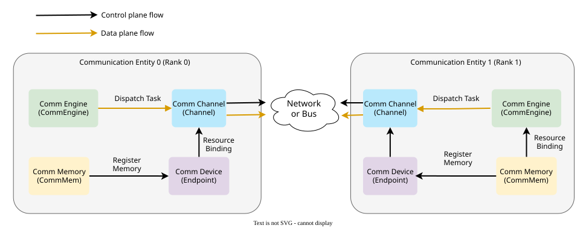
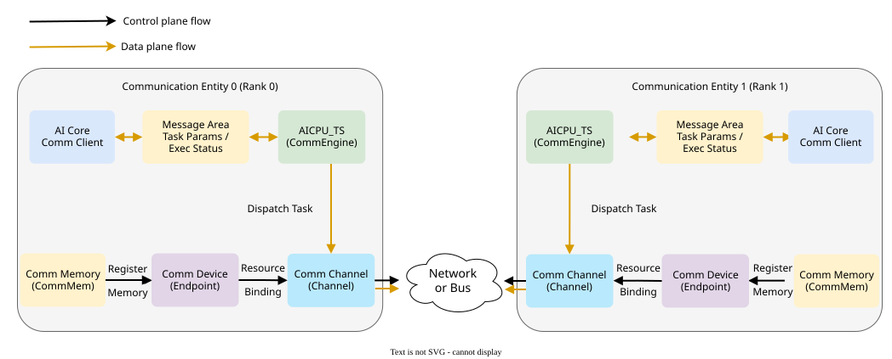
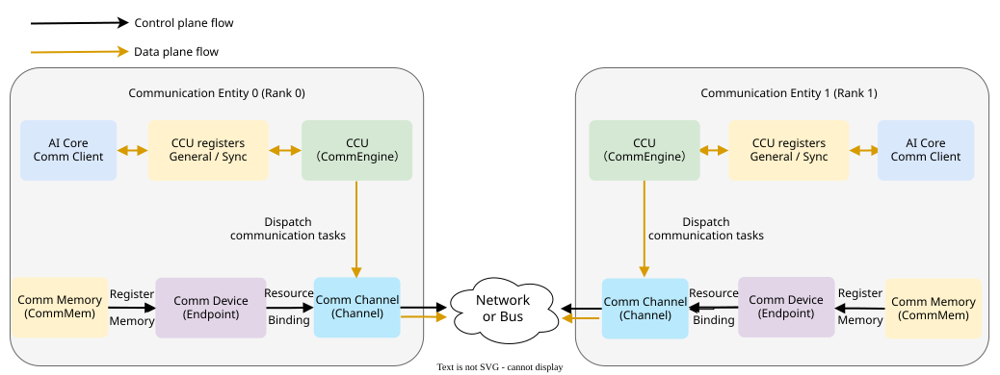

# Communication Model

<!-- md-trans-meta sourceCommit=5ed547c8af0b4fe59c907ddcd1d49348087706f5 translatedAt=2026-11-05T01:48:47.848Z pushedAt=2026-11-09T06:49:19.130Z nl=2 -->

## Overview

This document describes the communication model, including the communication objects, communication resources, and data paths involved in communication tasks under different execution modes.

**Communication entity**: the basic unit that participates in communication, corresponding to the process or thread that executes communication tasks. One or more communication entities can run on each NPU or host.

**Team**: a set of communication entities that collaborate with each other and need to perform collective communication, defining the scope of participants in a communication operation. Each communication entity in a team is called a **rank**.

**Rank ID**: a unique logical identifier assigned to a rank within a team, taking a non-negative consecutive integer value. Communication operators use the rank ID to identify communication objects and implement message routing and task distribution.

A communication process is built between two communication entities through the following four **primitive concepts**:

**Table 1** Communication primitive concepts

| Concept | Brief Description | Main Hardware |
|------|-----------|---------|
| **Endpoint** | Logical interface for network communication, including the protocol and address. | NPU network port/Host NIC |
| **Channel** | Data channel between the communication devices at both ends (including synchronization Notify). | RoCE QP/UB Jetty connection |
| **CommMem** | A memory segment registered to the communicator and accessible by the endpoint. | NPU HBM/Host memory |
| **CommEngine** | The module that executes communication tasks, including threads and a thread scheduler, driving the communication hardware to move data. | AICPU_TS, CCU, AIV |

The communication model is built around the four primitive concepts above. Communication tasks are divided into two modes based on the relationship between the initiator and the executor:

**Table 2** Communication modes

| Mode | Task Initiator | Task Executor | Characteristics |
| --- | --- | --- | --- |
| Direct-drive mode | Communication engine | Communication engine | The communication engine directly issues and executes communication tasks. |
| Proxy mode | AI Core client | AICPU_TS or CCU server | The initiator and the executor are separated. The client submits requests to the server through a proxy medium. |

## Direct-Drive Mode

The communication process between the two communication entities, rank 0 and rank 1, is divided into two phases: **control-plane communication resource creation** and **data-plane communication task execution**. The black solid lines represent the resource creation and binding process on the control plane, and the brown solid lines represent the task delivery process on the data plane, as shown in [Figure 1](#fig-direct-communication-model).

**Figure 1** Direct-drive communication model

### Control Plane: Creating Communication Resources

1. Create an endpoint ([`HcommEndpointCreate`](https://www.hiascend.com/document/detail/en/CANNCommunityEdition/latest/commlib/commopdev/docs/en/api_ref/comm_opdev/control_plane_api/basic_resource_mgmt/HcommEndpointCreate.md)) and specify the communication protocol, address, and location information.
2. Register CommMem with the endpoint ([`HcommMemReg`](https://www.hiascend.com/document/detail/en/CANNCommunityEdition/latest/commlib/commopdev/docs/en/api_ref/comm_opdev/control_plane_api/basic_resource_mgmt/HcommMemReg.md)) so that the memory can be accessed by the remote end.
3. Create a channel based on the endpoint ([`HcommChannelCreate`](https://www.hiascend.com/document/detail/en/CANNCommunityEdition/latest/commlib/commopdev/docs/en/api_ref/comm_opdev/control_plane_api/basic_resource_mgmt/HcommChannelCreate.md)) and pass in `EndpointHandle` to complete resource binding. Meanwhile, the local end and the remote end exchange the registered memory information.

### Data Plane: Communication Engine Dispatches Communication Tasks to Drive Hardware Execution

The communication engine executes the instructions issued by the user, records the description of the communication tasks to be executed in the channel, including information such as the communication memory address and communication operation, and drives the hardware to execute them according to different protocols.

## Proxy Mode

Like the direct-drive mode, the proxy mode also includes a control plane and a data plane. The control plane is responsible for communication resource creation, memory registration, channel establishment, and access relationship preparation; the data plane is responsible for delivering communication requests based on the established channel and completing data transfer between the local end and the peer end. Unlike the direct-drive mode, in which the communication engine directly undertakes communication tasks, in the proxy mode the AI Core acts as the client to submit communication requests, and the AICPU_TS or CCU acts as the server to receive and process them, returning the task status upon completion.

### AICPU_TS Server

When the AICPU_TS server is used, the AI Core and AICPU_TS exchange communication requests and task statuses through the message area, and data between the local end and the peer end is transmitted through the communication path, as shown in [Figure 2](#fig-aicpu-ts-proxy-communication-model).

**Figure 2** AICPU_TS proxy mode communication model

The AI Core client writes the communication request and task parameters through the message area and notifies AICPU_TS to process them. After reading the request, the AICPU_TS server operates the channel to complete data transfer between the local end and the peer end, and then returns the completion status through the message area.

### CCU Server

When the CCU server is used, the AI Core and the CCU exchange communication requests and task status through general-purpose registers and synchronization registers. The general-purpose registers store information such as the communication operation, data location, and data volume, while the synchronization registers record the task start and completion status, as shown in [Figure 3](#fig-ccu-proxy-communication-model).

**Figure 3** CCU proxy mode communication model

The AI Core client writes communication requests and task parameters through the general-purpose registers and notifies the CCU to process them through the synchronization registers. After reading the requests, the CCU server operates the channel to complete data transfer between the local end and the peer end, and then updates the completion status in the synchronization registers.
