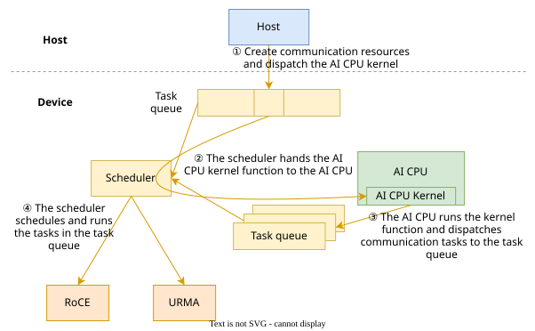
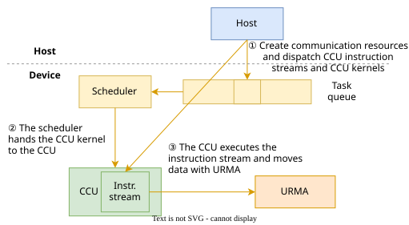
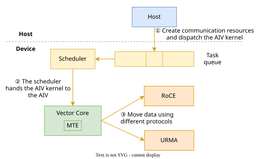
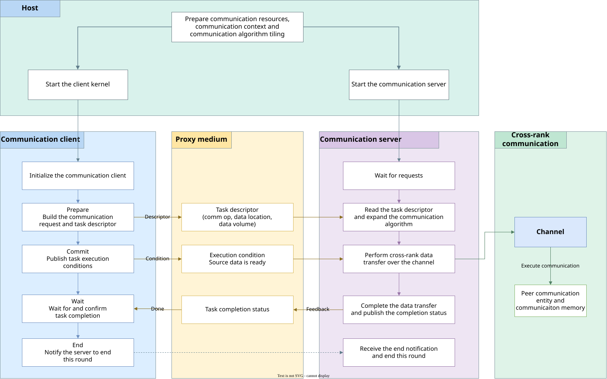
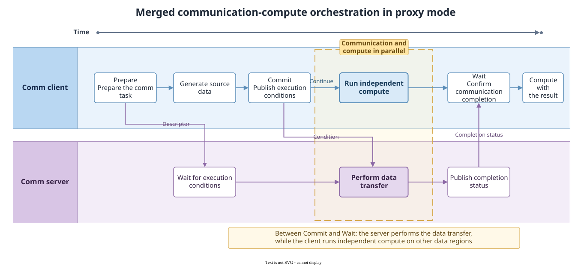
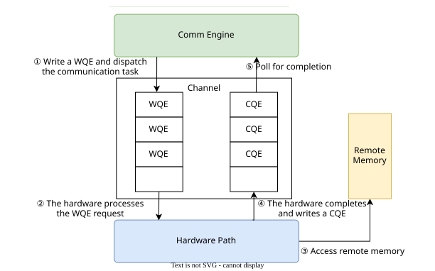

# Execution Model

<!-- md-trans-meta sourceCommit=5ed547c8af0b4fe59c907ddcd1d49348087706f5 translatedAt=2026-11-05T01:52:16.698Z pushedAt=2026-11-09T06:49:19.132Z nl=2 -->

## Overview

This document describes the execution model of communication tasks, covering the process from task dispatch and scheduling to execution completion, as well as the transaction order and synchronization mechanisms involved in this process.

Communication tasks support two execution modes based on the relationship between the initiator and the executor:

**Table 1** Execution modes

| Mode | Task Initiator | Task Executor | Characteristics | Application Scenario |
| --- | --- | --- | --- | --- |
| Direct-drive mode | Communication engine | Communication engine | The communication engine directly dispatches and executes communication tasks. Users control task submission, ordering, and synchronization through the data plane API. | Scenarios that require fine-grained control over communication timing and resource usage |
| Proxy mode | AI Core client | AICPU_TS or CCU server | The initiator and executor are separated. The client describes the task and publishes execution conditions, while the server parses the task, initiates the communication algorithm, and executes it through the channel. | Scenarios that merge compute and communication within the AI Core kernel |

Both modes are built on the concepts defined in [Communication Model](./communication_model.md), such as communication devices (endpoint), communication channels (channel), and communication memory (CommMem). Cross-rank data transfer is completed through the channel. In direct-drive mode, the communication engine directly operates the channel. In proxy mode, the server operates the channel, and the client interacts with the server through a proxy media (message area or CCU registers).

This document first introduces the execution mechanisms of the three types of communication engines (AICPU_TS, CCU, and AIV) in direct-drive mode. It then introduces the execution mechanism of proxy mode and the merged communication-computing orchestration approach in proxy mode. Finally, it introduces the transaction order that constrains the execution order and completion order of transactions, as well as the local synchronization and remote synchronization mechanisms that control the execution timing of multiple execution entities.

## Direct-Drive Mode

The communication engine is the core module that executes communication tasks in a communication entity. The execution models of direct-drive execution by different communication engines are described as follows.

### AICPU_TS Direct-Drive Execution Mechanism

AICPU_TS uses the task descriptor dispatch mode. The execution flow is shown in [Figure 1](#fig-aicpu-ts-direct-execution-model).

**Figure 1** AICPU_TS direct-drive execution mechanism<a id="fig-aicpu-ts-direct-execution-model"></a>



1. The host submits an AI CPU kernel to the task queue.
2. The task scheduler dispatches the AI CPU kernel to the AI CPU for execution.
3. The AI CPU submits communication task descriptors to the task queue.
4. The task scheduler dispatches the communication tasks to the executor.

> [!NOTE] Note
>
> The AI CPU dispatches communication tasks through task descriptors, **without occupying compute cores**, making it suitable for high-bandwidth big data scenarios.

### CCU Direct-Drive Execution Mechanism

The CCU adopts a dedicated acceleration unit execution mode. The execution flow is shown in [Figure 2](#fig-ccu-direct-execution-model).

The Collective Communication Unit (CCU) is a dedicated collective communication coprocessor located on the IO die.

**Figure 2** CCU direct-drive execution mechanism<a id="fig-ccu-direct-execution-model"></a>



1. The host dispatches a CCU instruction sequence (consisting of instructions recognizable by the CCU) to the CCU instruction space, and submits the corresponding CCU kernel task to the task queue.
2. The CCU kernel is dispatched by the scheduler and then sent to the CCU for execution.
3. The CCU executes the corresponding instruction stream and uses Unified Remote Memory Access (URMA) to complete data movement.

> [!NOTE] Note
>
> The CCU is a dedicated collective communication acceleration unit that executes preset CCU instruction streams (moving data through URMA). It delivers **high bandwidth and low latency** while occupying few compute cores and little memory access bandwidth, but it is limited by on-chip resources and supports a limited number of communicators.

### AIV Direct-Drive Execution Mechanism

AIV uses the Vector Core execution mode. The execution flow is shown in [Figure 3](#fig-aiv-direct-execution-model).

**Figure 3** AIV direct-drive execution mechanism<a id="fig-aiv-direct-execution-model"></a>



1. The host submits an AIV kernel to the task queue.
2. The task scheduler dispatches the AIV kernel to the Vector Core.
3. The Vector Core uses different protocols to complete data movement.

> [!NOTE] Note
>
> AIV has low latency but occupies Vector compute cores, making it suitable for small-data, low-latency scenarios.

## Proxy Mode

### Proxy Mode Execution Mechanism

Proxy mode separates the preparation of a communication task from data transmission. The client prepares and submits a communication request in the current operator kernel, while the server completes data transmission between the local end and the peer end on an independent execution unit and feeds back the completion status to the client.

Currently, the client supports AI Core, and the server supports AICPU_TS and CCU. The proxy media used by different servers are as follows:

**Table 2** Proxy media used by different servers

| Client | Server | Task Parameter Passing | Execution Condition and Completion Status Passing |
| --- | --- | --- | --- |
| AI Core | AICPU_TS | Message area | Message area |
| AI Core | CCU | CCU general-purpose register | CCU synchronization register |

The two types of servers follow the same task preparation, submission, execution, and completion process. A proxy communication as a whole includes the following processes:

1. **Run preparation**: The host prepares communication resources and the communication context, and starts the client kernel and the server.
2. **Task submission**: The client describes the communication operation, data location, and data volume. After the source data is ready, the client passes the task parameters and execution conditions to the server through the proxy media.
3. **Data transmission and completion**: The server obtains the task parameters, initiates the communication algorithm, and completes data transmission between the local end and the peer end through the channel. After the communication is complete, the server feeds back the completion status to the client. After the task is submitted, the client can continue to execute computations that have no data dependency on this round of communication, and wait for task completion when the communication result is needed.

For details about the server types and the transmission mode of communication requests, see [Communication Model](./communication_model.md).

The execution mechanism of the proxy mode is shown in [Figure 4](#fig-proxy-execution-model).

**Figure 4** Proxy mode execution mechanism<a id="fig-proxy-execution-model"></a>



The proxy mode involves the following participants:

**Table 3** Proxy mode participants

| Participant | Responsibility |
| --- | --- |
| Host | Allocates communication resources, prepares the communication context, and starts the client kernel and the server. |
| Client | Prepares communication tasks, publishes task execution conditions, waits for the completion status, and uses the communication results or reuses resources after the task is complete. |
| Proxy medium | Passes task parameters, task execution conditions, and the completion status between the client and the server. |
| Server | Obtains and parses task parameters, initiates the communication algorithm, executes communication tasks through the channel, and publishes the completion status. |
| Channel | Determines the cross-rank communication peer, communication path, and remote memory access relationship. |

[Figure 4](#fig-proxy-execution-model) shows the process in which the host starts a communication task, the client submits a request, the proxy media passes task information and status, and the server completes data transfer and returns the completion status. A communication task is executed in the following phases:

1. **Initialization**: The host prepares communication resources and starts the client kernel and the server. The client completes the initialization required for the current round of execution.
2. **Prepare**: The client prepares the communication request, records information such as the communication operation, data location, and data volume, and forms a task description. The task enters the executable state in the Commit phase.
3. **Commit**: After completing source data production and the necessary inter-core synchronization, the client submits the task execution condition. Commit indicates that the source data is ready and the server can start processing the request. After Commit is complete, the client continues with subsequent computation, and the communication completion status is confirmed by a subsequent Wait.
4. **Server execution**: The server reads the task description and completes data transfer between the local end and the remote end based on the information in it. After the data transfer is complete, the server returns the completion status to the client.
5. **Wait**: The client waits for and confirms task completion. Completion of Wait indicates that this round of data transfer has ended and the client can read the communication result. After the related data is no longer in use, the source memory and destination memory can be reused.
6. **End**: After all communication tasks in the current kernel are complete, the client notifies the server to end this round of execution.

### Merged Communication-Compute Orchestration

In proxy mode, communication tasks are handed over to an independent server for execution, so that the server and the client can perform communication and compute separately, providing a parallel execution basis for merged communication-compute. A MC2 operator can arrange communication and compute based on data dependencies. A typical orchestration is shown in [Figure 5](#fig-proxy-execution-parallel):

**Figure 5** Merged communication-compute orchestration in proxy mode<a id="fig-proxy-execution-parallel"></a>



In this orchestration, after Commit publishes the task execution conditions, the server starts reading the current round of data from the source memory and writes the communication results to the destination memory, while the client continues to use other data areas to perform compute that has no data dependency on the current round of communication. The client executes Wait at the position where the communication results are first needed; after Wait completes, the communication results in the destination memory can be used for subsequent compute. By scheduling independent compute between Commit and Wait, the MC2 operator can overlap the execution time of communication and compute.

## Transaction Order

A transaction refers to an independent memory or message operation initiated by a user. A series of transactions form a transaction flow, which is managed by a work queue (WQ). As shown in [Figure 6](#fig-task-execution-model), the data plane describes a single transaction by constructing a WQE (Work Queue Element) and submits it to a channel for execution. It then determines whether the transaction has been executed by asynchronously polling the completion queue (CQ). The execution and completion status of WQEs in the WQ is fed back by the CQ. The CQEs (Completion Queue Elements) stored in the CQ are used to record the execution results of the corresponding transactions.

**Figure 6** Communication task dispatch and execution flow<a id="fig-task-execution-model"></a>



Although the hardware work queue receives WQEs in submission order, the actual completion order of transactions may differ from the submission order due to factors such as network routing, DMA scheduling, and hardware channel contention. When a group of transactions with dependencies exists, if no ordering mechanism is provided, operations may be executed out of order, causing issues such as data corruption and abnormal business logic. Therefore, a **transaction order** must be defined between transactions to constrain their execution and completion order, ensuring that tasks are executed according to the expected logic.

### RoCE Transaction Order

**Order Preservation Within the Same WQ**

The hardware retrieves WQEs from the WQ in first-in-first-out (FIFO) order for processing, and writes CQEs to the associated CQ in the same order in which the WQEs were enqueued. That is, a WQE enqueued earlier completes earlier, and its corresponding CQE is also generated earlier.

**No Order Preservation Across Different WQs**

A CQ may be shared by multiple WQs, in which case the generation order of CQEs from different WQs cannot be guaranteed.

### Transaction Order of URMA

In URMA, you can specify the **Order or Fence flag** in a WQE to constrain the transaction order of a work queue.

The **Order flag** can constrain the execution order and completion order between transactions.

The Order flag can specify the following three execution orders:

**Table 4** Execution orders of the Order flag

| Execution Order | Description |
|--------|------|
| No Order | Out-of-order execution, with no execution order constraint. |
| Relax Order | There is no execution order constraint between weakly ordered transactions, and out-of-order execution is allowed. However, it constrains strongly ordered transactions: a strongly ordered transaction can be executed only after all preceding weakly ordered transactions are complete. |
| Strong Order | Order-preserving execution. A strongly ordered transaction must wait until all preceding weakly ordered and strongly ordered transactions are complete before it can be executed. |

The Order flag can specify the following two completion orders:

**Table 5** Completion orders of the Order flag

| Completion Order | Description |
|--------|------|
| No Order | Out-of-order completion. The CQEs corresponding to transactions can be reported out of order. |
| Ordered | Ordered completion. The CQEs corresponding to transactions must be reported in order. |

When the **Fence flag** is enabled, the operation must wait until the preceding read or atomic operations are complete before it can be executed. It can be used together with the Order flag.

> [!CAUTION] Caution
>
> 1. The ordering mechanism of the Order or Fence flag can only ensure the execution order of WQEs within the same WQ, and does not guarantee the order across WQs.
> 2. Strong ordering incurs performance overhead, reducing communication throughput and increasing latency. When developing communication operators, configure the execution order based on service requirements, constraining only the execution order of dependent tasks while allowing independent tasks to execute out of order, so as to minimize performance loss.

## Synchronization Mechanism

In a distributed multi-device environment, each NPU runs independently and at different speeds. Therefore, synchronization must be applied to control the execution timing of multiple execution entities and ensure that communication and data access are performed in the expected order.

Synchronization in distributed communication scenarios can be mainly divided into two types: local synchronization and remote synchronization.

> [!NOTE] Note
>
> The code in this section uses the Ain API as an example and is pseudocode, intended only to illustrate the usage of the synchronization mechanism. It cannot be used directly. For details about how to use the Ain API, see [Ain-based Communication Operator Development Guide](../communication_op_dev/ain_operator_impl.md).

### Local Synchronization

If you need to wait for a submitted communication task to complete before performing subsequent operations, you must actively poll the completion queue (CQ) and read the completion events in the queue to determine whether the corresponding communication task has completed.

Take a remote read operation as an example. After the local end reads data from the peer's memory, it must confirm the read completion through local synchronization before accessing the read result. Otherwise, it may read data that has not been fully updated, causing errors in subsequent logic.

```cpp
// Initialize the UBuf workspace size: it must not be less than 512B.
constexpr uint32_t HCOMM_BUF_SIZE = 512U;

// The team and symmetric window handles are created on the host side and then delivered. For details about how to create them, see Ain-Based Communication Operator Development Guide.
extern "C" __global__ __aicore__ void local_sync_kernel(
    __gm__ void* team,
    __gm__ void* dstWin, // Destination symmetric window
    __gm__ void* srcWin, // Source symmetric window
    uint32_t peer)       // Peer rank ID
{
    __ubuf__ uint8_t hcommLocal[HCOMM_BUF_SIZE];
    AscendC::AinDescriptorUbuf hcommUbuf{hcommLocal, HCOMM_BUF_SIZE, 0U};
    AscendC::Ain ain(0);

    // One-sided read (non-blocking): read 4 bytes of data starting at offset 0 of the peer's srcWin into the local dstWin starting at offset 0.
    ain.Get(team, peer, dstWin, 0, srcWin, 0, sizeof(uint32_t), hcommUbuf);
    // Local synchronization (blocking): wait for all submitted communication tasks on all peer channels in the team to complete, ensuring that this read has completed.
    ain.Flush(team);
    // Local synchronization is complete. The read result has been written to the local buffer registered by dstWin and can be safely accessed.
    Process(dstWin);
}
```

### Remote Synchronization

Local synchronization cannot learn the remote status. Without remote synchronization, the local end may read data before the remote end finishes writing, resulting in half-updated or stale dirty data and causing business logic errors. Remote synchronization must be completed through network interaction and can be classified into point-to-point synchronization and barrier synchronization by synchronization scope.

**Point-to-Point Synchronization**

When establishing point-to-point cross-rank synchronization, the peer sends a synchronization signal after completing data writing, and the local end polls the signal to determine whether the remote data is ready.

Take a remote write operation as an example. Rank 0 writes data to Rank 1. Rank 1 must confirm through point-to-point synchronization that the data has been fully written before accessing the write result. Otherwise, undefined behavior occurs, the read result is unpredictable, and stale or partially updated data may be read, causing errors in subsequent logic.

```cpp
// Initialize the UBuf workspace size: it must not be less than 512B.
constexpr uint32_t HCOMM_BUF_SIZE = 512U;

// The team and symmetric window handles are created and delivered by the host. For details about how to create them, see Ain-based Communication Operator Development Guide.
extern "C" __global__ __aicore__ void p2p_sync_kernel(
    __gm__ void* team,
    __gm__ void* sendWin,   // Symmetric window where the send data resides
    __gm__ void* recvWin,   // Symmetric window where the receive data resides
    __gm__ void* signalWin, // Symmetric window where the synchronization signal resides
    uint32_t rankId,        // Local rank ID
    uint64_t signalVal)     // Initial value of the synchronization signal
{
    __ubuf__ uint8_t hcommLocal[HCOMM_BUF_SIZE];
    AscendC::AinDescriptorUbuf hcommUbuf{hcommLocal, HCOMM_BUF_SIZE, 0U};
    AscendC::Ain ain(0);

    if (rankId == 0) {
        // Append a remote signal atomic add operation after the Rank 0 write task: add 1 to the signal count at offset 0 of Rank 1's signalWin.
        ain.Put(team, 1, recvWin, 0, sendWin, 0, sizeof(uint32_t), AscendC::AinSignalInc{signalWin, 0}, hcommUbuf);
        // Local synchronization: wait for the submitted write task to complete
        ain.Flush(team);
    } else if (rankId == 1) {
        // Point-to-point synchronization: Rank 1 blocks until the signal count is incremented by 1, ensuring that Rank 0's data has been fully written.
        ain.WaitSignal(team, signalWin, 0, signalVal + 1);
        // Point-to-point synchronization is complete, and subsequent processes can safely access the data.
        Process(recvWin);
    }
}
```

**Barrier Synchronization**

Barrier synchronization is a collective remote synchronization that requires all communication entities within a specified communication scope to arrive at the synchronization point before execution can continue. If any entity fails to arrive, all other communication entities block and wait.

Take the AllGather collective communication operation as an example: all ranks in the communication group aggregate each other's data. Before aggregation, it must be ensured that the send buffers of all ranks have completed preprocessing; after aggregation, it must be ensured that all ranks have obtained the complete data. Without a front barrier, some ranks may read send data that has not yet been fully preprocessed; without a back barrier, the postprocessing of some ranks may release or overwrite buffers prematurely, contaminating data that is still being aggregated.

```cpp
// Initialize the UBuf workspace size: it must not be less than 512B.
constexpr uint32_t HCOMM_BUF_SIZE = 512U;

// The team and symmetric window handles are created on the host side and then delivered. For details about how to create them, see Ain-based Communication Operator Development Guide.
extern "C" __global__ __aicore__ void barrier_sync_kernel(
    __gm__ void* team,
    __gm__ void* sendWin, // Symmetric window where the send data resides
    __gm__ void* recvWin) // Symmetric window where the receive data resides
{
    __ubuf__ uint8_t hcommLocal[HCOMM_BUF_SIZE];
    AscendC::AinDescriptorUbuf hcommUbuf{hcommLocal, HCOMM_BUF_SIZE, 0U};
    AscendC::Ain ain(0);
    // Create a barrier session: the third parameter is the barrier resource index, which must be consistent with contextIndex (0) used when constructing Ain.
    AscendC::AinBarrierSession ainBarrier(&ain, team, 0);
    // Preprocess the send data.
    PreProcess(sendWin);
    // Front barrier (blocking): block until all ranks reach the synchronization point to ensure that the send data of all ranks is ready.
    ainBarrier.Sync(AscendC::AinMemoryOrder::AIN_MEMORY_ORDER_RELAX, hcommUbuf);
    // All ranks in the communication group aggregate data.
    AllGather(team, sendWin, recvWin);
    // Back barrier (blocking): block until all ranks reach the synchronization point to ensure that data aggregation of all ranks is complete.
    ainBarrier.Sync(AscendC::AinMemoryOrder::AIN_MEMORY_ORDER_RELAX, hcommUbuf);
    // Postprocess the send data and receive data.
    PostProcess(sendWin, recvWin);
}
```

> [!CAUTION] Caution
>
> Avoid overusing barrier synchronization. Frequent barrier synchronization introduces large global latency and can easily become a performance bottleneck. If remote synchronization is required, prefer point-to-point synchronization.
