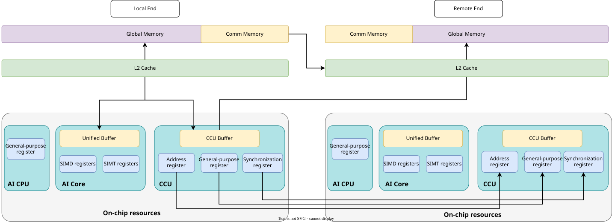
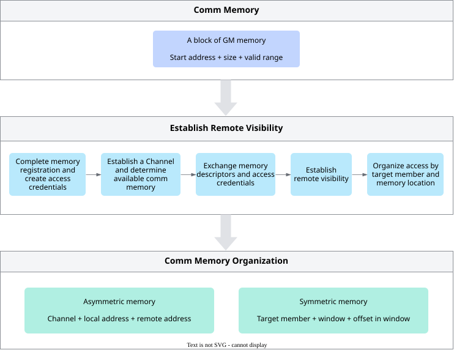
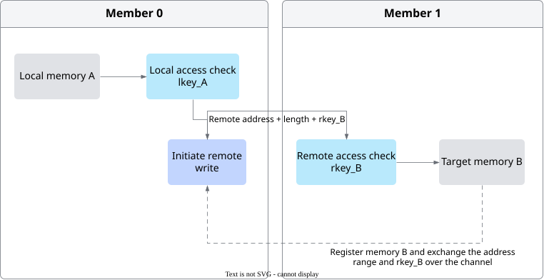
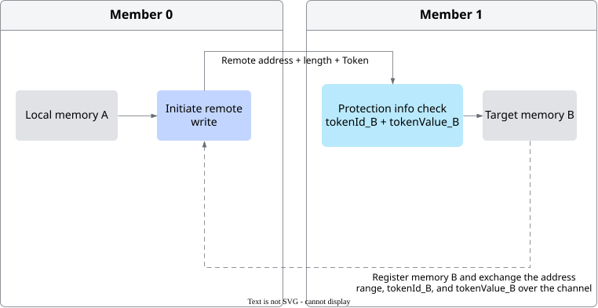

# Memory Model

<!-- md-trans-meta sourceCommit=5ed547c8af0b4fe59c907ddcd1d49348087706f5 translatedAt=2026-11-05T01:54:01.408Z pushedAt=2026-11-09T06:49:19.134Z nl=2 -->

Communication involves multiple memory resources. The following table summarizes the physical locations of common memory types in communication programming and their cross-device access capabilities.

**Table 1** Memory resources and their cross-device access capabilities

| Memory Resource | Physical Location | Local-side Participation in Cross-Device Access | Access Initiated by the Peer |
| --- | --- | --- | --- |
| Global Memory (GM) | Global device memory | Can serve as the local source during remote write and as the local destination during remote read. | After the communication memory is exposed to the peer, it can serve as the source of remote read or the destination of remote write. |
| Unified Buffer | On-chip AI Core | Does not serve as a local operand for remote read/write. | Not supported as an operand for remote read/write. |
| AI Core register | On-chip AI Core | Does not serve as a local operand for remote read/write. | Not supported as an operand for remote read/write. |
| CCU Buffer | On-chip CCU | Can serve as the local source during remote write and as the local destination during remote read. | Not supported as an operand for remote read/write. |
| CCU register | On-chip CCU | Can write communication parameters such as the address, `Token`, and data length to the peer through a channel, or send synchronization notifications. | Can receive communication parameters or synchronization notifications written by the peer through a channel. |

- By primary purpose, GM can be divided into compute memory and communication memory. Compute memory stores the input, output, and intermediate results of computation; communication memory carries the source data and destination data transferred across devices. After a remote write request passes access verification, it is written to the L2 Cache corresponding to the target GM address. Data consistency between the L2 Cache and GM is maintained by hardware.
- Unified Buffer is located inside the AI Core. During compute-communication fusion, compute data is moved between the compute unit and GM through Unified Buffer. When a computation result needs to participate in communication, it is first moved from Unified Buffer to the communication memory in GM. After communication data arrives at the local GM, it can also be moved into Unified Buffer to continue computation.
- CCU Buffer is the on-chip storage resource inside the CCU, used for temporarily storing, relaying, and reducing communication data.
- The CCU register is located inside the CCU, used to store communication parameters such as the access address, `Token`, and data length, as well as synchronization states.

The memory hierarchy and communication capabilities are shown in [Figure 1](#fig-memory-hierarchy-communication-capability):

**Figure 1** Memory hierarchy and communication capabilities<a id="fig-memory-hierarchy-communication-capability"></a>



[Figure 1](#fig-memory-hierarchy-communication-capability) shows, from top to bottom, the hierarchical relationship among GM, L2 Cache, and the on-chip resources of the execution engine. The local side and the remote side each have their own GM, L2 Cache, and on-chip resources. The arrows in [Figure 1](#fig-memory-hierarchy-communication-capability) represent only the data paths related to communication, and do not expand on the computational data flow among the Unified Buffer, SIMD/SIMT registers, and compute units inside the AI Core. [Figure 1](#fig-memory-hierarchy-communication-capability) illustrates only the write direction from the local side to the remote side; the read or write path from the remote side to the local side is symmetric.

Among these resources, communication memory and CCU on-chip resources can directly participate in cross-device communication: communication memory can serve as the source range of a remote read or the destination range of a remote write; the CCU Buffer of the CCU can move data with the peer GM in a transfer initiated by the local CCU, and CCU registers can pass communication parameters and synchronization notifications to the peer through channels. The Unified Buffer and AI Core registers mainly handle local caching, data staging, and computation. Based on this difference in capabilities, the following sections focus on the organization and access mechanism of communication memory, as well as the communication mode of CCU on-chip resources.

## Communication Memory

Communication memory is physically located in GM. It is a memory range prepared by the control plane that can serve as a communication operand and be exposed to the peer. Communication memory carries the source data and destination data of cross-device transfers.

Before communication starts, the control plane records the valid range of the communication memory and establishes communication relationships and access authorization for it. The data plane performs communication operations based on these resources. The process from preparation to organization of communication memory is shown in [Figure 2](#fig-communication-memory-flow).

**Figure 2** Preparation and organization of communication memory<a id="fig-communication-memory-flow"></a>



The following describes how communication memory establishes remote visibility, how access credentials protect the memory range, and how a program organizes communication memory and describes the target member and memory location.

### Remote Visibility

A segment of GM memory establishes remote visibility through the following steps:

1. The control plane records the start address, size, and valid range of the memory.
2. The control plane registers the memory according to the communication protocol and establishes access credentials for the valid range.
3. A channel is established to determine the communication memory that the channel can use.
4. The memory description and the credentials required for remote access are exchanged with the peer.

After the preceding preparations are complete, the peer obtains the address range and access authorization of the target memory, and can access this segment of memory through the established channel.

After remote visibility is established, remote access is initiated using the following information:

- The channel is used to determine the communication peer and the established communication relationship.
- The remote address and access length are used to describe the target range in the peer memory.
- Access credentials are used to indicate that this operation has obtained access authorization for the target memory range.

For the specific communication memory registration, channel creation, and remote memory acquisition process, see the [Hcomm AIV direct-drive URMA sample](../../../../examples/aicore/hcomm/01_hcomm_urma_write_read_nbi/README.md).

### Access Credentials

Access credentials are established by the memory registration process for the registered range and are used to express the authorization of a communication task to access that range. When a channel is created, the address range of the target memory and the credentials required for remote access are exchanged with the peer. When a communication task is executed, the communication hardware verifies access to the local or remote registered memory based on the credentials. The credential mechanisms used by different communication protocols are as follows.

**Table 2** Access credential mechanisms of different communication protocols

| Protocol Type | Access Credentials | Verification Mechanism |
| --- | --- | --- |
| RoCE | `lkey`, `rkey` | `lkey` is used to verify the access of the communication engine to the local operand, and `rkey` is used to verify the remote access to the registered memory on the target side. |
| UB-type protocol | `tokenId`, `tokenValue` | `tokenId` is used to locate the protection information corresponding to the target memory, and `tokenValue` is used to verify the access permission. Both must match the target address range. |

#### RoCE Access Process

Using member 0 writing its local memory A into memory B of member 1 as an example, the access process is shown in [Figure 3](#fig-roce-remote-write):

1. Member 0 registers memory A and obtains `lkey_A` for local access.
2. Member 1 registers memory B and obtains `rkey_B` for authorizing remote access.
3. When the channel is established, member 1 exchanges the address range of memory B and `rkey_B` with member 0.
4. When member 0 initiates a write operation, the communication task carries the local address of memory A and `lkey_A`, as well as the remote address of memory B and `rkey_B`.
5. The initiator-side communication hardware uses `lkey_A` to verify the read of memory A, and the target-side communication hardware uses `rkey_B` to verify the write to memory B. Data can be written to memory B only after both verifications pass.

**Figure 3** RoCE remote write access process<a id="fig-roce-remote-write"></a>



A single RoCE remote write uses both the `lkey` of the initiator-side local source memory and the `rkey` of the target-side destination memory. The two respectively protect the local operand and the remote operand, and each matches its own registered memory range.

#### UB Protocol Access Process

Still using the example where member 0 writes local memory A to memory B of member 1, the access process is shown in [Figure 4](#fig-ub-remote-write):

1. Member 1 registers memory B and establishes `tokenId_B` and `tokenValue_B` for this memory range.
2. When establishing the channel, member 1 exchanges the address range of memory B, `tokenId_B`, and `tokenValue_B` with member 0.
3. When member 0 initiates a write operation, the communication task carries the remote address of memory B, the access length, `tokenId_B`, and `tokenValue_B`.
4. The target-side communication hardware locates the protection information corresponding to memory B based on `tokenId_B`, uses `tokenValue_B` to verify the access permission, and checks whether the remote address and access length fall within the registered range corresponding to that protection information.
5. Only after both the `Token` and the target memory range match can the data be written to memory B.

**Figure 4** UB protocol remote write access process<a id="fig-ub-remote-write"></a>



After memory registration, channel establishment, and access credential exchange are completed, both communication parties have the basic conditions for accessing the peer's communication memory. The upper-layer programming model also needs to provide users with a way to specify the target member and its memory location.

### Organization of Communication Memory

Based on the organization mode in which communication memory is presented to users, it can be classified into asymmetric memory and symmetric memory. Both organization modes are built on the channel, the actual GM address range, and access credentials. The difference lies in how users specify the target member and memory location.

The differences between the two organization modes are described in the following table.

**Table 3** Comparison of communication memory organization modes

| Organization Mode | Memory Organization Seen by Users | Information Provided by Each Operation | Underlying Processing |
| --- | --- | --- | --- |
| Asymmetric memory | Each member manages communication memory separately. | Channel, local address, and remote address | The target member is determined based on the channel. The local address specifies the source or destination of local data, and the remote address locates the peer memory. |
| Symmetric memory | Corresponding memory of each member forms a logical window. | Target member, window, and offset within the window | The channel corresponding to the target member is selected, and the offset is resolved to an actual address and matched with access credentials. |

#### Asymmetric Memory

Asymmetric memory means that the communication memory of each member is independent of the others. The memory size, layout, and actual address of different members can differ, and a unified logical layout is not required. When asymmetric memory is used, each communication member allocates and manages its own communication memory.

When initiating communication, the user specifies the target member through a channel and provides the local address and remote address separately. A write operation reads data from the local address and writes it to the remote address, while a read operation reads data from the remote address and writes it to the local address. The underlying layer determines the communication peer based on the channel, locates the registered memory of the peer based on the remote address and access length, and matches the credentials required for this access.

```text
Channel + local address + remote address + access length
        -> Determine the target member.
        -> The local address determines the local data range.
        -> The remote address and access length locate the registered memory of the peer.
        -> Match the access credentials and transfer data.
```

Both Hcomm primitive programming and direct programming based on CCU raw instructions use the asymmetric memory organization. The following example scenario further illustrates asymmetric memory.

Assume that member 0 needs to write 256 bytes of data starting at an offset of 64 bytes in its local source GM memory A to the position at an offset of 128 bytes in the communication memory B of member 1. A and B are prepared by the two members separately, and their start addresses and memory layouts do not need to be the same. When the channel is established, the memory B of member 1 and its remote access credentials have already been exchanged to member 0. The Hcomm pseudocode implementation is as follows:

```cpp
// localMemA: start address of local source GM memory A
// remoteMemB: remote start address of communication memory B of member 1
auto localAddr = localMemA + 64;
auto remoteAddr = remoteMemB + 128;

hcomm.WriteNbi(
    channelToMember1, // channel to member 1
    remoteAddr,       // remote destination location
    localAddr,        // local source location
    256);             // transfer length, in bytes
```

In the call, `channelToMember1`, `localAddr`, and `remoteAddr` determine the target member, the local source location, and the remote destination location, respectively. The Hcomm primitive then performs the following processing:

1. Determine target member 1 based on the channel.
2. Determine the local source range based on `localAddr` and the transfer length, and determine the remote destination range based on `remoteAddr` and the transfer length.

Depending on the communication protocol used by the channel, the address range and access credentials are matched as follows:

- RoCE path: The local `src` and remote `dst` are matched against the local and remote registered memory respectively, and the local `lkey` and remote `rkey` are obtained.
- UB-type protocol path: The remote `dst` is matched against the remote buffer registered in the channel and its `Token`; the local `src` only needs to satisfy the GM address and length constraints of the `WriteNbi` API, without querying the local registered memory or matching local access credentials.

After the corresponding range and credential matching is completed, data transfer is initiated. In this write operation, the local address always represents the data source, and the remote address always represents the data destination. RoCE also requires matching the `lkey` for the local source, while the UB-type protocol only matches the `Token` for the remote destination.

#### Symmetric Memory

When symmetric memory is used, each communication member provides a segment of local communication memory, and these corresponding memory segments are jointly organized into a logical window. The user describes the access location by the target member, window, and offset within the window, based on which the underlying layer resolves the channel and the actual remote address.

```text
target member + logical window + offset within window + access length
        -> Select the channel and window memory corresponding to the member.
        -> Resolve the offset within the window to the actual GM address.
        -> Match the access credentials and transfer data.
```

Symmetry is reflected in that all members use consistent logical organization and offset rules, while the actual addresses of the corresponding memory of each member may differ. Each member in the window corresponds to a segment of actual GM. The underlying layer selects the channel corresponding to the target member, converts the offset to the actual address, and uses the access credentials that match that memory range.

Programming communication based on the Ain API is an example of using symmetric memory. The following example scenario further illustrates symmetric memory.

Assume that a logical window consists of a segment of communication memory provided by member 0, member 1, and member 2 respectively, and the actual start addresses of these three memory segments can be different. Member 0 wants to write 256 bytes of data starting from offset 64 bytes in its local window to offset 128 bytes in the window of member 2. The Ain pseudocode implementation is as follows:

```cpp
ain.Put(
    communicationGroup, // current communication group
    2,                  // target member
    window, 128,        // destination window and offset within the window
    window, 64,         // source window and offset within the window
    256,                // transfer length, in bytes
    /* other parameters omitted */);
```

Compared with the Hcomm primitive programming example, this call does not directly provide the channel to member 2 and the remote GM address. Instead, it expresses the access location through the target member, the window, and the offset within the window. Ain then performs the following processing:

1. Select the channel to the target member based on target member 2.
2. Use the actual start address of member 0 recorded in the window plus the source offset to obtain the local GM address.
3. Add the destination offset to the actual memory start address of member 2 recorded in the window to obtain the remote GM address.
4. Match the corresponding access credentials through the underlying Hcomm API and initiate a write operation.

Users work with a unified logical window, target member, and offset within the window. The underlying channel, actual GM address, and access credentials are resolved and matched by Ain and its reused Hcomm API.

## CCU On-Chip Memory Model

Communication memory resides in GM and is used to hold the source data and destination data for cross-device transfer. Remote access conditions are established through memory registration, channels, and access credentials. When the CCU executes a communication task, it uses the on-chip CCU Buffer to temporarily store, relay, and reduce data, and uses registers to store the movement parameters and synchronization state. These two types of on-chip resources work together with the communication memory in GM to complete data movement and processing.

### CCU Buffer

The CCU Buffer is an on-chip cache inside the CCU and supports the following data movement paths:

- Local movement: Data can be moved bidirectionally between the local GM and the local CCU Buffer.
- Read from remote: The local CCU reads communication data from the remote GM and writes it to the local CCU Buffer.
- Write to remote: The local CCU reads data from the local CCU Buffer and writes it to the remote GM.

Cross-device movement is initiated by the local CCU that holds the CCU Buffer, and the remote operand resides in the remote GM. When the remote device performs a remote write, the destination range is the communication memory in the local GM.

During reduction, the CCU can temporarily store data from different sources in the CCU Buffer, complete the reduction on-chip in order, and then write the result to the local or remote GM. Keeping intermediate data on the CCU chip reduces repeated reads and writes to the GM during collective communication.

### CCU Registers

CCU registers are located inside the CCU hardware, including address registers, general-purpose registers, and synchronization registers. The three types of registers serve the following purposes:

- Address registers store the GM addresses required for CCU data movement, and support updating the data location based on address offsets.
- General-purpose registers store the data used by communication tasks, such as communication memory addresses, `Token`, and data length. The CCU can load these values from the local GM into the general-purpose registers, and can also write the values in the general-purpose registers back to the local GM.
- Synchronization registers contain multiple event bits, where each event bit represents a condition to be waited for, such as completion of data movement, completion of a preceding task, or arrival of a notification from the peer. After the condition is met, the corresponding event bit is set, and the CCU then continues execution.

In CCU operator orchestration that requires exchanging remote GM addresses and `Token` through registers, the read/write parties pass parameters and synchronize according to the following process:

- The party whose GM is accessed writes the communication memory address and `Token` into the general-purpose registers of the read/write initiator through the channel, and sets the notification event agreed upon by both parties.
- The read/write initiator waits for the notification event, reads the address and `Token`, loads the address into the address register, and uses the address and `Token` to access the peer GM.
- After data movement is complete, the read/write initiator can set the peer's notification event to inform the peer that the data is ready or that this round of movement is complete.

CCU tasks pass communication parameters and synchronization status through registers, while the user data of communication is transferred through the data paths related to GM or CCU Buffer.
