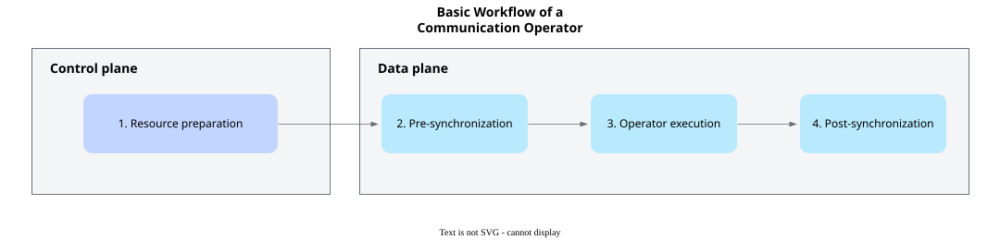

# Overview

<!-- md-trans-meta sourceCommit=5ed547c8af0b4fe59c907ddcd1d49348087706f5 translatedAt=2026-11-05T01:54:47.595Z pushedAt=2026-11-09T06:49:19.133Z nl=2 -->

## Introduction

As large language models continue to grow in scale, training and inference are gradually expanding from a single NPU to large-scale clusters. Multiple NPUs need to work together to complete computation and data processing, making inter-NPU communication efficiency a key factor affecting overall system performance.

Model structures, message sizes, and network topologies vary across different business scenarios, making it difficult for preset communication algorithms to maintain optimal performance in all scenarios. At the same time, the deeper integration of communication and computation places higher demands on the programming flexibility of communication operators. Ascend C provides kernel-oriented communication programming capabilities, decoupling the underlying communication platform from operator implementation. This allows developers to customize communication algorithms based on business characteristics and focus on algorithm design and implementation.

This chapter follows the development process of communication operators as its main thread. It first explains the collaboration between communication resource preparation and device-side operator execution through the programming paradigm, and then describes how to determine communication paths based on hardware and networking conditions, how to select communication patterns, and how communication resources and tasks are organized in various models.

## Ascend C Communication Programming Paradigm

Ascend C communication programming separates the control plane from the data plane. The control plane runs on the host side and is responsible for querying the topology, establishing communication relationships, registering communication memory, and preparing synchronization resources. The data plane runs on the device side and uses the communication relationships and resources prepared by the control plane to complete communication operations. After the information prepared by the control plane is passed to the device-side kernel, it can be reused during kernel execution.

From the developer's perspective, a communication process can be divided into four stages: resource preparation, pre-synchronization, operator execution, and post-synchronization, as shown in [Figure 1](#fig-communication-operator-workflow).

**Figure 1** Basic workflow of a communication operator

1. **Resource preparation**: Select available links based on the communication members and topology, establish communication relationships, and prepare communication memory and synchronization resources.
2. **Pre-synchronization**: Before operator execution, confirm that the source data is ready and ensure that the relevant communication members and execution units meet the communication conditions.
3. **Operator execution**: Use the prepared communication resources and, according to the communication algorithm, complete operations such as data transfer, synchronization, and reduction through protocols that match the actual links.
4. **Post-synchronization**: After confirming that the communication tasks have reached the completion condition, read the output data or reuse the relevant memory and task resources.

The four stages above only describe the basic logic of communication programming and do not mean that all operations must be executed strictly serially. As long as the data dependency, resource usage, and synchronization requirements are met, developers can organize communication tasks and computation tasks to run in parallel.

## Programming Model Overview

Table 1 describes the content of the subsequent chapters.

**Table 1** Content of subsequent chapters

| Chapter | Main Content |
| --- | --- |
| [Abstract Hardware Architecture](./abstract_hardware_architecture.md) | Describes the hardware components involved in communication, the data paths between NPUs, and multi-NPU networking modes, helping developers identify reachable links and plan data paths. |
| [Communication Pattern Classification and Selection](./communication_pattern_selection.md) | Describes the classification of driving modes, communication engines, and communication protocols, as well as the methods for selecting communication patterns based on networking and performance goals. |
| [Communication Model](./communication_model.md) | Describes the relationships among objects such as communication entities, endpoints, channels, and communication memory. |
| [Memory Model](./memory_model.md) | Describes communication-related storage resources, remote visibility of communication memory, access authorization, and addressing modes. |
| [Execution Model](./execution_model.md) | Describes the process of a communication task from preparation, submission, execution, and synchronization to completion. |
| [CCU Programming](./ccu_programming.md) | Describes the architecture and programming model of the CCU. |

## Supported Products

<!-- npu="950" id1 -->
- Ascend 950PR&950DT products: Supported
<!-- end id1 -->
<!-- npu="A3" id2 -->
- Atlas A3 products: Not supported
<!-- end id2 -->
<!-- npu="910b" id3 -->
- Atlas A2 products: Not supported
<!-- end id3 -->
<!-- npu="310b" id4 -->
- Atlas 200I/500 A2 inference products: Not supported
<!-- end id4 -->
<!-- npu="310p" id5 -->
- Atlas inference products: Not supported
<!-- end id5 -->
<!-- npu="910" id6 -->
- Atlas training products: Not supported
<!-- end id6 -->
