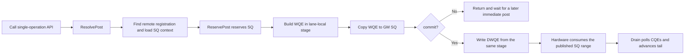
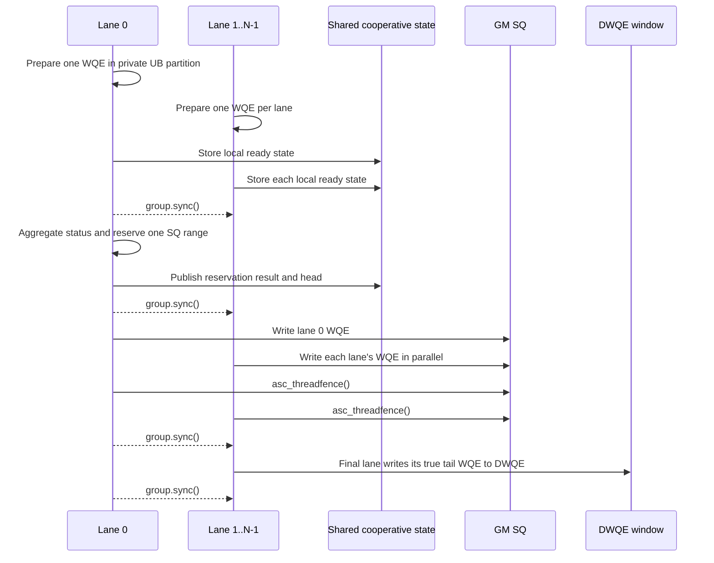

# Hcomm SIMT Batch Design

[中文](../../zh/guide/simt_batch_design.md)

## 1. Background and Scope

The SIMT single-operation path supports `WriteNbi`, `ReadNbi`, `WriteWithNotifyNbi`, `WriteValueNbi`,
`AtomicFAA`, and `AtomicCAS`. Each call resolves communication context, builds a WQE, writes it to the SQ,
and, in immediate mode, publishes it through DWQE. Those fixed costs are repeated for a sequence of small
communication operations.

This design adds explicit BatchHandle semantics to the SIMT `COMM_PROTOCOL_UBC_CTP` path. A caller prepares
multiple operations in UB, publishes them with `BatchCommit`, and waits with `Drain`. The design borrows the
"UB staging, cached handle, explicit commit" structure from the existing SIMD batch implementation, while
retaining SIMT packed counters and DWQE publication and adding multi-lane cooperation.

The current implementation targets the UBC CTP path on Ascend 950 (`dav-3510`). Phase one establishes a
functionally correct and testable baseline. WQE compaction, whole-batch copies, and fewer submission
instructions belong to the later performance phase.

## 2. Goals

- Provide consistent BatchHandle overloads for all six SIMT communication operations.
- Support both single-lane preparation and cooperative submission by multiple lanes in one SIMT group.
- Reuse the validated single-operation WQE builders and DWQE publication path to limit phase-one risk.
- Cache remote registration information in the handle instead of scanning the remote table for every item.
- Preserve ordinary SIMT APIs and avoid introducing a separate batch header.
- Provide a runnable minimal example, a full functional matrix, and a separate performance baseline.

This phase does not target final performance, concurrent groups sharing one channel, multiple items per lane in
a cooperative commit, or operator-specific WQEBB compaction.

## 3. Terms

| Term | Meaning |
| --- | --- |
| Lane | One SIMT thread. An `Hcomm` object and a single-lane BatchHandle are lane-private. |
| Group | A synchronizable set of lanes provided by `cooperative_groups`. Every lane participates in a collective commit. |
| WQE | Work Queue Element describing one communication operation. |
| SQ | The GM circular Send Queue from which the device reads WQEs. |
| DWQE | The 128-byte Doorbell WQE window. Writing the final WQE to it publishes the preceding SQ range. |
| CQ/CQE | Completion Queue and completion entry. `Drain` consumes CQEs and advances the SQ tail. |
| BatchHandle | A lane-private handle containing UB storage, prepared counts, remote registration data, and a queue snapshot. |
| ResolvePost | Resolution of the remote token, SQ addresses, head/tail, and DWQE address required for one post. |

"Prepare" only builds a WQE in UB. "Write SQ" places it in the GM queue visible to the device. "Publish" writes
DWQE so the prepared SQ range becomes executable. These are separate phases.

## 4. API Shape

Batch support is exposed as overloads of the existing `AscendC::simt::Hcomm` in
[`hcomm_simt.h`](../../../include/aicore/hcomm/hcomm_simt.h).

```cpp
constexpr uint32_t itemCount = 8U;
constexpr uint32_t workspaceBytes =
    AscendC::simt::HcommSimtBatchBufferBytes(itemCount);
alignas(128) __ubuf__ uint64_t workspace[workspaceBytes / sizeof(uint64_t)];

AscendC::simt::Hcomm<> hcomm;
int32_t ret = hcomm.Init(nullptr, 0U);
auto batch = hcomm.MakeBatchHandle(
    channel, reinterpret_cast<__ubuf__ uint8_t*>(workspace), workspaceBytes, remoteBase);

ret = hcomm.WriteNbi(batch, remoteDst, localSrc, len);
ret = hcomm.ReadNbi(batch, localDst, remoteSrc, len);
ret = hcomm.WriteWithNotifyNbi(batch, remoteDst, localSrc, len, notifyAddr, notifyValue);
ret = hcomm.WriteValueNbi<uint64_t>(batch, remoteDst, value);
ret = hcomm.AtomicFAA<uint64_t>(batch, remoteDst, fetchAddr, addValue);
ret = hcomm.AtomicCAS<uint64_t>(batch, remoteDst, fetchAddr, compareValue, swapValue);
ret = hcomm.BatchCommit(batch);
ret = hcomm.Drain(batch);
```

| Interface | Responsibility | Writes SQ | Publishes DWQE |
| --- | --- | --- | --- |
| `Init` | Initializes Hcomm; binds shared cooperative state in multi-lane mode | No | No |
| `MakeBatchHandle` | Validates workspace, selects a remote registration, and caches token and initial queue data | No | No |
| Six batch operations | Validate capacity/range and build a complete WQE in lane-private UB | No | No |
| `BatchCommit` | Reserve SQ, patch dynamic head/owner, write SQ, and publish through the final item | Yes | Yes |
| `Drain(batch)` | Require no uncommitted item, poll CQ, and reclaim SQ space | No | No |

`HcommSimtBatchBufferBytes` is defined in the existing public `hcomm_common.h`, isolating user code from
internal WQE constants. The correctness-first format currently uses 128 bytes per item. The caller owns the UB
workspace and chooses its capacity.

## 5. Original Single-operation Flow

The single-operation API calls `PostWqe`, with all steps executed sequentially by one lane.



`ResolvePost` does more than prefill a few fields. It:

1. Scans the channel's remote registration table for an entry covering the target range and reads its
   `tokenId` and `tokenValue`.
2. Loads the default QP's SQ base, WQE size, depth, packed-head address, tail address, DWQE window, TP ID,
   and remote EID.

`ReservePost` then atomically reserves SQ space from the packed head and SQ tail. Every path writes the WQE to
ordinary SQ; immediate mode additionally writes DWQE from the same lane-local stage. SQ contents and the tail
WQE used as the doorbell therefore come from one construction result.

## 6. Single-lane Explicit Batch

Single-lane mode separates remote-registration resolution and WQE construction from immediate submission and
defers publication to `BatchCommit`.


### 6.1 Handle Creation

`MakeBatchHandle` probes one real byte at `remoteBase` to select a remote registration. A zero-length lookup can
select the wrong token at the boundary of adjacent registrations. The handle caches the registration's
`base/size/token` and partitions caller-owned UB by group rank. A single lane owns the complete workspace.

The handle also captures the packed head at creation. No other handle may drive the same channel while the batch
contains prepared items. If the head changes before commit, `BatchCommit` fails rather than overwriting SQ using
a stale position.

### 6.2 WQE Preparation

All six batch operations reuse the descriptor and `Store` logic of the single-operation path, but target the
BatchHandle UB partition instead of a temporary lane-local stage. Every item currently uses the complete 128-byte
immediate-WQE layout instead of an operator-specific compact representation.

Preparation uses the cached remote token and checks the target with `BatchContainsRemote`. Notify also validates
`notifyAddr`. This avoids repeated registration-table scans without allowing a cached token to be used for a
different registration.

### 6.3 Commit and Publication

Queue head, tail, and SQ addresses may change after handle creation, so a complete queue context cannot be used
indefinitely as a commit snapshot. `BatchCommit` retains the cached remote token but resolves current SQ fields
while reserving positions, then patches the dynamic `nextHead` and `owner` fields in WQE word 0.

All preceding items are written only to ordinary SQ. The final item is written to both SQ and DWQE. DWQE is not
a fallback copy of an SQ item; it is the publication action that carries the final producer position and makes the
preceding SQ range executable. A successful commit clears the prepared state so the handle can prepare another
batch.

The current implementation prioritizes correctness and reserves/copies complete 128-byte WQEs item by item. A
batch should remain within the effective SQ space available to the channel. Whole-range reservation, bulk copies,
and compact WQEBBs are performance-phase work.

## 7. Multi-lane Cooperative Batch

A SIMD batch has one execution entity. Multiple SIMT lanes build and write different WQEs concurrently. If every
lane independently used the single-lane commit, they would race on the packed head, and the final DWQE could be
published before other SQ writes became visible. Multi-lane commit is therefore collective and establishes the
following order:



The constraints and rationale are:

- Every lane owns its own `Hcomm` and BatchHandle, but `Hcomm(group)` binds them to the same group.
- Every lane passes the same shared UB state area to `Init`. The first four `uint32_t` words contain global status
  and the 64-bit head; one following word stores each lane's ready state.
- The phase-one implementation requires exactly one CQE-producing WQE per lane. Lane 0 verifies readiness and
  reserves `group.size() * 2` WQEBBs in one operation, avoiding head contention.
- Every lane derives a unique SQ position from the common starting head and its rank, then patches its own
  `nextHead/owner`.
- `asc_threadfence` orders a lane's GM SQ stores before later synchronization; `group.sync` waits for every lane
  to finish the phase.
- Only the final lane writes DWQE because it owns the true tail WQE of the contiguous range. Synchronization on
  both sides prevents early workspace reuse or the start of another batch.

A group of size one automatically dispatches to the single-lane `BatchCommit` path.

## 8. Relationship to SIMD Batch

| Dimension | SIMD batch | SIMT batch |
| --- | --- | --- |
| Shared model | Caller-owned UB, cached registration, staged WQEs, explicit commit and Drain | Same |
| Execution entity | One SIMD execution flow | One lane or a synchronized lane group |
| Queue state | Separate SQ/CQ counters in `ChannelEntity` | Packed `head/wqeCnt` in SQ context plus tail |
| Copy | `DataCopy` from a contiguous UB range to circular SQ | Complete 128-byte WQEs written to SQ today |
| Publication | Update SQ head and ring a scalar doorbell | Write the final WQE to the 128-byte DWQE window |
| Thread coordination | Not required | Range reservation, fence, and group synchronization |
| Current operations | Existing SIMD Write/Read/WriteWithNotify capabilities | Write/Read/Notify/WriteValue/FAA/CAS |
| Address contract | Handle caches token; later ranges are mainly caller responsibility | Caches token and checks remote base/size internally |

Reusable elements are the BatchHandle lifecycle, UB staging, remote-token cache, explicit `BatchCommit/Drain`
shape, and circular-SQ concepts. The SIMD `DataCopy + st_dev(newSqHead)` publication mechanism is not directly
reusable: SIMT must preserve its existing DWQE semantics and establish visibility across multiple lanes.

## 9. State and Error Handling

BatchHandle maintains ordering through:

- `capacity`: WQEs that the current lane can prepare.
- `prepared`: WQEs built in UB but not yet committed.
- `preparedCqe/lastCqe`: whether the range produces the expected CQEs and has a completion-bearing tail.
- `headSnapshot`: detects channel progress by another path while the batch is being prepared.
- `valid`: whether the handle can still be used; a partial-submission risk invalidates it.

Failures return `-1`. Callers must check every append, `BatchCommit`, and `Drain`. `Drain(batch)` requires
`prepared == 0`, preventing unsubmitted UB work from being mistaken for completed work.

## 10. Constraints

- Only the `COMM_PROTOCOL_UBC_CTP` path on `dav-3510` is supported.
- SIMD Hcomm, ordinary SIMT posts, and a SIMT BatchHandle with prepared items must not drive one channel concurrently.
- A BatchHandle binds one remote registration; all remote data and Notify addresses remain inside that range.
- Workspace alignment must satisfy the implementation, and capacity is calculated with `HcommSimtBatchBufferBytes`.
- Every lane in a multi-lane group follows the same control flow through `Init`, preparation, and `BatchCommit`.
- Phase-one multi-lane mode supports one CQE-producing WQE per lane per batch.
- One lane calls `Drain` after all posting lanes return.

## 11. Verification

Functional verification is in [`examples/simt_batch`](../../../examples/simt_batch/README_en.md):

- `run_basic.sh` covers the minimal single-lane path with two Writes.
- `run.sh` covers all six APIs, homogeneous items, two consecutive commits, a mixed batch, a single-item batch,
  and final data.
- `run.sh matrix` covers `1x1`, `2x1`, `8x1`, `2x2`, and `8x2`, where `NxM` means N lanes per batch and M commits.
- The host checks device status, commit counts, Read/FAA/CAS fetch values, and final remote data.

Performance verification is in
[`examples/simt_batch_perf`](../../../examples/simt_batch_perf/README_en.md). It compares Immediate and
ExplicitBatch with the same operation, payload, message length, and iteration count, reporting latency,
bandwidth, and speedup. Functional tests are the correctness gate; phase one does not require a predetermined
speedup.

## 12. Future Optimization

Each optimization is evaluated as one mechanism change, first against the complete functional matrix and then
against the performance baseline:

1. Replace item-by-item reservation in single-lane commit with one whole-range reservation.
2. Use a SIMT-appropriate bulk transfer to reduce UB-to-SQ instructions while keeping DWQE sourced from the true tail WQE.
3. Compact WQEBBs according to the actual Write/Read/operator format.
4. Reduce queue-context reloads only after its lifetime and consistency rules are demonstrated.
5. Extend cooperative commit from one item per lane to multiple items per lane with deterministic SQ layout and tail selection.
6. Measure crossover points across batch size, group size, message length, and operator to select Immediate or Batch.

These optimizations must not change the public call sequence, remote-registration contract, or visibility before
DWQE publication.

## 13. Related Documents

- [Hcomm Usage Guide](./hcomm_usage.md)
- [SIMT Batch Functional Example](../../../examples/simt_batch/README_en.md)
- [SIMT Batch Performance Example](../../../examples/simt_batch_perf/README_en.md)
- [Build & Test](./build_and_test.md)
