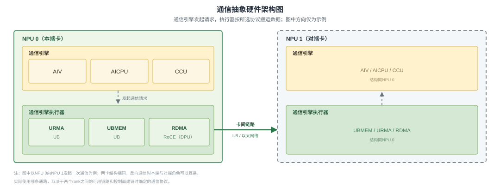
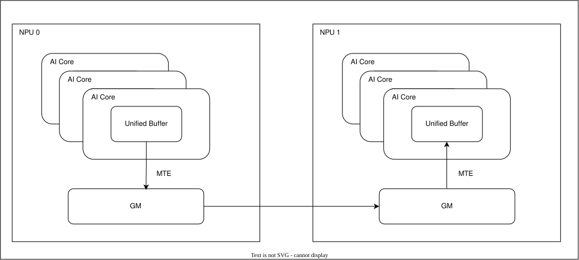
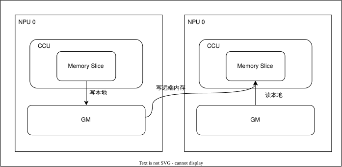
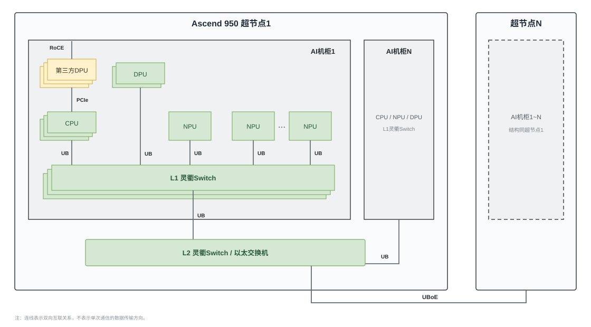

# 抽象硬件架构

## 整体架构

从通信编程的视角看，参与通信的硬件可按职责抽象为通信引擎和通信引擎执行器。通信引擎执行通信算法，通信引擎执行器承接远端访问请求，二者共同完成数据搬运、同步和归约等操作。

**图1** 通信抽象硬件架构图

图1以NPU 0向NPU 1发起通信为例。通信引擎按照算法组织通信操作，需要访问其他NPU时，将请求提交给通信引擎执行器，再由执行器通过卡间链路访问对端。两端具有相同的抽象结构，通信方向可以互换。

### 通信引擎执行器

通信引擎执行器提供访问对端内存的硬件能力。实际使用哪种执行器，取决于rank之间的可用链路和建链时选择的通信协议。

**表2** 通信引擎执行器

| 远端访问方式 | 承载通路 | 访问语义 | 说明 |
| --- | --- | --- | --- |
| URMA | UB | 异步 | 异步读写对端内存，提交请求后需要确认搬运完成。 |
| UBMEM | UB | 同步 | 将对端内存映射到统一地址空间，通过Load/Store语义访问。 |
| RDMA | RoCE（以太网络） | 异步 | 通过以太网络异步读写对端内存，网络处理可由DPU承载。 |

各通信引擎支持的协议及其适用场景，参见[通信方式分类及选择](communication_mode_selection.md)。

### 通信引擎

Ascend 950PR/Ascend 950DT提供AIV、AICPU和CCU三类通信引擎。三者都可以组织卡内数据搬运和卡间通信，但执行通信任务的硬件单元和数据通路不同。

#### AIV

AIV使用Vector Core执行通信Kernel，并在Kernel中组织数据搬运、同步和归约等操作。

- 卡内：通过MTE在GM与Unified Buffer之间搬运数据。
- 卡间：通过通信引擎执行器在本端GM与对端GM之间传输数据。

**图2** AIV数据通路

#### AICPU

AICPU执行通信Kernel，并按照通信算法构造和提交数据搬运任务。

- 卡内：数据搬运到本端的GM操作。
- 卡间：通过通信引擎执行器在本端GM与对端GM之间传输数据。

#### CCU

CCU是位于IO Die上的集合通信专用处理器，内置片上高速存储空间Memory Slice（MS）和归约单元，可按照预置的通信指令执行数据搬运、同步和归约。

**图3** CCU通信架构与数据通路

- 卡内：在本端GM与MS之间双向搬运数据。
- 卡间：将对端GM中的数据读入本端MS，完成归约后写入本端GM；也可将本端GM中的数据经由MS写入对端GM。

MS为CCU提供了独立的片上数据中转和处理空间。需要复用或连续归约的数据可暂存在MS中，减少中间结果对GM的反复读写，从而节省GM访存带宽，为计算任务留出更多带宽并提升通信与计算的并发能力。MS与升精度归约单元配合，还可使归约顺序和浮点截断误差更加可控，提高归约运算的精度和确定性。CCU独立执行通信任务，不占用计算核，也有利于降低通信时延。

## 组网架构

前面介绍了各通信引擎的卡内、卡间通信方式，但实际应用中，一般会构成组网形式来使用。Ascend 950提供POD、Server和标卡三种硬件形态：POD和Server可以通过灵衢Switch构建分层UB网络并组成超节点。

**图4** Ascend 950卡间互联组网

图4展示POD和Server接入灵衢网络后的组网关系。在超节点内，CPU、NPU和支持UB的DPU接入机柜内的L1灵衢Switch，不同机柜再通过L2灵衢Switch互联；不同超节点之间通过UBoE连接。第三方DPU可经PCIe接入CPU侧，并连接RoCE网络。实际通信路径由rank所在的组网层级和可达链路决定。
