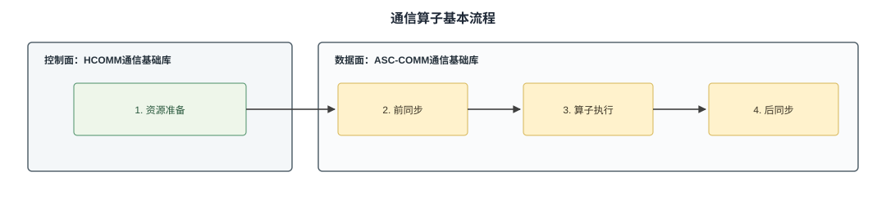

# 概述

HCOMM和ASC-COMM为通信算子开发提供基础能力，支持开发者实现通信算法。本节介绍控制面与数据面的职责划分，以及二者协同完成通信的基本流程。

## 数据面与控制面的划分

通信过程可以划分为控制面和数据面，二者的具体分工如表1所示。

**表1** 控制面与数据面的职责划分

| 层面 | 通信基础库 | 运行位置或执行单元 | 主要职责 |
| --- | --- | --- | --- |
| 控制面 | HCOMM | Host CPU | 提供拓扑信息查询与通信资源管理功能。|
| 数据面 | ASC-COMM | Device侧Kernel，由AICPU与STARS、AIV或CCU等通信引擎执行 | 使用控制面准备的资源，实现数据面的数据读写、同步等操作。 |

## 通信编程范式

通信算子的基本流程可以概括为资源准备、前同步、算子执行和后同步，图1是根据职责划分的基本流程图。

1. **资源准备**：根据通信域、拓扑结构和可用链路建立通信关系，并准备数据传输、内存访问和同步所需的资源。
2. **前同步**：搬运数据前，相关rank交换必要信息或确认就绪状态，确保能够正确访问对端数据。
3. **算子执行**：通信引擎按照通信算法完成数据搬运，并根据算子需要执行本地处理或归约等计算。
4. **后同步**：数据搬运完成后，相关rank确认本轮通信结束，再读取结果或复用相关内存。
