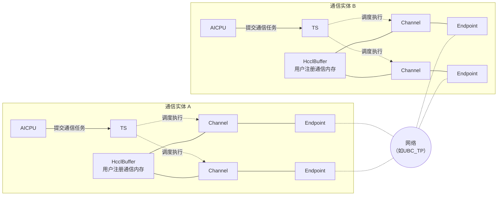
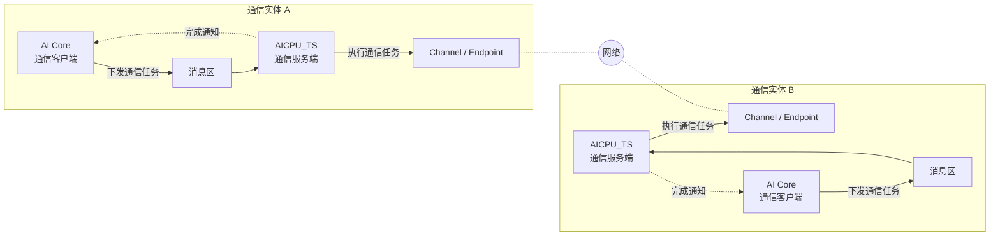

# AICPU（A5）通信模型

本文介绍 AICPU_TS 通信引擎在 Ascend 950 上的通信模型，说明通信的发起方、参与通信的实体、通信协议，以及 Channel 与 Endpoint 等概念。

## AICPU_TS 通信模型

AICPU_TS 通信模型属于网络语义通信模型：通信任务由 AICPU 提交，算子开发者基于 Channel 访问远端通信实体的通信内存，或与远端通信实体同步。远端通信内存不映射到本端地址空间。

AICPU_TS 在 Ascend 950 上支持 UBC_TP、UBC_CTP、UBoE、ROCE 通信协议，协议在创建 Channel 时由 Endpoint 决定。

**图1** AICPU_TS 通信模型




- 通信实体：通信域内的通信成员（rank），是 Channel 的两端。通信任务由通信实体上的 AICPU 提交给 TS，再由 TS 调度至执行器执行，不占用计算核。

- 通信内存：通信实体上的一块内存可以注册给通信域，表示这块内存可以被通信域内的其他通信实体访问，包括 HcclBuffer 与用户注册通信内存，详见[通信内存模型](./aicpu_memory_model_v1.0.md)。

- Endpoint：表示与其他通信实体通信时使用的端口（如网卡的 NetDevice 等）。
  - Endpoint 包含地址与协议等属性，一个 Endpoint 可能包含多个物理口（比如 Bonding 场景）。
  - 每个通信实体可以包含多个 Endpoin实体特定 Endpoint 之间建立的通信通道，是本端访问远端通信内存以及与对端同步的入口。
- Channel：
  - 本端通信实体的 Channel 与远端通信实体的 Channel 具有一对一的关联关系，一对 Endpoint 之间可以建立多个 Channel。
  - 创建 Channel 时，本端与远端需要同步调用 Channel 创建接口。
  - 创建 Channel 时，本端注册的内存信息会与远端注册的内存信息进行交换，控制面也提供了基于 Channel 查询远端内存信息（地址与大小）的接口。
  - `Write`、`Read` 等通信操作基于 Channel 由一侧通信实体单边发起，对端不需要对称调用；通信操作为异步，写后需通过 Notify 或 Fence 确认对端数据就绪。


  Channel 的内部元素如下图所示。Channel 关联一个或多个连接实例，连接实例的具体形态由协议决定（如 RoCE 的 QP、UB 的 jetty 等），Channel 建立时对应连接实例会建链；Channel 还包含多个 Notify 实例，用于通信实体之间的同步，与远端 Channel 中的 Notify 按序号对应。

  **图2** Channel 模型

  ```mermaid
  flowchart LR
      subgraph A2["通信实体 A"]
          subgraph CA["Channel"]
              direction LR
              NA["Notify 0<br/>Notify 1<br/>Notify 2"]
              QA1["连接实例"]
              QA2["连接实例"]
          end
      end
      subgraph B2["通信实体 B"]
          subgraph CB["Channel"]
              direction LR
              QB1["连接实例"]
              QB2["连接实例"]
              NB["Notify 0<br/>Notify 1<br/>Notify 2"]
          end
      end
      QA1 -.- QB1
      QA2 -.- QB2
  ```

- Notify：用于同步操作的抽象概念，在不同通信引擎下可能由不同实体实现。
  - 创建 Channel 时可以指定 Channel 包含的 Notify 实例数量。
  - 本端可以通过 Channel 向远端通信实体对应 Channel 中的某个 Notify（使用序号指定）发送同步信号。
  - 本端可以基于 Channel 的某个 Notify，等待来自远端通信实体的同步信号，等到同步信号后才可以执行后续操作。
  - 使用的 Notify 序号不得超过创建 Channel 时指定的数量。

## 代理模式通信模型

在代理模式通算融合场景下，通信的发起方与执行方是分离的：AI Core 在执行计算的同时作为通信客户端发起通信请求，AICPU_TS 作为通信服务端执行通信任务，客户端与服务端之间通过消息区代理通信任务。代理模式的服务端可以是 AICPU 或 CCU，本文只讨论 AICPU_TS 服务端。

相比上一节 AICPU 既发起又执行通信的形态，代理模式只在发起侧增加了 AI Core 这一层，通信实体、Endpoint、Channel、Notify、通信内存等概念保持不变，仍由 AICPU_TS 服务端使用，AI Core 侧不直接使用这些通信资源。

**图3** 代理模式通信模型



- 通信客户端：运行在 AI Core 上，异步下发通信任务并获得任务标识，在合适的时机通知服务端执行该任务，也可以等待任务执行结束。客户端不执行通信任务，也不直接使用 Channel、Endpoint 等通信资源。

- 通信服务端：即上一节的 AICPU_TS，接收客户端下发的通信任务后展开并执行，使用的通信实体、Endpoint、Channel、Notify、通信内存与上一节完全一致。

- 消息区：客户端与服务端之间传递通信任务的媒介，客户端下发通信任务时，将通信原语类型、收发地址、数据量与数据类型等任务信息写入消息区；服务端从消息区读取任务信息，据此展开并执行通信任务，再将执行状态写回消息区供客户端查询。客户端与服务端因此不需要直接交互，通信任务的下发、执行与完成通知都经由消息区完成。

