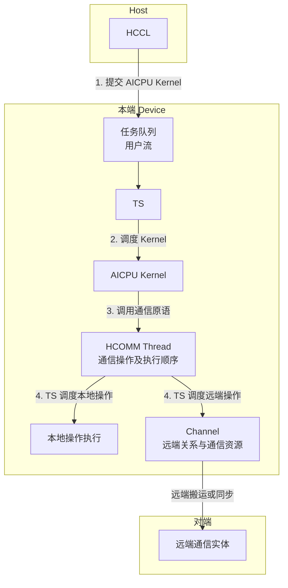

# AICPU（A5）执行模型

本文介绍 AICPU_TS 通信引擎在 Ascend 950 上的直驱执行模型，重点说明通信如何执行，以及执行顺序和同步机制如何保证通信内存一致性。通信实体、Endpoint 和 Channel 的关系参见[《AICPU（A5）通信模型》](./aicpu_comm_model_v1.0.md)；内存类型、注册方式和地址使用范围参见[《AICPU（A5）通信内存模型》](./aicpu_memory_model_v1.0.md)。

## 1 概述

### 1.1 文档范围

直驱模式下，Host 将 AICPU Kernel 提交到用户流，AICPU Kernel 调用 HCOMM 通信原语，将本地搬运、远端搬运和同步请求提交到 HCOMM Thread。HCOMM Thread 按已建立的顺序和依赖执行请求，并通过 Channel 与对端通信。

本文只描述正常执行路径中用户能够调用、配置或观察的执行对象、执行阶段、同步关系和内存可见性，不描述异常处理与恢复，也不描述内部任务格式、内部缓存、底层执行资源或硬件进度结构。代理模式不在本文范围内，后续单独说明。

### 1.2 执行对象与术语

| 对象或术语 | 含义 |
| --- | --- |
| Host 用户流 | 用户通过 [`HcclAicpuKernelLaunch`](../api_ref/comm_mgr_c/HcclAicpuKernelLaunch.md) 提交 AICPU Kernel，并建立 Kernel 前后依赖的执行流。 |
| AICPU Kernel | 运行通信算子逻辑并调用 HCOMM 通信原语的 Kernel。 |
| 调用线程 | 实际调用 HCOMM 原语的软件线程。 |
| HCOMM Thread | `ThreadHandle` 引用的通信执行上下文。带 `OnThread` 后缀的原语将通信操作提交到指定 HCOMM Thread。 |
| Channel | 本端访问特定远端通信实体的通信内存并与对端同步的通道。 |
| Thread Notify | 在本端两个 HCOMM Thread 之间建立执行依赖的同步机制。 |
| Channel Notify | 在 Channel 两端建立生产者和消费者依赖的同步机制。 |
| 完成观察点 | 用户能够确认特定作用范围内的通信操作达到约定完成条件的位置。 |
| 通信内存一致性 | 通信执行与同步机制对内存访问顺序、数据可见性和内存复用时机提供的保证，不表示硬件缓存一致性。 |

Host 用户流、调用线程和 HCOMM Thread 属于不同层次，不能用“线程顺序”统一指代。通信模型定义通信参与者和通道，通信内存模型定义内存对象及其静态可访问范围，本文定义通信执行过程中何时可以访问、复用或释放这些对象。

## 2 直驱通信执行流程

直驱模式沿用[《通信引擎》“AI CPU+TS”章节](../comm_op_dev_guide/prog_models_concepts/comm_engine.md)中的基本执行流程，并在通信操作中增加 HCOMM Thread 和 Channel 两个对象。其执行流程如图1所示。

**图1** 直驱模式通信执行流程



图中的步骤与 AI CPU+TS 调度流程一一对应：

1. Host 通过 [`HcclAicpuKernelLaunch`](../api_ref/comm_mgr_c/HcclAicpuKernelLaunch.md) 将 AICPU Kernel 提交到用户流对应的任务队列。
2. TS 从任务队列中调度 AICPU Kernel，并交由 AI CPU 执行。
3. AICPU Kernel 调用 HCOMM 通信原语，将本地搬运、远端搬运或同步操作提交到指定 HCOMM Thread。同一 HCOMM Thread 上的操作按照该 Thread 的执行顺序推进。
4. TS 调度 HCOMM Thread 上的通信操作执行。本地操作不需要 Channel；远端搬运和跨端同步通过 Channel 访问对应的远端通信实体及其通信资源。

HCOMM Thread 说明通信操作按照哪个执行上下文和顺序推进，Channel 说明远端操作通过哪条通信关系执行。下一章在这两个对象的基础上说明 Thread 内、Thread 间和 Channel 两端的同步关系，以及这些关系建立的通信内存一致性。

## 3 顺序、同步与通信内存一致性

通信内存一致性建立在通信操作的执行顺序之上。HCOMM Thread 规定同一执行上下文中的操作顺序，Thread Notify 将顺序扩展到本端不同 HCOMM Thread，Channel Notify 将顺序扩展到 Channel 两端，Channel Fence 则约束同一 Channel 上的前后读写。AICPU_TS 只保证通过这些机制显式建立的依赖，不会自动推导不同 HCOMM Thread 或不同 rank 之间的数据依赖。

不同场景应按以下方式建立顺序和同步关系：

1. **同一 HCOMM Thread**：通信操作按照该 Thread 的执行顺序推进，后序操作依赖前序操作。该顺序不表示调用线程已经观察到前序操作完成，也不能推导其他 HCOMM Thread 或对端的状态。
2. **本端不同 HCOMM Thread**：源 HCOMM Thread 调用 [`HcommThreadNotifyRecordOnThread`](https://gitcode.com/cann/hcomm/blob/master/docs/zh/api_ref/comm_opdev/data_plane_api/cpu-cpu_ts-aicpu_ts/local_operations/HcommThreadNotifyRecordOnThread.md)，目标 HCOMM Thread 调用 [`HcommThreadNotifyWaitOnThread`](https://gitcode.com/cann/hcomm/blob/master/docs/zh/api_ref/comm_opdev/data_plane_api/cpu-cpu_ts-aicpu_ts/local_operations/HcommThreadNotifyWaitOnThread.md)。目标 Thread 的 Wait 后序操作依赖于源 Thread 的 Record 前序操作。Thread Notify 只建立本端依赖，不能证明跨 rank 数据已经就绪。
3. **Channel 两端**：一端调用 [`HcommChannelNotifyRecordOnThread`](https://gitcode.com/cann/hcomm/blob/master/docs/zh/api_ref/comm_opdev/data_plane_api/cpu-cpu_ts-aicpu_ts/communication_operations/HcommChannelNotifyRecordOnThread.md)，另一端调用 [`HcommChannelNotifyWaitOnThread`](https://gitcode.com/cann/hcomm/blob/master/docs/zh/api_ref/comm_opdev/data_plane_api/cpu-cpu_ts-aicpu_ts/communication_operations/HcommChannelNotifyWaitOnThread.md)。对端 Wait 得到满足后，其后序操作依赖于本端 Record 的前序操作。`HcommWriteWithNotifyOnThread` 和 `HcommWriteReduceWithNotifyOnThread` 可以将远端写与通知组合，但接收端仍需通过对应的 Wait 建立消费者依赖。
4. **同一 Channel 的前后读写**：在前后两组 Channel 读写之间调用 [`HcommChannelFenceOnThread`](https://gitcode.com/cann/hcomm/blob/master/docs/zh/api_ref/comm_opdev/data_plane_api/cpu-cpu_ts-aicpu_ts/communication_operations/HcommChannelFenceOnThread.md)，保证 Fence 前的 Channel 读写在 Fence 后的 Channel 读写之前完成。Fence 不向对端发送通知，也不是独立的完成等待接口。

上述顺序和同步关系最终用于确定以下三个内存一致性边界：

| 一致性边界 | 前置条件 | 边界满足后的行为 |
| --- | --- | --- |
| 源内存可复用 | 通信引擎对源内存的读取已经完成，并由相应执行顺序或完成依赖保证。 | 在接口约束范围内修改、覆盖或释放源内存。 |
| 目的数据可见 | 通信引擎对目的内存的写入已经完成，访问方与该写入之间存在执行依赖。 | 具有对应依赖的执行上下文可以读取目的数据。 |
| 对端可消费 | 目的数据已经可见，且对端通过 Channel Notify Wait 等机制建立消费者依赖。 | 对端 Wait 后序消费者可以读取和处理数据。 |

三个边界分别回答源内存何时可以复用、目的数据何时可以读取，以及对端消费者何时可以使用数据。每个边界都必须根据对应通信操作和同步关系独立判断，不能用其中一个边界代替另一个。典型的生产者到消费者链路如下：

```text
生产者写入源数据
    -> 通信请求按 HCOMM Thread 顺序读取源数据
    -> 通信写入目的数据并完成
    -> 生产者发布 Channel Notify
    -> 对端 Channel Notify Wait 得到满足
    -> 对端消费者读取目的数据
```

算子还应遵守以下约束：

- 通信操作完成前，源内存和目的内存必须保持有效。通信引擎读取源内存期间，生产者不得修改对应区域；通信引擎写入目的内存期间，消费者不得读取或修改对应区域。
- 同一 HCOMM Thread 的后序通信请求可以依赖前序请求访问同一内存；调用线程直接访问该内存时，仍需要等待相应完成观察点。
- Channel Notify 只表示 Record 前序操作与 Wait 后序操作之间建立了依赖。若发送端还需要知道接收端已经处理完数据，接收端必须反向发送完成通知。
- 通信任务完成前，不得注销通信内存、销毁或重新绑定相关 Channel，也不得销毁承载任务的 HCOMM Thread。

## 4 典型执行模式

### 4.1 Push 模式

以 Write 为基础的 Push 流程如下：

```text
发送端生产 sendBuf
    -> 发送端 LocalCopy：sendBuf -> 本端通信内存
       [LocalCopy 完成后，sendBuf 可复用]
    -> 发送端 WriteWithNotify：本端通信内存 -> 对端通信内存
       [Write 完成后，本端通信内存可复用；对端通信内存可见]
    -> 接收端 Channel Notify Wait 得到满足
       [对端通信内存可消费]
    -> 接收端 LocalCopy：对端通信内存 -> recvBuf
       [LocalCopy 完成后，recvBuf 可消费]
```

不使用 `WriteWithNotify` 时，应将 Write 和 Channel Notify Record 提交到具有正确顺序的 HCOMM Thread。接收端若要允许发送端再次写入该通信内存，还需要在完成 LocalCopy 后向发送端返回通知；发送端不能根据单向写入通知推导接收端已经处理完数据。

### 4.2 Pull 模式

Pull 模式由数据读取方发起远端读：

```text
数据提供方准备远端通信内存
    -> 数据提供方 Channel Notify Record
    -> 读取方 Channel Notify Wait 得到满足
       [远端源数据可读取]
    -> 读取方 Read：远端通信内存 -> 本端通信内存
       [Read 完成后，本端通信内存可见]
    -> 读取方 LocalCopy：本端通信内存 -> recvBuf
       [LocalCopy 完成后，recvBuf 可消费]
    -> 读取方向数据提供方返回完成通知
       [数据提供方收到通知后，远端源内存可复用]
```

数据提供方发布的就绪通知只表示源数据已经准备好，不能同时表示该内存可以复用。读取方完成 Read 后，需要通过反向 Channel Notify 等算法同步机制告知数据提供方。
