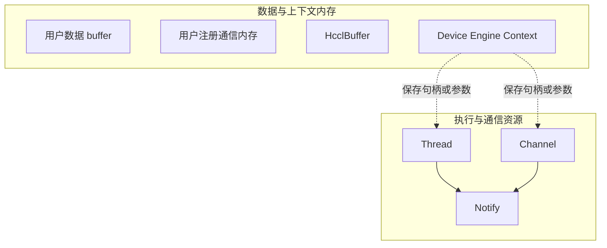
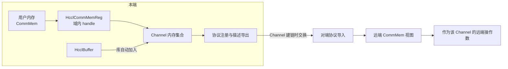

# AICPU（A5）通信内存模型

AICPU 通信算子在运行过程中会使用数据内存、上下文内存以及执行与通信资源。本文从算子开发者视角说明这些对象的层级划分、远端可见性机制与数据搬运能力。具体的内存申请、释放和异常清理流程由算子实现说明。

## 内存与资源层级

AICPU 通信中的数据内存、上下文内存和执行与通信资源是不同类型的对象。下表汇总了各类对象的位置或表示、申请或获取方式、生命周期与用途。

| 分类 | 对象 | 位置 / 表示 | 申请 / 获取方式 | 生命周期 | 用途 |
| --- | --- | --- | --- | --- | --- |
| 数据内存 | 用户数据 buffer | Device（HBM） | 用户通过 Runtime API 申请 | 用户管理 | 通信数据的源或目的（sendBuf / recvBuf） |
| 数据内存 | 用户注册通信内存 | Device 或 Host，由 `CommMem` 描述 | 用户申请原始内存，通过 `HcclCommMemReg` 注册 | 原始内存由用户管理，注册关系随通信域管理 | 作为需要随 Channel 交换的通信内存 |
| 数据内存 | HcclBuffer | Device（HBM） | 库内部申请，通过 [`HcclGetHcclBuffer`](https://gitcode.com/cann/hcomm/blob/master/docs/zh/api_ref/comm_opdev/control_plane_api/comms_domain_resource_mgmt/HcclGetHcclBuffer.md) 或 [`HcclChannelGetHcclBuffer`](https://gitcode.com/cann/hcomm/blob/master/docs/zh/api_ref/comm_opdev/control_plane_api/comms_domain_resource_mgmt/HcclChannelGetHcclBuffer.md) 获取 | 随通信域，调用者不释放 | 集合通信的中间或工作内存 |
| 上下文内存 | Device Engine Context | Device（HBM） | 通过 `HcclEngineCtxCreate` 创建，通过 `HcclEngineCtxGet` 获取 | 用户显式创建和销毁 | 存放 Device 侧复用的资源句柄或参数 |
| 执行资源 | Thread | Stream、Notify 等执行资源的软件抽象 | 通过 `HcclThreadAcquire` 获取或复用 | 随通信域，由库内部管理 | 承载通信任务的执行流和线程间同步 |
| 通信资源 | Channel | Endpoint、连接和 Notify 等通信资源的软件抽象 | 通过 [`HcclChannelAcquire`](https://gitcode.com/cann/hcomm/blob/master/docs/zh/api_ref/comm_opdev/control_plane_api/comms_domain_resource_mgmt/HcclChannelAcquire.md) 获取或复用 | 随通信域，由库内部管理 | 建立跨 rank 通信通道并关联远端内存 |
| 同步资源 | Notify | Thread 或 Channel 使用的同步资源 | 申请 Thread 或 Channel 时指定数量 | 随所属 Thread 或 Channel，由库内部管理 | Thread 间或 Channel 两端同步 |

- 用户数据 buffer、用户注册通信内存和 HcclBuffer 是通信数据的载体。
- Device Engine Context 用于保存可复用的资源句柄或参数，不包含 Thread、Channel 或 Notify 资源本体。
- Thread、Channel 和 Notify 属于执行与通信资源，不属于用户可寻址的 HBM。`ThreadHandle` 和 `ChannelHandle` 是 `uint64_t` 句柄，用于引用对应资源。

内存与资源层级如下图所示：

## 本地与远端内存可见性

### 可见性范围

| 内存类型 | 本端获取方式 | 建立远端可见性的方式 | 对端获取方式 | 所有权 |
| --- | --- | --- | --- | --- |
| HcclBuffer | [`HcclGetHcclBuffer`](https://gitcode.com/cann/hcomm/blob/master/docs/zh/api_ref/comm_opdev/control_plane_api/comms_domain_resource_mgmt/HcclGetHcclBuffer.md) | Channel 创建时由库自动加入注册和交换集合 | [`HcclChannelGetHcclBuffer`](https://gitcode.com/cann/hcomm/blob/master/docs/zh/api_ref/comm_opdev/control_plane_api/comms_domain_resource_mgmt/HcclChannelGetHcclBuffer.md) | 随通信域，由库内部管理 |
| 用户注册通信内存 | 用户持有原始内存，通过 [`HcclCommMemReg`](https://gitcode.com/cann/hcomm/blob/master/docs/zh/api_ref/comm_opdev/control_plane_api/comms_domain_resource_mgmt/HcclCommMemReg.md) 获取 [`HcclMemHandle`](https://gitcode.com/cann/hcomm/blob/master/docs/zh/api_ref/comm_opdev/datatype_definition/HcclMemHandle.md) | 将 handle 填入 [`HcclChannelDesc.memHandles`](https://gitcode.com/cann/hcomm/blob/master/docs/zh/api_ref/comm_opdev/datatype_definition/HcclChannelDesc.md) 和 [`HcclChannelDesc.memHandleNum`](https://gitcode.com/cann/hcomm/blob/master/docs/zh/api_ref/comm_opdev/datatype_definition/HcclChannelDesc.md)，随指定 Channel 注册和交换 | [`HcclChannelGetRemoteMems`](https://gitcode.com/cann/hcomm/blob/master/docs/zh/api_ref/comm_opdev/control_plane_api/comms_domain_resource_mgmt/HcclChannelGetRemoteMems.md) | 原始内存由用户管理，注册和交换关系由库管理 |

本端可访问不代表远端可见。用户内存只有完成通信域绑定，并随具体 Channel 注册和交换后，才能被该 Channel 的对端通信操作使用。

### 远端可见性的建立过程

远端可见性不是由单个接口一次完成，而是在通信域管理和 Channel 建链过程中逐步建立：

1. **通信域绑定**：[`HcclCommMemReg`](https://gitcode.com/cann/hcomm/blob/master/docs/zh/api_ref/comm_opdev/control_plane_api/comms_domain_resource_mgmt/HcclCommMemReg.md) 保存用户内存的 [`CommMem`](https://gitcode.com/cann/hcomm/blob/master/docs/zh/api_ref/comm_opdev/datatype_definition/CommMem.md) 元数据，并返回通信域内的 [`HcclMemHandle`](https://gitcode.com/cann/hcomm/blob/master/docs/zh/api_ref/comm_opdev/datatype_definition/HcclMemHandle.md)。
2. **Channel 内存选择**：[`HcclGetHcclBuffer`](https://gitcode.com/cann/hcomm/blob/master/docs/zh/api_ref/comm_opdev/control_plane_api/comms_domain_resource_mgmt/HcclGetHcclBuffer.md) 获取的 HcclBuffer 由库自动加入 Channel 的交换集合；用户注册通信内存通过 [`HcclChannelDesc.memHandles`](https://gitcode.com/cann/hcomm/blob/master/docs/zh/api_ref/comm_opdev/datatype_definition/HcclChannelDesc.md) 和 [`HcclChannelDesc.memHandleNum`](https://gitcode.com/cann/hcomm/blob/master/docs/zh/api_ref/comm_opdev/datatype_definition/HcclChannelDesc.md) 加入指定 Channel。
3. **协议注册与交换**：Channel 创建时，Endpoint 根据当前 Channel 使用的传输协议注册本端通信内存，并生成远端访问该内存所需的协议访问保护信息。本端随后将内存地址、长度、内存标识以及对应协议的访问保护信息组成内存描述，并在 Channel 建链过程中发送给对端。
    - 对于 UB 协议，本端注册内存时生成 tokenId 和 tokenValue，并由底层返回用于远端导入的 UB 内存 key；对端 Endpoint 使用 key 和 tokenValue 导入远端内存，并在后续通信操作中使用 tokenId 和 tokenValue 进行访问校验；
    - 对于 RoCE 协议，本端注册内存后获得 lkey 和 rkey，其中 lkey 用于本地内存访问，rkey 用于对端访问授权。对端保存并使用 rkey 访问对应的远端内存区域。
4. **远端内存查询**：Channel 创建完成后，通过对应接口获取远端地址和大小。

### HcclBuffer 的可见性路径

HcclBuffer 由库内部管理，用户不参与注册和描述交换：

1. 本端通过 [`HcclGetHcclBuffer`](https://gitcode.com/cann/hcomm/blob/master/docs/zh/api_ref/comm_opdev/control_plane_api/comms_domain_resource_mgmt/HcclGetHcclBuffer.md) 获取本端 HcclBuffer。
2. Channel 创建时，库将 HcclBuffer 自动加入注册和交换集合。
3. 对端通过 [`HcclChannelGetHcclBuffer`](https://gitcode.com/cann/hcomm/blob/master/docs/zh/api_ref/comm_opdev/control_plane_api/comms_domain_resource_mgmt/HcclChannelGetHcclBuffer.md) 获取该 Channel 对端的 HcclBuffer 地址和大小。

### 用户注册通信内存的可见性路径

用户注册通信内存由用户选择，并随指定 Channel 交换：

1. 用户准备已分配的 Device 或 Host 内存，并使用 [`CommMem`](https://gitcode.com/cann/hcomm/blob/master/docs/zh/api_ref/comm_opdev/datatype_definition/CommMem.md) 描述其地址、大小和类型。
2. 调用 [`HcclCommMemReg`](https://gitcode.com/cann/hcomm/blob/master/docs/zh/api_ref/comm_opdev/control_plane_api/comms_domain_resource_mgmt/HcclCommMemReg.md) 获取 [`HcclMemHandle`](https://gitcode.com/cann/hcomm/blob/master/docs/zh/api_ref/comm_opdev/datatype_definition/HcclMemHandle.md)。
3. 将 handle 填入 [`HcclChannelDesc.memHandles`](https://gitcode.com/cann/hcomm/blob/master/docs/zh/api_ref/comm_opdev/datatype_definition/HcclChannelDesc.md) 和 [`HcclChannelDesc.memHandleNum`](https://gitcode.com/cann/hcomm/blob/master/docs/zh/api_ref/comm_opdev/datatype_definition/HcclChannelDesc.md)，再创建 Channel。
4. 对端通过 [`HcclChannelGetRemoteMems`](https://gitcode.com/cann/hcomm/blob/master/docs/zh/api_ref/comm_opdev/control_plane_api/comms_domain_resource_mgmt/HcclChannelGetRemoteMems.md) 获取该 Channel 已交换的远端内存列表。

### 本地地址与远端地址语义

对于本文关注的 Ascend 950/AICPU_TS RMA Channel，本地地址和远端地址具有不同的使用语义。

| 地址类型 | 地址来源 | 使用方式 |
| --- | --- | --- |
| 本地地址 | 用户持有的本端内存地址、[`HcclGetHcclBuffer`](https://gitcode.com/cann/hcomm/blob/master/docs/zh/api_ref/comm_opdev/control_plane_api/comms_domain_resource_mgmt/HcclGetHcclBuffer.md) 返回值 | 可作为本地访问地址，或作为通信原语的本地操作数；具体访问能力取决于内存类型和执行引擎 |
| 远端地址 | [`HcclChannelGetHcclBuffer`](https://gitcode.com/cann/hcomm/blob/master/docs/zh/api_ref/comm_opdev/control_plane_api/comms_domain_resource_mgmt/HcclChannelGetHcclBuffer.md)、[`HcclChannelGetRemoteMems`](https://gitcode.com/cann/hcomm/blob/master/docs/zh/api_ref/comm_opdev/control_plane_api/comms_domain_resource_mgmt/HcclChannelGetRemoteMems.md) 返回的地址 | 只能作为返回该地址的 Channel 上 Read、Write、Reduce 等通信原语的远端操作数 |

远端地址不是本地虚拟地址，不能由本端 CPU 或 AICPU 直接解引用，也不能用于本地拷贝。远端地址与 Channel、远端 rank 和已交换内存区域绑定，操作的地址和长度必须完整落在对应区域内，不得跨 Channel 复用。

### 使用约束

- [`CommMem`](https://gitcode.com/cann/hcomm/blob/master/docs/zh/api_ref/comm_opdev/datatype_definition/CommMem.md) 只描述内存类型、地址和大小，不是完整的协议访问描述。
- HcclBuffer 由库自动加入 Channel；用户注册通信内存必须通过 `memHandles/memHandleNum` 显式加入。
- 远端地址只在返回该地址的 Channel 及其已交换区域内有效。
- 异步通信操作完成前，原始内存、注册关系和 Channel 必须保持有效。
- 查询远端内存得到的地址、标签和列表由库内部管理，调用者不得释放。

## 数据搬运能力

本章只说明 AICPU_TS 可以对哪些内存执行搬运，以及本地地址与远端地址在搬运原语中的方向。任务提交、完成与同步语义参见[《AICPU（A5）执行模型》](./aicpu_exec_modelv1.0.md)。

### 搬运原语

| 能力 | 原语 | 数据方向与结果 |
| --- | --- | --- |
| 本地拷贝 | [`HcommLocalCopyOnThread`](https://gitcode.com/cann/hcomm/blob/master/docs/zh/api_ref/comm_opdev/data_plane_api/cpu-cpu_ts-aicpu_ts/local_operations/HcommLocalCopyOnThread.md) | 本端源内存 → 本端目的内存 |
| 本地归约 | [`HcommLocalReduceOnThread`](https://gitcode.com/cann/hcomm/blob/master/docs/zh/api_ref/comm_opdev/data_plane_api/cpu-cpu_ts-aicpu_ts/local_operations/HcommLocalReduceOnThread.md) | 将本端源数据与本端目的数据归约，结果写入本端目的内存 |
| 远端写 | [`HcommWriteOnThread`](https://gitcode.com/cann/hcomm/blob/master/docs/zh/api_ref/comm_opdev/data_plane_api/cpu-cpu_ts-aicpu_ts/communication_operations/HcommWriteOnThread.md) | 本端源内存 → 当前 Channel 的远端目的内存 |
| 远端读 | [`HcommReadOnThread`](https://gitcode.com/cann/hcomm/blob/master/docs/zh/api_ref/comm_opdev/data_plane_api/cpu-cpu_ts-aicpu_ts/communication_operations/HcommReadOnThread.md) | 当前 Channel 的远端源内存 → 本端目的内存 |
| 搬运并归约 | [`HcommWriteReduceOnThread`](https://gitcode.com/cann/hcomm/blob/master/docs/zh/api_ref/comm_opdev/data_plane_api/cpu-cpu_ts-aicpu_ts/communication_operations/HcommWriteReduceOnThread.md)、[`HcommReadReduceOnThread`](https://gitcode.com/cann/hcomm/blob/master/docs/zh/api_ref/comm_opdev/data_plane_api/cpu-cpu_ts-aicpu_ts/communication_operations/HcommReadReduceOnThread.md) | 在远端写或远端读过程中执行归约，结果分别写入远端或本端目的内存 |
| 搬运并通知 | [`HcommWriteWithNotifyOnThread`](https://gitcode.com/cann/hcomm/blob/master/docs/zh/api_ref/comm_opdev/data_plane_api/cpu-cpu_ts-aicpu_ts/communication_operations/HcommWriteWithNotifyOnThread.md)、[`HcommWriteReduceWithNotifyOnThread`](https://gitcode.com/cann/hcomm/blob/master/docs/zh/api_ref/comm_opdev/data_plane_api/cpu-cpu_ts-aicpu_ts/communication_operations/HcommWriteReduceWithNotifyOnThread.md) | 将远端写与对端 Notify 合并为一次操作 |
| 批量搬运 | [`HcommBatchTransferOnThread`](https://gitcode.com/cann/hcomm/blob/master/docs/zh/api_ref/comm_opdev/data_plane_api/cpu-cpu_ts-aicpu_ts/communication_operations/HcommBatchTransferOnThread.md) | 一次提交多组受支持的搬运操作 |

### 地址方向与范围

- `LocalCopy` 和 `LocalReduce` 的源地址与目的地址均为本地地址，且必须能被当前执行引擎直接访问。
- `Write` 的源地址为本地地址，目的地址为当前 Channel 的远端地址；`WriteReduce` 和带 Notify 的写操作沿用相同的地址方向。
- `Read` 的源地址为当前 Channel 的远端地址，目的地址为本地地址；`ReadReduce` 沿用相同的地址方向。
- 远端搬运的本地操作数可以是 HcclBuffer，也可以是当前通信引擎和协议支持的用户注册通信内存；远端操作数必须来自当前 Channel 已注册并交换的 HcclBuffer 或用户注册通信内存。

