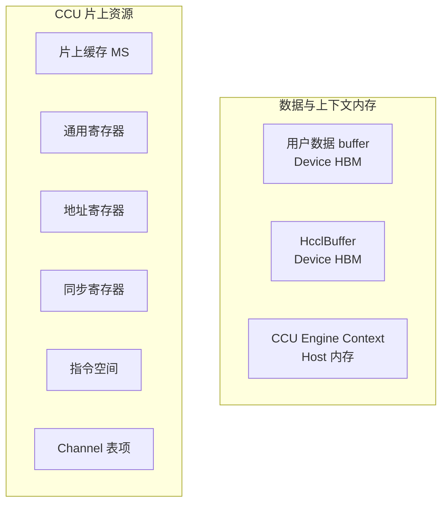

# CCU（A5）通信内存模型

本文从算子开发者视角说明 CCU 通信内存的层级划分、管理方式、远端可见性机制与数据搬运能力，帮助开发者正确申请、获取与使用通信内存。

CCU 仅 Ascend 950PR / 950DT（A5）支持，通信协议走 UBC_CTP / UBC_TP，属网络语义（RMA）路径。

## 内存与资源层级

- **用户数据 buffer**：位于 Device HBM，用作通信数据的源或目的（sendBuf / recvBuf）。
- **HcclBuffer**：位于 Device HBM，用作集合通信的中间或工作内存。
- **CCU Engine Context**：位于 Host 内存，用于保存可复用的资源句柄或参数。
- **片上缓存 MS**：位于 CCU die，用于数据暂存和多路归约。
- **通用寄存器**：位于 CCU die，用于保存标量或 Token。
- **地址寄存器**：位于 CCU die，用于保存 HBM 地址。
- **同步寄存器**：位于 CCU die，用于表示本地事件或 Channel 两端通知。
- **指令空间**：位于 CCU die，用于保存 Kernel 指令。
- **Channel 表项**：位于 CCU die，用于保存 UB 通信上下文。

### 编程资源抽象

| 资源抽象 | 对应的硬件对象 / 表示 | 申请 / 获取方式 | 生命周期 | 用途 |
| --- | --- | --- | --- | --- |
| [`CcuBuffer`](https://gitcode.com/cann/hcomm/blob/master/docs/zh/api_ref/comm_opdev/data_plane_api/ccu/resource_allocation_operation/CcuBuffer.md) | 片上缓存 MS（4KB） | 在 Kernel 中构造 | 随 CCU 实例，由库内部管理 | 数据暂存和多路归约操作数 |
| [`Variable`](https://gitcode.com/cann/hcomm/blob/master/docs/zh/api_ref/comm_opdev/data_plane_api/ccu/resource_allocation_operation/Variable.md) | 通用寄存器 | 在 Kernel 中构造 | 随 CCU 实例，由库内部管理 | 保存标量或 Token |
| [`Address`](https://gitcode.com/cann/hcomm/blob/master/docs/zh/api_ref/comm_opdev/data_plane_api/ccu/resource_allocation_operation/Address.md) | 地址寄存器 | 在 Kernel 中构造 | 随 CCU 实例，由库内部管理 | 保存 HBM 地址 |
| [`Event`](https://gitcode.com/cann/hcomm/blob/master/docs/zh/api_ref/comm_opdev/data_plane_api/ccu/resource_allocation_operation/Event.md) | 同步寄存器 | 在 Kernel 中构造 | 随 CCU 实例，由库内部管理 | 表示本地完成事件 |
| Notify | Channel 关联的同步寄存器 | 创建 Channel 时由库内部配置 | 随 Channel，由库内部管理 | Channel 两端同步 |
| [`LocalAddr`](https://gitcode.com/cann/hcomm/blob/master/docs/zh/api_ref/comm_opdev/data_plane_api/ccu/resource_allocation_operation/LocalAddr.md) / [`RemoteAddr`](https://gitcode.com/cann/hcomm/blob/master/docs/zh/api_ref/comm_opdev/data_plane_api/ccu/resource_allocation_operation/RemoteAddr.md) | Address + Variable 复合表示 | 在 Kernel 中构造 | 随 CCU 实例，由库内部管理 | 表示本地或远端 HBM 操作数 |
| Channel | Channel 表项及关联的 UB 通信上下文 | 通过 [`HcclChannelAcquire`](https://gitcode.com/cann/hcomm/blob/master/docs/zh/api_ref/comm_opdev/control_plane_api/comms_domain_resource_mgmt/HcclChannelAcquire.md) 获取或复用 | 随通信域，由库内部管理 | 建立跨 rank 通信通道 |

## 本地与远端内存可见性

CCU 访问 HBM 时使用“地址 + Token”共同描述操作数。内存对远端可见，表示通信对端已经获得该内存的地址和配套 Token，并能通过对应 Channel 将二者组装为远端操作数。Token 是访问凭据，不替代内存地址，也不搬运内存中的实际数据。

### 可见性范围

| 内存类型 | 本端来源 | 建立远端可见性的方式 | 对端表示 | 所有权 |
| --- | --- | --- | --- | --- |
| HcclBuffer | 通过 [`HcclGetHcclBuffer`](https://gitcode.com/cann/hcomm/blob/master/docs/zh/api_ref/comm_opdev/control_plane_api/comms_domain_resource_mgmt/HcclGetHcclBuffer.md) 获取 | Channel 建链后可通过 [`HcclChannelGetHcclBuffer`](https://gitcode.com/cann/hcomm/blob/master/docs/zh/api_ref/comm_opdev/control_plane_api/comms_domain_resource_mgmt/HcclChannelGetHcclBuffer.md) 获取对端地址；执行 CCU Kernel 前还需准备并交换该内存对应的 Token | `RemoteAddr` | 随通信域，由库内部管理 |
| 用户数据 buffer | 算子的 input、output 等用户 HBM | Host 查询本端内存的 Token 并将地址和 Token 传入 Kernel；通信双方按照算法约定交换地址和 Token | `RemoteAddr` | 原始内存由用户管理 |

CcuBuffer、通用寄存器、地址寄存器、同步寄存器、CCU Engine Context 和指令空间不属于远端 HBM 可见性范围。Channel 关联的 [`Variable`](https://gitcode.com/cann/hcomm/blob/master/docs/zh/api_ref/comm_opdev/data_plane_api/ccu/resource_allocation_operation/Variable.md) 可以承载地址、Token 等访问元数据，但 Variable 本身不是远端用户内存。

### 地址与 Token

[`LocalAddr`](https://gitcode.com/cann/hcomm/blob/master/docs/zh/api_ref/comm_opdev/data_plane_api/ccu/resource_allocation_operation/LocalAddr.md) 和 [`RemoteAddr`](https://gitcode.com/cann/hcomm/blob/master/docs/zh/api_ref/comm_opdev/data_plane_api/ccu/resource_allocation_operation/RemoteAddr.md) 均由地址和 Token 组成。地址保存在地址寄存器中，Token 保存在通用寄存器中。

| 对象 | `addr` 字段 | `token` 字段 | 使用范围 |
| --- | --- | --- | --- |
| `LocalAddr` | 本端 HBM 地址 | 与该本端内存范围配套的 Token | 本地操作，或跨 rank 操作的本地操作数 |
| `RemoteAddr` | 对端 HBM 地址 | 与该对端内存范围配套的 Token | 配合对应 Channel 作为跨 rank 操作的远端操作数 |

### 远端可见性的建立过程

1. **查询并编码 Token**：Host 调用 [`HcommCcuGetMemToken`](https://gitcode.com/cann/hcomm/blob/master/docs/zh/api_ref/comm_opdev/control_plane_api/ccu_kernel_launch_execution/HcommCcuGetMemToken.md)，输入本端内存的起始地址和长度。Runtime 返回 `tokenId` 和 `tokenValue`，HCOMM 将有效标记、`tokenId` 和 `tokenValue` 编码为一个 64 位 `tokenInfo`。`tokenInfo` 是供 CCU 使用的不透明访问凭据，算子不应自行解析或修改。
2. **组装本端地址**：Host 通过 `kernelArg`，或通过 `taskArgs` 配合 [`LoadArg`](https://gitcode.com/cann/hcomm/blob/master/docs/zh/api_ref/comm_opdev/data_plane_api/ccu/arg_load_store/LoadArg.md)，将内存地址和 `tokenInfo` 传入本端 Kernel。Kernel 将地址写入 `LocalAddr.addr`，将 `tokenInfo` 写入 `LocalAddr.token`，形成该内存的本端操作数。
3. **交换远端访问元数据**：通信双方按照算法约定交换需要开放访问的地址和 Token。对于 HcclBuffer，Channel 提供对端 HcclBuffer 的关联关系和地址，算法还需准备并交换对应 Token；对于用户数据 buffer，地址和 Token 均由算法显式交换。
4. **组装远端地址**：当前 HCCL CCU 算法可通过 [`WriteVariableWithNotify`](https://gitcode.com/cann/hcomm/blob/master/docs/zh/api_ref/comm_opdev/data_plane_api/ccu/synchronization/WriteVariableWithNotify.md) 将地址和 Token 分别写入双方约定的对端 Channel Variable。该原语保证 Variable 先写入、Notify 后到达；接收方通过 [`NotifyWait`](https://gitcode.com/cann/hcomm/blob/master/docs/zh/api_ref/comm_opdev/data_plane_api/ccu/synchronization/NotifyWait.md) 等待对应 Notify，随后读取地址和 Token，并组装当前远端 rank 的 `RemoteAddr`。
5. **执行远端访问**：后续跨 rank 原语使用当前 Channel、`LocalAddr` 和 `RemoteAddr` 访问本端和远端 HBM。CCU 使用 `addr` 完成寻址，并使用配套 Token 完成访问授权校验。具体鉴权机制和校验时点属于硬件实现细节。

地址始终由 `addr` 字段承载，`HcommCcuGetMemToken` 不会将地址转换为 Token。通信双方交换的是地址、Token 等访问元数据，不会搬运用户 buffer 中的实际数据。

### 本地地址与远端地址语义

| 地址类型 | 表示的内存 | 使用方式 |
| --- | --- | --- |
| `LocalAddr` | 本端 HBM | 可用于本地操作，也可作为跨 rank 操作的本地操作数 |
| `RemoteAddr` | 当前 Channel 对端的 HBM | 只能配合对应 Channel，作为跨 rank 操作的远端操作数 |

`RemoteAddr` 不是本端可直接解引用的地址，不能用于 `Load`、`Store`、`LocalCopy` 等本地操作。其地址和 Token 必须来自同一个远端 rank，并与执行通信操作时使用的 Channel 匹配。

### 使用约束

- 地址和 Token 必须对应同一段内存，通信操作的地址和长度必须完整落在查询 Token 时对应的有效连续内存范围内。
- `RemoteAddr` 与远端 rank、Channel 和内存范围绑定，不得跨 rank 或跨 Channel 混用。
- 异步通信操作完成前，本端和远端原始内存、地址与 Token 来源以及 Channel 必须保持有效。
- HcclBuffer 由库内部管理，调用者不得释放；用户数据 buffer 由用户管理，但在相关通信操作完成前不得释放或复用。
- Token 属于安全信息，Host 和 Device 日志均不得打印。原始内存失效后，不得继续使用与该内存配套的地址和 Token。

## 数据搬运能力

CCU 可以在本端 HBM、片上 CcuBuffer、通用寄存器和对端 HBM 之间搬运数据，并支持在搬运过程中完成归约。主要数据通路如下图所示。

### 搬运路径

- **本端 HBM ↔ Variable**：通过 [`Load`](https://gitcode.com/cann/hcomm/blob/master/docs/zh/api_ref/comm_opdev/data_plane_api/ccu/arg_load_store/Load.md) 从本端 HBM 加载一个或一组值到通用寄存器，通过 [`Store`](https://gitcode.com/cann/hcomm/blob/master/docs/zh/api_ref/comm_opdev/data_plane_api/ccu/arg_load_store/Store.md) 将寄存器中的值保存到本端 HBM。
- **本端 HBM ↔ CcuBuffer**：通过 [`LocalCopy`](https://gitcode.com/cann/hcomm/blob/master/docs/zh/api_ref/comm_opdev/data_plane_api/ccu/data_movement/LocalCopy.md) 在本端 HBM 与片上 CcuBuffer 之间双向搬运数据。
- **CcuBuffer ↔ 对端 HBM**：通过 [`Read`](https://gitcode.com/cann/hcomm/blob/master/docs/zh/api_ref/comm_opdev/data_plane_api/ccu/data_movement/Read.md) 将对端 HBM 数据读入本端 CcuBuffer，通过 [`Write`](https://gitcode.com/cann/hcomm/blob/master/docs/zh/api_ref/comm_opdev/data_plane_api/ccu/data_movement/Write.md) 将本端 CcuBuffer 数据写入对端 HBM。
- **本端 HBM ↔ 对端 HBM**：通过 [`Read`](https://gitcode.com/cann/hcomm/blob/master/docs/zh/api_ref/comm_opdev/data_plane_api/ccu/data_movement/Read.md) 和 [`Write`](https://gitcode.com/cann/hcomm/blob/master/docs/zh/api_ref/comm_opdev/data_plane_api/ccu/data_movement/Write.md) 直接搬运数据；通过 [`ReadReduce`](https://gitcode.com/cann/hcomm/blob/master/docs/zh/api_ref/comm_opdev/data_plane_api/ccu/data_movement/ReadReduce.md) 和 [`WriteReduce`](https://gitcode.com/cann/hcomm/blob/master/docs/zh/api_ref/comm_opdev/data_plane_api/ccu/data_movement/WriteReduce.md) 在搬运过程中完成归约。
- **写对端寄存器**：通过 [`WriteVariableWithNotify`](https://gitcode.com/cann/hcomm/blob/master/docs/zh/api_ref/comm_opdev/data_plane_api/ccu/synchronization/WriteVariableWithNotify.md) 写入对端 Variable 并触发对应 Notify，通过 [`NotifyRecord`](https://gitcode.com/cann/hcomm/blob/master/docs/zh/api_ref/comm_opdev/data_plane_api/ccu/synchronization/NotifyRecord.md) 置位对端同步寄存器。这两类操作用于传递标量元数据或同步，不搬运用户 buffer 数据。

此外，[`LocalCopy`](https://gitcode.com/cann/hcomm/blob/master/docs/zh/api_ref/comm_opdev/data_plane_api/ccu/data_movement/LocalCopy.md) 支持本端 HBM 内复制；[`LocalReduce`](https://gitcode.com/cann/hcomm/blob/master/docs/zh/api_ref/comm_opdev/data_plane_api/ccu/data_movement/LocalReduce.md) 支持本端 HBM 数据归约，以及 2～8 个 CcuBuffer 的多路归约。

`CcuBuffer` 是可选的片上中转和归约资源，不是所有数据搬运或归约操作的必经路径。CCU 既可在本端 HBM 与对端 HBM 之间直接搬运和归约，也可通过 CcuBuffer 暂存数据或执行多路归约；CCU 不支持直接访问其他设备的 CcuBuffer。
