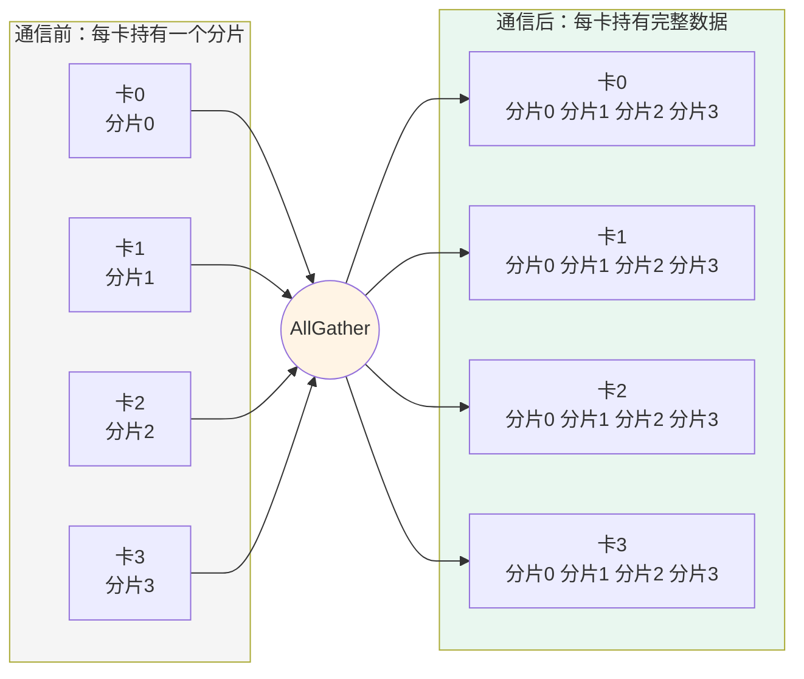
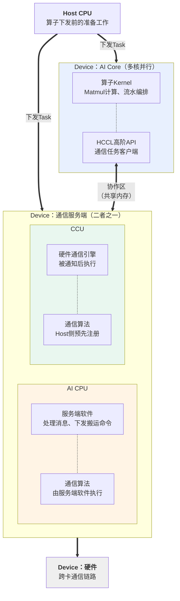
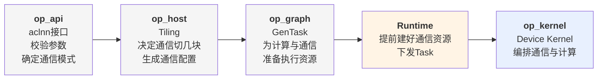

# MC2编程模型概述

MC2（Merged Compute and Communication）指通信与计算融合的算子。传统做法是先执行一个通信算子，等它结束再执行一个计算算子，通信耗时完全暴露在端到端时延中。MC2算子把通信任务切成多块下发，让每一块数据的通信与上一块数据的计算在时间上重叠，从而把通信耗时隐藏在计算流水中。

本章以AllGatherMatmul算子为例介绍MC2编程模型。该算子完成AllGather通信与Matmul计算的融合：

$$
y = AllGather(x1) @ x2 + bias
$$

每张卡持有x1的一个分片，通信负责把所有卡的分片收集齐，计算负责把收集后的完整矩阵与x2相乘。以4卡为例，AllGather的语义如下图：每张卡把自己的分片发给其他所有卡，通信结束后每张卡都持有一份按卡号顺序排列的完整数据。



回到AllGatherMatmul，每张卡拿到完整的x1之后与本卡的x2相乘，得到本卡的输出。这个算子存在两个天然的重叠机会：

- **本卡自己的那一份x1不需要等通信**，可以在通信进行的同时先算出来。
- **远端数据可以分块到达**，第一块到了就可以开始算第一块，不必等全部数据齐备。

MC2编程模型要解决的核心问题，就是如何组织通信与计算的下发和同步，把这两个重叠机会用起来。

本套资料按四个视角组织：

| 章节 | 回答的问题 |
| --- | --- |
| **概述**（本章） | MC2算子由哪几部分组成，端到端怎么跑起来 |
| [内存模型](内存模型.md) | 数据放在哪块内存，谁申请，生命周期多长 |
| [通信模型](通信模型.md) | 通信任务怎么下发，Kernel里要调哪些接口 |
| [执行模型](执行模型.md) | 通信与计算怎么并行，需要做哪些同步 |

本套资料以Ascend 950PR/Ascend 950DT为例，覆盖**AI CPU**与**CCU**两种通信服务端。两者共享绝大部分编程模型，差异处会明确标注，详见[两种通信模式](#两种通信模式)。

## 执行体划分

一个MC2算子在运行时涉及三类执行体：Host CPU负责准备，AI Core负责计算并下发通信任务，**通信服务端**负责执行通信。



通信服务端有两种：**AI CPU** 与 **CCU**。两者在模型中的位置相同，都是接收AI Core下发的通信任务并执行，选择哪一种由算子属性决定，详见[两种通信模式](#两种通信模式)。

图中的AI Core与通信服务端是**两个并行运行的执行体**，两者之间没有函数调用关系，全部协作通过一块共享内存完成，本套资料称之为**协作区**。AI Core发出通信任务后可以立即返回去做计算，不必等通信结束。

这就是通信与计算能够重叠的基础。具体而言，Kernel的编排分为四步：

1. **一次性下发全部分块的通信任务**，不等待通信完成。
2. **计算本卡数据** —— 这部分不依赖通信，可以与正在进行的通信并行。
3. **逐块等待并计算远端数据** —— 第一块数据到达后计算第一块，计算第一块的同时第二块正在传输。
4. **全核同步后收尾**。

这样，除了第一块数据到达前的等待，其余各块的通信耗时都被前一块的计算所掩盖。分块大小与数量的选取原则见[执行模型](执行模型.md)。

以上机制在两种通信模式下完全一致。两种模式在服务端内部的工作方式不同，详见[通信模型](通信模型.md)。

## 两种通信模式

Ascend 950PR/Ascend 950DT上，MC2算子的通信服务端有两种选择，构成两种通信模式。模式由算子属性`comm_mode`指定。

| 模式 | comm_mode | 服务端 | 通信算法的执行方式 |
| --- | --- | --- | --- |
| **AI Core + AI CPU** | `ai_cpu` | AI CPU核上运行的服务端软件 | 由服务端软件执行 |
| **AI Core + CCU** | `ccu` | 专用硬件通信引擎 | 由硬件引擎执行，算法在Host侧预先注册到引擎上 |

两种模式的客户端都在AI Core上，差异在服务端。后文用简称"AI CPU模式"与"CCU模式"。

两种模式下客户端与服务端的协作机制不同：AI CPU模式下客户端把通信任务写进消息区、服务端循环读取；CCU模式下客户端把任务参数写进参数区、再通过门铃通知硬件引擎。这一差异由HCCL高阶API内部处理，详见[通信模型](通信模型.md)。

### 两种模式对开发者的差异

两种模式共享绝大部分编程模型，开发者需要注意下面三处差异：

| 差异 | 说明 |
| --- | --- |
| 创建通信对象时的模板参数 | 指定服务端类型，两种模式取值不同 |
| CCU模式需要设置环境变量 | 见下文 |
| 下发与提交分开调用的收益不同 | 详见[通信模型](通信模型.md) |

除此之外，切换模式不需要改写任何通信编排逻辑。

### CCU模式的前置条件

使用CCU模式需要在**创建通信域之前**设置环境变量：

```bash
export HCCL_OP_EXPANSION_MODE=CCU_SCHED
```

原因是CCU硬件实例在建立通信域时申请，而通信域的创建早于算子调用。若该环境变量未设置，或CCU资源不足，通信域侧会回退到AI CPU；此时算子属性中的`comm_mode = "ccu"`与实际使用的服务端不匹配。

AI CPU模式不需要设置环境变量。

## 端到端实现流程

MC2算子的实现代码分为四部分：`op_api`（aclnn接口）、`op_host`（Tiling）、`op_graph`（GenTask）、`op_kernel`（Device Kernel）。下图串起从aclnn接口调用到通信完成的完整链路，标出每个环节承担的角色。



其中Runtime属于CANN的执行框架，不是算子代码的一部分。开发者在通信方面需要关注的工作集中在两处：

- **Tiling里生成通信配置并决定切分** —— 决定用哪个通信域、哪种通信算法、通信切成几块。
- **Kernel里编排通信与计算的顺序** —— 决定什么时候下发、什么时候等待、什么时候计算。

通信资源的申请、通信算法的执行都由框架完成，开发者不需要自行建链或编写数据搬运逻辑。

流程中有五个关键时机值得单独说明。以下内容在两种通信模式下一致。通信与计算之间的同步细节见[执行模型](执行模型.md)。

**① 通信配置在Tiling阶段生成。** Tiling侧调用Tiling接口，把通信域名、算法名、数据类型、服务端类型打包成配置结构体，随TilingData一起下发。这份配置有两个消费方：Host侧的Runtime用它申请通信资源，Device侧的通信客户端用它标识任务对应的资源。

**② 通信资源在Kernel启动之前就已备好。** 建链、注册内存、申请执行资源都是重量级动作，涉及跨卡协商，不可能在通信过程中临时完成。Runtime依据通信配置提前把这些资源建好，交给Device侧。服务端启动时只是"认领"这些已有资源，不做任何申请动作。

**③ 计算Task与服务端Task拿到同一份通信上下文。** GenTask在两个Task中各预留一个通信上下文槽位，Runtime往两个槽位填入同一个值。这是AI Core与通信服务端能够访问同一块协作区的前提。

**④ 通信任务一次性全部下发，然后立即去算本卡数据。** 下发是异步的，写完就返回。此时服务端已经开始处理第一个任务、硬件已经开始搬运第一块数据，而AI Core正在计算不依赖通信的本卡部分。

**⑤ 计算与通信逐块交错。** AI Core每等到一块数据就计算一块，等待下一块的同时上一块的计算已完成。分块的大小与数量由Tiling按照"通信耗时与计算耗时相当"的原则确定，详见[执行模型](执行模型.md)。
