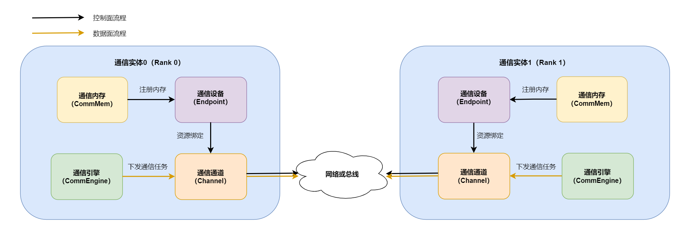

# 通信模型

## 概述

本文介绍通信模型，描述通信任务在不同执行模式下涉及的通信对象、通信资源与数据通路。

**通信实体**是参与通信的基本单元，对应执行通信任务的进程或线程。每个NPU或Host上可运行一个或多个通信实体。

**通信组(Team)**是一组相互协作、需进行集合通信的通信实体集合，定义了通信操作的参与方范围。通信组中的每个通信实体称为一个 **Rank**。

**Rank Id** 是通信组内分配给每个Rank的唯一逻辑标识，取值为非负连续整数。通信算子借助Rank Id识别通信对象，实现消息路由与任务分发。

两个通信实体之间通过以下四个**原语概念**构建通信过程：

| 概念 | 一句话解释 | 主要对应硬件 |
|------|-----------|---------|
| **通信设备(Endpoint)** | 网络通信的逻辑接口，包含协议与地址 | NPU网口 / Host NIC |
| **通信通道(Channel)** | 两端通信设备间的数据通道（含同步Notify） | RoCE QP / UB Jetty连接 |
| **通信内存(CommMem)** | 注册到通信域、可被通信设备(Endpoint)访问的内存段 | NPU HBM / Host内存 |
| **通信引擎(CommEngine)** | 执行通信任务的模块，含Thread与线程调度器，驱动通信硬件搬移数据 | AICPU_TS、CCU、AIV |

通信模型围绕上述四个原语概念构建，通信任务按发起方与执行方的关系分为两种模式：

| 模式 | 任务发起方 | 任务执行方 | 特点 |
| --- | --- | --- | --- |
| 直驱模式 | 通信引擎 | 通信引擎 | 通信引擎直接下发并执行通信任务。 |
| 代理模式 | AI Core客户端 | AICPU_TS或CCU服务端 | 发起方与执行方分离，客户端通过代理介质向服务端提交请求。 |

## 直驱模式

下方直驱通信模型示意图展示了Rank 0与Rank 1两个通信实体之间的通信流程，整体划分为**控制面通信资源创建**和**数据面通信任务执行**两个阶段：黑色实线代表控制面的资源创建与绑定过程，棕色实线代表数据面的任务下发流程。

### 控制面：创建通信资源

1. 创建Endpoint（[`HcommEndpointCreate`](https://www.hiascend.com/document/detail/zh/CANNCommunityEdition/latest/commlib/commopdev/docs/zh/api_ref/comm_opdev/control_plane_api/basic_resource_mgmt/HcommEndpointCreate.md)），指定通信协议、地址与位置信息。
2. 将CommMem注册到Endpoint（[`HcommMemReg`](https://www.hiascend.com/document/detail/zh/CANNCommunityEdition/latest/commlib/commopdev/docs/zh/api_ref/comm_opdev/control_plane_api/basic_resource_mgmt/HcommMemReg.md)），使内存可被远端访问。
3. 基于Endpoint创建Channel（[`HcommChannelCreate`](https://www.hiascend.com/document/detail/zh/CANNCommunityEdition/latest/commlib/commopdev/docs/zh/api_ref/comm_opdev/control_plane_api/basic_resource_mgmt/HcommChannelCreate.md)），传入`EndpointHandle`完成资源绑定；同时本端与远端交换注册内存信息。

### 数据面：通信引擎下发通信任务驱动硬件执行

通信引擎执行用户下发的指令，将要执行的通信任务描述记录在Channel中，包括通信内存地址、通信操作等信息，根据不同协议驱动硬件执行。

## 代理模式

代理模式指当前算子Kernel将通信请求交给独立的数据面单元，由数据面单元根据请求完成本端与对端之间的数据传输。

当前代理模式支持AI Core + AICPU_TS和AI Core + CCU两种组合。在这两种组合中，AI Core作为通信客户端，负责准备和提交通信请求并等待任务完成；AICPU_TS或CCU作为通信服务端，负责接收请求、完成数据传输并反馈完成状态。数据传输由通信服务端执行，不依赖当前算子Kernel持续执行通信操作。

### AICPU_TS服务端

使用AICPU_TS服务端时，AI Core与AICPU_TS通过消息区传递通信请求和任务状态，本端与对端之间的数据通过通信通路传输。

**图1** AICPU_TS代理模式通信模型

通信任务按以下流程执行：

1. AI Core将通信操作、数据位置和数据量等信息写入消息区，并通知AICPU_TS开始处理。
2. AICPU_TS从消息区读取通信请求，根据请求中的通信操作、数据位置和数据量完成本端与对端之间的数据传输。
3. 数据传输完成后，AICPU_TS将完成状态写入消息区。AI Core等待完成状态，然后继续执行后续任务。

### CCU服务端

使用CCU服务端时，AI Core与CCU通过通用寄存器和同步寄存器传递通信请求和任务状态。通用寄存器保存通信操作、数据位置和数据量等信息，同步寄存器记录任务开始和完成状态。

**图2** CCU代理模式通信模型

通信任务按以下流程执行：

1. AI Core将通信请求写入通用寄存器，并通过同步寄存器通知CCU开始处理。
2. CCU从通用寄存器读取通信请求，根据请求中的通信操作、数据位置和数据量完成本端与对端之间的数据传输。
3. 数据传输完成后，CCU更新同步寄存器中的完成状态。AI Core等待完成状态，然后继续执行后续任务。
