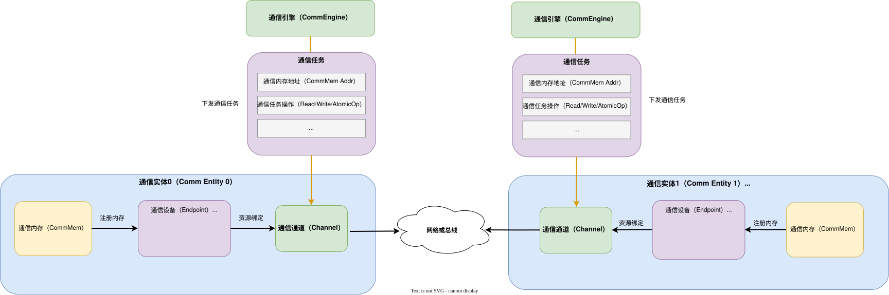
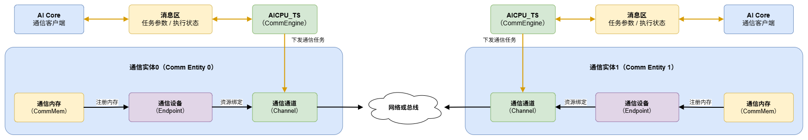
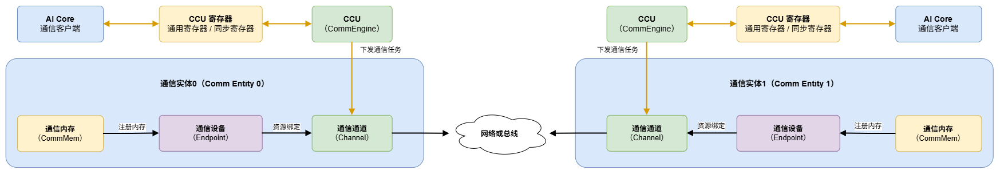

# 1 概述

本文介绍 通信模型，描述通信任务在不同执行模式下涉及的通信对象、通信资源与数据通路。

通信模型围绕 Endpoint、Channel、通信内存（CommMem）、通信引擎（CommEngine）四个原语概念构建，通信任务按发起方与执行方的关系分为两种模式：

| 模式 | 任务发起方 | 任务执行方 | 特点 |
| --- | --- | --- | --- |
| 直驱模式 | 通信引擎 | 通信引擎 | 通信引擎直接下发并执行通信任务 |
| 代理模式 | AI Core 客户端 | AICPU_TS 或 CCU 服务端 | 发起方与执行方分离，客户端通过代理介质向服务端提交请求 |

两种模式均通过 Channel 完成跨 rank 数据搬运。直驱模式下通信引擎直接操作 Channel；代理模式下由服务端操作 Channel，客户端通过代理介质（消息区或 CCU 寄存器）与服务端交互。通信过程均可分为控制面通信资源创建与数据面通信任务执行两个阶段。

本文首先介绍直驱模式下的原语概念与通信过程；随后介绍代理模式下 AICPU_TS 与 CCU 两类服务端的通信模型。通信任务的执行过程详见[执行模型](./exacution_model.md)。

# 2 直驱模式

通信基础是四个**原语概念**——构成直驱模式下所有通信操作的基本元素：

| 概念 | 一句话解释 | 主要对应硬件 |
|------|-----------|---------|
| **通信设备(Endpoint)** | 网络通信的逻辑接口，包含协议与地址 | NPU 网口 / Host NIC |
| **通信通道(Channel)** | 两端通信设备间的数据通道（含同步 Notify） | RoCE QP / UB Jetty 连接 |
| **通信内存(CommMem)** | 注册到通信域、可被通信设备(Endpoint)访问的内存段 | NPU HBM / Host 内存 |
| **通信引擎(CommEngine)** | 执行通信任务的模块，含 Thread 与线程调度器，驱动通信硬件搬移数据 | AICPU_TS、CCU、AIV |

通信过程可分为控制面通信资源创建与数据面通信任务执行两个阶段。在下方直驱通信模型示意图中，黑色实线对应控制面资源创建绑定过程，棕色实线对应数据面任务下发。

## 2.1 控制面：创建通信资源

1. 创建 Endpoint（`HcommEndpointCreate`），指定通信协议、地址与位置信息。
2. 将 CommMem 注册到 Endpoint（`HcommMemReg`），使内存可被远端访问。
3. 基于 Endpoint 创建 Channel（`HcommChannelCreate`），传入 `EndpointHandle` 完成资源绑定；同时本端与远端交换注册内存信息。

## 2.2 数据面：通信引擎下发通信任务驱动硬件执行

通信引擎执行用户下发的指令，将要执行的通信任务描述记录在Channel中，包括通信内存地址、通信操作等信息，根据不同协议驱动硬件执行。

# 3 代理模式

代理模式指当前算子 Kernel 将通信请求交给独立的数据面单元，由数据面单元根据请求完成本端与对端之间的数据传输。

当前代理模式支持 AI Core + AICPU_TS 和 AI Core + CCU 两种组合。在这两种组合中，AI Core 作为通信客户端，负责准备和提交通信请求并等待任务完成；AICPU_TS 或 CCU 作为通信服务端，负责接收请求、完成数据传输并反馈完成状态。数据传输由通信服务端执行，不依赖当前算子 Kernel 持续执行通信操作。

## 3.1 AICPU_TS 服务端

使用 AICPU_TS 服务端时，AI Core 与 AICPU_TS 通过消息区传递通信请求和任务状态，本端与对端之间的数据通过通信通路传输。

**图1** AICPU_TS 代理模式通信模型

通信任务按以下流程执行：

1. AI Core 将通信操作、数据位置和数据量等信息写入消息区，并通知 AICPU_TS 开始处理。
2. AICPU_TS 从消息区读取通信请求，根据请求中的通信操作、数据位置和数据量完成本端与对端之间的数据传输。
3. 数据传输完成后，AICPU_TS 将完成状态写入消息区。AI Core 等待完成状态，然后继续执行后续任务。

## 3.2 CCU 服务端

使用 CCU 服务端时，AI Core 与 CCU 通过通用寄存器和同步寄存器传递通信请求和任务状态。通用寄存器保存通信操作、数据位置和数据量等信息，同步寄存器记录任务开始和完成状态。

**图2** CCU 代理模式通信模型

通信任务按以下流程执行：

1. AI Core 将通信请求写入通用寄存器，并通过同步寄存器通知 CCU 开始处理。
2. CCU 从通用寄存器读取通信请求，根据请求中的通信操作、数据位置和数据量完成本端与对端之间的数据传输。
3. 数据传输完成后，CCU 更新同步寄存器中的完成状态。AI Core 等待完成状态，然后继续执行后续任务。
