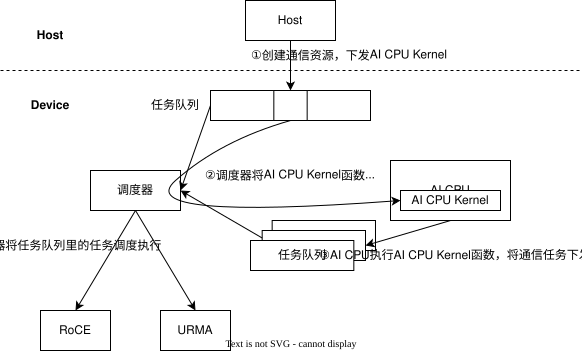
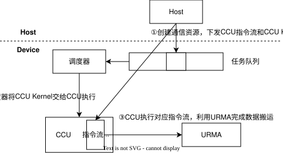
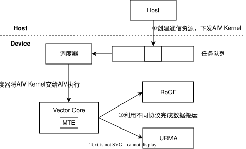
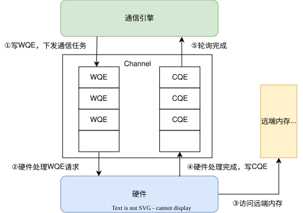
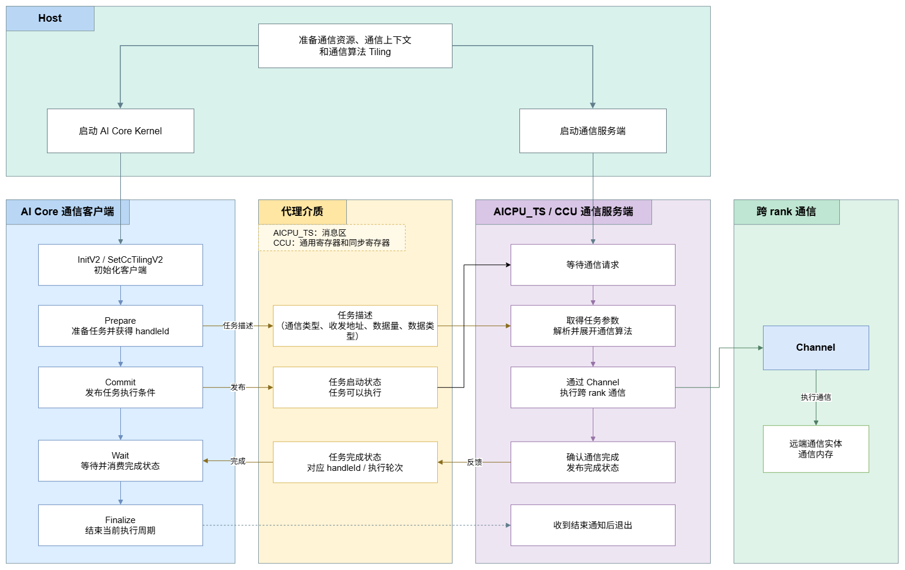

# 概述

本文介绍通信任务在的执行模型，描述通信任务从下发、调度到执行完成的过程，以及在此过程中涉及的执行序与同步机制。

通信任务按发起方与执行方的关系分为两种执行模式：

| 模式 | 任务发起方 | 任务执行方 | 特点 | 适用场景 |
| --- | --- | --- | --- | --- |
| 直驱模式 | 通信引擎 | 通信引擎 | 通信引擎直接下发并执行通信任务，用户通过数据面接口控制任务提交、保序与同步 | 对通信时序和资源占用有精细控制需求的场景 |
| 代理模式 | AI Core 客户端 | AICPU_TS 或 CCU 服务端 | 发起方与执行方分离，客户端描述任务并发布执行条件，服务端解析任务、展开通信算法并通过 Channel 执行 | AI Core Kernel 内融合计算与通信的场景 |

两种模式均建立在[通信模型](./comm_model.md)定义的 Endpoint、Channel、通信内存等概念之上，跨 rank 数据搬运均通过 Channel 完成。直驱模式下通信引擎直接操作 Channel；代理模式下由服务端操作 Channel，客户端通过代理介质（消息区或 CCU 寄存器）与服务端交互。

本文首先介绍直驱模式下 AICPU_TS、CCU、AIV 三类通信引擎的执行机制，以及执行序与同步机制；随后介绍代理模式的执行机制、基于 HCCL 高阶 API 的执行流程，以及 AICPU_TS 与 CCU 两类服务端的执行差异。

# 直驱模式

## 直驱执行机制
通信引擎是通信实体中执行通信任务的核心模块。不同通信引擎直驱的执行模型如下所示。

### 2.1.1 AICPU_TS直驱执行机制

- Task 描述符下发模式

1. Host 提交 AICPU Kernel 至任务队列
2. TS 调度器将 AICPU Kernel 分发至 AICPU 执行
3. AICPU 提交通信 Task 描述符至 TS 队列
4. TS 调度器将通信 Task 分发至执行器

> **要点**: AICPU 通过 Task 描述符下发通信任务，**不占计算核**，适合大数据高带宽场景

#### 2.1.2 CCU直驱执行机制

- 专用加速单元执行模式

CCU（Collective Communication Unit，集合通信加速单元）是位于 IO Die 的专用集合通信协处理器，Thread 抽象为 Mission。

1. Host 将 CCU 指令序列（由 CCU 可识别的指令组成）下发至 CCU 指令空间，同时提交 CCU Kernel 任务至任务队列
2. CCU Kernel 被调度器调度后发送至 CCU 执行
3. CCU 执行对应指令流，并利用 URMA（Unified Remote Memory Access，统一远端内存访问）完成数据搬运

> **要点**: CCU 是专用集合通信加速单元，执行预置的 CCU 指令流（经 URMA 搬运数据）；**高带宽、低时延**且少占计算核与访存带宽，但受片上资源限制、支持的通信域数量有限（Ascend 950PR/950DT）

#### 2.1.3 AIV直驱执行机制

- Vector Core 执行模式

1. Host 提交 AIV Kernel 至任务队列
2. TS 调度器将 AIV Kernel 分发至 Vector Core
3. Vector Core 利用不同协议完成数据搬运

> **要点**: AIV 低延迟但占 Vector 计算核，适合小数据低延迟场景

### 2.2 执行序

事务（Transaction）指用户发起的一次独立内存或消息操作，一系列事务构成事务流，由工作队列（WQ, Work Queue）进行管理。
如下图所示，数据面通过构造 WQE（Work Queue Element，工作队列项）描述单个事务，提交至 Channel 执行；再通过异步轮询完成队列（CQ, Completion Queue）判断事务是否执行完成。WQ 内 WQE 的执行完成状态由 CQ 反馈，CQ 中存储的 CQE（Completion Queue Element，完成队列项）用于记录对应事务的执行结果。

硬件工作队列虽按提交顺序接收 WQE，但受网络路由、DMA 调度、硬件通道竞争等因素影响，事务实际完成顺序可能与提交顺序不一致。当存在一组具有依赖关系的事务时，若缺少保序机制，会出现操作乱序，引发数据错乱、业务逻辑异常等问题，因此需要引入保序机制，约束事务的执行与完成顺序，保障任务按照预期逻辑执行。

#### 2.2.1 RoCE 的执行序

**同一 WQ 内保序**
硬件按“先进先出”（FIFO）顺序从 WQ 中取出 WQE 进行处理，向关联 CQ 写入 CQE 时也遵循 WQE 的入队顺序。即：先入队的 WQE 先完成，对应的 CQE 也先产生。

**不同 WQ 间不保序**
一个 CQ 可能被多个 WQ 共享，此时无法保证来自不同 WQ 的 CQE 的产生顺序。

#### 2.2.2 URMA 的执行序

在 URMA 中，可在 WQE 中指定 Order 或 Fence 标志来约束工作队列内事务的执行顺序。

**Order 标志**，指定以下三种执行序：

| 执行序 | 说明 |
|--------|------|
| No Order | 乱序执行，无任何执行序限制。 |
| Relaxed Order | 弱序事务之间无执行序限制，允许乱序执行；但会约束强序事务——只有排在前面的弱序事务全部完成后，强序事务才能执行。 |
| Strong Order | 保序执行，强序事务必须等待前面所有弱序事务和强序事务都完成后才能执行。 |

**Fence 标志**，指定以下两种执行序：

| 执行序 | 说明 |
|--------|------|
| 强 Fence | 强制事务执行序，不与其他标志共同作用，必须等待前面所有事务执行完成后才能执行。 |
| 弱 Fence | 弱事务执行序，写操作必须等待前面的读操作完成后才能执行，可与 Order 标志配合使用。 |

> **注意**：Order 或 Fence 标志的保序机制只能确保同一 WQ 内 WQE 的执行顺序，不保证跨 WQ 的顺序。

---

### 2.3 同步机制
由于分布式多卡环境，各个 NPU独立运行、执行速度不一致，有的跑很快、有的跑很慢，因此必须施加同步，控制多个执行实体的执行时序，保证通信、数据访问按预期顺序执行。
分布式通信场景的同步主要可分为本端同步、远端同步、屏障同步三种。

#### 2.3.1 本端同步（PollCQ）

在事务流中，若需等待已提交任务执行完成后再执行后续任务，需要用户主动轮询完成队列。本地轮询成功仅表示本端硬件已完成处理，并不代表远端已收到并处理完数据。

#### 2.3.2 远端同步（Signal/Notify）

本端同步只能确认本地硬件完成处理，无法获知远端状态；远端同步必须通过网络交互，由对端反馈状态。若需建立与对端的同步，可借助同步信号实现：对端在完成数据写入后发送同步信号，本端通过轮询该信号来判断远端数据是否已就绪。

#### 2.3.3 屏障同步（Barrier）

指定通信范围内所有进程或线程必须全部抵达同步点后方可继续执行；任意一个未抵达同步点，其余进程或线程均会阻塞等待。

> **注意**：避免滥用 Barrier。频繁的屏障同步会引入较大的全局延迟，易成为性能瓶颈。

# 代理模式

本文介绍代理模式下通信任务从准备、发布到完成的执行过程。在代理模式下，AI Core 作为通信客户端发起通信任务，AICPU_TS 或 CCU 作为通信服务端执行通信任务。本文重点说明通信客户端与通信服务端之间的任务传递、执行和完成关系。

Channel、Endpoint 和通信实体之间的关系参见[代理模式通信模型](./proxy_comm_model.md)，通信地址、访问授权和通信数据的一致性参见[内存模型](./memory_model.md)。

## 模型概述

代理模式将通信任务的发起方与执行方分离。Host 侧在 Kernel 启动前准备通信资源和通信上下文，并启动 AI Core 计算任务和通信服务端。Kernel 执行期间，AI Core 客户端负责描述通信任务、确定任务何时可以执行以及等待任务完成；通信服务端负责取得任务参数、展开通信算法、通过 Channel 执行通信操作并反馈完成状态。

代理执行模型包含以下两类服务端：

- AICPU_TS 服务端：AI Core 与 AICPU_TS 通过消息区传递任务参数、任务发布状态和完成状态。
- CCU 服务端：AI Core 与 CCU 通过 CCU 通用寄存器传递任务参数，通过同步寄存器传递任务启动和完成状态。

基于 HCCL 高阶 API 开发时，上述差异由 API 封装，用户通过相同的 Prepare、`Commit`、`Wait` 和 `Finalize` 接口管理任务。采用自定义客户端与服务端协议时，用户基于 HCOMM 和 CCU 接口自行实现任务格式和同步机制。

## 代理执行机制

**图1** 代理模式执行机制

代理模式包含以下参与方：

| 参与方 | 职责 |
| --- | --- |
| Host | 申请通信资源，准备通信上下文和通信算法 Tiling，启动通信服务端和 AI Core Kernel |
| AI Core 客户端 | 准备通信任务，发布任务执行条件，等待完成状态，并在任务完成后消费结果或复用资源 |
| 代理介质 | 在客户端与服务端之间传递任务参数、任务启动状态和完成状态 |
| AICPU_TS 或 CCU 服务端 | 取得并解析任务参数，展开通信算法，通过 Channel 执行通信任务并发布完成状态 |
| Channel | 确定跨 rank 通信对端、通信路径和远端内存访问关系 |

通信任务按以下流程执行：

1. Host 侧准备通信资源和通信上下文，启动通信服务端和 AI Core Kernel。
2. AI Core 客户端初始化通信对象，设置通信算法 Tiling，并调用集合通信 Prepare 接口准备任务。Prepare 接口记录通信类型、收发地址、数据量和数据类型等任务参数，并返回标识该任务的 `handleId`。
3. AI Core 客户端完成源数据生产以及必要的核间同步后，调用 `Commit` 发布任务执行条件。服务端从该发布点开始执行任务，任务完成状态由客户端通过 `Wait` 确认。
4. 通信服务端取得任务参数和执行条件，根据通信算法使用的 Channel 展开并执行跨 rank 通信操作。
5. 通信任务完成后，服务端通过代理介质发布对应任务的完成状态。
6. AI Core 客户端调用 `Wait` 等待并消费完成状态。当 `Wait` 返回 `HCCL_SUCCESS` 时，客户端可以读取该任务的输出数据；所有使用者完成访问后，可以复用相应的源内存、目的内存和任务资源。
7. AI Core 客户端完成当前执行周期的全部通信任务后，调用 `Finalize` 通知服务端结束当前执行周期。

代理介质承载通信任务参数和执行状态，Channel 对应的通信通路承载跨 rank 用户数据。

## 基于 HCCL 高阶 API 的执行流程

HCCL 高阶 API 为 AI Core 侧的集合通信任务客户端接口，MC2 算子是该接口的典型使用场景。用户在 AI Core Kernel 中管理通信任务的准备、发布和完成时机，服务端任务传递与完成反馈的具体实现由 API 封装。

**图2** HCCL 高阶 API 单任务执行时序

### 初始化

Host 侧在 Kernel 启动前准备通信上下文和通信算法 Tiling。AI Core 客户端在 Kernel 中按以下顺序完成初始化：

1. 创建 `Hccl` 对象，通过 [`HcclServerType`](https://gitcode.com/cann/asc-devkit/blob/master/docs/zh/api/SIMD-API/adv_api/HCCL_communication/HCCL_Kernel/HCCL_template_params.md) 模板参数选择通信服务端，并可通过 `HcclServerConfig` 指定负责向服务端下发任务的 AI Core 类型和 block。
2. 调用 [`InitV2`](https://gitcode.com/cann/asc-devkit/blob/master/docs/zh/api/SIMD-API/adv_api/HCCL_communication/HCCL_Kernel/InitV2.md) 传入通信上下文和初始化 Tiling。
3. 调用 [`SetCcTilingV2`](https://gitcode.com/cann/asc-devkit/blob/master/docs/zh/api/SIMD-API/adv_api/HCCL_communication/HCCL_Kernel/SetCcTilingV2.md) 设置对应集合通信算法的 Tiling 地址。

### 任务准备与发布

用户调用 [`AllGather`](https://gitcode.com/cann/asc-devkit/blob/master/docs/zh/api/SIMD-API/adv_api/HCCL_communication/HCCL_Kernel/AllGather.md)、[`AllReduce`](https://gitcode.com/cann/asc-devkit/blob/master/docs/zh/api/SIMD-API/adv_api/HCCL_communication/HCCL_Kernel/AllReduce.md) 或 [`ReduceScatter`](https://gitcode.com/cann/asc-devkit/blob/master/docs/zh/api/SIMD-API/adv_api/HCCL_communication/HCCL_Kernel/ReduceScatter.md) 等 Prepare 接口准备通信任务。一次 Prepare 调用返回一个 `handleId`，后续通过该 `handleId` 发布和等待对应任务。

Prepare 接口建立任务描述，`Commit` 发布该任务的数据传输执行条件。两类服务端对任务描述的处理方式不同：

- 使用 AICPU_TS 服务端时，Prepare 接口将任务描述写入消息区，AICPU_TS 读取并解析任务，在收到任务发布状态后执行该任务对应的数据传输。
- 使用 CCU 服务端时，Prepare 接口记录任务描述；AI Core 调用 `Commit` 时，客户端选择可用任务槽位，将本轮任务参数写入该槽位对应的通用寄存器，并置起启动同步寄存器。

源数据准备完成后，用户调用 [`Commit`](https://gitcode.com/cann/asc-devkit/blob/master/docs/zh/api/SIMD-API/adv_api/HCCL_communication/HCCL_Kernel/Commit.md) 发布任务。`Commit` 是客户端向服务端发布“任务可以执行”这一条件的接口边界。若 Prepare 接口的模板参数 `commit` 取值为 `true`，Prepare 接口会同时完成任务发布。

调用 `Commit` 前，用户必须保证该任务使用的源数据已经生成完成，并保证负责发布任务的 AI Core 可以观察到源数据已经就绪。如果源数据由其他 AI Core 生成，用户需要根据算子编排先完成计算核之间的数据生产同步，再调用 `Commit`。

`Commit` 返回后，服务端可能正在读取源内存或写入目的内存。在对应的 `Wait` 返回前，该轮通信使用的源内存和目的内存区域必须保持有效，源内存区域保持内容不变，目的内存区域交由通信服务端写入。用户可以同时执行访问其他内存区域的计算。

### 任务完成与结束

用户调用 [`Wait`](https://gitcode.com/cann/asc-devkit/blob/master/docs/zh/api/SIMD-API/adv_api/HCCL_communication/HCCL_Kernel/Wait.md) 阻塞当前 AI Core，直到 `handleId` 对应的一轮通信任务完成。两类服务端向用户提供相同的完成语义：`Wait` 返回表示对应的一轮通信已经完成，底层完成状态由 HCCL 高阶 API 管理。

`Wait` 返回后，当前任务的通信输出可以由客户端读取或用于后续计算。

完成当前执行周期的全部通信任务后，用户调用 [`Finalize`](https://gitcode.com/cann/asc-devkit/blob/master/docs/zh/api/SIMD-API/adv_api/HCCL_communication/HCCL_Kernel/Finalize.md) 通知服务端退出：

- `Finalize<true>` 为默认形式，客户端等待最后一个通信任务完成后结束当前执行周期。
- `Finalize<false>` 只发送结束通知，不等待已下发任务完成，不表示输出数据已经可用，也不保证接口返回时对端已经收到数据。

> [!CAUTION]注意
> - `Finalize` 结束当前 `Hccl` 对象的执行周期。后续通信需要重新创建并初始化 `Hccl` 对象。
> - `Wait` 和具有同步语义的 `Finalize` 确认通信任务完成。AI Core 之间的计算进度和代码执行位置通过核间同步接口确认。
> - 多个 AI Core 参与同一个通信执行周期时，需要在 `Finalize` 前使用 `SyncAll`、`CrossCoreSetFlag` 和 `CrossCoreWaitFlag` 等适当的核间同步接口，确保所有参与核均已完成任务准备、发布和等待，再由服务端结束当前执行周期。

## AICPU_TS 与 CCU 服务端的执行差异

HCCL 高阶 API 向用户提供统一的任务生命周期，两类服务端的差异主要体现在代理介质和内部任务推进方式。

| 执行阶段 | AICPU_TS 服务端 | CCU 服务端 |
| --- | --- | --- |
| 任务描述 | Prepare 将任务参数写入消息区 | Prepare 记录任务参数，`Commit` 时写入任务槽位对应的通用寄存器 |
| 任务发布 | `Commit` 更新消息区中的任务发布状态 | `Commit` 置起任务槽位对应的启动同步寄存器 |
| 服务端执行 | AICPU_TS 读取并解析消息区中的任务，通过 Channel 执行通信 | CCU 指令流等待启动状态，读取通用寄存器并通过 Channel 执行通信 |
| 完成反馈 | AICPU_TS 更新消息区中的完成轮次 | CCU 置起任务槽位对应的完成同步寄存器 |
| 客户端完成接口 | `Wait` 等待对应完成轮次 | `Wait` 等待对应完成轮次 |

HCCL 高阶 API 负责读写消息区或 CCU 寄存器，并管理任务发布和完成协议，用户通过统一接口控制任务生命周期。

## 自定义客户端与服务端协议

采用自定义代理协议时，用户可以基于已有的 HCOMM 和 CCU 接口设计 AI Core 客户端与 AICPU_TS 或 CCU 服务端之间的任务格式和同步机制。暂无实现。
