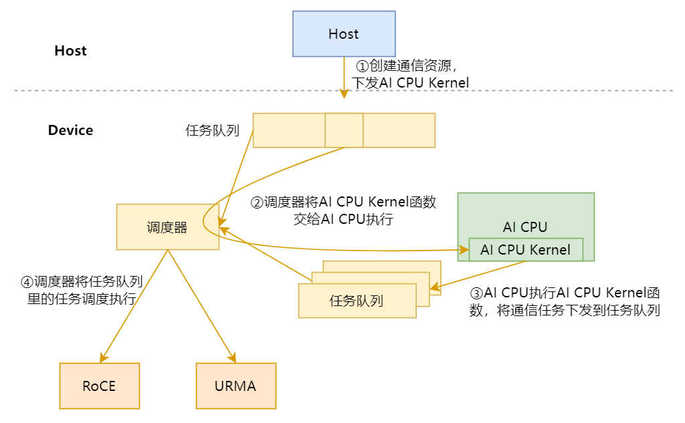
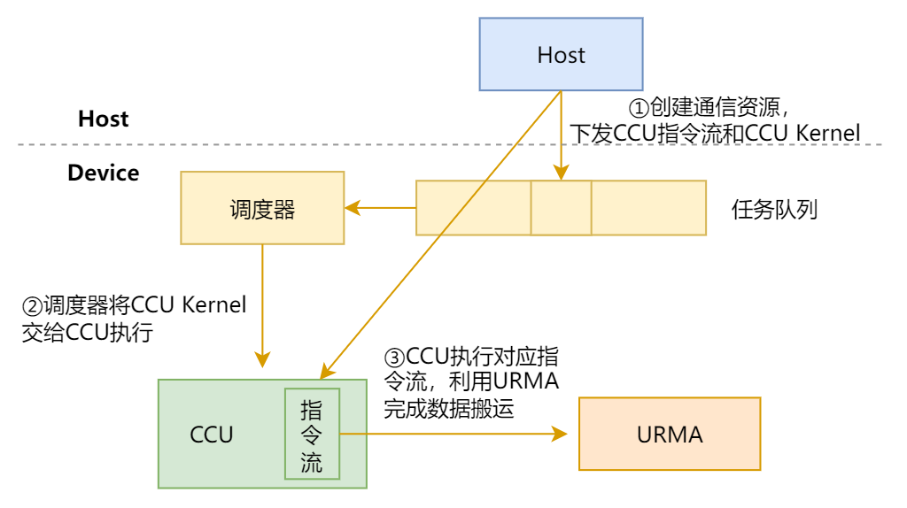
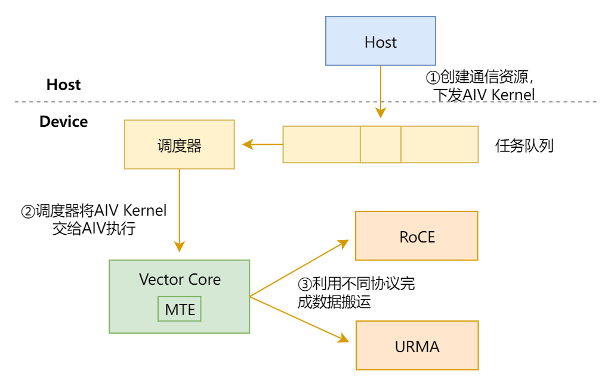
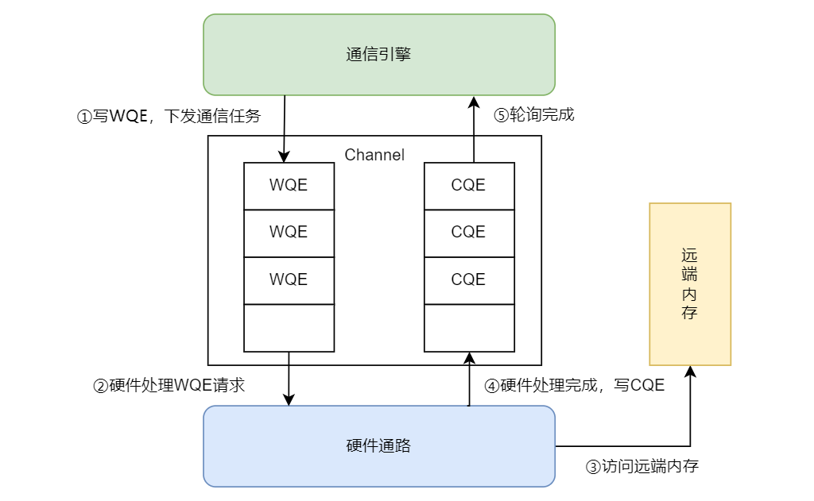
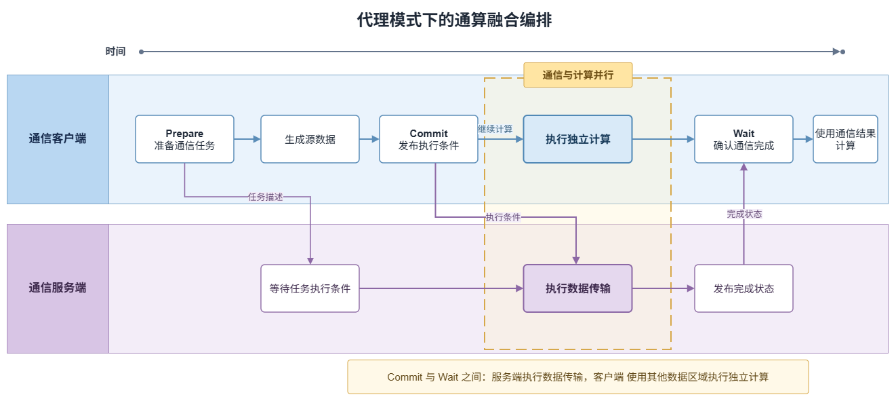

# 执行模型

## 概述

本文介绍通信任务的执行模型，描述通信任务从下发、调度到执行完成的过程，以及在此过程中涉及的执行序与同步机制。

通信任务按发起方与执行方的关系分为两种执行模式：

| 模式 | 任务发起方 | 任务执行方 | 特点 | 适用场景 |
| --- | --- | --- | --- | --- |
| 直驱模式 | 通信引擎 | 通信引擎 | 通信引擎直接下发并执行通信任务，用户通过数据面接口控制任务提交、保序与同步 | 对通信时序和资源占用有精细控制需求的场景 |
| 代理模式 | AI Core 客户端 | AICPU_TS 或 CCU 服务端 | 发起方与执行方分离，客户端描述任务并发布执行条件，服务端解析任务、展开通信算法并通过 Channel 执行 | AI Core Kernel 内融合计算与通信的场景 |

两种模式均建立在[通信模型](./communication_model.md)定义的 Endpoint、Channel、通信内存等概念之上，跨 rank 数据搬运均通过 Channel 完成。直驱模式下通信引擎直接操作 Channel；代理模式下由服务端操作 Channel，客户端通过代理介质（消息区或 CCU 寄存器）与服务端交互。

本文首先介绍直驱模式下 AICPU_TS、CCU、AIV 三类通信引擎的执行机制，以及执行序与同步机制；随后介绍代理模式的执行机制、基于 HCCL 高阶 API 的执行流程，以及 AICPU_TS 与 CCU 两类服务端的执行差异。

## 直驱模式

### 直驱执行机制

通信引擎是通信实体中执行通信任务的核心模块。不同通信引擎直驱的执行模型如下所示。

#### AICPU_TS直驱执行机制

- 任务描述符下发模式



1. Host 提交 AICPU Kernel 至任务队列。
2. 任务调度器将 AICPU Kernel 分发至 AICPU 执行。
3. AICPU 提交通信任务描述符至任务队列。
4. 任务调度器将通信任务分发至执行器。

> **要点**: AICPU 通过任务描述符下发通信任务，**不占计算核**，适合大数据高带宽场景。

#### CCU直驱执行机制

- 专用加速单元执行模式

   CCU（Collective Communication Unit，集合通信加速单元）是位于 IO Die 的专用集合通信协处理器。



1. Host 将 CCU 指令序列（由 CCU 可识别的指令组成）下发至 CCU 指令空间，同时提交 CCU Kernel 任务至任务队列。
2. CCU Kernel 被调度器调度后发送至 CCU 执行。
3. CCU 执行对应指令流，并利用 URMA（Unified Remote Memory Access，统一远端内存访问）完成数据搬运。

> **要点**: CCU 是专用集合通信加速单元，执行预置的 CCU 指令流（经 URMA 搬运数据）；**高带宽、低时延**且少占计算核与访存带宽，但受片上资源限制、支持的通信域数量有限。

#### AIV直驱执行机制

- Vector Core 执行模式



1. Host 提交 AIV Kernel 至任务队列。
2. 任务调度器将 AIV Kernel 分发至 Vector Core。
3. Vector Core 利用不同协议完成数据搬运。

> **要点**: AIV 低延迟但占 Vector 计算核，适合小数据低延迟场景。


### 执行序

事务（Transaction）指用户发起的一次独立内存或消息操作，一系列事务构成事务流，由工作队列（WQ, Work Queue）进行管理。
如下图所示，数据面通过构造 WQE（Work Queue Element，工作队列项）描述单个事务，提交至 Channel 执行；再通过异步轮询完成队列（CQ, Completion Queue）判断事务是否执行完成。WQ 内 WQE 的执行完成状态由 CQ 反馈，CQ 中存储的 CQE（Completion Queue Element，完成队列项）用于记录对应事务的执行结果。



硬件工作队列虽按提交顺序接收 WQE，但受网络路由、DMA 调度、硬件通道竞争等因素影响，事务实际完成顺序可能与提交顺序不一致。当存在一组具有依赖关系的事务时，若缺少保序机制，会出现操作乱序，引发数据错乱、业务逻辑异常等问题，因此需要引入保序机制，约束事务的执行与完成顺序，保障任务按照预期逻辑执行。

#### RoCE 的执行序

**同一 WQ 内保序**

硬件按"先进先出"（FIFO）顺序从 WQ 中取出 WQE 进行处理，向关联 CQ 写入 CQE 时也遵循 WQE 的入队顺序。即：先入队的 WQE 先完成，对应的 CQE 也先产生。

**不同 WQ 间不保序**

一个 CQ 可能被多个 WQ 共享，此时无法保证来自不同 WQ 的 CQE 的产生顺序。

#### URMA 的执行序

在 URMA 中，可在 WQE 中指定 Order 或 Fence 标志来约束工作队列内事务的执行顺序。

**Order 标志**，指定以下三种执行序：

| 执行序 | 说明 |
|--------|------|
| No Order | 乱序执行，无任何执行序限制。 |
| Relaxed Order | 弱序事务之间无执行序限制，允许乱序执行；但会约束强序事务——只有排在前面的弱序事务全部完成后，强序事务才能执行。 |
| Strong Order | 保序执行，强序事务必须等待前面所有弱序事务和强序事务都完成后才能执行。 |

**Fence 标志**，指定以下两种执行序：

| 执行序 | 说明 |
|--------|------|
| 强 Fence | 强制事务执行序，不与其他标志共同作用，必须等待前面所有事务执行完成后才能执行。 |
| 弱 Fence | 弱事务执行序，写操作必须等待前面的读操作完成后才能执行，可与 Order 标志配合使用。 |

> **注意**：
1. Order 或 Fence 标志的保序机制只能确保同一 WQ 内 WQE 的执行顺序，不保证跨 WQ 的顺序。
2. 强保序存在性能开销，会降低通信吞吐、增大延迟。通信算子开发需结合业务需求配置执行序，仅约束有依赖任务的执行顺序，无依赖任务允许乱序执行，减少性能损失。

---

### 同步机制

由于分布式多卡环境，各个 NPU独立运行、执行速度不一致，因此必须施加同步，控制多个执行实体的执行时序，保证通信、数据访问按预期顺序执行。

分布式通信场景的同步主要可分为本端同步、远端同步两种。

#### 本端同步

若需等待已提交通信任务执行完成后再执行后续操作，用户需主动轮询完成队列（CQ），通过读取队列内的完成事件，判断对应通信任务是否执行完成。

以远端读操作为例，本端从对端内存读取数据后，必须通过本端同步确认读取完成，再访问读取结果；否则可能读到未更新完毕的数据，导致后续逻辑出错。

```cpp
// 本端同步：提交远端读事务后轮询 CQ，确认本端读取完成后再使用数据
uint32_t* localBuf;    // 本端接收缓冲区
uint32_t* remoteBuf;   // 远端数据地址
// 从对端remoteBuf读取4字节数据到 localBuf
Read(channel, localBuf, remoteBuf, sizeof(uint32_t));
// 轮询 CQ，阻塞至本端读取完成
PollCQ(channel);
// 此处本端已完成读取，localBuf 中的数据可用
if (*localBuf == expectValue) {
    Process();
}
```

#### 远端同步

本端同步无法获知远端状态，若缺少远端同步，可能出现远端尚未写完数据而本端已读取的情况，导致读到半更新或旧的脏数据，引发业务逻辑异常。远端同步需借助网络交互完成，按同步范围可分为点对点同步与屏障同步。

**点对点同步**

建立点对点的跨Rank同步时，由对端在完成数据写入后发送同步信号，本端通过轮询该信号判断远端数据是否已就绪。

以远端写操作为例，Rank 0 向 Rank 1 写入数据，Rank 1 必须通过点对点同步确认数据已写入完毕，再访问写入结果；否则可能读到半更新的数据，导致后续逻辑出错。

```cpp
// 点对点同步：Rank 0 向 Rank 1 写入数据，Rank 1 等待同步信号后处理数据
uint32_t* localBuf;    // 本端数据缓冲区
uint32_t* remoteBuf;   // 远端数据缓冲区
uint32_t* notifyBuf;   // 同步信号缓冲区
uint32_t notifyVal;    // 预期同步信号值

if (rankId == 0) {
    // Rank 0: 从本端localBuf写4字节数据到远端remoteBuf，并写同步信号值到同步缓冲区
    WriteWithNotify(channel, remoteBuf, localBuf, sizeof(uint32_t), notifyBuf, notifyVal);
} else {
    // Rank 1: 轮询同步信号缓冲区，直至接收到预期同步信号
    While (*notifyBuf != notifyVal) {}
    // 此时Rank 0的数据已完整写入Rank 1的localBuf(对应Rank 0的remoteBuf)，可安全访问
    Process(localBuf);
}
```

**屏障同步**

屏障同步是一种集合式远端同步，要求指定通信范围内所有通信实体全部抵达同步点后方可继续执行；任意一个未抵达，其余通信实体均会阻塞等待。

以集合通信 AlltoAll 操作为例：通信组内所有 Rank 交换数据，交换前需保证各 Rank 的发送缓冲区已完成预处理，交换后需保证所有数据已交换完毕。若缺少前屏障，部分 Rank 可能读到尚未预处理完毕的发送数据；若缺少后屏障，部分 Rank 的后处理可能提前释放或覆盖缓冲区，污染尚未完成交换的数据。

```cpp
// 屏障同步：通信组 team 内所有 Rank 在 AlltoAll 前后施加同步
Team team;
uint32_t* sendBuf; // 发送数据缓冲区
uint32_t* recvBuf; // 接收数据缓冲区

PreProcess(sendBuf);              // 预处理发送数据
Barrier(team);                    // 前屏障：等待所有 Rank 完成预处理，确保发送数据就绪
AlltoAll(team, sendBuf, recvBuf); // 通信组内所有 Rank 交换数据
Barrier(team);                    // 后屏障：等待所有 Rank 完成交换，确保接收数据完整
PostProcess(sendBuf, recvBuf);    // 后处理发送数据和接收数据
```

> **注意**：避免滥用屏障同步。频繁的屏障同步会引入较大的全局延迟，易成为性能瓶颈；若需要使用远端同步，优先采用点对点同步方式。


## 代理模式

代理模式将通信任务的准备与数据传输分离。客户端在当前算子 Kernel 中准备并提交通信请求，服务端在独立执行单元上完成本端与对端之间的数据传输，并向客户端反馈完成状态。

当前客户端支持 AI Core，服务端支持 AICPU_TS 和 CCU。不同服务端使用的代理介质如下：

| 客户端 | 服务端 | 任务参数传递 | 执行条件和完成状态传递 |
| --- | --- | --- | --- |
| AI Core | AICPU_TS | 消息区 | 消息区 |
| AI Core | CCU | CCU 通用寄存器 | CCU 同步寄存器 |

两种服务端遵循相同的任务准备、提交、执行和完成过程。一次代理通信从整体上包括以下过程：

1. **运行准备**：Host 准备通信资源和通信上下文，并启动客户端 Kernel 和服务端。
2. **任务提交**：客户端描述通信操作、数据位置和数据量，在源数据就绪后，通过代理介质向服务端传递任务参数和执行条件。
3. **数据传输与完成**：服务端取得任务参数，展开通信算法，并通过 Channel 完成本端与对端之间的数据传输。通信完成后，服务端将完成状态反馈给客户端。任务提交后，客户端可以继续执行与本轮通信没有数据依赖的计算，并在需要使用通信结果时等待任务完成。

服务端类型以及通信请求的传递方式参见[通信模型](./communication_model.md)。

代理模式的执行机制如下图所示。

**图1** 代理模式执行机制


代理模式包含以下参与方：

| 参与方 | 职责 |
| --- | --- |
| Host | 申请通信资源，准备通信上下文，启动客户端 Kernel 和服务端。 |
| 客户端 | 准备通信任务，发布任务执行条件，等待完成状态，并在任务完成后使用通信结果或复用资源。 |
| 代理介质 | 在客户端与服务端之间传递任务参数、任务执行条件和完成状态。 |
| 服务端 | 取得并解析任务参数，展开通信算法，通过 Channel 执行通信任务并发布完成状态。 |
| Channel | 确定跨 rank 通信对端、通信路径和远端内存访问关系。 |

图中展示了 Host 启动通信任务、客户端提交请求、代理介质传递任务信息和状态，以及服务端完成数据传输并返回完成状态的过程。一次通信任务按照以下阶段执行：

1. **初始化**：Host 准备通信资源，启动客户端 Kernel 和服务端；客户端完成本轮执行所需的初始化。
2. **Prepare**：客户端准备通信请求，记录通信操作、数据位置和数据量等信息，形成任务描述。任务在 Commit 阶段进入可执行状态。
3. **Commit**：客户端完成源数据生产以及必要的核间同步后，提交任务执行条件。Commit 表示源数据已经准备完成，服务端可以开始处理请求。Commit 完成后，客户端继续执行后续计算，通信完成状态由后续的 Wait 确认。
4. **服务端执行**：服务端读取任务描述，根据其中的信息完成本端与对端之间的数据传输。数据传输完成后，服务端向客户端返回完成状态。
5. **Wait**：客户端等待并确认任务完成。Wait 完成表示本轮数据传输已经结束，客户端可以读取通信结果；相关数据使用结束后，源内存和目的内存可以复用。
6. **结束**：当前 Kernel 中的通信任务全部完成后，客户端通知服务端结束本轮执行。

代理模式将通信任务交给独立的服务端执行，使服务端与客户端可以分别执行通信和计算，为通算融合提供了并行执行基础。通算融合算子可以根据数据依赖关系安排通信和计算，一种典型编排如下所示：

**图2** 代理模式下的通算融合编排



在这种编排中，Commit 发布任务执行条件后，服务端开始从源内存读取本轮数据并将通信结果写入目的内存，客户端继续使用其他数据区域执行与本轮通信没有数据依赖的计算。客户端在首次需要使用通信结果的位置执行 Wait；Wait 完成后，目的内存中的通信结果可以用于后续计算。通过将独立计算安排在 Commit 与 Wait 之间，通算融合算子可以重叠通信与计算的执行时间。
