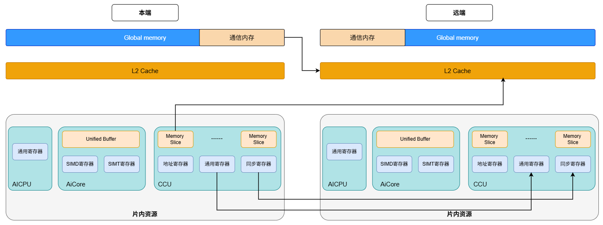
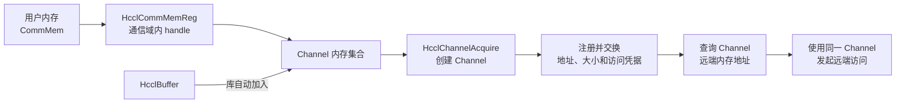
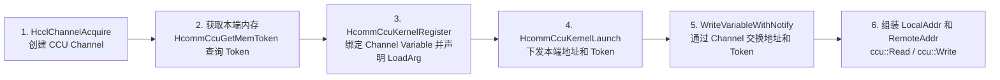

# 内存模型

本文从通信数据的存储层级、执行引擎可使用的通信通路，以及本地与远端地址的可见性三个方面说明通信内存模型。

## 内存层级和通信能力的划分

本文中的 Global Memory（GM）指 Device 上的 全局内存。图中的通信内存是 GM 中已纳入通信域和 Channel 管理、可用作通信操作数的内存范围，不是独立于 GM 的物理内存层级。

图中内存与片内资源按以下层级组织：

| 层级 | 图中对象 | 通信中的作用 |
| --- | --- | --- |
| GM | Global Memory、通信内存 | 保存用户数据、HcclBuffer 和用户注册的 Device 通信内存。普通 GM 可作为本地操作数；纳入对应通信关系的 GM 范围才可作为远端操作数 |
| L2 Cache | 每个 Device 上的 L2 Cache | 缓存当前 Device 的 GM 数据，为该 Device 上的多个执行单元共享 |
| AICPU 片内资源 | 通用寄存器 | 承载 AICPU 执行通信任务时使用的标量数据和控制信息，当前暂不支持 |
| AICore 片内资源 | Unified Buffer（UB）、SIMD 寄存器和 SIMT 寄存器 | UB 用于 AICore 片内数据暂存和通信工作区；SIMD/SIMT 寄存器承载核内计算数据 |
| CCU 片内资源 | Memory Slice、地址寄存器、通用寄存器和同步寄存器 | Memory Slice 用于数据暂存和归约；地址寄存器保存 GM 地址，通用寄存器保存标量数据或 Token，同步寄存器用于通信同步 |

### 通信数据流

图中箭头仅表示通信相关的数据通路，不展开 AICore 内部 UB、SIMD/SIMT 寄存器与计算单元之间的计算数据流。图中只绘制了从本端到远端的方向；从远端到本端的读取或写入通路与之对称，不再重复绘制。

从通信能力看，数据可以在本端通信内存与对端已开放的 GM 范围之间搬运，也可以在执行引擎支持的片内资源与对端已开放的 GM 范围之间搬运。CCU 还支持通过通信关系操作对端的 Memory Slice 或寄存器资源，并可与本 Device 内支持的 AICore 片内资源交换数据。

### GM 与 L2 Cache 的一致性

向远端 GM 写入时，远端目的地址的写事务不经过发起侧的 L2 Cache，而是到达目标 Device 后进入并更新写入侧的 L2 Cache。L2 Cache 是单个 Device 内多核共享的缓存，L2 Cache 与 GM 之间的数据一致性由硬件保证。因此，通信写入到达目标 Device 的 L2 Cache 后，不需要为了将数据从 L2 Cache 手动刷新到 GM 而执行额外操作。但是，缓存一致性不表示通信操作已经完成，也不自动建立生产者与消费者之间的访问顺序。消费端读取数据前，仍需要通过通信完成等待、Notify 或 Fence 等机制确认写入已完成并建立正确的执行顺序。

## 本地与远端内存可见性

本章中，“本地可见”表示当前执行引擎可以将一段本端内存作为本地操作数；“远端可见”表示通信对端已经获得该内存的地址、有效范围和访问凭据，可以通过对应的通信关系发起访问。

本地地址可以被当前引擎访问，不代表该地址已经对远端可见。建立远端可见性还需要确定对端、开放的内存范围并建立访问授权。

### 编程接口对比

| 通信方式 | 用户使用的远端内存表示 | 对端通信关系 | 访问凭据对用户是否可见 |
| --- | --- | --- | --- |
| HComm（AICPU/AICore） | 远端地址 | 显式传入 `ChannelHandle` | 否，由 Channel 保存和使用 |
| CCU | `RemoteAddr`，由地址和 Token 组成 | 显式传入 `ChannelHandle` | 是，以不透明值的形式使用 |
| AIN | `HcommWindowHandle + peer + offset` | 显式传入 Team 和 peer | 否，由 Team 内的通信关系使用 |

HComm 和 CCU 原语都显式传入 Channel。Channel 用于确定通信对端和通信路径，内存地址和访问凭据用于确定可访问的内存范围。因此，一次有效的远端访问必须同时满足以下条件：

- Channel 指向正确的远端 rank。
- 远端操作数使用该 rank 已经开放的地址和范围。
- 访问操作使用与该内存范围匹配的访问凭据。

HComm 将访问凭据封装在 Channel 中，CCU 则要求用户将不透明 Token 与地址组装为 `LocalAddr` 或 `RemoteAddr`。

AIN 不要求用户显式传入 Channel 和远端地址，而是通过 Team、peer、对称窗口和偏移选择远端内存。其底层仍使用 Team 中的通信通道和已建立的访问授权，但这些信息不是 AIN 数据面原语的显式参数。

### 访问凭据：Key 与 Token

Channel 根据通信协议使用对应的内存注册和访问凭据。UB 与 RoCE 协议中的 Key 和 Token 含义不同。

| 通信协议 | 凭据 | 用途 |
| --- | --- | --- |
| UB 类协议 | UB 内存 Key | 用于 Channel 建立阶段将本端注册内存导出给对端，供对端导入并建立远端内存访问关系 |
| UB 类协议 | `tokenId` 和 `tokenValue` | 与注册内存范围绑定，用于后续通信操作的内存访问校验 |
| RoCE 协议 | `lkey` | 本端内存注册 Key，用于授权通信引擎访问本地内存区域 |
| RoCE 协议 | `rkey` | 远端内存访问 Key，交换给对端后，用于授权对端访问对应内存区域 |

不同编程接口对访问凭据的暴露方式不同：HComm 和 AIN 不要求用户在通信原语中传入 Key 或 Token；CCU 则将 UB Token 作为 `LocalAddr` 和 `RemoteAddr` 的组成部分。

### HComm 的本地与远端可见性

AICPU HComm 和 AICore HComm 使用相同的地址与访问授权模型。通信原语传入 Channel、本地地址和远端地址；访问凭据由库在 Channel 创建时准备，无需作为数据面原语参数传入。

#### 本地地址与远端地址

| 地址类型 | 地址来源 | 使用方式 |
| --- | --- | --- |
| 本地地址 | 用户持有的本端内存地址，或 [`HcclGetHcclBuffer`](https://gitcode.com/cann/hcomm/blob/master/docs/zh/api_ref/comm_opdev/control_plane_api/comms_domain_resource_mgmt/HcclGetHcclBuffer.md) 返回的地址 | 作为当前执行引擎的本地访问地址，或作为 HComm 原语的本地操作数 |
| 远端地址 | [`HcclChannelGetHcclBuffer`](https://gitcode.com/cann/hcomm/blob/master/docs/zh/api_ref/comm_opdev/control_plane_api/comms_domain_resource_mgmt/HcclChannelGetHcclBuffer.md) 或 [`HcclChannelGetRemoteMems`](https://gitcode.com/cann/hcomm/blob/master/docs/zh/api_ref/comm_opdev/control_plane_api/comms_domain_resource_mgmt/HcclChannelGetRemoteMems.md) 返回的对端地址 | 只能作为返回该地址的 Channel 上 Read、Write 等通信原语的远端操作数 |

远端地址表示对端地址空间中的位置，不是本端可直接解引用的普通地址，也不能用于本地拷贝。同一数值的地址不代表同一段内存，远端地址的含义由远端 rank、Channel 和已交换的内存范围共同确定。

#### 远端可见性的建立

HComm 可以使用 HcclBuffer 或用户注册通信内存，两类内存的用户可见流程如下。

| 内存类型 | 本端准备 | 加入 Channel | 获取远端地址 |
| --- | --- | --- | --- |
| HcclBuffer | 通过 [`HcclGetHcclBuffer`](https://gitcode.com/cann/hcomm/blob/master/docs/zh/api_ref/comm_opdev/control_plane_api/comms_domain_resource_mgmt/HcclGetHcclBuffer.md) 获取 | Channel 创建时由库自动加入 | 通过 [`HcclChannelGetHcclBuffer`](https://gitcode.com/cann/hcomm/blob/master/docs/zh/api_ref/comm_opdev/control_plane_api/comms_domain_resource_mgmt/HcclChannelGetHcclBuffer.md) 获取 |
| 用户注册通信内存 | 使用 [`CommMem`](https://gitcode.com/cann/hcomm/blob/master/docs/zh/api_ref/comm_opdev/datatype_definition/CommMem.md) 描述内存，通过 [`HcclCommMemReg`](https://gitcode.com/cann/hcomm/blob/master/docs/zh/api_ref/comm_opdev/control_plane_api/comms_domain_resource_mgmt/HcclCommMemReg.md) 获取 `HcclMemHandle` | 将 handle 填入 `HcclChannelDesc.memHandles/memHandleNum` | 通过 [`HcclChannelGetRemoteMems`](https://gitcode.com/cann/hcomm/blob/master/docs/zh/api_ref/comm_opdev/control_plane_api/comms_domain_resource_mgmt/HcclChannelGetRemoteMems.md) 获取 |

远端可见性的建立流程如下图所示。

远端可见性按以下流程建立：

1. 用户准备本端通信内存。如果使用用户内存，调用 `HcclCommMemReg` 将内存与通信域绑定。
2. 用户调用 [`HcclChannelAcquire`](https://gitcode.com/cann/hcomm/blob/master/docs/zh/api_ref/comm_opdev/control_plane_api/comms_domain_resource_mgmt/HcclChannelAcquire.md) 创建 Channel。HcclBuffer 由库自动加入；用户注册通信内存由用户选择并加入该 Channel。
3. Channel 建立过程中，库完成通信内存的注册，并与对端交换地址、大小和访问凭据。
4. Channel 创建完成后，用户查询该 Channel 的远端内存地址。
5. 数据面原语使用同一 Channel 与查询得到的远端地址发起访问。

HComm 使用的访问凭据在 Channel 建立时由库生成、交换和保存，原语通过 `ChannelHandle` 使用对应凭据。

### CCU 的本地与远端可见性

CCU 与 HComm 一样，通过 Channel 确定通信对端。不同的是，CCU 访问 GM 时使用“地址 + Token”共同描述操作数。CCU 将内存地址和与该内存范围匹配的 Token 一起暴露给用户，由用户在 CCU Kernel 中组装为 `LocalAddr` 或 `RemoteAddr`。
地址用于定位内存，Token 是内存访问凭据，用于授权指定内存范围。

CCU 使用 UB 类协议。`tokenId` 和 `tokenValue` 不作为公开数据结构提供给用户；Host 侧获得的是一个 `uint64_t` 类型的完整 Token 值，CCU Kernel 中以 `ccu::Variable` 承载该值。用户只需将 Token 作为整体传递和使用，不解析或修改其内容。

#### `LocalAddr` 与 `RemoteAddr`

| 对象 | 组成 | 使用方式 |
| --- | --- | --- |
| [`LocalAddr`](https://gitcode.com/cann/hcomm/blob/master/docs/zh/api_ref/comm_opdev/data_plane_api/ccu/resource_allocation_operation/LocalAddr.md) | 本端地址 + 与该内存范围匹配的 Token | 用于本地内存操作，或作为跨 rank 通信的本地操作数 |
| [`RemoteAddr`](https://gitcode.com/cann/hcomm/blob/master/docs/zh/api_ref/comm_opdev/data_plane_api/ccu/resource_allocation_operation/RemoteAddr.md) | 对端地址 + 与该内存范围匹配的 Token | 配合对应 Channel，作为跨 rank 通信的远端操作数 |

`RemoteAddr` 不是本端可直接解引用的地址，不能用于 CCU 本地 `Load`、`Store` 或 `LocalCopy` 等操作。

#### 远端可见性的建立

远端可见性的建立流程如下图所示。

远端可见性按以下流程建立：

1. Host 侧通过 [`HcclChannelAcquire`](https://gitcode.com/cann/hcomm/blob/master/docs/zh/api_ref/comm_opdev/control_plane_api/comms_domain_resource_mgmt/HcclChannelAcquire.md) 创建或获取指向目标 rank 的 CCU Channel，获得后续跨 rank 访问使用的 `ChannelHandle`。
2. Host 侧获取通信操作使用的本端内存地址和大小。如果使用 HcclBuffer，调用 [`HcclGetHcclBuffer`](https://gitcode.com/cann/hcomm/blob/master/docs/zh/api_ref/comm_opdev/control_plane_api/comms_domain_resource_mgmt/HcclGetHcclBuffer.md) 获取；如果使用用户内存，该内存必须是已注册的合法内存。Host 侧调用 [`HcommCcuGetMemToken`](https://gitcode.com/cann/hcomm/blob/master/docs/zh/api_ref/comm_opdev/control_plane_api/ccu_kernel_launch_execution/HcommCcuGetMemToken.md) 为每个操作使用的本端内存范围获取 `uint64_t tokenInfo`。
3. Host 侧调用 [`HcommCcuKernelRegister`](https://gitcode.com/cann/hcomm/blob/master/docs/zh/api_ref/comm_opdev/control_plane_api/ccu_kernel_launch_execution/HcommCcuKernelRegister.md) 注册 Kernel，通过 `kernelArgs` 传入 `ChannelHandle` 等算法编排信息。Kernel 通过 [`ccu::GetResByChannel`](https://gitcode.com/cann/hcomm/blob/master/docs/zh/api_ref/comm_opdev/data_plane_api/ccu/resource_allocation_operation/GetResByChannel.md) 获取用于接收对端地址和 Token 的 Channel Variable，并通过 [`ccu::LoadArg`](https://gitcode.com/cann/hcomm/blob/master/docs/zh/api_ref/comm_opdev/data_plane_api/ccu/arg_load_store/LoadArg.md) 声明 `taskArgs` 与本端地址、Token 对应 `ccu::Variable` 的映射关系。
4. Host 侧调用 [`HcommCcuKernelLaunch`](https://gitcode.com/cann/hcomm/blob/master/docs/zh/api_ref/comm_opdev/control_plane_api/ccu_kernel_launch_execution/HcommCcuKernelLaunch.md)，通过 `taskArgs` 传入本端地址和 Token。Kernel 执行前，这些参数按 `ccu::LoadArg` 声明加载到对应的 `ccu::Variable`。
5. Kernel 调用 [`ccu::WriteVariableWithNotify`](https://gitcode.com/cann/hcomm/blob/master/docs/zh/api_ref/comm_opdev/data_plane_api/ccu/synchronization/WriteVariableWithNotify.md) 通过对应 Channel 将需要对端访问的本端地址和 Token 写入对端约定的 Channel Variable 槽位，并同时向对端发送 Notify。通信双方调用 [`ccu::NotifyWait`](https://gitcode.com/cann/hcomm/blob/master/docs/zh/api_ref/comm_opdev/data_plane_api/ccu/synchronization/NotifyWait.md) 等待交换完成后，第 3 步中获取的 Channel Variable 中即为对端地址和对端 Token。
6. Kernel 将本端地址和本端 Token 组装为 `LocalAddr`，将对端地址和对端 Token 组装为 `RemoteAddr`。然后调用 [`ccu::Read`](https://gitcode.com/cann/hcomm/blob/master/docs/zh/api_ref/comm_opdev/data_plane_api/ccu/data_movement/Read.md) 或 [`ccu::Write`](https://gitcode.com/cann/hcomm/blob/master/docs/zh/api_ref/comm_opdev/data_plane_api/ccu/data_movement/Write.md) 等跨 rank 读写原语，同时传入对应的 `ChannelHandle`、`LocalAddr` 和 `RemoteAddr`。

### AIN 的本地与远端可见性

AIN 使用 Team 选择通信对端，使用对称窗口和偏移定位本地或远端内存。用户在 AIN 原语中传入 `HcommTeamHandle`、`peer`、`HcommWindowHandle` 和 `offset`，无需直接传入 `ChannelHandle`、远端裸地址或 Token。

#### Team

Team 是一组参与通信的 member 及其通信关系的集合。Team 记录当前 rank 在 Team 中的 member ID（`selfMemberId`），以及通往其他 member 的 Channel。

`peer` 是目标 member 在 Team 中的 member ID，取值范围为 `[0, memberNum)`。Team 内 member ID 与通信域全局 rank ID 的映射由 Team 决定，二者不一定相同。AIN 根据 `peer` 同时选择目标 member 的窗口内存和通往该 member 的 Channel。

#### 对称窗口

对称窗口将 Team 中各 member 的一段对应内存组织为同一个逻辑内存对象。`offset` 是相对某个 member 窗口起始地址的字节偏移，不是绝对地址。AIN 使用窗口、member 和 `offset` 按以下规则计算地址：

  - 本端地址为当前 member 的窗口起始地址加本地 `offset`。
  - 远端地址为 `peer` 对应 member 的窗口起始地址加远端 `offset`。

`Put` 和 `Get` 均传入 `srcOffset` 和 `dstOffset`，源偏移和目的偏移独立计算，不要求取值相同。
`peer` 和 `offset` 只负责选择通信对象和定位窗口内存，不会建立新的访问授权或扩大已有的可见范围。有效的远端访问要求 `peer` 属于当前 Team、`offset + bytes` 完整落在对应窗口成员的内存范围内，且当前 Team 中通往该 member 的 Channel 已具备对该内存范围的访问授权。

AIN 原语按照以下方式使用窗口：

| AIN 原语 | 本地内存 | 远端内存 |
| --- | --- | --- |
| `Put` | `srcWin` 中本地 member 的 `srcOffset` | `dstWin` 中 peer member 的 `dstOffset` |
| `PutValue` | 不使用本地源窗口 | `dstWin` 中 peer member 的 `dstOffset` |
| `Get` | `dstWin` 中本地 member 的 `dstOffset` | `srcWin` 中 peer member 的 `srcOffset` |

例如，`Put(team, peer, dstWin, 128, srcWin, 64, 256, ...)` 从本地 member 的 `srcWin` 起始地址偏移 64 字节处读取 256 字节，写入 `peer` 对应 member 的 `dstWin` 起始地址偏移 128 字节处。

#### 远端可见性的建立

当前 AIN 公开接口提供的是 Kernel 侧数据面原语，不包含 Team 和对称窗口的创建或注册接口。`HcommTeamHandle` 和 `HcommWindowHandle` 由上层通信框架在 Kernel 启动前准备，并通过 Kernel 入参提供给用户。用户不应自行构造或解析这两种句柄。

远端可见性的建立流程如下图所示。

远端可见性按以下流程建立：

1. 上层通信框架确定 Team 的 member 集合、当前 rank 的 member ID 以及 member 与 rank 的映射关系。
2. 上层通信框架收集各 member 的对应内存地址和大小，为需要通信的 peer 建立 HComm Channel，并完成窗口内存的注册、远端地址和大小交换以及访问授权建立。上层通信框架将 member 到 Channel 的对应关系记录在 Team 中，将各 member 的对应内存记录在同一个逻辑对称窗口中。窗口本身只记录内存范围，不创建访问授权。
3. 上层通信框架生成 `HcommTeamHandle` 和 `HcommWindowHandle`。Host 侧启动 AICore Kernel 时，通过 Kernel 入参将这两种句柄传入 Kernel。
4. Kernel 侧创建 `AscendC::Ain` 对象，调用 `Ain::Put`、`Ain::Get` 或 `Ain::PutValue` 时传入 Team、`peer`、窗口句柄和偏移。
5. AIN 根据 Team 和 `peer` 选择目标 member 及对应 Channel，根据 Window、当前 member 或 `peer` 与 `offset` 定位本地和远端内存，并使用该 Channel 已建立的访问授权发起远端访问。

