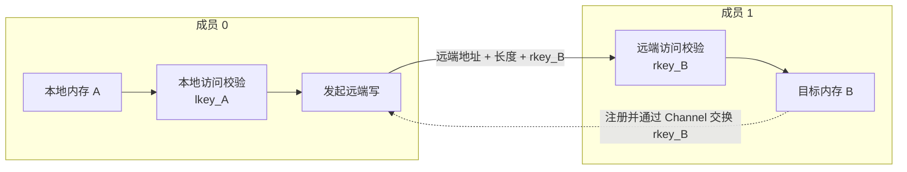
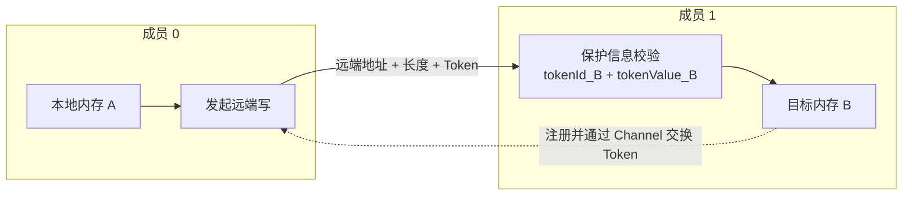

# 内存模型

通信会涉及多种内存资源。下表汇总了通信编程中常见内存的物理位置及其跨端访问能力。

| 内存资源 | 物理位置 | 本端跨端写入 | 被对端访问 |
| --- | --- | --- | --- |
| Global Memory（GM） | Device 全局内存 | 通信内存可以作为本端源或目的 | 通信内存向对端开放后，可以作为对端访问的源或目的 |
| L2 Cache | Device 核外共享缓存 | 不作为独立的通信操作数 | 不支持直接访问 |
| Unified Buffer（UB） | AI Core 片内 | 不作为跨端传输的源或目的 | 不支持直接访问 |
| AI Core 寄存器 | AI Core 片内 | 不作为跨端传输的源或目的 | 不支持直接访问 |
| Memory Slice | CCU 片内 | 可以作为本端 CCU 的源或目的 | 不支持直接访问 |
| CCU 寄存器 | CCU 片内 | 可以通过 Channel 向对端写入标量或发送同步通知 | 可以接收对端通过 Channel 写入的标量或同步通知，但不能通过普通地址直接访问 |

- GM 按主要用途可以分为计算内存和通信内存。计算内存保存计算的输入、输出和中间结果；通信内存承载通信的源数据和目的数据。
- 通信内存是指 GM 中能够作为通信操作数的内存范围，可以向对端开放，不是独立的物理内存层级。
- L2 Cache 位于 GM 与执行单元的访存路径之间，为本 Device 上的多个核提供共享的数据缓存。
- UB 位于 AI Core 内部，用于在 GM 与计算单元之间搬运和暂存数据；AI Core 发起通信时，UB 还用于临时准备通信任务。AI Core 寄存器用于保存核内计算数据。
- Memory Slice 位于 CCU 内部，用于暂存、中转和归约通信数据。
- CCU 寄存器位于 CCU 内部，用于保存访问地址、标量、同步状态。

内存层级和通信能力如下图所示：


图中从上到下展示 GM、L2 Cache 和执行引擎片内资源之间的层级关系，本端和远端分别拥有各自的 GM、Cache 和片内资源。
图中箭头仅表示通信相关的数据通路，不展开 AICore 内部 UB、SIMD/SIMT 寄存器与计算单元之间的计算数据流。图中只绘制了从本端到远端的方向；从远端到本端的读取或写入通路与之对称。


## 通信内存

通信内存可以向对端开放，具有远端可见性。远端可见即代表通信对端已经获得目标内存的地址范围和访问授权，并且能够通过已建立的通信关系访问该段内存。通信内存有两种来源：

- HcclBuffer 由通信域的控制面申请和管理。建立 Channel 时，控制面自动将 HcclBuffer 作为该 Channel 可用的通信内存进行准备。
- 用户注册通信内存由用户申请 GM，再通过控制面登记到通信域。建立 Channel 时，用户选择需要与该 Channel 关联的内存。

两类通信内存均位于 GM，区别主要在于底层内存由谁申请和管理，以及用户是否需要参与控制面的准备过程。不同通信引擎对两类通信内存的支持范围可能不同，具体约束由相应的编程接口说明。

下文先说明一块 GM 内存具备远端可见性的步骤，并说明访问凭据如何保护远端访问，最后说明程序如何组织通信内存并描述目标成员和内存位置。


### 本地与远端可见性

要使一段 GM 具备远端可见性，控制面需要注册该内存，确定哪些 Channel 可以使用该内存，并在通信双方之间交换内存描述和访问凭据。

内存注册用于向通信协议声明一段可以参与通信的有效内存范围。注册时，控制面记录内存的地址、大小和有效范围，并按照通信协议为该范围建立访问凭据。建立 Channel 时，控制面选择该 Channel 可使用的注册内存，并将远端访问所需的信息交换给对端。

对于 HcclBuffer，上述准备由控制面自动完成；对于用户提供的 GM，用户需要先将其注册为通信内存，并在建立 Channel 时选择需要向对端开放的内存。

从准备本端 GM 到建立远端可见性，可以概括为以下过程：

```text
准备本端内存
    -> 注册内存并为有效范围建立访问保护信息
    -> 建立 Channel 并选择该 Channel 可使用的注册内存
    -> 向对端交换内存描述和访问凭据
    -> 建立远端可见性
```

具备远端可见性后，访问还需要满足以下条件：

- 远端地址表示对端地址空间中的位置，不能作为本端普通地址直接解引用。
- 访问的地址和长度必须完整落在对端开放的内存范围内。
- 目标地址、Channel 或访问凭据中的任一项不匹配，都不能形成有效的远端访问。


### 访问凭据

内存注册会为注册范围建立协议相关的访问凭据。建立 Channel 时，目标内存的地址范围及远端访问所需的凭据会交换给对端。发起通信时，通信任务携带目标地址、访问长度和相应凭据，由通信硬件校验本次操作是否落在凭据所保护的内存范围内。

访问凭据不能脱离注册内存和 Channel 单独使用。只有目标地址、访问长度、Channel 和访问凭据相互匹配，才能形成有效的远端访问。不同通信协议采用的凭据机制如下。

| 协议类型 | 访问凭据 | 校验机制 |
| --- | --- | --- |
| RoCE | `lkey`、`rkey` | `lkey` 用于校验通信引擎对本地操作数的访问，`rkey` 用于校验对目标端注册内存的远端访问 |
| UB 类协议 | `tokenId`、`tokenValue` | `tokenId` 用于定位目标内存对应的保护信息，`tokenValue` 用于校验访问权限；二者需要与目标地址范围匹配 |

#### RoCE 访问过程

以成员 0 将本端内存 A 写入成员 1 的内存 B 为例：

1. 成员 0 注册内存 A，获得用于本地访问的 `lkey_A`。
2. 成员 1 注册内存 B，获得 `lkey_B` 和 `rkey_B`。其中，`rkey_B` 用于授权对内存 B 的远端访问。
3. 建立 Channel 时，成员 1 将内存 B 的地址范围和 `rkey_B` 交换给成员 0。
4. 成员 0 发起写操作时，通信任务携带内存 A 的本地地址和 `lkey_A`，以及内存 B 的远端地址和 `rkey_B`。
5. 发起端通信硬件使用 `lkey_A` 校验对内存 A 的读取，目标端通信硬件使用 `rkey_B` 校验对内存 B 的写入。两项校验通过后，数据才能写入内存 B。



一次 RoCE 远端写同时使用发起端本地源内存的 `lkey` 和目标端目的内存的 `rkey`。二者分别保护本地操作数和远端操作数，并与各自的注册内存范围匹配。

#### UB 类协议访问过程

仍以成员 0 将本端内存 A 写入成员 1 的内存 B 为例：

1. 成员 1 注册内存 B，为该内存范围建立 `tokenId_B` 和 `tokenValue_B`。
2. 建立 Channel 时，成员 1 将内存 B 的地址范围、`tokenId_B` 和 `tokenValue_B` 交换给成员 0。
3. 成员 0 发起写操作时，通信任务携带内存 B 的远端地址、访问长度、`tokenId_B` 和 `tokenValue_B`。
4. 目标端通信硬件根据 `tokenId_B` 定位内存 B 对应的保护信息，使用 `tokenValue_B` 校验访问权限，并检查远端地址和访问长度是否落在该保护信息对应的注册范围内。
5. Token 和目标内存范围均匹配后，数据才能写入内存 B。



完成内存注册、Channel 建立和访问凭据交换后，通信双方已经具备访问对端通信内存的基础条件。上层编程模型还需要向用户提供一种方式，用于指定目标成员及其内存位置。

### 通信内存的组织

根据通信内存向用户呈现的组织方式，可以分为非对称内存和对称内存。两者改变的是用户如何指定目标成员和内存位置，不会改变底层对 Channel、实际 GM 地址范围和访问凭据的要求。

#### 非对称内存

非对称内存是指各成员的通信内存彼此独立，不同成员的内存大小、布局和实际地址可以不同，不要求形成统一的逻辑布局。采用非对称内存时，各通信成员分别申请和管理自己的通信内存。

发起通信时，用户通过 Channel 指定目标成员，并分别提供本地地址和远端地址。底层根据 Channel 确定通信对端，根据地址和长度匹配已注册的内存范围及其访问凭据。

```text
Channel + 本地地址 + 远端地址 + 访问长度
        -> 确定目标成员
        -> 匹配本地和远端注册内存范围
        -> 匹配访问凭据并传输数据
```

HComm 和 CCU 是采用这类内存组织的示例；具体通信对象和地址参数可参考接口章节说明。

##### HComm 示例

以下示例场景用于进一步说明非对称内存。

假设成员 0 要把本端通信内存 A 中偏移 64 字节开始的 256 字节数据，写入成员 1 的通信内存 B 中偏移 128 字节的位置。A 和 B 由两个成员分别准备，其起始地址和内存布局不需要相同。建立 Channel 时，成员 1 的内存 B 及其远端访问凭据已经交换给成员 0。HComm伪码实现：

```cpp
// localMemA：本端通信内存 A 的起始地址
// remoteMemB：成员 1 的通信内存 B 的远端起始地址
auto localAddr = localMemA + 64;
auto remoteAddr = remoteMemB + 128;

hcomm.WriteNbi(
    channelToMember1, // 通往成员 1 的 Channel
    remoteAddr,       // 远端目的位置
    localAddr,        // 本地源位置
    256);             // 传输长度，单位为字节
```

调用中的 `channelToMember1`、`localAddr` 和 `remoteAddr` 分别确定目标成员、本地源位置和远端目的位置。HComm 随后完成以下处理：

1. 根据 Channel 确定目标成员 1。
2. 确认本地和远端访问范围分别落在已注册的内存 A 和内存 B 中。
3. 根据实际通信协议匹配本次访问所需的 `lkey`、`rkey` 或 Token，并发起数据传输。

用户在每次操作中显式提供 Channel、本地地址和远端地址；访问凭据可以由 HComm 根据地址范围在 Channel 内部匹配，不需要出现在接口调用中。

#### 对称内存
以下示例场景用于进一步说明对称内存。

采用对称内存时，各通信成员分别提供一段本端通信内存，这些对应内存被共同组织为一个逻辑窗口。用户通过目标成员、窗口和窗口内偏移描述访问位置，不需要在每次操作中直接提供底层 Channel 和远端实际地址。

```text
目标成员 + 逻辑窗口 + 窗口内偏移 + 访问长度
        -> 选择该成员对应的 Channel 和窗口内存
        -> 将窗口内偏移解析为实际 GM 地址
        -> 匹配访问凭据并传输数据
```

对称性体现在各成员使用一致的逻辑组织和偏移规则，不表示各成员的实际地址必须相同。窗口中的每个成员仍然对应一段实际 GM，底层仍需选择目标成员对应的 Channel，将偏移换算为实际地址，并使用与该内存范围匹配的访问凭据。

AIN 是采用这类编程形态的示例，编程算子实现由相应接口和算子实现章节说明。

##### AIN 示例

假设一个逻辑窗口由成员 0、成员 1 和成员 2 各自提供的一段通信内存组成，这三段内存的实际起始地址可以不同。成员 0 要把本地窗口中偏移 64 字节开始的 256 字节数据写入成员 2 的窗口偏移 128 字节处。Ain伪码实现：

```cpp
ain.Put(
    communicationGroup, // 当前通信组
    2,                  // 目标成员
    window, 128,        // 目的窗口及窗口内偏移
    window, 64,         // 源窗口及窗口内偏移
    256,                // 传输长度，单位为字节
    /* 其余参数省略 */);
```

与 HComm 示例相比，这次调用没有直接给出通往成员 2 的 Channel 和远端 GM 地址，而是通过目标成员、窗口和窗口内偏移表达访问位置。AIN 随后完成以下处理：

1. 根据目标成员 2 选择通往该成员的 Channel。
2. 使用窗口中记录的成员 0 实际内存起始地址加源偏移，得到本地 GM 地址。
3. 使用窗口中记录的成员 2 实际内存起始地址加目的偏移，得到远端 GM 地址。
4. 通过底层 HComm 匹配相应的访问凭据并发起写操作。

用户面对的是统一的逻辑窗口、目标成员和窗口内偏移。底层 Channel、实际 GM 地址和访问凭据由 AIN 及其复用的 HComm 完成解析和匹配。

两种组织方式的差异如下表所示。

| 组织方式 | 用户看到的内存组织 | 每次操作提供的信息 | 底层处理方式 |
| --- | --- | --- | --- |
| 非对称内存 | 各成员分别管理通信内存 | Channel、本地地址和远端地址 | 根据 Channel 确定目标成员，根据地址范围匹配注册内存和访问凭据 |
| 对称内存 | 各成员的对应内存组成逻辑窗口 | 目标成员、窗口和窗口内偏移 | 选择目标成员对应的 Channel，将偏移解析为实际地址并匹配访问凭据 |

## L2 Cache

L2 Cache 是本 Device 上多个核共享的核外缓存，用于缓存本 Device 的 GM 数据。L2 Cache 与 GM 之间的数据一致性由硬件维护，因此用户不需要手动在 L2 Cache 与 GM 之间同步同一份数据。

L2 Cache 与 GM 一致不表示所有缓存层级都不存在旧副本。同一份 GM 数据还可能缓存在各核独立的 DCache 或 SIMT DCache 中：生产者的新数据可能尚未完成写回，消费者也可能命中本核保留的旧数据。使用通信数据时，需要根据实际的生产和消费路径处理相应的私有缓存。

缓存一致性、通信完成和执行顺序是三个不同的问题：

- 缓存一致性用于保证访问方观察到正确的数据副本。
- 通信完成用于确认本轮数据传输已经达到相应的完成条件。
- 执行顺序用于保证生产者和消费者按照预期先后访问数据。

因此，不能根据 L2 Cache 与 GM 之间的一致性推断通信已经完成，也不能据此省略完成等待或执行同步。具体缓存操作、完成等待和同步方法由缓存一致性、同步模型及算子实现章节说明。

## Unified Buffer

Unified Buffer（UB）是 AI Core 内部的高速存储资源，用于在 Kernel 执行期间暂存计算数据。与 GM 相比，UB 更靠近计算单元，容量更小，生命周期和可见范围也受到 Kernel 及核内执行方式的约束。

典型计算过程中，数据先在 GM 与 UB 之间搬运，再由 AI Core 对 UB 中的数据进行计算。

AI Core 作为通信发起方时，UB 还为通信任务提供临时存储空间。当前 AI Core HComm 的 RoCE 和 UBC_CTP/URMA 通信路径均使用这段空间；AIN 在解析通信成员和对称内存的窗口地址后复用 AI Core HComm，因此也使用相同的 UB 临时空间。

这段 UB 主要用于组装通信任务描述符，其中记录操作类型、源地址、目的地址、数据长度和访问凭据等控制信息。描述符组装完成后被提交到通信队列，由通信硬件根据描述符访问 GM 中的通信数据；等待任务完成时，完成队列信息也会临时读入 UB 进行解析。因此，这里的 UB 承载的是通信控制信息，不是向对端开放的用户通信数据。

UB 不是本文定义的通信内存。AI Core 可以访问本核 UB，不表示该 UB 已经对其他 Device 可见；远端通信仍以已经完成内存注册并与通信关系关联的 GM 范围为主要对象。UB 的申请方式、容量划分以及通信临时空间的具体配置由对应的 AI Core 编程接口和算子实现章节说明。

## Memory Slice

Memory Slice 是 CCU 内部的高速存储资源，用于暂存、中转和归约通信数据。CCU 可以在本端 GM 与本端 Memory Slice 之间搬运数据，也可以使用本端 Memory Slice 参与本端与对端 GM 之间的数据传输。

Memory Slice 属于 CCU 的本地片内资源，不是 GM，也不是对端可以通过普通远端地址直接访问的通信内存。对端通信数据最终仍通过已开放的 GM 范围和相应访问授权进行定位。Memory Slice 的分配、数据搬运和归约方式由 CCU 算子实现章节说明。

## AI Core 寄存器

AI Core 的 SIMD 和 SIMT 寄存器位于 AI Core 核内，是最靠近计算单元的存储资源，用于保存核内计算数据。两类寄存器分别服务于对应的执行方式，其作用域、生命周期和使用方法由相应编程模型决定。

AI Core 寄存器不属于普通通信内存，不能像 GM 一样作为跨端通信的远端地址使用。SIMD 和 SIMT 寄存器的分配和使用方式由对应的 AI Core 编程章节说明。

## CCU 寄存器

CCU 寄存器位于 CCU 硬件内部，包括地址寄存器、通用寄存器和同步寄存器。地址寄存器用于保存访问地址，通用寄存器用于保存标量或访问元数据，同步寄存器用于保存和传递同步状态。

CCU 寄存器可以参与 CCU 内部的数据准备和专用同步过程，部分寄存器资源还支持专用的跨端操作，但不能由此将所有 CCU 寄存器理解为可通过普通地址访问的通信内存。具体资源申请、数据装载和同步操作由 CCU 编程接口及算子实现章节说明。

图中 AICPU 通用寄存器同样表示 AICPU 内部资源，本文不将其作为用户可编程通信内存展开。
