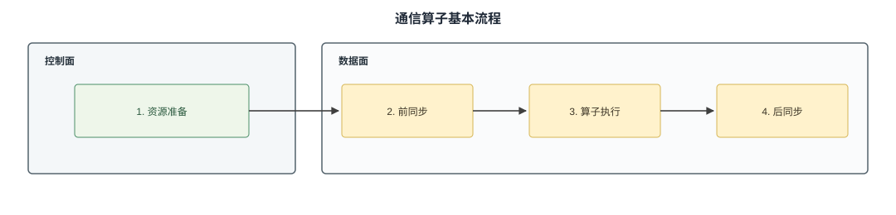

# 概述

当模型规模超出单张NPU的算力与内存容量时，计算任务必须拆分到多张卡、多台服务器上协同完成，卡间数据交换随之进入端到端性能的关键路径。过去这部分能力由集合通信库封闭提供，开发者只能在既有的通信算子中选择；而通算融合、自定义通信算法、小数据低时延等场景，要求开发者能够自己编排数据搬运的时机、路径与粒度。为此CANN开放了通信算子的开发能力：由**HCOMM**完成通信资源的建立与管理，由**ASC-COMM**在Kernel中发起实际的数据搬运。

与单卡算子只需关注本地计算不同，通信算子要跨越多个rank协同工作：数据从哪个单元发起、经由哪条通路到达对端、对端内存以什么方式被访问、任务由谁推进并判定完成，这些都需要开发者显式决策。本章遵循「职责划分—硬件能力—方式选择—通信语义」的递进逻辑逐层展开。作为全章起点，本节先明确通信由哪些部件分工完成，再给出所有通信算子共同遵循的编程范式，为后续各节建立统一的框架。

## 数据面与控制面的划分

通信并非一次接口调用即可完成，而是由Host与Device协同完成的过程：通信关系的建立与资源管理开销较大且可复用，适合放在算子执行前统一完成；真正的数据搬运则必须在Device侧的Kernel中就地发起。据此通信过程可以划分为控制面和数据面，二者的具体分工如表1所示。

**表1** 控制面与数据面的职责划分

| 层面 | 通信基础库 | 运行位置或执行单元 | 主要职责 |
| --- | --- | --- | --- |
| 控制面 | HCOMM | Host CPU | 提供拓扑信息查询与通信资源管理功能。|
| 数据面 | ASC-COMM | Device侧Kernel，由AICPU与STARS、AIV或CCU等通信引擎执行 | 使用控制面准备的资源，实现数据面的数据读写、同步等操作。 |

控制面的开销集中在通信域建链、内存注册等一次性准备阶段，数据面则位于每轮迭代的关键路径上。因此两者的优化目标不同：控制面关注资源的正确性与复用，数据面关注单次搬运的时延与带宽。

## Ascend C通信编程范式

按照上述职责划分，通信算子的基本流程可以概括为资源准备、前同步、算子执行和后同步，如图1所示。

1. **资源准备**：根据通信域、拓扑结构和可用链路建立通信关系，并准备数据传输、内存访问和同步所需的资源。
2. **前同步**：搬运数据前，相关rank交换必要信息或确认就绪状态，确保能够正确访问对端数据。
3. **算子执行**：通信引擎按照通信算法完成数据搬运，并根据算子需要执行本地处理或归约等计算。
4. **后同步**：数据搬运完成后，相关rank确认本轮通信结束，再读取结果或复用相关内存。

其中资源准备由控制面在算子执行前完成，其余三步发生在Device侧的Kernel中。两轮同步之所以必要，是因为rank之间彼此独立执行，只有确认对端已就绪才能安全访问其内存，也只有确认搬运结束才能读取结果或复用内存。无论采用哪种通信引擎或协议，通信算子都遵循这一范式，差异仅体现在各步骤由哪个单元执行、使用哪套接口。

## 小结

本节明确了两点：通信由控制面与数据面分工完成，以及通信算子统一遵循“资源准备—前同步—算子执行—后同步”的流程骨架。范式只描述流程，每一步的具体实现取决于硬件提供的能力，后续各节据此逐层细化。

[抽象硬件架构](./abstract_hardware_architecture.md)介绍参与通信的硬件组件与数据通路：AIV、AICPU、CCU三类通信引擎是发起通信的单元，选择哪一类直接决定通信占用何种资源、静态开销与可达带宽；通信引擎执行器承载对远端内存的访问，决定访问是同步还是异步；组网架构则决定卡间互联的范围与带宽上限。明确硬件能力边界后，[通信方式分类及选择](./communication_mode_selection.md)从驱动模式、通信引擎和通信协议三个维度对比各类通信方式：驱动模式区分通信由当前Kernel直接发起还是交由独立单元推进，通信协议决定数据在链路上的传输规范与适用的组网形态，三者的组合共同决定通信的时延、带宽与资源占用。

选定通信方式之后，还需要理解通信的具体语义。通信模型说明通信引擎与通信协议如何组合成一条可用的通信通路，明确各种组合的能力与约束；内存模型说明通信涉及的内存类型与地址空间，以及本端内存如何被对端访问，这是保证数据正确可见的前提；执行模型说明通信任务如何下发、由谁推进以及如何判定完成，直接对应范式中前同步、算子执行与后同步三步的实现方式。由于直驱模式与代理模式在通路构造、内存使用和任务推进上均有差异，这三节都会分别展开说明。

## 支持的产品型号

Ascend 950PR/Ascend 950DT
