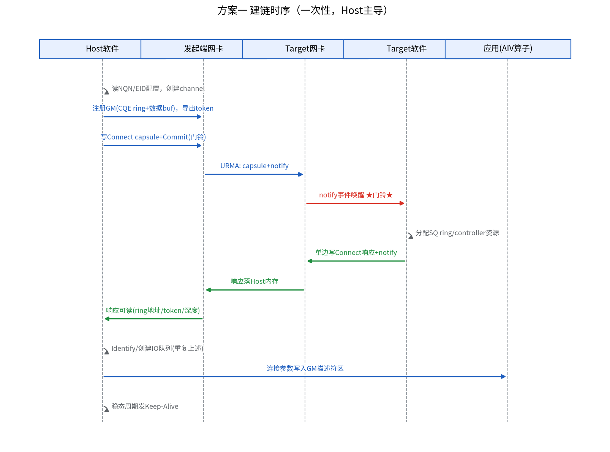
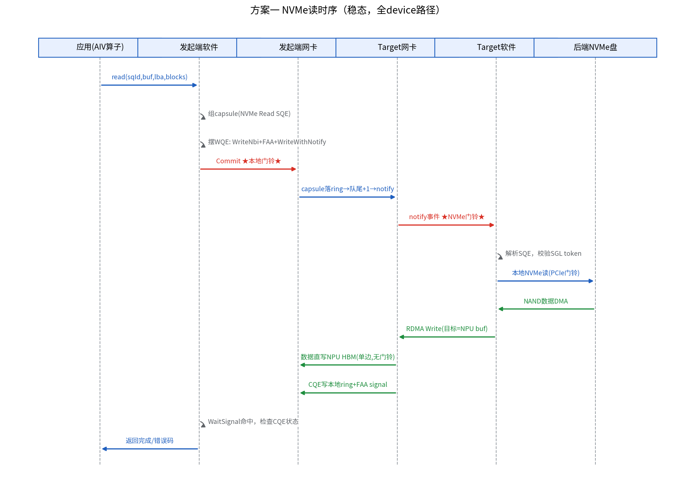
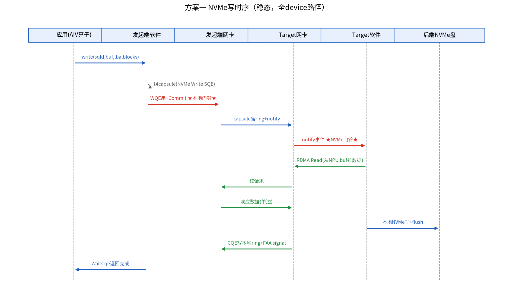
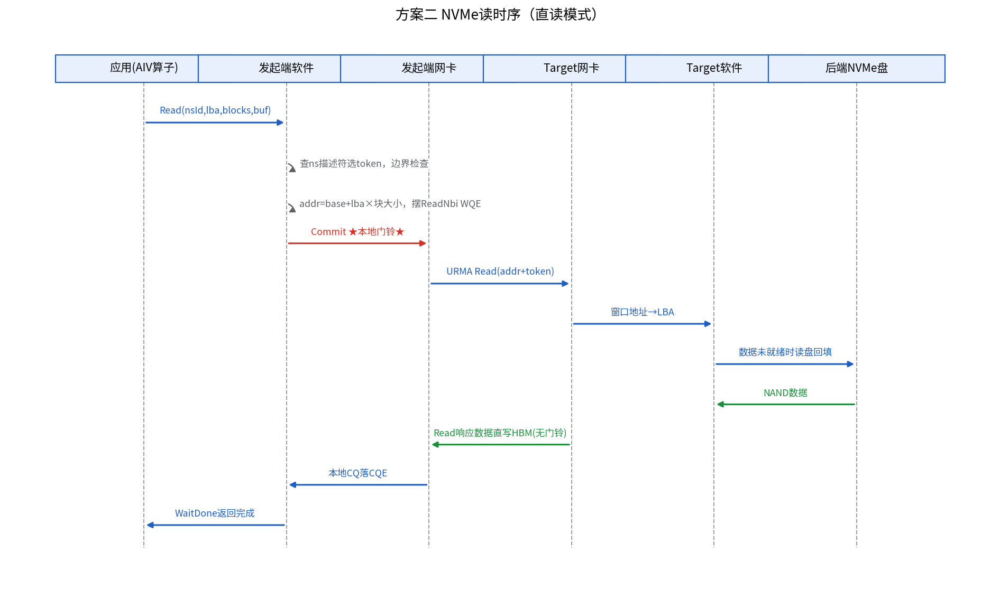
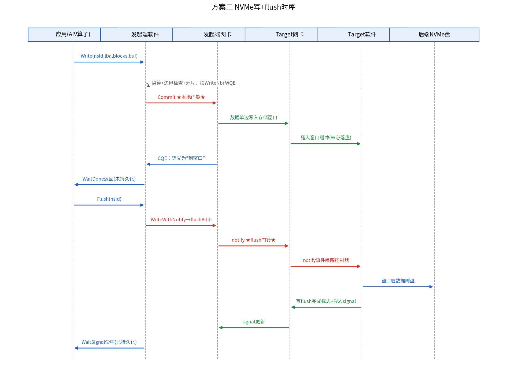
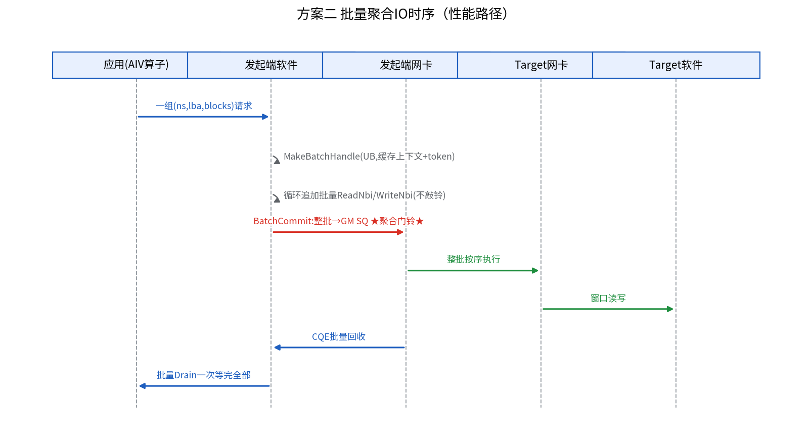

# NPU 直访远端 NVMe 盘设计方案（设计草案）

> **文档性质**：本文是设计提案（design proposal），描述的能力**均未在本仓实现**，不代表当前已支持的功能。
> 文中涉及的现有接口以 `include/aicore/hcomm/hcomm.h` 和 `include/aicore/ain/ain.h` 为准。
>
> **适用范围**：Ascend 950PR / Ascend 950DT，网络走 URMA（UBC_CTP）。
>
> **版本**：v2（补充详细设计与端到端时序图）。

## 1. 背景

目标场景：NPU（AIV 直驱）绕过 Host CPU，直接访问远端 NVMe 盘，数据路径为 NVMe over Fabric，网络部分走 URMA。

经过分析，当前仓的能力与该场景之间存在两个结构性缺口：

1. **WQE 语义缺口**：设备侧 URMA 路径只暴露单边操作（`ReadNbi`、`WriteNbi`、`WriteWithNotifyNbi`、`AtomicFAA`/`AtomicCAS`、`WriteReduceNbi`，见 `src/aicore/hcomm/impl/platform_v310/hcomm_aiv_urma_def.h`），没有 SEND/RECV 双边语义。而 NVMe-oF 的命令 capsule 投递本质上是双边操作（target 需要预投命令槽位、被到达事件唤醒、做流控）。
2. **对端模型缺口**：Host 侧建链流程（`src/aicore/hcomm/host/hcomm_host_impl.h`）假设对端是暴露 HBM 对称窗口的 NPU（EID + 对端 MR 表），不是 NVMe-oF target 或存储端点。

此外，URMA/UB 不在标准 NVMe-oF 传输绑定（RDMA/TCP/FC）之列，因此无论哪套方案，对端都不能是"任意标准 NVMe-oF target"，必须有存储侧的配合。

两套方案的共同基础：**数据面**复用本仓现有的单边引擎（`WriteNbi`/`ReadNbi`/`MakeBatchHandle`/`BatchCommit`/`Drain`），引擎和 WQE 格式代码均不需要修改；差别在**控制面**（命令投递）由谁、以什么语义完成。

## 2. 共同前置验证（两方案实施前都必须确认）

| 编号 | 待确认项 | 影响的方案 | 确认途径 |
| --- | --- | --- | --- |
| V1 | 950 UB 网卡的 AIV 直驱模式是否支持 SEND/RECV WQE | 方案一 | 网卡固件/驱动文档或海思接口人 |
| V2 | 目标存储是否支持 URMA/UB 网络接入 | 两者 | 存储产品规格 |
| V3 | target 侧配合能力：方案一需可运行定制 capsule 协议栈；方案二需内存窗口能力，并确认窗口读语义（直读/预取）、flush 机制、单 MR 覆盖上限 | 两者 | 存储产品接口人 |

---

## 3. 方案一：双边语义——NPU 作为 NVMe-oF initiator

### 3.1 设计目标

NPU 侧实现 NVMe-oF initiator 能力：connect / admin 队列 / IO 队列 / completion 全流程，命令 capsule 通过双边语义投递，target 侧消费 capsule 并终结到后端 NVMe 盘。

由于 URMA 无标准 binding 且设备侧大概率没有 SEND/RECV WQE（待 V1 确认），本方案采用**单边原语模拟双边语义**的私有 binding。设计分工：**管理面慢路径在 Host，IO 热路径全在 device**——稳态读写不经过 Host CPU。管理面留 Host 的原因：connect/identify/keep-alive 是低频操作，下放无性能收益；字符串解析、鉴权、定时器、错误恢复状态机不适合 AscendC 受限编程环境；且建链所需的 aclrt/驱动调用本身就是 Host 能力。

### 3.2 总体分层

```text
┌────────────────────────── NPU ──────────────────────────┐
│ 算子 Kernel                                               │
│   └── NVMe IO 热路径（新增，device 侧）                     │
│         └── capsule 传输层（新增，device 侧）               │
│               └── AscendC::Hcomm<COMM_PROTOCOL_UBC_CTP>  │  ← 现有，不改动
├────────────────────────── Host ─────────────────────────┤
│ NVMe-oF initiator 协议状态机（新增，用户态）                 │
│   connect / identify / 建 IO 队列 / keep-alive / 重连      │
│ 存储端点建链适配（新增）+ 本地 MR key 导出（新增接口）        │
└──────────────────────────────────────────────────────────┘
              │  URMA（capsule 环 + notify + 单边数据面）
┌────────────────────────── 存储侧 ────────────────────────┐
│ 定制 target 栈（跑在存储侧 CPU/DPU）：消费 capsule，        │
│ 执行 NVMe 命令，单边 RDMA 搬数据，写回 completion           │
└──────────────────────────────────────────────────────────┘
```

### 3.3 详细设计

#### 3.3.1 capsule 传输层（核心新代码，device 侧）

用单边原语复刻双边语义，每个 IO 队列对应一对 ring：

**SQ ring（命令通道，位于 target 侧注册内存）**

- 布局：定长槽位数组（每槽 64B，放一个 NVMe 命令 capsule）+ 队头指针（target 持有）+ 队尾指针（initiator 持有）；
- 提交一条命令的三步 WQE 串：
  1. `WriteNbi`：capsule 写入 `ringBase + tail × 64` 槽位；
  2. `AtomicFAA`：远端队尾指针 +1；
  3. `WriteWithNotifyNbi`：向 target 约定的 notify 地址写入新队尾值——**这就是 NVMe 语义上的"敲门铃"**，target 侧 URMA 队列产生通知事件，唤醒 target 协议栈（替代标准 binding 里 SEND 的到达事件）；
- 顺序保证：使用默认 `URMA_DEFAULT_CFG`（强序 + fence + CQE），保证 capsule 先于 notify 对 target 可见；
- 门铃聚合：连续多条命令可只在最后一条敲 notify（batch-last 模式），notify 值携带最终队尾。

**CQE ring（完成通道，位于 NPU 本地 GM）**

- target 处理完命令后：`WriteNbi` 将 16B CQE 写入本地 CQE ring，再对本地 signal 地址做 `AtomicFAA`（或 notify）；
- NPU 侧用 `Ain` 的 `WaitSignal` 阻塞等待，或轮询标志位。

**信用流控**

- target 预投的槽位数即队列深度；initiator 本地维护 `outstanding = 已提交 - 已完成`，达到深度则停止提交，等 CQE 回收槽位；
- 槽位复用由 CQE 天然驱动（一条 CQE 释放一个槽位），无需额外 head 指针同步。

**多队列**：多个 SQ/CQ ring 对对应多条 channel，按 AIV 核数映射，继承 NVMe 的无锁并行模型；批量场景可用 `MakeBatchHandle` 把多 slot 的 capsule 写入聚合为一次 `BatchCommit`。

代码落点：新增 `src/aicore/nvmeof/` 目录，内部复用 `Hcomm<COMM_PROTOCOL_UBC_CTP>` 的 WQE 提交与完成机制，`src/aicore/hcomm/` 下代码不改动。

#### 3.3.2 device 侧 IO 热路径接口草案

```cpp
// 位于 src/aicore/nvmeof/，供算子 Kernel 调用
class NvmeofDeviceIo {
public:
    // 提交 NVMe 读/写，返回 tag；组 capsule、写 ring、FAA 队尾、按需 notify
    template <bool commit = true>
    __aicore__ inline int32_t SubmitRead(uint32_t sqId, GM_ADDR buf, uint64_t lba, uint32_t blocks, uint16_t& tag);
    template <bool commit = true>
    __aicore__ inline int32_t SubmitWrite(uint32_t sqId, GM_ADDR buf, uint64_t lba, uint32_t blocks, uint16_t& tag);
    // 显式敲门铃（配合 commit=false 聚合）
    __aicore__ inline int32_t Doorbell(uint32_t sqId);
    // 等待 tag 对应的 CQE；内部 WaitSignal + CQE 状态检查
    __aicore__ inline int32_t WaitCqe(uint32_t sqId, uint16_t tag, uint32_t timeoutCycles);
};
```

#### 3.3.3 initiator 协议状态机（新增，Host 用户态）

- discovery 裁剪为静态配置（NQN、EID 表）；
- connect / identify / 创建 IO 队列：通过 capsule 通道发 fabric 命令（此时 SQ ring 复用 admin ring）；
- keep-alive：KATO/2 周期发心跳 capsule；超时进入重连流程；
- 不使用内核 nvme-fabrics（只认标准 RDMA/TCP binding，接不了 URMA），自研用户态模块；
- 连接参数（ring 地址、深度、token）协商完成后写入 GM 描述符区，device 侧热路径只读。

#### 3.3.4 Host 建链扩展与 MR 导出（改造现有代码）

- 现有 `src/aicore/hcomm/host/hcomm_host_impl.h` 面向 NPU 对端（从 ChannelEntity 解析对端 MR 表），需新增"存储端点"通道类型：
  - 存储侧 EID 交换与建链（依赖底层 hcomm/URMA 驱动允许连非 NPU 端点）；
  - target 侧 SQ ring 地址与 token 导入（connect 响应带回）；
  - **本地 GM buffer 的 tokenId/tokenValue 导出接口**（target 执行 RDMA Read/Write 搬数据需要；现有代码只缓存远端 token，无本地 key 导出能力）。

#### 3.3.5 可靠性

- 命令级超时：device 侧用 cycle counter 计时，超时的 tag 上报；
- 升级路径：device 置 GM 错误标志 → Host 执行 abort / 队列冻结 / 连接重建；
- NVMe 状态码到块层错误码的映射。

### 3.4 端到端时序

参与者说明（时序图各列）：

| 缩写 | 含义 |
| --- | --- |
| App | NPU 侧算子 Kernel（AIV） |
| InitSW | 发起端软件：device 侧 IO 热路径 / Host 侧协议状态机 |
| InitNIC | 发起端（NPU）URMA 网卡 |
| TgtNIC | target 侧 URMA 网卡 |
| TgtSW | target 侧驱动/软件（定制 NVMe-oF target 栈，存储侧 CPU/DPU） |
| Disk | 后端 NVMe 盘 |

#### 3.4.1 建链时序（一次性，Host 主导）



> 时序图颜色约定：红色 = 门铃/notify，绿色 = 数据传输，蓝色 = 请求/命令，灰色 = 本地动作。

```text
1.  InitSW(Host) → InitSW(Host) : 静态读取 NQN/EID 配置，创建到存储端点的 channel
2.  InitSW(Host) → InitNIC      : 注册本地 GM（CQE ring + 数据 buffer），导出 token
3.  InitSW(Host) → capsule 通道 : 发 Connect 命令（经 admin ring，写 capsule + notify）
4.  InitNIC      → TgtNIC       : URMA 写 capsule + notify
5.  TgtNIC       → TgtSW        : 通知事件唤醒，解析 Connect
6.  TgtSW        → TgtSW        : 分配 SQ ring 槽位、controller 资源
7.  TgtSW        → InitSW(Host) : 单边写 Connect 响应（ring 地址/token/队列深度）+ notify
8.  InitSW(Host) → TgtSW        : Identify / 创建 IO 队列（重复步骤 3-7）
9.  InitSW(Host) → App          : 连接参数写入 GM 描述符区，device 热路径就绪
10. （稳态）InitSW(Host) 周期性发 Keep-Alive capsule
```

#### 3.4.2 NVMe 读时序（稳态，全 device 路径）



```text
1.  App    → InitSW(dev) : read(sqId, buf, lba, blocks)
2.  InitSW → InitSW      : 组 64B capsule（NVMe Read SQE，SGL = 本地 buf 地址 + token）
3.  InitSW → InitSW      : 摆三条 WQE：WriteNbi(capsule→SQ ring 槽位)
4.                         AtomicFAA(target 队尾 +1)
5.                         WriteWithNotifyNbi(新队尾→notifyAddr)
6.  InitSW → InitNIC     : Commit，敲本地门铃，WQE 串提交硬件
7.  InitNIC → TgtNIC     : 链路上按序执行：capsule 落 ring → 队尾更新 → notify
8.  TgtNIC → TgtSW       : notify 事件落到 target CQ ★NVMe 语义的门铃★
9.  TgtSW  → TgtSW       : 解析 SQE，校验 SGL token，分配命令资源
10. TgtSW  → Disk        : 本地 NVMe 读（PCIe doorbell）
11. Disk   → TgtSW       : NAND 数据 DMA 到 target 缓冲
12. TgtSW  → TgtNIC      : 发 RDMA Write（目标 = capsule 中 SGL 的 NPU buf）
13. TgtNIC → InitNIC     : 数据单边写入 NPU HBM ★数据面，无任何门铃★
14. TgtSW  → TgtNIC      : WriteNbi(CQE→NPU 本地 CQE ring) + FAA(本地 signal)
15. TgtNIC → InitNIC     : CQE + signal 更新
16. App    → InitSW(dev) : WaitCqe → WaitSignal 命中，检查 CQE 状态
17. InitSW → App         : 返回完成/错误码
```

#### 3.4.3 NVMe 写时序（要点差异）



```text
1-8. 同读时序，capsule 为 NVMe Write SQE；小写请求可走 inline（数据随 capsule 携带）
9.   TgtSW 解析 SQE 后发 RDMA Read，主动从 NPU buf 拉取数据（单边）
10.  TgtSW → Disk : 本地 NVMe 写 + flush
11-17. CQE 回写与等待同读时序
```

### 3.5 约束与依赖

- 依赖 V1：若无 SEND/RECV WQE，按本文模拟方案实施，控制面每条命令多一次 notify 往返；
- 依赖 V3：target 必须是定制栈或华为 UB 存储提供的等价 capsule 通道，**无法对接标准内核 nvmet / SPDK target**；
- 本方案是私有 binding，不构成标准 NVMe-oF 互通能力；
- 开发量评估：capsule 层 + device IO 热路径（千行级）+ Host 协议状态机与建链适配（大头）+ target 侧配合开发。

---

## 4. 方案二：单边语义——target 侧终结 NVMe（盘即内存）

### 4.1 设计目标

不在 fabric 上跑 NVMe-oF 协议。存储系统（UB 盘框/带控制器的存储）内部完成 LBA→NAND 翻译，通过 URMA 把容量暴露为可注册的远端内存窗口；NPU 纯单边读写，NVMe 协议在存储盒子内部终结。

### 4.2 总体分层

```text
┌────────────────────────── NPU ──────────────────────────┐
│ 算子 Kernel                                               │
│   └── 块访问助手（新增，device 侧）：地址换算 + 边界检查      │
│         └── AscendC::Hcomm<COMM_PROTOCOL_UBC_CTP>        │  ← 现有，不改动
├────────────────────────── Host ─────────────────────────┤
│ 存储端点建链适配（新增）：EID + 存储 MR token 表导入         │
│ namespace 描述符管理（新增，下发到 GM）                       │
└──────────────────────────────────────────────────────────┘
              │  URMA 纯单边 Read/Write（+ flush notify）
┌────────────────────────── 存储侧 ────────────────────────┐
│ 存储控制器：内存窗口 ↔ LBA 映射 ↔ NVMe 盘                   │
│ （NVMe 协议在盒子内部终结，存储产品能力，零开发）             │
└──────────────────────────────────────────────────────────┘
```

### 4.3 详细设计

#### 4.3.1 Host 建链适配（新增模块，改动集中处）

- 新增到存储端点的建链流程：存储 EID + 存储侧 MR token 表导入（存储侧没有 NPU 的 ChannelEntity 结构，token 表通过静态配置或带外通道获取）；
- 产出与现有 `ChannelHandle` 兼容的句柄，引擎层零改动；
- 组装 namespace 描述符数组并下发 GM：

```c
struct NsDescriptor {       // 每 namespace 一条
    uint64_t windowBase;    // 窗口远端基地址
    uint32_t tokenId;       // 存储侧 MR token
    uint32_t tokenValue;
    uint64_t capacityBlocks;
    uint32_t blockSize;     // 通常 4KB
    uint64_t flushAddr;     // 约定的 flush notify 地址
};
```

#### 4.3.2 device 侧块访问助手（新增，薄层）

NPU 看到的是存储窗口的 URMA 内存地址，**始终看不到盘的 LBA**——LBA→NAND 的翻译完全在存储控制器内部。因此本层不需要"映射表"：

- **地址换算（纯算术）**：线性窗口形态下 `(ns, lba)` 的换算即 `remoteAddr = windowBase + lba × blockSize`，实现为内联 helper，不涉及查表；
- **namespace 描述符**：每 namespace 一条（窗口基地址、MR token、容量），由 Host 建链时下发到 GM；批量路径下一个 namespace 配一个 BatchHandle，token 在 `MakeBatchHandle` 时缓存，机制天然匹配；
- **边界检查与分片**：LBA 越界拦截；单条 WQE 有长度上限，大 IO 切成多条 `ReadNbi`/`WriteNbi`；
- **仅当存储非线性暴露时**（extent 粒度、精简配置等，由存储产品定义）才需要查表映射，此时映射关系与表均由存储侧提供，属条件分支而非默认设计。

接口草案：

```cpp
// 位于 src/aicore/ubstore/，供算子 Kernel 调用
class UbStoreDeviceIo {
public:
    template <bool commit = true>
    __aicore__ inline int32_t Read(uint32_t nsId, uint64_t lba, uint32_t blocks, GM_ADDR buf);
    template <bool commit = true>
    __aicore__ inline int32_t Write(uint32_t nsId, uint64_t lba, uint32_t blocks, GM_ADDR buf);
    __aicore__ inline int32_t Flush(uint32_t nsId);          // 写 flushAddr 触发落盘
    template <pipe_t pipe = PIPE_MTE3>
    __aicore__ inline int32_t WaitDone(uint32_t timeoutCycles); // 有界等待，封装 Drain
};
```

#### 4.3.3 地址空间说明（大容量盘不构成约束）

- 远端地址只是 WQE 中的 64 位字段（`GM_ADDR`），**不进入 NPU 本地地址空间**——NPU 无需将远端窗口映射进本地 VA，2^64 的寻址范围覆盖 TB～EB 级盘面没有瓶颈；
- NPU 侧真正占用本地内存的只有 IO staging buffer（KB～MB 级，复用），与盘容量无关；
- 随容量增长的只有 MR 分段描述符条数：URMA 寻址为 (tokenId, tokenValue, addr) 三元组，若存储可将整个 namespace 注册为单个 MR，则一个 token 即可；若单 MR 有大小限制，namespace 描述符变为一组分段 (base, token, len)，换算时先按范围选 token 再算偏移，仍为线性微量增长。单 MR 覆盖能力需在 V2/V3 验证时确认；
- 单条 WQE 长度上限（批量接口 `len` 为 `uint32_t`）只影响分片粒度，与盘容量无关。

#### 4.3.4 数据面（全部复用现有能力）

- 单块 IO：`ReadNbi`/`WriteNbi`；
- 多块聚合 IO：`MakeBatchHandle` + 批量 `ReadNbi`/`WriteNbi` + `BatchCommit` + 批量 `Drain`——批量路径天然适合聚合多个 LBA 请求，是本方案的性能亮点；
- 写后 flush：按存储产品约定，用 `WriteWithNotifyNbi` 写约定的 flush 地址触发落盘（语义依赖 V3 确认）。

#### 4.3.5 可靠性包装

- 在 `Drain` 外封装有界超时 + 有限重试（现有 `HCOMM_URMA_MAX_RETRY_TIMES` 为"死等"模型，存储场景需改为有界等待 + 错误码上抛）；
- IO 错误到块层错误码的映射。

### 4.4 端到端时序

参与者说明（时序图各列）：

| 缩写 | 含义 |
| --- | --- |
| App | NPU 侧算子 Kernel（AIV） |
| InitSW | 发起端软件：device 侧块访问助手 / Host 侧建链适配 |
| InitNIC | 发起端（NPU）URMA 网卡 |
| TgtNIC | target 侧 URMA 网卡 |
| TgtSW | target 侧驱动/软件（存储控制器，窗口↔LBA 映射） |
| Disk | 后端 NVMe 盘 |

#### 4.4.1 NVMe 读时序（直读模式）



> 时序图颜色约定同 3.4.1：红色 = 门铃/notify，绿色 = 数据传输，蓝色 = 请求/命令，灰色 = 本地动作。

直读模式的前提是存储窗口语义为"读地址即得数据"（控制器透明完成窗口↔NAND 同步，待 V3 确认）。

```text
1.  App    → InitSW(dev) : Read(nsId, lba, blocks, buf)
2.  InitSW → InitSW      : 查 ns 描述符（选 token）+ 边界检查
3.                         remoteAddr = windowBase + lba × blockSize，超限分片
4.  InitSW → InitSW      : 摆 ReadNbi WQE（src=remoteAddr, dst=本地 buf）
5.  InitSW → InitNIC     : Commit，敲本地门铃
6.  InitNIC → TgtNIC     : URMA Read 请求（addr + token）
7.  TgtNIC → TgtSW       : 窗口地址 → LBA 翻译
8.  TgtSW  → Disk        : 窗口数据未就绪时，控制器读盘回填
9.  Disk   → TgtSW       : NAND 数据
10. TgtNIC → InitNIC     : Read 响应数据直接写 NPU HBM（单边响应，无门铃）
11. InitNIC → InitSW     : 本地 CQ 落 CQE
12. App    → InitSW(dev) : WaitDone（有界超时封装 Drain）
13. InitSW → App         : 返回完成/错误码
```

若 V3 确认存储为**预取模式**（窗口需先prepare），则在步骤 4 之前插入：

```text
3a. InitSW → TgtSW : WriteWithNotifyNbi 写 prepare 描述符（ns/lba/len→预取请求槽位）★门铃★
3b. TgtSW → Disk   : 控制器将 NAND 数据 DMA 至窗口
3c. TgtSW → App    : 单边写就绪标志 + FAA 本地 signal，App WaitSignal 命中后继续步骤 4
```

#### 4.4.2 NVMe 写 + flush 时序



```text
1.  App    → InitSW(dev) : Write(nsId, lba, blocks, buf)
2.  InitSW → InitSW      : 地址换算 + 边界检查 + 分片（同读）
3.  InitSW → InitSW      : 摆 WriteNbi WQE（src=本地 buf, dst=remoteAddr）
4.  InitSW → InitNIC     : Commit，敲本地门铃
5.  InitNIC → TgtNIC     : 数据单边写入存储窗口
6.  TgtNIC → TgtSW       : 数据落入控制器窗口缓冲（此时未必落盘）
7.  InitNIC → InitSW     : 本地 CQE，WaitDone 返回——语义为"到窗口"，非"已持久化"
8.  App    → InitSW(dev) : Flush(nsId)
9.  InitSW → InitSW      : WriteWithNotifyNbi → 约定 flushAddr ★flush 门铃★
10. TgtNIC → TgtSW       : notify 事件唤醒控制器
11. TgtSW  → Disk        : 窗口脏数据刷盘（本地 NVMe 写 + flush）
12. TgtSW  → InitNIC     : 单边写 flush 完成标志 + FAA 本地 signal
13. App    → InitSW(dev) : WaitSignal 命中，持久化确认
```

#### 4.4.3 批量聚合 IO 时序（性能路径）



```text
1.  App    → InitSW(dev) : 一组 (ns, lba, blocks) 请求
2.  InitSW → InitSW      : MakeBatchHandle（UB 缓冲，缓存 SQ/CQ 上下文与 token）
3.  InitSW → InitSW      : 循环摆批量 WQE：ReadNbi/WriteNbi 追加到 BatchHandle（不敲铃）
4.  InitSW → InitNIC     : BatchCommit：整批复制到 GM SQ，敲一次门铃 ★聚合门铃★
5.  InitNIC → TgtNIC     : 整批按序执行
6.  InitNIC → InitSW     : CQE 批量回收
7.  App    → InitSW(dev) : 批量 Drain 一次等完全部
```

### 4.5 约束与依赖

- 依赖 V2/V3：存储产品必须支持 URMA/UB 并以内存语义暴露容量（如 OceanDisk 形态），这是方案成立的唯一硬前提；
- **窗口读语义需确认**：直读模式还是预取模式（见 4.4.1），直接影响读路径时延与 device 侧逻辑；
- **durability 语义需单独确认**：单边写进存储窗口 ≠ 落盘，必须与存储产品确认持久化触发机制（约定 flush 地址/notify，或控制器自动刷盘）；
- 锁定 UB 存储生态，不能对接通用 NVMe-oF target。

---

## 5. 两方案对比

| 维度 | 方案一（双边，完整 initiator） | 方案二（单边，target 终结 NVMe） |
| --- | --- | --- |
| 对端要求 | target 必须配合：定制栈或 UB 存储的 capsule 通道 | 存储产品以内存窗口暴露容量 |
| 是否标准协议 | 否（URMA 私有 binding，自定义 capsule 通道） | 否（fabric 上为内存语义，NVMe 在盒子内终结） |
| device 侧新代码 | capsule 层 + IO 热路径（千行级） | 块访问助手（百行级薄层） |
| Host 侧新代码 | initiator 协议状态机 + 建链 + MR 导出（大头） | 建链适配 + token 导入（小头） |
| target 侧开发 | 需要配合开发/定制 | 零（依赖存储产品能力） |
| 硬件依赖 | 依赖 V1（SEND/RECV WQE），无则软件模拟双边 | 无额外依赖，现有单边 WQE 够用 |
| 读路径时延 | capsule 往返 + target 解析 + 数据回写，至少 2 跳协议处理 | 直读模式下 1 次单边读即回数据，路径最短 |
| 写路径时延 | capsule + target 拉数据 + CQE 往返 | 1 次单边写到窗口 + 按需 flush |
| Durability 语义 | 完整（NVMe flush 命令语义明确） | 依赖存储产品的窗口持久化约定，需逐一确认 |
| 错误恢复 | 全套自建（abort/重连/队列重建） | 有界重试 + 错误映射，存储内部可靠性由产品兜底 |
| 生态兼容性 | 仍接不了标准 NVMe-oF target | 锁定 UB 存储生态 |
| 开发量/风险 | 大；协议栈 + 双边模拟 + target 配合，三处不确定性 | 中；风险集中在"存储窗口语义"一个外部前提 |

## 6. 选型建议

1. 已有或计划采购 UB 存储（盘即内存形态）→ **方案二**。它是唯一改动与收益成比例的路径，BatchHandle 批量机制与聚合 IO 场景天然匹配。
2. 必须对接自研存储且愿意投入协议栈开发 → 方案一。建议控制面放 Host、只把 IO 热路径留在 device，并优先完成 V1 验证；若 SEND/RECV WQE 存在，方案一可升级为原生双边，性能与语义都更干净。
3. 若"必须对接标准 NVMe-oF target"是硬约束 → 两套方案均不成立，需退回 RoCE 网络 + Host 侧标准 initiator（内核 nvme-fabrics / SPDK）的 GDS 式路线，本仓只负责 HBM 内存注册与完成通知。

## 7. 验证方式（实施后）

- 编译验证：单卡环境完成 device 侧新模块编译（参考现有 UT 构建方式，见[构建与测试](../guide/build_and_test.md)）。
- 功能验证：双卡/存储环境端到端读写 + 数据校验（参考 `examples/hcomm_write_read_nbi` 的校验模式）。
- 故障验证：注入超时/断链，验证有界重试与错误上抛。
- 性能验证：聚合 IO 下 BatchHandle 路径的下发时延与带宽（参考 `examples/simt_urma_perftest` 的统计方法）。

## 8. 相关文档

- [Hcomm 使用说明](../guide/hcomm_usage.md)
- [API 参考](../api/README.md)
- [构建与测试](../guide/build_and_test.md)
- [三方依赖与兼容性](../guide/dependencies.md)
