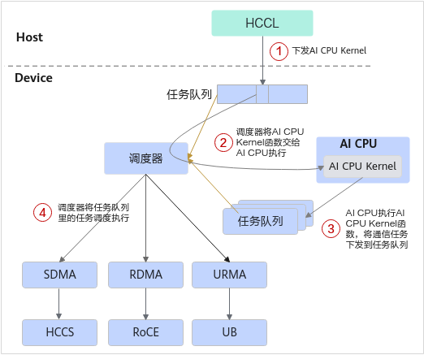
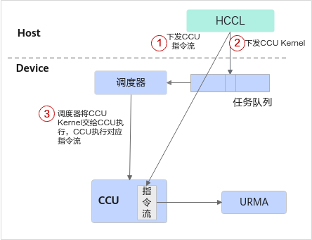
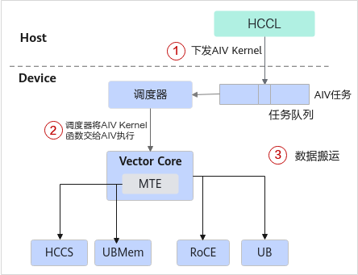

# 二、执行模型

### 2.1 执行流程
通信引擎是通信实体中执行通信任务的核心模块。不同通信引擎直驱的执行模型如下所示。

#### 2.1.1 AICPU_TS通信引擎

- Task 描述符下发模式

1. Host 提交 AICPU Kernel 至任务队列
2. TS 调度器将 AICPU Kernel 分发至 AICPU 执行
3. AICPU 提交通信 Task 描述符至 TS 队列
4. TS 调度器将通信 Task 分发至执行器

> **要点**: AICPU 通过 Task 描述符下发通信任务，**不占计算核**，适合大数据高带宽场景

#### 2.1.2 CCU通信引擎

- 专用加速单元执行模式

CCU（Collective Communication Unit，集合通信加速单元）是位于 IO Die 的专用集合通信协处理器，Thread 抽象为 Mission。

1. Host 将 CCU 指令序列（由 CCU 可识别的指令组成）下发至 CCU 指令空间，同时提交 CCU Kernel 任务至任务队列
2. CCU Kernel 被调度器调度后发送至 CCU 执行
3. CCU 执行对应指令流，并利用 URMA（Unified Remote Memory Access，统一远端内存访问）完成数据搬运

> **要点**: CCU 是专用集合通信加速单元，执行预置的 CCU 指令流（经 URMA 搬运数据）；**高带宽、低时延**且少占计算核与访存带宽，但受片上资源限制、支持的通信域数量有限（Ascend 950PR/950DT）

#### 2.1.3 AIV通信引擎

- Vector Core 执行模式

1. Host 提交 AIV Kernel 至任务队列
2. TS 调度器将 AIV Kernel 分发至 Vector Core
3. Vector Core 利用不同协议完成数据搬运

> **要点**: AIV 低延迟但占 Vector 计算核，适合小数据低延迟场景

### 2.2 保序机制

事务（Transaction）指用户发起的一次独立内存或消息操作，一系列事务构成事务流，由工作队列（WQ, Work Queue）进行管理。
如下图所示，数据面通过构造 WQE（Work Queue Element，工作队列项）描述单个事务，提交至 Channel 执行；再通过异步轮询完成队列（CQ, Completion Queue）判断事务是否执行完成。WQ 内 WQE 的执行完成状态由 CQ 反馈，CQ 中存储的 CQE（Completion Queue Element，完成队列项）用于记录对应事务的执行结果。

硬件工作队列虽按提交顺序接收 WQE，但受网络路由、DMA 调度、硬件通道竞争等因素影响，事务实际完成顺序可能与提交顺序不一致。当存在一组具有依赖关系的事务时，若缺少保序机制，会出现操作乱序，引发数据错乱、业务逻辑异常等问题，因此需要引入保序机制，约束事务的执行与完成顺序，保障任务按照预期逻辑执行。

#### 2.2.1 RoCE 的执行序

**同一 WQ 内保序**
硬件按“先进先出”（FIFO）顺序从 WQ 中取出 WQE 进行处理，向关联 CQ 写入 CQE 时也遵循 WQE 的入队顺序。即：先入队的 WQE 先完成，对应的 CQE 也先产生。

**不同 WQ 间不保序**
一个 CQ 可能被多个 WQ 共享，此时无法保证来自不同 WQ 的 CQE 的产生顺序。

#### 2.2.2 URMA 的执行序

在 URMA 中，可在 WQE 中指定 Order 或 Fence 标志来约束工作队列内事务的执行顺序。

**Order 标志**，指定以下三种执行序：

| 执行序 | 说明 |
|--------|------|
| No Order | 乱序执行，无任何执行序限制。 |
| Relaxed Order | 弱序事务之间无执行序限制，允许乱序执行；但会约束强序事务——只有排在前面的弱序事务全部完成后，强序事务才能执行。 |
| Strong Order | 保序执行，强序事务必须等待前面所有弱序事务和强序事务都完成后才能执行。 |

**Fence 标志**，指定以下两种执行序：

| 执行序 | 说明 |
|--------|------|
| 强 Fence | 强制事务执行序，不与其他标志共同作用，必须等待前面所有事务执行完成后才能执行。 |
| 弱 Fence | 弱事务执行序，写操作必须等待前面的读操作完成后才能执行，可与 Order 标志配合使用。 |

> Order 或 Fence 标志的保序机制只能确保同一 WQ 内 WQE 的执行顺序，不保证跨 WQ 的顺序。

---

### 2.3 同步机制
由于分布式多卡环境，各个 NPU独立运行、执行速度不一致，有的跑很快、有的跑很慢，因此必须施加同步，控制多个执行实体的执行时序，保证通信、数据访问按预期顺序执行。
分布式通信长江的同步主要可分为本端同步、远端同步、屏障同步三种。

#### 2.3.1 本端同步（PollCQ）

在事务流中，若需等待已提交任务执行完成后再执行后续任务，需要用户主动轮询完成队列。本地轮询成功仅表示本端硬件已完成处理，并不代表远端已收到并处理完数据。

#### 2.3.2 远端同步（Signal/Notify）

本端同步只能确认本地硬件完成处理，无法获知远端状态；远端同步必须通过网络交互，由对端反馈状态。若需建立与对端的同步，可借助同步信号实现：对端在完成数据写入后发送同步信号，本端通过轮询该信号来判断远端数据是否已就绪。

#### 2.3.3 屏障同步（Barrier）

通信域内所有进程或线程必须全部抵达同步点后方可继续执行；任意一个未抵达同步点，其余进程或线程均会阻塞等待。

> **注意**：避免滥用 Barrier。频繁的屏障同步会引入较大的全局延迟，易成为性能瓶颈。
