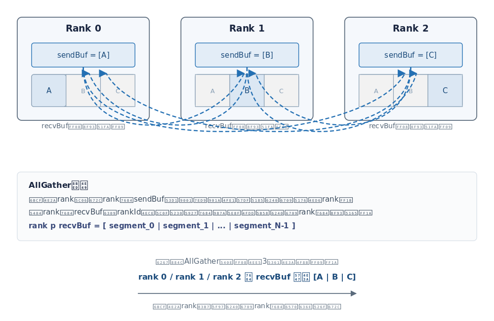

# CCU通信算子开发指南

## 概述

本指南介绍如何以`<<<>>>`直调方式开发CCU通信算子，覆盖Host侧资源准备、任务下发与Kernel侧通信执行的全流程。

本指南以AllGather为例展开。AllGather是集合通信算子，功能是将通信域内所有rank的输入按照rankId从小到大的顺序拼接，再将拼接结果发送到所有rank的输出缓冲区，如[图1](#fig-allgather)所示。

**图1** AllGather语义<a id="fig-allgather"></a>



样例采用FullMesh算法实现：每个rank与其余`rankSize - 1`个rank各建立一条Channel，通过`ccu::Write`将本rank输入直接写入各对端recvBuf中本rank对应的分片，无需经过中间rank中转；本rank数据通过`ccu::LocalCopy`完成本地落位。前同步通过`ccu::WriteVariableWithNotify`与`ccu::NotifyWait`互换通信内存信息，后同步通过`ccu::NotifyRecord`与`ccu::NotifyWait`确认所有rank完成数据接收。

<!-- npu="950" id1 -->
> [!NOTE]说明
> 本样例支持Ascend 950PR/Ascend 950DT系列产品，要求CANN版本不低于9.1.0；单卡环境仅支持编译验证，实际运行至少需要2张NPU。
<!-- end id1 -->

## 总体流程

以[allgather](../../../examples/ccu/ccu_direct/01_allgather/README.md)样例为例，CCU AllGather算子的完整实现流程分为Host侧资源准备与Kernel侧通信执行两个阶段，通信完成后销毁资源。

**Host侧资源准备**（控制面）：在Host侧完成通信任务执行所需的资源准备、任务下发与资源回收。

1. 初始化运行环境：初始化ACL和HCCL通信域，获取当前环境中的NPU数量。
2. 分配内存与初始化输入数据：分配Device内存，初始化输入数据并拷贝到Device。
3. 建立CCU Channel：基于HCCL通信域为每个对端rank申请CCU Channel。
4. 创建CCU实例并绑定通信域：创建CCU实例并绑定到通信域。
5. 获取内存Token与准备任务参数：通过`HcommCcuGetMemToken`获取输入内存Token，并准备CCU任务参数。
6. 下发任务<<<>>>：通过`CcuAllGatherMesh1DMem2MemKernel<<<schd, insHandle, stream>>>`直调CCU Kernel，其`<<<>>>`语法详见[核函数](#核函数)章节。
7. 销毁资源：销毁通信域、Stream和Device内存。

**Kernel侧通信执行**（数据面）：任务下发到Stream后，CCU硬件在Kernel侧按前同步、算子执行、后同步的通信编程范式完成数据搬运与同步。

1. Kernel内资源准备：加载任务参数、绑定远端Variable。
2. 前同步：将本端通信内存信息（output地址、token）写入对端并附带同步信号，等待对端就绪后再执行数据搬运。
3. 算子执行：发起跨rank数据搬运与本rank本地拷贝，并等待全部搬运完成。
4. 后同步：通知对端搬运完成，并等待所有对端完成。

Host侧与Kernel侧的关联体现在：Host侧完成资源准备后，通过第6步「下发任务<<<>>>」直调Kernel，将Channel句柄、任务参数（taskArgs、kernelArg）随任务下发到Stream；Kernel侧随后通过`ccu::LoadArg`加载任务参数、`ccu::GetResByChannel`绑定Variable，再依次执行前同步、算子执行、后同步。其中前同步属于资源准备在数据面的延伸：Host侧准备的Token等通信内存信息，需经前同步交换到对端后，跨rank搬运才能发起。

本章后续内容按此流程展开，代码关键片段均取自[allgather](../../../examples/ccu/ccu_direct/01_allgather/README.md)样例。

## Host侧资源准备

### 初始化运行环境

- 初始化ACL并查询设备数量。

    ```cpp
    // 设备资源初始化
    ACLCHECK(aclInit(NULL));
    // 查询设备数量
    uint32_t devCount;
    ACLCHECK(aclrtGetDeviceCount(&devCount));
    ```

- 生成通信域初始化信息rootInfo。

    ```cpp
    int32_t rootRank = 0;
    ACLCHECK(aclrtSetDevice(rootRank));
    // 生成 Root 节点信息，各线程使用同一份 RootInfo
    void* rootInfoBuf = nullptr;
    ACLCHECK(aclrtMallocHost(&rootInfoBuf, sizeof(HcclRootInfo)));
    HcclRootInfo* rootInfo = (HcclRootInfo*)rootInfoBuf;
    HCCLCHECK(HcclGetRootInfo(rootInfo));
    ```

- 各rank初始化通信域并创建Stream。

    每个rank初始化通信域前，先通过`aclrtSetDevice`切换到本rank的设备，再基于同一份rootInfo初始化本rank的通信域，并创建任务Stream。

    ```cpp
    // 设置当前rank操作的设备，device为当前rank对应的设备号（0~devCount-1）
    ACLCHECK(aclrtSetDevice(static_cast<int32_t>(device)));

    // 初始化集合通信域
    HcclComm comm;
    HCCLCHECK(HcclCommInitRootInfo(devCount, rootInfo, device, &comm));

    // 创建任务流
    aclrtStream stream;
    ACLCHECK(aclrtCreateStream(&stream));
    ```

### 分配内存与初始化输入数据

- 申请集合通信所需的Device内存存放输入、输出数据。

    ```cpp
    ACLCHECK(aclrtMalloc(&sendBuf, sendSize, ACL_MEM_MALLOC_HUGE_ONLY));
    ACLCHECK(aclrtMalloc(&recvBuf, recvSize, ACL_MEM_MALLOC_HUGE_ONLY));
    ```

- 申请Host内存初始化输入数据后拷贝到Device侧。

    ```cpp
    // 申请 Host 内存存放输入数据，并初始化为 Device ID + 1
    void* hostBuf = nullptr;
    ACLCHECK(aclrtMallocHost(&hostBuf, sendSize));

    // 将输入数据从 Host 拷贝到 Device
    ACLCHECK(aclrtMemcpy(sendBuf, sendSize, hostBuf, sendSize, ACL_MEMCPY_HOST_TO_DEVICE));
    ACLCHECK(aclrtFreeHost(hostBuf));
    ```

### 建立CCU Channel

- 查询rankId和rankSize

    ```cpp
    uint32_t rankId = 0;
    uint32_t rankSize = 0;
    HCCLCHECK(HcclGetRankId(comm, &rankId));
    HCCLCHECK(HcclGetRankSize(comm, &rankSize));
    ```

- 为每个对端rank申请Channel

    `kernelChannels`为保存Channel句柄的容器，对本通信域内除本rank外的每一个对端rank，查询链路信息、选取UB_CTP协议链路填充Channel描述符并申请Channel。

    ```cpp
    kernelChannels.resize(rankSize - 1);
    uint32_t channelIndex = 0;
    for (uint32_t remoteRank = 0; remoteRank < rankSize; remoteRank++) {
        if (remoteRank == rankId) {
            continue;
        }
        uint32_t netLayer = 0;
        uint32_t listSize = 0;
        CommLink* linkList = nullptr;
        // 获取srcRank和dstRank间link信息
        HCCLCHECK(HcclRankGraphGetLinks(comm, netLayer, rankId, remoteRank, &linkList, &listSize));

        HcclChannelDesc desc;
        HCCLCHECK(HcclChannelDescInit(&desc, 1));
        CommProtocol protocol = CommProtocol::COMM_PROTOCOL_UB_CTP;
        for (uint32_t idx = 0; idx < listSize; idx++) {
            CommLink link = linkList[idx];
            if (link.linkAttr.linkProtocol == protocol) {
                desc.remoteRank = remoteRank;
                desc.notifyNum = CHANNEL_NOTIFY_NUM; // Channel上协商的notify槽位数量
                desc.channelProtocol = link.linkAttr.linkProtocol;
                desc.localEndpoint.protocol = link.srcEndpointDesc.protocol;
                desc.localEndpoint.commAddr = link.srcEndpointDesc.commAddr;
                desc.localEndpoint.loc = link.srcEndpointDesc.loc;
                desc.remoteEndpoint.protocol = link.dstEndpointDesc.protocol;
                desc.remoteEndpoint.commAddr = link.dstEndpointDesc.commAddr;
                desc.remoteEndpoint.loc = link.dstEndpointDesc.loc;
                break;
            }
        }
        // 在CCU引擎上申请Channel
        HCCLCHECK(HcclChannelAcquire(comm, CommEngine::COMM_ENGINE_CCU, &desc, 1, &kernelChannels[channelIndex]));
        channelIndex++;
    }
    ```

- 查询Die编号

    首次建链时可查询本端端点所在的Die编号，作为后续调度配置的依据。

    ```cpp
    EndpointAttrDieId dieIdValue = 0;
    HCCLCHECK(HcclRankGraphGetEndpointInfo(
        comm, rankId, &desc.localEndpoint, ENDPOINT_ATTR_DIE_ID, sizeof(EndpointAttrDieId), &dieIdValue));
    ```

### 创建CCU实例并绑定通信域

- 创建CCU实例

    ```cpp
    // CCU_DIE_NUM为IO Die数量，CCU_DEFAULT_RES为地址、循环、CCU Buffer、变量、事件、CCU线程等资源的份额配置
    std::vector<HcommCcuResDescHandle> resDescs;
    for (uint32_t dieId = 0; dieId < CCU_DIE_NUM; dieId++) {
        HcommCcuResDescHandle desc = 0;
        CcuResult ret = HcommCcuInsResDescCreate(dieId, &desc);
        // Die资源不可用时跳过
        if (HcommCcuQueryRemainResDesc(desc) == CCU_E_UNAVAIL) {
            (void)HcommCcuInsResDescDestroy(desc);
            continue;
        }
        // 设置实例内各类资源份额：地址、循环、CCU Buffer、变量、事件、CCU线程
        for (const auto& res : CCU_DEFAULT_RES) {
            (void)HcommCcuInsResDescSetNum(desc, res.type, res.num);
        }
        resDescs.push_back(desc);
    }
    CcuInsHandle insHandle{0};
    CcuResult ret = HcommCcuInsCreate(resDescs.data(), static_cast<uint32_t>(resDescs.size()), &insHandle);
    ```

- 将实例绑定到通信域。
    
    绑定后通信域接管实例的所有权和销毁责任，每个通信域只能绑定一个CCU实例。

    ```cpp
    HcclResult assignRet = HcclCommAssignCcuIns(comm, insHandle);
    ```

### 获取内存Token与准备任务参数

- 获取内存Token

    CCU硬件不直接使用进程虚拟地址访问HBM，须先通过[`HcommCcuGetMemToken`](https://gitcode.com/cann/hcomm/blob/master/docs/zh/api_ref/comm_opdev/control_plane_api/ccu_kernel_launch_execution/HcommCcuGetMemToken.md)将`(虚拟地址, 大小)`转换为驱动颁发的64位Token，再随任务参数传入Kernel。

    ```cpp
    // inputSize为每个rank的输入字节数
    uint64_t token = 0;
    uint64_t baseInputAddr = reinterpret_cast<uint64_t>(sendBuf);
    uint64_t baseOutputAddr = reinterpret_cast<uint64_t>(recvBuf);
    HCCLCHECK(HcommCcuGetMemToken(baseInputAddr, inputSize, &token));
    ```

- 准备taskArgs

    `taskArgs`为执行期参数数组，与Kernel函数的SQE参数一一对应。AllGather场景包含输入输出地址、token、卡间偏移、分片大小及本地拷贝的切分参数：

    ```cpp
    uint64_t taskArgs[HCOMM_HOST_TASK_ARG_NUM] = {  // HCOMM_HOST_TASK_ARG_NUM为参数个数，样例为10
        baseInputAddr, baseOutputAddr, token,     0,         inputSize * rankId,
        inputSize,     goSize[0] ,      goSize[1], goSize[2], goSize[3],
    }; // goSize为CalGoSize计算的本地拷贝切分参数：偏移、循环参数、并行参数、残余大小
    ```

- 准备kernelArg

    `kernelArg`为编排上下文，持有Channel句柄、rankSize、rankId等：

    ```cpp
    auto kernelArg = std::make_shared<CcuKernelArgAllGatherMesh1DMem2Mem>();
    kernelArg->rankSize = rankSize;
    kernelArg->rankId = rankId;
    kernelArg->channelCount = static_cast<uint32_t>(kernelChannels.size());
    for (uint32_t i = 0; i < kernelChannels.size(); ++i) {
        kernelArg->channels[i] = kernelChannels[i];
    }
    ```

### 下发任务<<<>>>

- 通过`<<<>>>`直调CCU Kernel，将任务下发到Stream执行，其中`<<<>>>`的语法与参数详见[核函数](#核函数)章节。

    ```cpp
    const uint64_t dieMask = 1ULL << dieId;

    asccomm_ccu_schd schd = {1, 0, dieMask, 0};
    CcuAllGatherMesh1DMem2MemKernel<<<schd, insHandle, stream>>>(
        taskArgs[0], taskArgs[1], taskArgs[2], taskArgs[3], taskArgs[4], taskArgs[5], taskArgs[6], taskArgs[7],
        taskArgs[8], taskArgs[9], kernelArg.get());
    ```

### 销毁资源

- 通信完成后，销毁通信域、释放Device内存、销毁Stream并重置设备：

    ```cpp
    HCCLCHECK(HcclCommDestroy(hcclComm)); // 销毁通信域
    ACLCHECK(aclrtFree(sendBuf));         // 释放 Device 侧内存
    ACLCHECK(aclrtFree(recvBuf));
    ACLCHECK(aclrtDestroyStream(stream)); // 销毁任务流
    ACLCHECK(aclrtResetDevice(device));   // 重置设备
    ```

## 核函数

CCU算子的代码分为Host侧与Kernel侧两部分：Host侧函数作为任务发起者，通过`<<<>>>`直调CCU Kernel下发任务，Kernel侧随后由CCU硬件执行通信任务。

`<<<>>>`是内核调用符，通过在函数名与参数列表之间插入`<<<...>>>`下发执行配置，实现Host侧跨界调用设备侧Kernel，其通用概念可参见Ascend C的[核函数](https://gitcode.com/cann/asc-devkit/blob/master/docs/zh/guide/programming_guide/programming_model/ai_core_simd_programming/kernel_function.md)介绍。CCU直调沿用该语法，执行配置为`schd`、`insHandle`、`stream`三个CCU专用参数，下面介绍其用法。

### <<<>>> 语法与参数

Host侧通过内核调用符<<<...>>>的语法形式调用核函数（Kernel），如下所示：

```cpp
kernel_name<<<schd, insHandle, stream>>>(argument list)
```

`<<<...>>>`内的参数为核函数（Kernel）的执行配置，由3个参数决定，

- **schd**：类型为`asccomm_ccu_schd`，CCU任务调度配置，包含以下字段：

    | 字段 | 说明 |
    | --- | --- |
    | num_blocks | mission个数 |
    | reserved | 保留字段，置0 |
    | phy_die_mask | 按位表示CCU所在的IO Die，`0x01`表示die0，`0x02`表示die1。一个CCU不能跨Die使用另一个IO Die的网络设备，因此当前仅支持配置单个Die |
    | binary_cache_tag | Kernel句柄缓存标签。非0时，相同标签的重复调用会复用已注册的Kernel句柄，避免重复注册；置0则每次调用都重新注册 |

- **insHandle**：类型为`CcuInsHandle`，CCU实例句柄。Kernel翻译产生的指令空间、寄存器、片上缓存等资源都挂载在CCU实例上，实例需在直调前创建并绑定到通信域。
- **stream**：类型为`aclrtStream`，指定关联的流。CCU任务下发到该Stream上，与其他任务一同维护异步执行顺序，通过`aclrtSynchronizeStream`等待完成。

### <<<>>> 函数签名

CCU Kernel使用`__ccu_host__`限定符修饰，其中SQE参数`sqeArgs1`~`sqeArgs10`与Host侧taskArgs一一对应，通过`ccu::LoadArg`按序加载；`kernelArg`为编排上下文，随Kernel注册一次性下发。完整的Kernel入口示例见下文「Kernel侧通信执行」章节。

## Kernel侧通信执行

以AllGather为例说明数据面的任务编排，Kernel入口如下：

```cpp
__ccu_host__ void CcuAllGatherMesh1DMem2MemKernel(
    uint64_t sqeArgs1, uint64_t sqeArgs2, ..., uint64_t sqeArgs10, CcuKernelArg arg)
{
    auto* kernelArg = static_cast<CcuKernelArgAllGatherMesh1DMem2Mem*>(arg);

    // ctx为Kernel上下文，保存input/output/token及切分参数等编程对象
    AllGatherMesh1DMem2MemContext ctx;
    ctx.arg = kernelArg;

    // 下文前同步、算子执行、后同步三个阶段在该函数内展开
}
```

### Kernel内资源准备

任务编排前，完成编程对象的初始化和任务参数的加载。

- 绑定远端Variable单元

    output地址和token属于需要从对端rank写入的Variable，通过`ccu::GetResByChannel`与Channel绑定，`OUTPUT_XN_ID`、`TOKEN_XN_ID`由通信双方约定：

    ```cpp
    // OUTPUT_XN_ID、TOKEN_XN_ID分别为对端output地址、token对应的Variable单元编号
    ctx.output.resize(ctx.arg->rankSize);
    ctx.token.resize(ctx.arg->rankSize);
    uint32_t channelIdx = 0;
    for (uint64_t peerId = 0; peerId < ctx.arg->rankSize; peerId++) {
        if (peerId != ctx.arg->rankId) {
            // 通过channel绑定对端rank的output地址与token
            ctx.output[peerId] = ccu::GetResByChannel<ccu::Variable>(ctx.arg->channels[channelIdx], OUTPUT_XN_ID);
            ctx.token[peerId] = ccu::GetResByChannel<ccu::Variable>(ctx.arg->channels[channelIdx], TOKEN_XN_ID);
            channelIdx++;
        }
    }
    ```

- 加载任务参数

    `ccu::LoadArg`按声明顺序将SQE参数加载到CCU变量中，该指令必须在程序最开始调用：

    ```cpp
    uint32_t argId = 0;
    CCU_CHK_VOID_RET(ccu::LoadArg(ctx.input, argId++));                        // 输入地址
    CCU_CHK_VOID_RET(ccu::LoadArg(ctx.output[ctx.arg->rankId], argId++));      // 本rank输出地址
    CCU_CHK_VOID_RET(ccu::LoadArg(ctx.token[ctx.arg->rankId], argId++));       // 内存token
    CCU_CHK_VOID_RET(ccu::LoadArg(ctx.currentRankSliceInputOffset, argId++));  // 卡间输入偏移
    CCU_CHK_VOID_RET(ccu::LoadArg(ctx.currentRankSliceOutputOffset, argId++)); // 卡间输出偏移
    CCU_CHK_VOID_RET(ccu::LoadArg(ctx.sliceSize, argId++));                    // 分片大小
    CCU_CHK_VOID_RET(ccu::LoadArg(ctx.goSize.addrOffset, argId++));            // 本地拷贝切分参数
    CCU_CHK_VOID_RET(ccu::LoadArg(ctx.goSize.loopParam, argId++));
    CCU_CHK_VOID_RET(ccu::LoadArg(ctx.goSize.parallelParam, argId++));
    CCU_CHK_VOID_RET(ccu::LoadArg(ctx.goSize.residual, argId++));
    ```

- 声明本地拷贝资源

    本地拷贝所需的`CcuBuffer`、`Event`等资源，以及搬运源/目的地址，也在此阶段声明和组装（样例中封装在`InitGroupCopyResources`和`ExecuteAllGatherTransfer`内）。

### 前同步

- 前同步保证所有rank都完成资源准备、互换了通信内存信息后再执行数据搬运。使用`ccu::WriteVariableWithNotify`将本端output地址和token的值写入对端，同时向对端notify单元发送同步信号；随后`ccu::NotifyWait`阻塞等待对端rank的同步信号到达：

    ```cpp
    // 将本端output地址与token写入对端，并置位对端CKE_IDX_0的对应标志位
    for (uint32_t i = 0; i < ctx.arg->channelCount; i++) {
        CCU_CHK_VOID_RET(ccu::WriteVariableWithNotify(
            ctx.arg->channels[i], ctx.output[ctx.arg->rankId], OUTPUT_XN_ID, CKE_IDX_0, 1 << OUTPUT_XN_ID));
        CCU_CHK_VOID_RET(ccu::WriteVariableWithNotify(
            ctx.arg->channels[i], ctx.token[ctx.arg->rankId], TOKEN_XN_ID, CKE_IDX_0, 1 << TOKEN_XN_ID));
    }
    // 等待对端将output地址与token写入本端
    uint32_t allBit = (1 << OUTPUT_XN_ID) | (1 << TOKEN_XN_ID);
    for (uint32_t i = 0; i < ctx.arg->channelCount; i++) {
        CCU_CHK_VOID_RET(ccu::NotifyWait(ctx.arg->channels[i], CKE_IDX_0, allBit));
    }
    ```

    > [!CAUTION]注意
    > 不可将"写Variable"与"NotifyRecord"拆分为两步调用。硬件不保证两条独立操作的到达顺序，对端收到Notify后读取Variable时存在读到旧值的风险，仅`WriteVariableWithNotify`能从硬件层保证"先写值后发Notify"的顺序。

    前同步完成后，所有rank都持有了对端output地址和token，可以组装远端地址发起搬运。

### 算子执行

AllGather的执行分为两部分：向其他rank写入本rank数据，以及本rank数据在本地落位。

- 组装搬运地址

    远端目的地址由对端同步来的output地址、token加卡间偏移构成，本地目的地址直接取本端变量：

    ```cpp
    ccu::LocalAddr src;
    src.addr = ctx.input;
    src.addr += ctx.currentRankSliceInputOffset;
    src.token = ctx.token[ctx.arg->rankId];

    for (uint32_t rankIdx = 0; rankIdx < ctx.arg->rankSize; rankIdx++) {
        if (rankIdx == ctx.arg->rankId) {
            localDst.addr = ctx.output[rankIdx] + ctx.currentRankSliceOutputOffset;
            localDst.token = ctx.token[rankIdx];
        } else {
            dst[rankIdx].addr = ctx.output[rankIdx] + ctx.currentRankSliceOutputOffset;
            dst[rankIdx].token = ctx.token[rankIdx];
        }
    }
    ```

- 提交跨rank写任务

    `ccu::Write`为异步操作，硬件搬运完成时自动置位event中mask对应的标志位：

    ```cpp
    CCU_IF(ctx.sliceSize != 0)
    {
        uint32_t channelId = 0;
        for (uint64_t rankIdx = 0; rankIdx < ctx.arg->rankSize; rankIdx++) {
            const uint16_t mask = 1 << rankIdx;
            if (rankIdx != ctx.arg->rankId) {
                // 本rank数据写入对端地址
                CCU_CHK_RET(ccu::Write(ctx.arg->channels[channelId], dst[rankIdx], src, ctx.sliceSize, ctx.event, mask));
                channelId++;
            }
        }
    }
    ```

- 本地拷贝

    本rank数据通过`ccu::LocalCopy`在本地内存间搬运。数据量较大时，将搬运切分为多个分片，经CCU Buffer中转，由多个Loop并发执行以撑满带宽（参见[CCU编程](../programming_model/ccu_programming.md)的"并发执行"一节，样例中封装为`GroupCopy`）：

    ```cpp
    // Loop执行体：HBM -> CcuBuffer -> HBM，两段搬运间用EventWait确认完成
    ccu::LocalCopy(ctx.moRes.ccuBuf[bufBase], loopSrc[index], loopLen[index], loopEvt, 1);
    ccu::EventWait(loopEvt, 1);
    ccu::LocalCopy(loopDst[index], ctx.moRes.ccuBuf[bufBase], loopLen[index], loopEvt, 1);
    ccu::EventWait(loopEvt, 1);
    ```

- 等待搬运完成

    本地与跨rank搬运全部提交后，记录完成事件并等待所有搬运分支完成。Event在硬件搬运完成时自动置位，此处`ccu::EventRecord`补齐本地拷贝分支的完成标志，`ccu::EventWait`等待全部rank位掩码置位：

    ```cpp
    CCU_CHK_RET(ccu::EventRecord(ctx.event, 1 << ctx.arg->rankId));
    const uint16_t totalMask = (1 << ctx.arg->rankSize) - 1;
    CCU_CHK_RET(ccu::EventWait(ctx.event, totalMask));
    ```

### 后同步

- 后同步保证所有rank都完成数据接收后，AllGather才算完成。向每个对端发送搬运完成通知，再等待所有对端的完成通知：

    ```cpp
    // 通知对端：本rank已完成数据搬运，POST_SYNC_ID为后同步使用的notify标志位
    for (uint32_t i = 0; i < ctx.arg->channelCount; i++) {
        CCU_CHK_VOID_RET(ccu::NotifyRecord(ctx.arg->channels[i], CKE_IDX_0, 1 << POST_SYNC_ID));
    }
    // 等待所有对端完成数据搬运
    for (uint32_t i = 0; i < ctx.arg->channelCount; i++) {
        CCU_CHK_VOID_RET(ccu::NotifyWait(ctx.arg->channels[i], CKE_IDX_0, 1 << POST_SYNC_ID));
    }
    ```

    后同步完成后，Kernel编排结束。Host侧通过`aclrtSynchronizeStream`感知任务完成，即可读取`recvBuf`中的AllGather结果。

## 注意事项

- 运行样例需要至少2张NPU；单卡环境仅支持编译验证。
- 运行前必须设置`HCCL_OP_EXPANSION_MODE=CCU_SCHED`。
- 样例默认使用`dav-3510`架构，仅覆盖Ascend 950PR/Ascend 950DT场景。
- 样例会使用环境中可见的全部NPU设备，设备数量不能超过`CCU_MAX_RANK_SIZE`。
