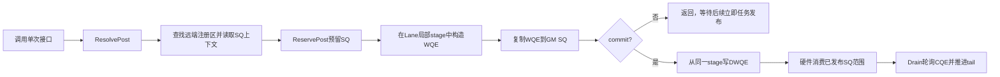
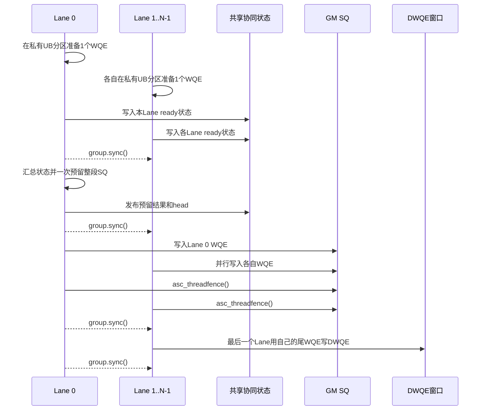

# Hcomm SIMT Batch设计

[English](../../en/guide/simt_batch_design.md)

## 1. 背景与范围

SIMT单次接口已经支持`WriteNbi`、`ReadNbi`、`WriteWithNotifyNbi`、`WriteValueNbi`、
`AtomicFAA`和`AtomicCAS`。每次调用都会解析通信上下文、构造WQE、写入SQ，并在立即提交模式下
通过DWQE发布。连续提交多个小通信任务时，这些固定开销会重复发生。

本设计在`COMM_PROTOCOL_UBC_CTP`的SIMT路径上增加显式BatchHandle语义：调用方先把多个通信任务
准备到UB，随后调用一次`BatchCommit`发布，并通过`Drain`等待完成。实现参考现有SIMD batch的
“UB预组装、句柄缓存、显式提交”结构，但保留SIMT已有的SQ计数和DWQE发布机制，并增加多Lane协同。

当前实现适用于Ascend 950（`dav-3510`）UBC CTP路径。第一阶段目标是建立功能正确、可验证的基础版本；
减少WQE大小、整批搬运和降低提交指令数属于后续性能阶段。

## 2. 设计目标

- 为六类SIMT通信操作提供一致的BatchHandle重载。
- 同时支持单Lane批量准备和一个SIMT cooperative group内的多Lane协同提交。
- 复用已经验证的单次接口WQE构造和DWQE发布路径，降低第一阶段引入风险。
- 在句柄中缓存远端注册区信息，避免每个batch项重复遍历远端注册表。
- 保持普通SIMT接口调用方式不变，不新增独立batch头文件。
- 提供最小功能用例、完整功能矩阵和独立性能基线。

当前阶段不以获得最终性能收益为完成标准，也不包含跨group共享同一channel、每Lane准备多项后协同提交、
按操作类型压缩WQEBB等扩展。

## 3. 术语

| 术语 | 含义 |
| --- | --- |
| Lane | 一个SIMT线程。`Hcomm`对象和单Lane BatchHandle均为Lane私有。 |
| Group | 由`cooperative_groups`提供的一组可同步Lane。多Lane提交要求组内所有Lane共同调用。 |
| WQE | Work Queue Element，描述一个通信任务的数据结构。 |
| SQ | Send Queue，设备读取WQE的GM环形队列。 |
| DWQE | 128B Doorbell WQE窗口。向该窗口写入最后一个WQE，同时通知硬件消费此前写入SQ的任务。 |
| CQ/CQE | Completion Queue及其完成项。`Drain`根据CQE确认已发布任务完成，并推进SQ tail。 |
| BatchHandle | 保存UB工作区、已准备项数、远端注册信息和队列快照的Lane私有句柄。 |
| ResolvePost | 从channel和目标远端地址解析一次提交所需信息，包括远端token、SQ地址、head/tail和DWQE地址。 |

“准备”是指只在UB中构造WQE；“写入SQ”是把WQE放入硬件可读取的GM队列；“发布”是写DWQE，
使已经写入SQ的任务对硬件成为可执行任务。这三个阶段不能混为一体。

## 4. 对外接口

Batch能力作为现有`AscendC::simt::Hcomm`的重载提供，声明位于
[`hcomm_simt.h`](../../../include/aicore/hcomm/hcomm_simt.h)。

```cpp
constexpr uint32_t itemCount = 8U;
constexpr uint32_t workspaceBytes =
    AscendC::simt::HcommSimtBatchBufferBytes(itemCount);
alignas(128) __ubuf__ uint64_t workspace[workspaceBytes / sizeof(uint64_t)];

AscendC::simt::Hcomm<> hcomm;
int32_t ret = hcomm.Init(nullptr, 0U);
auto batch = hcomm.MakeBatchHandle(
    channel, reinterpret_cast<__ubuf__ uint8_t*>(workspace), workspaceBytes, remoteBase);

ret = hcomm.WriteNbi(batch, remoteDst, localSrc, len);
ret = hcomm.ReadNbi(batch, localDst, remoteSrc, len);
ret = hcomm.WriteWithNotifyNbi(batch, remoteDst, localSrc, len, notifyAddr, notifyValue);
ret = hcomm.WriteValueNbi<uint64_t>(batch, remoteDst, value);
ret = hcomm.AtomicFAA<uint64_t>(batch, remoteDst, fetchAddr, addValue);
ret = hcomm.AtomicCAS<uint64_t>(batch, remoteDst, fetchAddr, compareValue, swapValue);
ret = hcomm.BatchCommit(batch);
ret = hcomm.Drain(batch);
```

接口职责如下：

| 接口 | 职责 | 是否写SQ | 是否发布DWQE |
| --- | --- | --- | --- |
| `Init` | 初始化Hcomm；多Lane模式下绑定共享协同状态区 | 否 | 否 |
| `MakeBatchHandle` | 校验workspace，选择远端注册区，缓存token和初始队列信息 | 否 | 否 |
| 六类batch操作 | 校验容量和远端范围，在Lane私有UB中构造完整WQE | 否 | 否 |
| `BatchCommit` | 预留SQ、修正动态head/owner、写SQ并由最后一项发布 | 是 | 是 |
| `Drain(batch)` | 要求batch中没有未提交项，轮询CQ并回收SQ空间 | 否 | 否 |

`HcommSimtBatchBufferBytes`位于现有公共`hcomm_common.h`，用于隔离用户代码与内部WQE常量。
当前基础格式每项占128B。UB由调用方提供，容量由调用方选择。

## 5. 原始单次接口流程

单次接口调用`PostWqe`完成一次通信任务，所有步骤均由同一Lane顺序执行。



`ResolvePost`不是简单预填字段。它完成两类解析：

1. 根据本次远端地址遍历channel的远端注册表，选择覆盖该地址范围的注册区，取得`tokenId`和
   `tokenValue`。
2. 读取默认QP的SQ上下文，得到SQ基址、WQE大小、深度、packed head地址、tail地址、DWQE窗口地址、
   TP ID和远端EID。

随后`ReservePost`基于packed head和SQ tail原子预留空间。WQE构造完成后，无论是否立即发布都先写入
普通SQ；立即模式还会从同一份Lane局部stage写DWQE。因此SQ内容和用于敲门的尾WQE来自同一构造结果。

## 6. 单Lane显式batch流程

单Lane模式将“解析远端注册信息”和“构造WQE”从每次立即提交路径中拆出，并把多个任务延迟到
`BatchCommit`处理。


### 6.1 创建句柄

`MakeBatchHandle`使用`remoteBase`中的一个真实字节选择远端注册区，避免零长度查找在相邻注册区边界
选择错误token。句柄保存注册区`base/size/token`，并按group rank切分调用方提供的UB。单Lane时
整个workspace均属于当前Lane。

句柄也保存创建时的packed head快照。batch准备期间不得通过其他句柄驱动同一channel；提交前如果
head已变化，`BatchCommit`失败，从而避免用过期位置覆盖SQ。

### 6.2 准备WQE

六类batch操作复用单次接口的descriptor和`Store`逻辑，但目标从Lane局部临时stage改为BatchHandle的
UB分区。每项使用立即WQE的完整128B布局，暂不按操作实际WQEBB数压缩。

准备阶段使用缓存的远端token构造WQE，同时通过`BatchContainsRemote`检查远端数据范围；Notify还会
单独检查`notifyAddr`。这样既避免重复注册表遍历，也避免调用方把缓存token用于另一个注册区。

### 6.3 提交与发布

队列head、tail和SQ地址可能在句柄创建后变化，不能把完整queue context永久缓存为提交依据。因此
`BatchCommit`保留远端token缓存，但按当前SQ上下文为每项预留位置，并在写SQ前修正WQE word 0中的
`nextHead`和`owner`动态字段。

前面的项只写普通SQ；最后一项同时写SQ和DWQE。DWQE不是“补发一个SQ中的副本”，而是发布动作本身：
它携带最终producer位置，使硬件开始消费此前已经准备好的SQ范围。提交成功后清零`prepared`状态，
句柄可用于下一批。

当前实现以正确性为先，逐项预留并复制完整128B WQE。一个batch仍应控制在channel可提供的有效SQ
空间内；性能阶段再评估整批一次预留、批量搬运和更紧凑的WQEBB布局。

## 7. 多Lane协同batch流程

SIMD batch只有一个执行实体，而SIMT group中的多个Lane会并行构造和写入不同WQE。仅让各Lane独立
调用单Lane提交会竞争packed head，也无法保证最后DWQE发布时其他Lane的SQ写入已经可见。因此多Lane
提交是collective操作，需要显式建立以下顺序：



关键约束和原因如下：

- 每个Lane持有自己的`Hcomm`和BatchHandle，但构造`Hcomm(group)`时绑定同一个group。
- 所有Lane向`Init`传入同一块共享UB状态区。前4个`uint32_t`保存整体状态和64位head，其后的每个
  word保存一个Lane的ready状态。
- 当前第一版要求每Lane恰好准备一个产生CQE的WQE。Lane 0确认全部ready后，一次预留
  `group.size() * 2`个WQEBB，避免多个Lane竞争head。
- 每个Lane依据同一个起始head和自身rank计算唯一SQ位置，并修正自己的`nextHead/owner`。
- `asc_threadfence`保证本Lane的GM SQ写入先于后续同步可见；`group.sync`保证所有Lane都完成该阶段。
- 只有最后一个Lane写DWQE，因为它持有整个连续SQ范围的真正尾WQE。发布前后的group同步防止有Lane
  过早覆盖UB或开始下一批。

group大小为1时，接口自动退化为单Lane`BatchCommit`，避免实例化多Lane路径。

## 8. 与SIMD batch的关系

| 维度 | SIMD batch | SIMT batch |
| --- | --- | --- |
| 共同思路 | 调用方提供UB；BatchHandle缓存注册信息；先准备WQE，再显式提交和Drain | 相同 |
| 执行实体 | 单个SIMD执行流 | 一个Lane，或一个可同步的Lane group |
| 队列状态 | 使用`ChannelEntity`中的独立SQ/CQ计数 | 使用SQ context中的packed `head/wqeCnt`及tail |
| 搬运方式 | `DataCopy`将连续UB区间搬到SQ，处理环回 | 当前按完整128B WQE写入SQ |
| 发布方式 | 更新SQ head并通过标量doorbell提交 | 最后一个WQE写128B DWQE窗口 |
| 多线程协调 | 不需要 | 需要整段预留、fence和group同步 |
| 当前操作范围 | Write/Read/WriteWithNotify等既有SIMD能力 | Write/Read/Notify/WriteValue/FAA/CAS |
| 地址责任 | 句柄缓存token，后续地址主要由调用方保证 | 缓存token，同时内部检查remote base/size |

可直接复用的是BatchHandle生命周期、UB预组装、远端token缓存、显式`BatchCommit/Drain`的接口形态和
环形SQ处理思路。不能直接复用的是SIMD的`DataCopy + st_dev(newSqHead)`发布方式；SIMT必须遵守已有
DWQE语义，并处理多Lane并发写入的可见顺序。

## 9. 状态与错误处理

BatchHandle通过以下状态维护调用顺序：

- `capacity`：当前Lane可准备的WQE数量。
- `prepared`：已在UB中构造但尚未提交的项数。
- `preparedCqe/lastCqe`：确认提交范围能产生预期CQE，且尾项可以用于完成判断。
- `headSnapshot`：检测batch准备期间channel是否被其他路径推进。
- `valid`：句柄是否仍可用；发生部分提交风险时置为无效，防止继续使用不一致状态。

调用失败返回`-1`。调用方必须检查每次append、`BatchCommit`和`Drain`的返回值。`Drain(batch)`要求
`prepared == 0`，避免把尚未发布的UB任务误判为已完成。

## 10. 约束

- 仅支持`COMM_PROTOCOL_UBC_CTP`和`dav-3510`路径。
- 同一channel不能同时由SIMD Hcomm、普通SIMT接口和含未提交项的SIMT BatchHandle并发驱动。
- BatchHandle绑定一个远端注册区，所有远端数据地址和Notify地址必须落在该范围内。
- workspace需满足实现要求的对齐，容量使用`HcommSimtBatchBufferBytes`计算。
- 多Lane提交要求组内所有Lane以一致的控制流调用`Init`、准备操作和`BatchCommit`，不能有Lane缺席。
- 当前多Lane版本每Lane每批只支持一个产生CQE的WQE。
- `Drain`由一个Lane在所有提交Lane返回后调用。

## 11. 验证设计

功能验证位于[`examples/simt_batch`](../../../examples/simt_batch/README.md)：

- `run_basic.sh`覆盖两项Write的最小单Lane使用路径。
- `run.sh`覆盖六类接口、同类多项、连续两次commit、混合batch、单项batch和最终数据。
- `run.sh matrix`覆盖`1x1`、`2x1`、`8x1`、`2x2`和`8x2`，其中`NxM`表示每批N个Lane、提交M批。
- Host同时检查设备返回码、commit次数、Read/FAA/CAS fetch值和远端最终数据，任一不一致均失败。

性能验证位于[`examples/simt_batch_perf`](../../../examples/simt_batch_perf/README.md)，以相同接口、负载、
消息长度和迭代次数比较Immediate与ExplicitBatch，输出延迟、带宽和speedup。功能用例是正确性门槛，
性能用例用于建立基线，不以预设speedup作为第一阶段通过条件。

## 12. 后续优化

后续按单变量方式评估以下优化，每项均需先通过完整功能矩阵，再比较性能基线：

1. 单Lane提交从逐项预留优化为整批一次预留。
2. 使用适合SIMT的批量搬运方式减少UB到SQ的指令数，同时保持最后DWQE来自真实尾WQE。
3. 按Write/Read等实际格式压缩WQEBB，降低UB和SQ占用。
4. 在证明队列上下文生命周期稳定后，减少`BatchCommit`中的上下文重载。
5. 将多Lane从“每Lane一项”扩展为“每Lane多项”，并定义确定的SQ排列和尾Lane选择规则。
6. 对不同batch size、group size、消息长度和操作类型建立性能拐点，决定何时使用Immediate或Batch。

这些优化不得改变公开调用顺序、远端注册区约束和DWQE发布前的可见性保证。

## 13. 相关文档

- [Hcomm使用说明](./hcomm_usage.md)
- [SIMT batch功能用例](../../../examples/simt_batch/README.md)
- [SIMT batch性能用例](../../../examples/simt_batch_perf/README.md)
- [构建与测试](./build_and_test.md)
