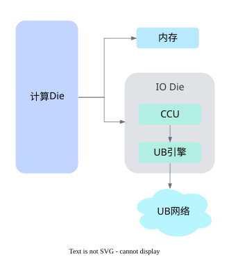
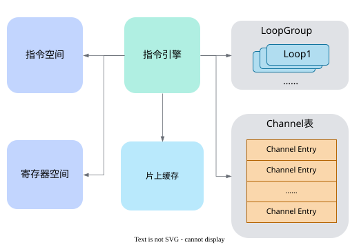
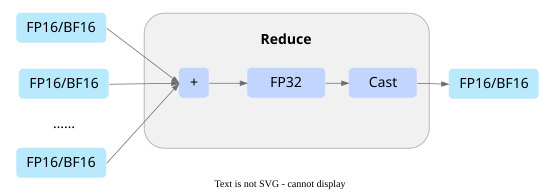
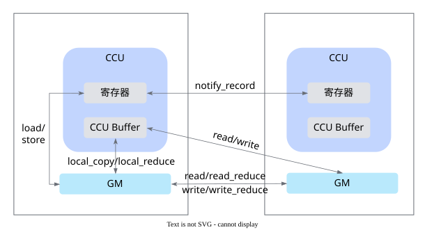
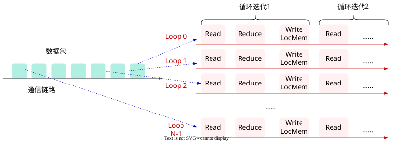
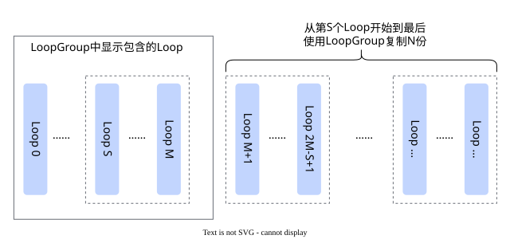

# CCU编程

CCU是Ascend 950PR&950DT系列产品上用于集合通信的专用硬件引擎，下文介绍CCU的架构和编程模型。

## CCU架构

### CCU系统架构

CCU是昇腾NPU中的专用集合通信协处理器。如[图1](#fig-ccu-system-architecture)所示，CCU位于Ascend 950PR&950DT系列产品的IO Die中。

**图1** CCU系统架构<a id="fig-ccu-system-architecture"></a>



### 基础概念

CCU内部包含多个关键组件，共同完成集合通信任务，如[图2](#fig-ccu-architecture)所示。

**图2** CCU架构<a id="fig-ccu-architecture"></a>



CCU内部组件的参数规格及职责如[表1](#tab-ccu-components)所示，其中寄存器分为通用寄存器、同步寄存器和地址寄存器三类。

**表1** CCU组件及职责<a id="tab-ccu-components"></a>

| 组件 | 参数规格 | 职责 |
| --- | --- | --- |
| 片上缓存 | 1536个4KB分片，共6MB | 片上数据缓存，以4KB分片为基础操作单元，支持多片的片上规约操作 |
| 通用寄存器 | 3072个，位宽64bit | 存放CCU执行过程中的参数或数据（长度和循环控制等参数、`token`信息），支持赋值、加法和移位运算 |
| 同步寄存器 | 1024个，位宽16bit | 实现类似信号量的同步操作，支持Set和Wait操作，保存指令依赖和同步状态 |
| 地址寄存器 | 3072个，位宽64bit | 存放通信操作的内存地址；未来会取消，由通用寄存器替代 |
| 并发执行引擎 | 200个 | LoopEngine，提供CCU并发与循环执行指令的能力 |
| 指令空间 | 32K条指令，单条32字节，共1MB | 存储CCU执行的指令序列 |
| Channel表 | 128个表项 | 存放Channel表项，每个表项包含用于UB通信的上下文信息 |

## CCU编程模型

本节分别从以下六个方面进行介绍：

- [资源抽象](#资源抽象)：指令的操作数及其申请方式。
- [计算能力](#计算能力)：寄存器计算和片上规约。
- [数据搬运](#数据搬运)：本地内存、CCU Buffer和远端内存之间的数据传输。
- [同步机制](#同步机制)：为异步操作建立先后关系。
- [任务编排](#任务编排)：用流程控制和并发原语把上述操作组织为完整的通信任务。
- [核函数](#核函数)：核函数的定义与调用方式。

### 资源抽象

CCU编程对象与硬件资源的对应关系如[表2](#tab-ccu-programming-resources)所示。该表用于说明编程职责，不表示软件对象与物理资源在所有实现中都严格一一对应。后续各节的操作数均来自这些编程对象。

**表2** CCU编程对象与硬件资源的对应关系<a id="tab-ccu-programming-resources"></a>

| 编程对象 | 说明 | 对应硬件资源 |
| --- | --- | --- |
| `ccu::variable` | 变量 | 通用寄存器 |
| `ccu::address` | 地址 | 地址寄存器 |
| `ccu::event` | 事件 | 同步寄存器 |
| `ccu::ccu_buffer` | 片上缓存分片 | CCU Buffer |
| `ccu::local_addr` | 本地地址 | 包含地址和`token`，分别由`address`和`variable`保存 |
| `ccu::remote_addr` | 远端地址 | 包含地址和`token`，分别由`address`和`variable`保存 |

资源的创建方式分为两种：

- 单个资源创建：默认构造函数直接创建。
- 批量连续资源创建：使用`ccu::array`创建。

```cpp
// 单个资源创建
ccu::variable var;
ccu::ccu_buffer buf;

// 批量资源创建
ccu::array<ccu::variable> variables(8);
ccu::array<ccu::event> events(4);
```

> [!NOTE]说明
>
> 使用原生数组创建资源（比如`variable` vars\[8\]），不保证资源的连续性。[并发执行](#并发执行)中的LoopGroup按资源ID偏移递推各实例使用的资源，要求这些资源连续，需使用`ccu::array`创建。

### 计算能力

CCU的计算能力分为两类：寄存器计算在通用寄存器和地址寄存器上进行，用于准备数据搬运所需的地址和长度等参数；片上规约在CCU Buffer上对通信数据做规约计算。

#### 寄存器计算

通用寄存器和地址寄存器支持赋值和加法，通用寄存器还支持移位，用于准备数据搬运的地址、长度等参数，以及维护循环计数。

- 立即数赋值

    ```cpp
    // 通用寄存器
    ccu::variable x; x = 5;

    // 地址寄存器
    uint64_t ptr;
    ccu::address addr;
    addr = ptr;
    ```

- variable赋值

    ```cpp
    ccu::variable x, y;
    ccu::variable v;
    // 通用寄存器
    v = x;

    // 地址寄存器
    ccu::address addr;
    addr = y;
    ```

- 加法

    ```cpp
    // 通用寄存器
    ccu::variable x, y, z;
    x = 5;
    y = 3;
    z = x + y;

    // 地址寄存器
    ccu::address addr1, addr2;
    addr1 += x;
    addr2 = addr1 + x;
    ```

- 移位

    仅通用寄存器支持，左移和右移的移位数需用`variable`给出，不支持立即数。

    ```cpp
    ccu::variable x, y, z;
    x = 256;
    y = 4;
    z = x >> y;
    x <<= y;
    ```

#### 片上规约

CCU Buffer支持最多8片的按序Reduce计算，输入类型与输出类型一致，支持的Reduce操作包括`ADD`、`MAX`和`MIN`，支持的数据类型包括FP32、FP16、BF16、INT32、INT16、INT8和UINT8。

对于FP16/BF16的ADD操作，为避免精度损失，CCU会升精度为FP32类型进行归约计算，如[图3](#fig-ccu-reduction-precision)所示。

**图3** FP16/BF16 ADD归约的升精度过程<a id="fig-ccu-reduction-precision"></a>



### 数据搬运

CCU的数据搬运能力如[图4](#fig-ccu-datacopy)所示，覆盖本地内存、CCU寄存器、CCU Buffer和远端内存之间的多条通路。

**图4** CCU数据搬运能力<a id="fig-ccu-datacopy"></a>



本地搬运使用`local_copy`，跨端读写远端内存使用`read`和`write`，搬运的同时完成规约使用`local_reduce`、`read_reduce`和`write_reduce`，本端内存与寄存器之间的参数搬运使用`load`和`store`。需要注意，数据搬运是异步操作，指令下发后硬件在后台执行，需要通过[同步机制](#同步机制)确认搬运完成后才能读取目标数据或复用相关资源。

### 同步机制

CCU的同步资源由同步寄存器在硬件侧实现，基于其事件位提供两类操作，如[表3](#tab-ccu-sync-operations)所示：

**表3** CCU同步操作<a id="tab-ccu-sync-operations"></a>

| 操作 | 说明 |
| --- | --- |
| record | 置位掩码对应的事件位，表示一个条件已经达成 |
| wait | 阻塞等待掩码对应的事件位被置位后才继续执行 |

按同步范围的不同，这两类操作抽象为两种同步机制，如[表4](#tab-ccu-sync-objects)所示：

**表4** CCU同步机制及适用场景<a id="tab-ccu-sync-objects"></a>

| 同步机制 | 适用场景 |
| --- | --- |
| event | 单个Device的本地操作 |
| notify | 不同Device之间的通信操作 |

本节的event和notify是CCU基于同步寄存器提供的机制；通信场景中通用的完成队列轮询、点对点同步和屏障同步参见[《执行模型》](./execution_model.md)的“同步机制”。

#### event

event用于本地同步，编程对象为`ccu::event`，持有本端同步寄存器的事件位。

- `event_record`：置位本端同步寄存器中对应的事件位，表示当前操作或阶段已完成。
- `event_wait`：等待本端同步寄存器中对应事件位被置位，即等待异步操作完成或其他任务发出的完成信号。

```cpp
ccu::event evt;

ccu::event_record(evt, 0x01);

ccu::event_wait(evt, 0x01);
```

#### notify

notify用于不同Device之间的通信操作，不引入新的编程对象：两个通信实体建立Channel后，基于Channel中的notify序号向对端发送通知，或等待来自对端的通知信号。

- `notify_record`：向对端发送通知，置位对端同步寄存器中对应的事件位。
- `notify_wait`：等待来自对端的通知，即等待本端同步寄存器中对应事件位被对端置位。

```cpp
ChannelHandle channel_handle;

// 发送通知到远端
ccu::notify_record(channel_handle, 0, 0x12);

// 等待远端通知
ccu::notify_wait(channel_handle, 0, 0x12);
```

### 任务编排

计算、搬运和同步操作通过流程控制组织为指令块，再由`loop`和`loop_group`并发执行，构成完整的通信任务。

#### 流程控制

流程控制相关接口如[表5](#tab-ccu-control-interfaces)所示：

**表5** CCU流程控制接口<a id="tab-ccu-control-interfaces"></a>

| 类型/接口 | 说明 |
| --- | --- |
| `ccu::func` | 定义指令函数块 |
| `ccu::call_func<func>(...)` | 调用函数块 |
| `CCU_IF`/`CCU_ELSE` | 条件分支 |
| `CCU_WHILE` | 条件循环 |

流程控制只用于编排CCU指令和通信任务，不用于替代AI Core或AI CPU的通用计算逻辑。分支和循环的条件由`variable`给出，`ccu::func`定义的函数块除了可以直接调用，也是下文Loop的执行体。

- 条件分支

  ```cpp
  ccu::variable counter;
  counter = 0;

  CCU_IF(counter != 5) {
       // then-block
  }
  CCU_ELSE {
       // else-block
  }
  ```

- 循环

  ```cpp
  ccu::variable counter, accumulator, step, one;
  counter = 0;
  accumulator = 0;
  step = 4;
  one = 1;

  CCU_WHILE(counter != 10) {
       accumulator = accumulator + step;
       counter = counter + one;
  }
  ```

- 函数块

  ```cpp
  // 定义函数块
  static ccu::func my_func([](ccu::variable x, ccu::variable y){
     ...
  });
  // 调用函数块
  ccu::variable arg1, arg2;
  ...
  ccu::call_func<my_func>(arg1, arg2);
  ```

#### 并发执行

CCU通过`Loop`和`LoopGroup`组织并发执行，对应的编程对象分别为`ccu::loop`和`ccu::loop_group`。

**Loop**

Loop是CCU任务中的基础并发单元，执行体为`ccu::func`定义的函数块，有以下特点：

  - Loop内的操作串行执行，不同Loop并行执行；
  - Loop可以循环执行内部操作，配合CCU Buffer循环搬运数据；
  - Loop参数：循环次数、每次循环操作的内存地址增量偏移；
  - 使用`ccu_buffer`搬运数据时，因大小有限，单次数据搬运数据量有限，利用多Loop并发可撑满链路带宽。

多个Loop并发搬运一块数据的方式如[图5](#fig-ccu-loop)所示。数据按地址划分为多个分片，Loop 0至Loop N-1各负责一段连续区域，经同一条通信链路传输。每个Loop的循环体是一段按序执行的指令序列，末尾的省略号表示LoopEngine自动迭代，逐分片完成该Loop负责的区域。

**图5** Loop并发搬运<a id="fig-ccu-loop"></a>



**LoopGroup**

LoopGroup是Loop的容器，当多个Loop的指令逻辑相同、只有数据位置不同时，可以只写一份Loop，由LoopGroup复制出多份实例，增加并发Loop的个数，有以下特点：

  - Loop不能单独执行，需要放在LoopGroup中；
  - 对于LoopGroup中的Loop，LoopGroup可以指定从哪个Loop开始复制，以及复制的次数；
  - LoopGroup需要指定复制后每组Loop使用的资源id偏移。

LoopGroup复制Loop的关系如[图6](#fig-ccu-loopgroup)所示。左侧实线框是显式写入LoopGroup的Loop，复制从第S个Loop开始，第S个至最后一个Loop各复制N份，生成右侧虚线框中的N组实例。

**图6** LoopGroup复制Loop<a id="fig-ccu-loopgroup"></a>



**使用示例**

```cpp
ChannelHandle chann;     // 建链后由kernel参数传入
ccu::remote_addr remote_mem;  // 远端地址，建链时获取
// ccu_buffer和event需按LoopGroup的偏移递推预留足够数量：
// 复制份数5为额外份数：原始1个Loop + 5个克隆 = 6个并发实例，
// 实例间ccu_buffer/event偏移均为10，最大用到第50片/槽，因此预留51
ccu::array<ccu::ccu_buffer> local_ccu_buf(51);
ccu::array<ccu::event> evts(51);
ccu::variable len;
len = 4096;
ccu::func func([&]() {
    ccu::write(chann, remote_mem, local_ccu_buf[0], len, evts[0]);
});
// 循环执行10次，每次地址增量偏移为4096B
ccu::loop loop({4096, 10}, func);

// 对LoopGroup中的Loop，从第0个Loop开始到最后一个，都复制5次
// 配置字段依次为：复制份数5、克隆起始Loop偏移0、实例间address偏移4096*10B、实例间ccu_buffer偏移10片、实例间event偏移10个
// max_loop_num按展开后的实例总数传：1个原始Loop + 5个克隆 = 6
ccu::loop_group group({5, 0, 4096*10, 10, 10}, 6, {loop});
```

### 核函数

CCU算子的代码分为Host侧与Kernel侧两部分：Host侧函数作为任务发起者，通过`<<<>>>`直调CCU Kernel下发任务（任务被封装为SQE：send queue element，发送队列元素）；Kernel在CCU侧被抽象为mission，由CCU硬件执行通信任务。

#### 核函数定义

定义CCU Kernel时需要遵循以下规则。

- **使用函数类型限定符**

    必须使用`__ccu_host__`函数类型限定符来标识该函数是一个CCU Kernel，可以被`<<<...>>>`调用。

- **参数规则**

    参数列表由SQE参数与`kernelArg`两类参数构成：

    - SQE参数`sqeArgs1`~`sqeArgsN`：类型为`uint64_t`，携带通信地址、`token`、切分参数等执行期参数，需在Kernel最开始通过`ccu::load_arg`按声明顺序加载到CCU变量中。
    - `kernelArg`：类型为`ccu_kernel_arg`，为编排上下文，持有Channel句柄、rankSize、rankId等；与SQE参数不同，`kernelArg`随Kernel注册一次性下发，不随每次调用重复传递。

- **其他规则**

    返回类型必须为`void`。

- 代码示例如下：

    ```cpp
    __ccu_host__ void CcuAllGatherMesh1DMem2MemKernel(
        uint64_t sqeArgs1, uint64_t sqeArgs2, ..., uint64_t sqeArgs10, ccu_kernel_arg arg)
    {
        // kernelArg为编排上下文，持有Channel句柄、rankSize、rankId等
        auto* kernelArg = static_cast<CcuKernelArgAllGatherMesh1DMem2Mem*>(arg);

        // ctx为Kernel上下文，保存input/output/token及切分参数等编程对象
        AllGatherMesh1DMem2MemContext ctx;
        ctx.arg = kernelArg;

        // 后续通过ccu::load_arg加载SQE参数，再编排通信任务
    }
    ```

#### 核函数调用

`<<<>>>`是内核调用符，在函数名与参数列表之间插入`<<<...>>>`即可下发执行配置，概念和用法与[Ascend C核函数](https://gitcode.com/cann/asc-devkit/blob/master/docs/zh/guide/programming_guide/programming_model/ai_core_simd_programming/kernel_function.md)一致。代码示例如下：
       
```cpp
kernel_name<<<schd, insHandle, stream>>>(argument list);
```

`<<<...>>>`内的参数为核函数（Kernel）的执行配置，由3个CCU专用参数决定：

- **schd**：类型为`asccomm_ccu_schd`，CCU任务调度配置，包含以下字段：

    | 字段 | 说明 |
    | --- | --- |
    | num_blocks | 规定了一次调用启动的mission个数，类比于Ascend C中的block_num，当前仅支持1，参见[mission](#mission) |
    | reserved | 保留字段，置0 |
    | phy_die_mask | 按位表示CCU所在的IO Die，`0x01`表示die0，`0x02`表示die1；一个CCU不能跨Die使用另一个IO Die的网络设备，因此当前仅支持配置单个Die |
    | binary_cache_tag | Kernel句柄缓存标签；非0时，相同标签的重复调用会复用已注册的Kernel句柄，避免重复注册；置0则每次调用都重新注册 |

- **insHandle**：类型为`void*`，不透明的CCU实例句柄，指向hcomm持有的CCU实例实体。Kernel翻译产生的指令空间、寄存器、片上缓存等资源都挂载在CCU实例上。通过`HcclCommQueryCcuIns`查询通信域获得，样例公共辅助函数`QueryCcuInstance`封装了该调用：

    ```cpp
    void* insHandle = nullptr;
    asccomm_examples::QueryCcuInstance(comm, insHandle);
    ```

    若通信域尚未创建CCU实例，该调用会自动创建后返回；返回的句柄由通信域管理，仅供借用，调用方不得销毁。

- **stream**：类型为`aclrtStream`，指定关联的流。CCU任务下发到该Stream上，与其他任务一同维护异步执行顺序。

调用示例如下（调用上文定义的AllGather Kernel，`taskArgs`与`sqeArgs1`~`sqeArgs10`一一对应，`insHandle`和`stream`需在直调前创建）：

```cpp

const uint32_t dieId = 0;                    // CCU所在的IO Die编号（die0或die1），由建链时查询得到
const uint64_t dieMask = 1ULL << dieId;      // 按位选中CCU所在的IO Die
uint64_t taskArgs[10] = {...};               // 执行期参数，与sqeArgs1~sqeArgs10一一对应
auto kernelArg = std::make_shared<CcuKernelArgAllGatherMesh1DMem2Mem>();  // 编排上下文
// insHandle为void*（不透明CCU实例句柄），通过HcclCommQueryCcuIns查询通信域获得；stream为aclrtStream，需在直调前创建

asccomm_ccu_schd schd = {1, 0, dieMask, 0};  // 1个mission，不缓存Kernel句柄
CcuAllGatherMesh1DMem2MemKernel<<<schd, insHandle, stream>>>(
    taskArgs[0], taskArgs[1], taskArgs[2], taskArgs[3], taskArgs[4], taskArgs[5], taskArgs[6], taskArgs[7],
    taskArgs[8], taskArgs[9], kernelArg.get());  // 最后一个参数为kernelArg
```

核函数的调用是异步的，调用后控制权立刻返回Host侧；Host侧可调用`aclrtSynchronizeStream`等待Stream上的CCU任务执行完毕。

#### mission

mission表示CCU执行的程序，是Kernel在CCU侧的抽象，类比于Ascend C中的block。Host侧编排的Kernel代码不能被CCU直接执行：Kernel注册时对应一个mission，其中的计算、搬运和同步操作被翻译为CCU指令序列并加载到指令空间中。

任务下发后，CCU根据SQE中携带的mission标识和指令入口，执行该mission的指令序列，完成通信任务。

## 编程约束与限制

### 参数加载约束

- 单个SQE最多携带13个64bit参数。
- 参数加载指令`load_arg`必须在程序最开始调用。

### 指令部署约束

- CCU位于一个设备的IO Die上。一个设备可能包含多个IO Die，不同IO Die包含不同的网络设备。实际组网中，不同的网络设备可能与不同的其他设备互联。一个CCU不能跨Die使用另一个IO Die的网络设备进行通信。
- 一个Kernel对应一个mission，当前单个Die仅支持一个mission，因此执行配置`schd`中的`num_blocks`当前仅支持1。
