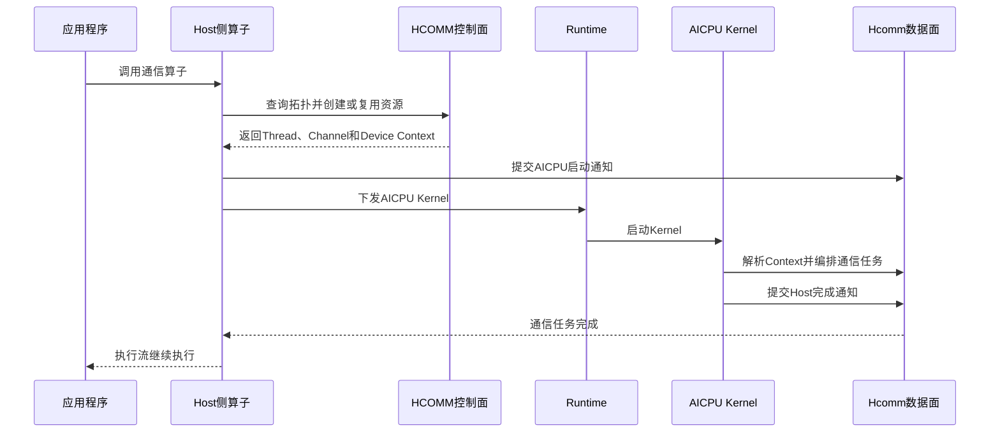

# Hcomm算子的实现

Hcomm算子是开发者使用HCOMM控制面准备拓扑和通信资源，并在通信执行端调用Hcomm数据面接口自行编排通信算法的自定义通信算子。本章以AICPU_TS为数据面发起方，介绍Hcomm算子的通用开发流程，并使用AllGather算子说明各阶段的实现方法。

HCOMM控制面接口资料由[HCOMM仓](https://gitcode.com/cann/hcomm)维护，Hcomm数据面接口请参见[HCOMM数据面API](../../api/hcomm/概述.md)。具体接口支持的产品、调用侧和通信协议以对应API的产品支持情况和约束说明为准。

## 总体流程

Hcomm算子的开发与执行分为Host侧准备和AICPU侧执行两个阶段。Host侧负责定义算子接口、查询拓扑、选择算法、创建资源并下发AICPU Kernel；Kernel启动后，AICPU侧取得资源上下文，调用Hcomm数据面接口进行任务编排。因此，从执行顺序看，Kernel下发在前，数据面任务编排在Kernel启动后执行。



开发Hcomm算子通常包含以下步骤：

1. **定义算子接口**：确定通信语义、输入输出、数据量、数据类型、通信域和执行流等参数。
2. **查询拓扑信息**：获取Rank、拓扑层级和可用链路，为算法选择和资源计算提供依据。
3. **选择通信算法**：根据拓扑、数据量、执行引擎和通信协议选择算法；固定实现可以省略该步骤。
4. **创建通信资源**：计算并申请Thread、Notify、Channel、通信内存和通信引擎上下文。
5. **实现任务编排**：使用本地数据操作、远端数据操作和同步控制接口描述通信算法。
6. **下发AICPU Kernel**：加载Kernel、封装参数并通过Runtime下发，同时建立Host与AICPU的同步关系。
7. **处理完成与资源生命周期**：等待执行完成，复用或释放通信资源。
8. **编译部署和验证**：构建Host与AICPU产物，部署算子包并验证功能、同步和资源复用。

## 1. 定义算子接口

通信算子接口用于表达上层业务可见的通信语义。接口参数应能够确定参与通信的数据、Rank关系、通信域和执行顺序。

常见接口参数如下：

| 参数类别 | 说明 |
| --- | --- |
| 数据地址 | 输入和输出的Device内存地址。 |
| 数据描述 | 元素数量和数据类型，或者直接以字节表示的数据长度。 |
| 通信域 | 确定参与通信的Rank集合和通信资源作用域。 |
| 执行流 | 确定通信任务与业务任务之间的执行顺序。 |

### AllGather算子示例

AllGather收集每个Rank的输入，并按照Rank编号顺序写入每个Rank的输出，通信域所有Rank均参与数据收集。

```cpp
HcclResult HcclAllGatherCustom(
    void *sendBuf,
    void *recvBuf,
    uint64_t sendCount,
    HcclDataType dataType,
    HcclComm comm,
    aclrtStream stream);
```


## 2. 查询拓扑信息

### 背景

通信域可能包含不同的网络层级、拓扑类型和Rank间链路。同一个通信算子在不同拓扑下可能需要使用不同算法或Channel协议，因此Host侧在创建资源前需要查询实际拓扑。

### HCOMM控制面支持的拓扑信息

HCOMM控制面提供以下常用查询能力：

| 拓扑信息 | 查询接口 |
| --- | --- |
| 获取当前Device在通信域中的Rank编号。 | [HcclGetRankId](https://gitcode.com/cann/hcomm/blob/master/docs/zh/api_ref/comm_opdev/control_plane_api/topo_info_query/HcclGetRankId.md) |
| 获取通信域中的Rank数量。 | [HcclGetRankSize](https://gitcode.com/cann/hcomm/blob/master/docs/zh/api_ref/comm_opdev/control_plane_api/topo_info_query/HcclGetRankSize.md) |
| 获取包含当前Rank的拓扑层级列表。 | [HcclRankGraphGetLayers](https://gitcode.com/cann/hcomm/blob/master/docs/zh/api_ref/comm_opdev/control_plane_api/topo_info_query/HcclRankGraphGetLayers.md) |
| 获取指定层级内的Rank列表。 | [HcclRankGraphGetRanksByLayer](https://gitcode.com/cann/hcomm/blob/master/docs/zh/api_ref/comm_opdev/control_plane_api/topo_info_query/HcclRankGraphGetRanksByLayer.md) |
| 获取指定层级内的Rank数量。 | [HcclRankGraphGetRankSizeByLayer](https://gitcode.com/cann/hcomm/blob/master/docs/zh/api_ref/comm_opdev/control_plane_api/topo_info_query/HcclRankGraphGetRankSizeByLayer.md) |
| 获取指定层级的拓扑类型。 | [HcclRankGraphGetTopoTypeByLayer](https://gitcode.com/cann/hcomm/blob/master/docs/zh/api_ref/comm_opdev/control_plane_api/topo_info_query/HcclRankGraphGetTopoTypeByLayer.md) |
| 获取指定层级中的拓扑实例数量和各实例规模。 | [HcclRankGraphGetInstSizeListByLayer](https://gitcode.com/cann/hcomm/blob/master/docs/zh/api_ref/comm_opdev/control_plane_api/topo_info_query/HcclRankGraphGetInstSizeListByLayer.md) |
| 获取源Rank和目的Rank之间的链路信息。 | [HcclRankGraphGetLinks](https://gitcode.com/cann/hcomm/blob/master/docs/zh/api_ref/comm_opdev/control_plane_api/topo_info_query/HcclRankGraphGetLinks.md) |

### 基础示例

1. 查询本Rank编号和通信域Rank数量。

    ```cpp
    uint32_t rankId = 0;
    uint32_t rankSize = 0;
    CHK_RET(HcclGetRankId(comm, &rankId));
    CHK_RET(HcclGetRankSize(comm, &rankSize));

    if (rankId >= rankSize) {
        return HCCL_E_PARA;
    }
    ```

2. 查询当前Rank所在的拓扑层级。

    ```cpp
    uint32_t *netLayers = nullptr;
    uint32_t netLayerNum = 0;
    CHK_RET(HcclRankGraphGetLayers(
        comm, &netLayers, &netLayerNum));

    for (uint32_t i = 0; i < netLayerNum; i++) {
        uint32_t rankNum = 0;
        CHK_RET(HcclRankGraphGetRankSizeByLayer(
            comm, netLayers[i], &rankNum));
    }
    ```

3. 查询两个Rank之间的可用链路。

    ```cpp
    CommLink *linkList = nullptr;
    uint32_t listSize = 0;
    CHK_RET(HcclRankGraphGetLinks(
        comm, 0, srcRank, dstRank, &linkList, &listSize));

    for (uint32_t i = 0; i < listSize; i++) {
        CommProtocol protocol = linkList[i].linkAttr.linkProtocol;
        // 根据目标数据面能力选择可用协议。
    }
    ```

### AllGather算子示例

AllGather样例先取得本Rank和Rank数量，再遍历所有对端Rank。`FillChannelDesc`从本Rank到对端Rank的链路中选择`UBC_CTP`协议，并将链路Endpoint信息转换为Channel描述。

```cpp
HcclResult FillChannelDesc(
    HcclComm comm, uint32_t srcRank, uint32_t dstRank,
    HcclChannelDesc &desc)
{
    CommLink *linkList = nullptr;
    uint32_t listSize = 0;
    CHK_RET(HcclRankGraphGetLinks(
        comm, 0, srcRank, dstRank, &linkList, &listSize));
    CHK_RET(HcclChannelDescInit(&desc, 1));

    for (uint32_t i = 0; i < listSize; i++) {
        CommLink &link = linkList[i];
        if (link.linkAttr.linkProtocol !=
            CommProtocol::COMM_PROTOCOL_UBC_CTP) {
            continue;
        }

        desc.remoteRank = dstRank;
        desc.notifyNum = 3;
        desc.channelProtocol = link.linkAttr.linkProtocol;
        desc.localEndpoint.protocol = link.srcEndpointDesc.protocol;
        desc.localEndpoint.commAddr = link.srcEndpointDesc.commAddr;
        desc.localEndpoint.loc = link.srcEndpointDesc.loc;
        desc.remoteEndpoint.protocol = link.dstEndpointDesc.protocol;
        desc.remoteEndpoint.commAddr = link.dstEndpointDesc.commAddr;
        desc.remoteEndpoint.loc = link.dstEndpointDesc.loc;
        return HCCL_SUCCESS;
    }
    return HCCL_E_NOT_FOUND;
}

CHK_RET(HcclGetRankId(comm, &param.myRank));
CHK_RET(HcclGetRankSize(comm, &param.rankSize));

for (uint32_t remoteRank = 0;
     remoteRank < param.rankSize; remoteRank++) {
    if (remoteRank == param.myRank) {
        continue;
    }
    HcclChannelDesc desc;
    CHK_RET(FillChannelDesc(
        comm, param.myRank, remoteRank, desc));
    channelDescs.push_back(desc);
}
```

## 3. 选择通信算法

### 背景

集合通信通常存在多种算法实现。不同算法对拓扑、数据量、Channel数量、并发Thread数量和临时通信内存的要求不同。为了获得稳定的功能和性能，需根据具体场景，选择合适的通信算法。

### 算法选择依据

| 选择依据 | 说明 |
| --- | --- |
| 算子语义 | AllGather、AllReduce和Broadcast等集合通信需要不同的数据关系。 |
| 拓扑结构 | Mesh、Ring以及跨Server拓扑适用的算法不同。 |
| 数据量和数据类型 | 影响分片方式、传输次数、规约能力和临时内存需求。 |
| 数据面发起方 | AICPU_TS、AIV等发起方支持的接口和并发模型不同。 |
| Channel协议 | 不同协议支持的数据操作、地址类型和同步能力不同。 |
| 资源上限 | Thread、Notify、Channel和通信内存必须满足算法需求。 |

如果算子只支持一种拓扑和一种固定算法，可以省略多算法选择，但仍需要校验产品、执行引擎和通信协议是否满足该实现的约束。

### 基础示例

下面展示一个简化的算法选择过程。实际实现还需要结合产品能力、数据量和协议进行判断。

```cpp
HcclResult SelectAlgorithm(
    CommEngine engine, CommTopo topoType,
    std::string &algorithmName)
{
    if (engine != CommEngine::COMM_ENGINE_AICPU_TS) {
        return HCCL_E_NOT_SUPPORT;
    }

    if (topoType == CommTopo::COMM_TOPO_1DMESH) {
        algorithmName = "AicpuMesh";
        return HCCL_SUCCESS;
    }
    return HCCL_E_NOT_SUPPORT;
}
```

### AllGather算子示例

AllGather样例只提供AICPU Mesh实现，没有独立的算法注册和选择模块。Host侧通过产品校验、固定算法Tag和`UBC_CTP`链路选择限定实现范围。

```cpp
CHK_RET(GetDeviceType(&param.devType));
if (param.devType != DEVICE_TYPE_A5) {
    return HCCL_E_INTERNAL;
}

int ret = sprintf_s(
    param.tag, sizeof(param.tag), "%s",
    "hccl_custom_allgather");
if (ret <= 0) {
    return HCCL_E_INTERNAL;
}

param.opType = HcclCMDType::HCCL_CMD_ALLGATHER;
```

该Tag同时用于批量任务标识和通信引擎上下文复用。扩展为多算法后，不同资源需求的算法应使用不同Tag，避免错误复用资源上下文。

## 4. 创建通信资源

### 背景

Hcomm数据面接口不在Kernel中临时创建拓扑和通信资源。Host侧需要根据算法并发关系计算资源，使用HCOMM控制面完成申请，再将AICPU执行需要的资源信息放入Device可访问的Context。

### 通信资源

| 资源 | 作用 |
| --- | --- |
| Context | 保存Thread、Channel、Notify和通信内存等资源信息，并支持按Tag复用。 |
| Thread | 承载通信任务。同一Thread上的任务按序执行，不同Thread可以并行执行。 |
| Thread Notify | 用于本Rank内Thread之间，以及Host执行流与AICPU控制Thread之间的同步。 |
| Channel | 连接本Rank和对端Rank，承载远端数据操作和Channel同步。 |
| Channel Notify | 用于Channel两端的数据就绪和传输完成同步。 |
| 通信内存 | 包括本端通信内存和通过Channel取得的对端通信内存。 |

Thread Notify和Channel Notify的作用域不同，需要分别计算。资源申请数量和最大Notify索引必须覆盖算法实际使用范围。

### 基础示例

1. 申请通信Thread。

    ```cpp
    uint32_t threadNum = 2;
    uint32_t notifyNumPerThread = 2;
    std::vector<ThreadHandle> threads(threadNum);

    CHK_RET(HcclThreadAcquire(
        comm, COMM_ENGINE_AICPU_TS,
        threadNum, notifyNumPerThread, threads.data()));
    ```

2. 根据Channel描述申请Channel，并取得对端通信内存。

    ```cpp
    ChannelHandle channel;
    CHK_RET(HcclChannelAcquire(
        comm, COMM_ENGINE_AICPU_TS,
        &channelDesc, 1, &channel));

    void *remoteAddr = nullptr;
    uint64_t remoteSize = 0;
    CHK_RET(HcclChannelGetHcclBuffer(
        comm, channel, &remoteAddr, &remoteSize));
    ```

3. 创建通信引擎Context并复制资源信息。

    ```cpp
    void *deviceCtx = nullptr;
    CHK_RET(HcclEngineCtxCreate(
        comm, algorithmTag, COMM_ENGINE_AICPU_TS,
        contextSize, &deviceCtx));
    CHK_RET(HcclEngineCtxCopy(
        comm, COMM_ENGINE_AICPU_TS, algorithmTag,
        hostContext, contextSize, 0));
    ```

### AllGather算子示例

Mesh AllGather为每个对端Rank创建一个Channel，并使用一个通信Thread承载一条对端通信路径。`rankSize`大于1时，Thread和Channel数量均为`rankSize - 1`。

```cpp
HcclResult HcclAllocAlgResourceAICPU(
    HcclComm comm, const OpParam &param,
    AlgResourceCtx &resCtx)
{
    void *cclBufferAddr = nullptr;
    uint64_t cclBufferSize = 0;
    CHK_RET(HcclGetHcclBuffer(
        comm, &cclBufferAddr, &cclBufferSize));
    resCtx.cclMem = CommBuffer{cclBufferAddr, cclBufferSize};

    uint32_t threadNum =
        param.rankSize > 1 ? param.rankSize - 1 : 1;
    resCtx.slaveThreadNum = threadNum - 1;
    resCtx.notifyNumOnMainThread = resCtx.slaveThreadNum;
    resCtx.notifyNumPerThread =
        std::vector<uint32_t>(resCtx.slaveThreadNum, 1);

    CHK_RET(HcclGetThreadAICPU(comm, param, resCtx));
    CHK_RET(HcclGetChannelAICPU(comm, param, resCtx));
    return HCCL_SUCCESS;
}
```

资源首次创建后，Host侧将`AlgResourceCtx`序列化并复制到AICPU通信引擎Context。后续调用先查询Context，存在时直接复用通信域级资源。

```cpp
void *deviceCtx = nullptr;
uint64_t contextSize = 0;
if (HcclEngineCtxGet(
        comm, param.tag, COMM_ENGINE_AICPU_TS,
        &deviceCtx, &contextSize) == HCCL_SUCCESS) {
    param.resCtxDevice = deviceCtx;
    param.ctxSize = contextSize;
} else {
    AlgResourceCtx resCtx;
    CHK_RET(HcclAllocAlgResourceAICPU(comm, param, resCtx));
    CHK_RET(HcclMemcpyCtxHostToDevice(
        comm, param, resCtx,
        &param.resCtxDevice, &param.ctxSize));
}
```

与当前Runtime执行流绑定的CPU_TS Thread不属于上述可复用Context，需要在每次算子调用时重新获取并导出到AICPU_TS通信引擎。

## 5. 实现任务编排

### 背景

任务编排是把通信算法转换为不同通信Thread上的数据操作和同步操作。数据操作通常异步提交，因此编排不仅要描述“搬运什么数据”，还需要明确本Rank内Thread依赖、Channel两端同步和数据完成条件。

### Hcomm数据面接口

本章样例主要使用以下接口：

| 类别 | 接口 | 作用 |
| --- | --- | --- |
| 任务管理 | [HcommBatchModeStart](../../api/hcomm/aicpu/任务管理/HcommBatchModeStart.md)、[HcommBatchModeEnd](../../api/hcomm/aicpu/任务管理/HcommBatchModeEnd.md) | 批量组织和提交本次数据面任务。 |
| 本地数据操作 | [HcommLocalCopyOnThread](../../api/hcomm/aicpu/本地数据操作/HcommLocalCopyOnThread.md) | 在本地Device内存之间复制数据。 |
| 远端数据操作 | [HcommWriteOnThread](../../api/hcomm/aicpu/远端数据操作/HcommWriteOnThread.md) | 将本端通信内存写入对端通信内存。 |
| Thread同步 | [HcommThreadNotifyRecordOnThread](../../api/hcomm/aicpu/同步控制/HcommThreadNotifyRecordOnThread.md)、[HcommThreadNotifyWaitOnThread](../../api/hcomm/aicpu/同步控制/HcommThreadNotifyWaitOnThread.md) | 协调本Rank内通信Thread和Host执行流。 |
| Channel同步 | [HcommChannelNotifyRecordOnThread](../../api/hcomm/aicpu/同步控制/HcommChannelNotifyRecordOnThread.md)、[HcommChannelNotifyWaitOnThread](../../api/hcomm/aicpu/同步控制/HcommChannelNotifyWaitOnThread.md) | 协调Channel两端的数据就绪和传输完成状态。 |

具体算法还可以根据需要使用远端读、远端规约、带Notify写、批量传输或Fence等接口。

### 基础示例

以下代码展示如何在指定通信Thread上执行本地数据复制。

```cpp
CHK_RET(HcommLocalCopyOnThread(
    thread, localCommunicationBuffer,
    inputBuffer, dataSize));
```

### AllGather算子示例

AllGather样例使用Mesh方式交换数据。每个Rank先把本地输入复制到HCCL Buffer中属于本Rank的分片，再把该分片写入所有对端Rank的相同位置。所有远端写完成后，本地HCCL Buffer包含全部Rank的数据。

```text
HCCL Buffer: [Rank 0分片][Rank 1分片] ... [Rank N-1分片]
```

`ExecOp`中单轮分片的核心编排如下。代码省略分片上限计算和统一错误处理。

```cpp
uint32_t dataTypeSize = SIZE_TABLE[param.dataType];
uint64_t dataSize = param.count * dataTypeSize;
uint64_t inputOffset = processedDataCount * dataTypeSize;
uint8_t *cclBuffer = static_cast<uint8_t *>(resCtx.cclMem.addr);
void *localSlice = cclBuffer + sliceSize * param.myRank;
void *inputSlice =
    static_cast<uint8_t *>(param.inputPtr) + inputOffset;

HcommLocalCopyOnThread(
    resCtx.threads[0], localSlice, inputSlice, sliceSize);
ThreadSyncBefore(resCtx.threads);

for (uint32_t i = 0; i < resCtx.channels.size(); i++) {
    ThreadHandle thread = resCtx.threads[i];
    ChannelHandle channel = resCtx.channels[i].handle;
    void *remoteSlice = static_cast<uint8_t *>(
        resCtx.channels[i].remoteCclMem.addr) +
        sliceSize * param.myRank;

    HcommChannelNotifyRecordOnThread(
        thread, channel, NOTIFY_IDX_ACK);
    HcommChannelNotifyWaitOnThread(
        thread, channel, NOTIFY_IDX_ACK, CUSTOM_TIMEOUT);

    HcommWriteOnThread(
        thread, channel, remoteSlice, localSlice, sliceSize);

    HcommChannelNotifyRecordOnThread(
        thread, channel, NOTIFY_IDX_DATA_SIGNAL);
    HcommChannelNotifyWaitOnThread(
        thread, channel, NOTIFY_IDX_DATA_SIGNAL,
        CUSTOM_TIMEOUT);
}

ThreadSyncAfter(resCtx.threads);
for (uint32_t rank = 0; rank < param.rankSize; rank++) {
    void *cclSlice = cclBuffer + sliceSize * rank;
    uint64_t outputOffset =
        rank * dataSize + processedDataCount * dataTypeSize;
    void *outputSlice =
        static_cast<uint8_t *>(param.outputPtr) + outputOffset;
    HcommLocalCopyOnThread(
        resCtx.threads[0], outputSlice, cclSlice, sliceSize);
}
```

其中，`ThreadSyncBefore`保证先完成本地输入拷贝，再启动从Thread上的通信任务；`ThreadSyncAfter`保证主Thread在所有对端任务完成后再整理输出。

## 6. 下发AICPU Kernel

### 背景

任务编排代码实现完成后，需要编译为AICPU Kernel，并由Host通过Runtime下发。开发顺序上可以先实现任务编排再实现Kernel下发；运行时则是Host先下发Kernel，Kernel启动后才调用任务编排函数。

### Kernel描述和下发流程

AICPU Kernel描述文件需要给出Kernel动态库和入口函数的映射关系，例如：

```json
{
  "<aicpu_kernel_name>": {
    "opInfo": {
      "opKernelLib": "AICPUKernel",
      "kernelSo": "<aicpu_kernel_so>",
      "functionName": "<aicpu_kernel_name>"
    }
  }
}
```

Host侧下发主要包含以下步骤：

1. 加载Kernel描述文件并取得二进制句柄。
2. 根据函数名取得Kernel函数句柄。
3. 初始化参数句柄并追加Kernel参数。
4. 设置Kernel属性并下发到Runtime执行流。

### 基础示例

下面展示通过ACL Runtime取得Kernel函数、封装参数并下发的基本过程。

```cpp
aclrtFuncHandle functionHandle;
aclrtArgsHandle argsHandle;
aclrtParamHandle paramHandle;

ACLCHECK(aclrtBinaryGetFunction(
    binaryHandle, kernelName, &functionHandle));
ACLCHECK(aclrtKernelArgsInit(
    functionHandle, &argsHandle));
ACLCHECK(aclrtKernelArgsAppend(
    argsHandle, kernelParam, kernelParamSize, &paramHandle));
ACLCHECK(aclrtKernelArgsFinalize(argsHandle));

ACLCHECK(aclrtLaunchKernelWithConfig(
    functionHandle, 1, stream,
    &launchConfig, argsHandle, nullptr));
```

### AllGather算子示例

AllGather样例将Kernel名称`HcclLaunchCustomAllGatherAicpuKernel`映射到`libcustom_allgather_aicpu_kernel.so`：

```json
{
  "HcclLaunchCustomAllGatherAicpuKernel": {
    "opInfo": {
      "opKernelLib": "AICPUKernel",
      "kernelSo": "libcustom_allgather_aicpu_kernel.so",
      "functionName": "HcclLaunchCustomAllGatherAicpuKernel"
    }
  }
}
```

Host侧在Kernel下发前向AICPU主Thread提交启动通知，下发后在CPU_TS Thread上等待AICPU返回完成通知。

```cpp
HcclResult LaunchKernelWithAclrt(
    OpParam &param, aclrtStream stream)
{
    CHK_RET(LoadAICPUKernel());

    CHK_RET(HcommThreadNotifyRecordOnThread(
        param.cpuThread, param.aicpuThreadOnCpu,
        param.aicpuRecordCpuIdx));

    aclrtFuncHandle functionHandle;
    aclrtArgsHandle argsHandle;
    aclrtParamHandle paramHandle;
    ACLCHECK(aclrtBinaryGetFunction(
        g_binKernelHandle,
        "HcclLaunchCustomAllGatherAicpuKernel",
        &functionHandle));
    ACLCHECK(aclrtKernelArgsInit(
        functionHandle, &argsHandle));
    ACLCHECK(aclrtKernelArgsAppend(
        argsHandle, &param, sizeof(OpParam), &paramHandle));
    ACLCHECK(aclrtKernelArgsFinalize(argsHandle));

    aclrtLaunchKernelAttr attr;
    attr.id = ACL_RT_LAUNCH_KERNEL_ATTR_TIMEOUT;
    attr.value.timeout = CUSTOM_TIMEOUT;
    aclrtLaunchKernelCfg config;
    config.numAttrs = 1;
    config.attrs = &attr;
    ACLCHECK(aclrtLaunchKernelWithConfig(
        functionHandle, 1, stream,
        &config, argsHandle, nullptr));

    CHK_RET(HcommThreadNotifyWaitOnThread(
        param.cpuThread, 0, CUSTOM_TIMEOUT));
    return HCCL_SUCCESS;
}
```

AICPU Kernel入口反序列化资源Context，等待Host启动通知，调用`ExecOp`进行任务编排，再向Host返回完成通知。

```cpp
extern "C" unsigned int
HcclLaunchCustomAllGatherAicpuKernel(OpParam *param)
{
    AlgResourceCtx resCtx;
    char *ctx = static_cast<char *>(param->resCtxDevice);
    std::vector<char> sequence(ctx, ctx + param->ctxSize);
    resCtx.DeSerialize(sequence);

    if (HcommBatchModeStart(param->tag) != HCCL_SUCCESS) {
        return 1;
    }
    if (HcommThreadNotifyWaitOnThread(
            resCtx.threads[0], param->aicpuRecordCpuIdx,
            CUSTOM_TIMEOUT) != HCCL_SUCCESS) {
        return 1;
    }
    if (ExecOp(*param, resCtx) != HCCL_SUCCESS) {
        return 1;
    }
    if (HcommThreadNotifyRecordOnThread(
            resCtx.threads[0], param->cpuThreadOnAicpu,
            0) != HCCL_SUCCESS) {
        return 1;
    }
    if (HcommBatchModeEnd(param->tag) != HCCL_SUCCESS) {
        return 1;
    }
    return 0;
}
```

## 7. 处理完成与资源生命周期

### 背景

Hcomm数据面接口通常采用异步提交语义，接口返回成功只表示任务已经提交到通信Thread。算子需要区分任务提交、数据操作完成、对端可见和Runtime执行流完成等状态。

### 完成与同步方式

| 同步范围 | 常用方式 |
| --- | --- |
| 本Rank内通信Thread之间 | Thread Notify。 |
| Channel两端之间 | Channel Notify。 |
| 指定Channel上的数据操作完成 | Channel Fence或接口定义的完成机制。 |
| Host执行流与AICPU之间 | 导出的控制Thread及Thread Notify。 |
| 应用程序等待整个执行流 | `aclrtSynchronizeStream`。 |

调用方在读取输出、销毁通信域或释放输入输出内存前，需要同步Runtime执行流。Thread、Channel、通信内存和通信引擎Context的释放方式取决于其创建接口和所属通信域，不能使用普通内存释放接口处理通信资源。

### 基础示例

Host与AICPU分别持有对端可访问的Thread Handle，通过两个方向的Notify建立启动和完成关系。

```cpp
// Host侧：通知AICPU开始，再等待AICPU完成。
HcommThreadNotifyRecordOnThread(
    cpuThread, aicpuThreadOnCpu, startNotifyIdx);
HcommThreadNotifyWaitOnThread(
    cpuThread, finishNotifyIdx, timeout);

// AICPU侧：等待Host开始，再通知Host完成。
HcommThreadNotifyWaitOnThread(
    aicpuThread, startNotifyIdx, timeout);
HcommThreadNotifyRecordOnThread(
    aicpuThread, cpuThreadOnAicpu, finishNotifyIdx);
```

### AllGather算子示例

测试程序在调用AllGather后同步执行流，只有同步成功后才读取输出和销毁资源。连续调用两次用于同时验证首次创建Context和后续资源复用路径。

```cpp
HCCLCHECK(HcclAllGatherCustom(
    sendBuf, recvBuf, count, HCCL_DATA_TYPE_FP32,
    hcclComm, stream));
ACLCHECK(aclrtSynchronizeStream(stream));

HCCLCHECK(HcclAllGatherCustom(
    sendBuf, recvBuf, count, HCCL_DATA_TYPE_FP32,
    hcclComm, stream));
ACLCHECK(aclrtSynchronizeStream(stream));

ACLCHECK(aclrtMemcpy(
    resultHostBuf, outputSize,
    recvBuf, outputSize, ACL_MEMCPY_DEVICE_TO_HOST));

HCCLCHECK(HcclCommDestroy(hcclComm));
ACLCHECK(aclrtFree(sendBuf));
ACLCHECK(aclrtFree(recvBuf));
ACLCHECK(aclrtDestroyStream(stream));
```

## 8. 编译部署和验证

### 背景

Hcomm算子同时包含Host和AICPU侧代码。两侧需要使用配套工具链分别编译，并将公共参数、Host动态库、Kernel描述和AICPU Kernel包部署到运行环境。

### 工程产物

| 产物 | 作用 |
| --- | --- |
| 对外头文件 | 向应用程序提供自定义通信算子接口。 |
| Host动态库 | 实现拓扑查询、资源创建、参数准备和Kernel下发。 |
| Kernel描述文件 | 建立Kernel名称、AICPU动态库和入口函数的映射。 |
| AICPU Kernel包 | 包含AICPU入口和任务编排实现。 |
| 测试程序 | 初始化通信域，构造输入并验证结果和同步。 |

Host和AICPU侧必须保持公共参数结构的字段顺序、大小和ABI一致。AICPU Kernel包还需要满足运行环境的部署、白名单和安全验签要求。

### 基础示例

HCCL自定义算子构建工程通过`vendor`、`ops`和工程路径构建算子安装包：

```bash
cd hccl
bash build.sh --vendor=<vendor> --ops=<ops> \
    --custom_ops_path=<ops_project_path>

./build_out/cann-hccl_custom_<ops>_linux-<arch>.run \
    --install
```

### AllGather算子示例

AllGather样例的编译、安装和测试命令如下：

```bash
cd hccl
bash build.sh --vendor=cust --ops=allgather_aicpu \
    --custom_ops_path=./examples/05_custom_ops_allgather/aicpu

./build_out/cann-hccl_custom_allgather_aicpu_linux-<arch>.run \
    --install

cd examples/05_custom_ops_allgather/aicpu/testcase
make
make test
```

功能验证至少覆盖以下内容：

- 不同Rank规模和数据量下的通信结果及输出布局。
- 各Rank参数不一致、非法地址和不支持拓扑等错误场景。
- Thread Notify、Channel Notify和完成等待是否存在超时。
- 大数据分片、通信内存复用和边界数据量。
- 同一通信域重复调用时的资源首次创建和后续复用。
- 执行流同步、通信域销毁和业务内存释放的先后顺序。

完整工程请参见HCCL仓中的[AICPU AllGather自定义通信算子样例](https://gitcode.com/cann/hccl/tree/master/examples/05_custom_ops_allgather/aicpu)。样例用于说明各阶段如何组合，不应作为其他Hcomm算子的固定算法模板。
