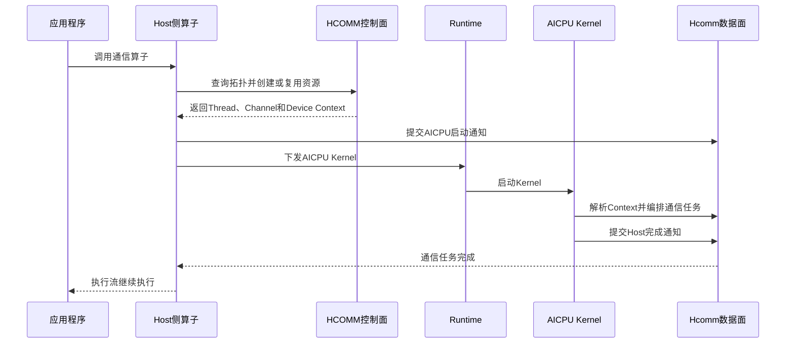
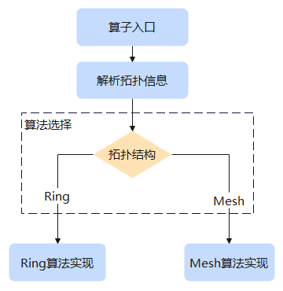
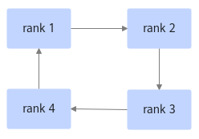
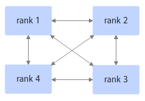

# Hcomm算子的实现

Hcomm算子是开发者使用HCOMM控制面准备拓扑和通信资源，并在通信执行端调用Hcomm数据面接口自行编排通信算法的自定义通信算子。本章以AICPU_TS为数据面发起方，介绍Hcomm算子的通用开发流程，并使用AllGather算子说明各阶段的实现方法。

HCOMM控制面接口资料由[HCOMM仓](https://gitcode.com/cann/hcomm)维护，Hcomm数据面接口请参见[HCOMM数据面API](../../api/hcomm/概述.md)。具体接口支持的产品、调用侧和通信协议以对应API的产品支持情况和约束说明为准。

## 总体流程

Hcomm算子的开发与执行分为Host侧准备和AICPU侧执行两个阶段。Host侧负责定义算子接口、查询拓扑、选择算法、创建资源并下发AICPU Kernel；Kernel启动后，AICPU侧取得资源上下文，调用Hcomm数据面接口进行任务编排。因此，从执行顺序看，Kernel下发在前，数据面任务编排在Kernel启动后执行。



开发Hcomm算子通常包含以下步骤：

1. **定义算子接口**：确定通信语义、输入输出、数据量、数据类型、通信域和执行流等参数。
2. **查询拓扑信息**：获取Rank、拓扑层级和可用链路，为算法选择和资源计算提供依据。
3. **选择通信算法**：根据拓扑、数据量、执行引擎和通信协议选择算法；固定实现可以省略该步骤。
4. **创建通信资源**：计算并申请Thread、Notify、Channel、通信内存和通信引擎上下文。
5. **实现任务编排**：使用本地数据操作、远端数据操作和同步控制接口描述通信算法。
6. **下发AICPU Kernel**：加载Kernel、封装参数并通过Runtime下发，同时建立Host与AICPU的同步关系。
7. **处理完成与资源生命周期**：等待执行完成，复用或释放通信资源。
8. **编译部署和验证**：构建Host与AICPU产物，部署算子包并验证功能、同步和资源复用。

## 1. 定义算子接口

通信算子接口用于表达上层业务可见的通信语义。接口参数应能够确定参与通信的数据、Rank关系、通信域和执行顺序。

常见接口参数如下：

| 参数类别 | 说明 |
| --- | --- |
| 数据地址 | 输入和输出的Device内存地址。 |
| 数据描述 | 元素数量和数据类型，或者直接以字节表示的数据长度。 |
| 通信域 | 确定参与通信的Rank集合和通信资源作用域。 |
| 执行流 | 确定通信任务与业务任务之间的执行顺序。 |

### AllGather算子示例

AllGather收集每个Rank的输入，并按照Rank编号顺序写入每个Rank的输出，通信域所有Rank均参与数据收集。

```cpp
HcclResult HcclAllGatherCustom(
    void *sendBuf,
    void *recvBuf,
    uint64_t sendCount,
    HcclDataType dataType,
    HcclComm comm,
    aclrtStream stream);
```


## 2. 查询拓扑信息

### 背景

通信域可能包含不同的网络层级、拓扑类型和Rank间链路。同一个通信算子在不同拓扑下可能需要使用不同算法或Channel协议，因此Host侧在创建资源前需要查询实际拓扑。

### HCOMM控制面支持的拓扑信息

HCOMM控制面提供以下常用查询能力：

| 拓扑信息 | 查询接口 |
| --- | --- |
| 获取当前Device在通信域中的Rank编号。 | [HcclGetRankId](https://gitcode.com/cann/hcomm/blob/master/docs/zh/api_ref/comm_opdev/control_plane_api/topo_info_query/HcclGetRankId.md) |
| 获取通信域中的Rank数量。 | [HcclGetRankSize](https://gitcode.com/cann/hcomm/blob/master/docs/zh/api_ref/comm_opdev/control_plane_api/topo_info_query/HcclGetRankSize.md) |
| 获取包含当前Rank的拓扑层级列表。 | [HcclRankGraphGetLayers](https://gitcode.com/cann/hcomm/blob/master/docs/zh/api_ref/comm_opdev/control_plane_api/topo_info_query/HcclRankGraphGetLayers.md) |
| 获取指定层级内的Rank列表。 | [HcclRankGraphGetRanksByLayer](https://gitcode.com/cann/hcomm/blob/master/docs/zh/api_ref/comm_opdev/control_plane_api/topo_info_query/HcclRankGraphGetRanksByLayer.md) |
| 获取指定层级内的Rank数量。 | [HcclRankGraphGetRankSizeByLayer](https://gitcode.com/cann/hcomm/blob/master/docs/zh/api_ref/comm_opdev/control_plane_api/topo_info_query/HcclRankGraphGetRankSizeByLayer.md) |
| 获取指定层级的拓扑类型。 | [HcclRankGraphGetTopoTypeByLayer](https://gitcode.com/cann/hcomm/blob/master/docs/zh/api_ref/comm_opdev/control_plane_api/topo_info_query/HcclRankGraphGetTopoTypeByLayer.md) |
| 获取指定层级中的拓扑实例数量和各实例规模。 | [HcclRankGraphGetInstSizeListByLayer](https://gitcode.com/cann/hcomm/blob/master/docs/zh/api_ref/comm_opdev/control_plane_api/topo_info_query/HcclRankGraphGetInstSizeListByLayer.md) |
| 获取源Rank和目的Rank之间的链路信息。 | [HcclRankGraphGetLinks](https://gitcode.com/cann/hcomm/blob/master/docs/zh/api_ref/comm_opdev/control_plane_api/topo_info_query/HcclRankGraphGetLinks.md) |

### 基础示例

1. 查询本Rank编号和通信域Rank数量。

    ```cpp
    uint32_t rankId = 0;
    uint32_t rankSize = 0;
    CHK_RET(HcclGetRankId(comm, &rankId));
    CHK_RET(HcclGetRankSize(comm, &rankSize));

    if (rankId >= rankSize) {
        return HCCL_E_PARA;
    }
    ```

2. 查询当前Rank所在的拓扑层级。

    ```cpp
    uint32_t *netLayers = nullptr;
    uint32_t netLayerNum = 0;
    CHK_RET(HcclRankGraphGetLayers(
        comm, &netLayers, &netLayerNum));

    for (uint32_t i = 0; i < netLayerNum; i++) {
        uint32_t rankNum = 0;
        CHK_RET(HcclRankGraphGetRankSizeByLayer(
            comm, netLayers[i], &rankNum));
    }
    ```

3. 查询两个Rank之间的可用链路。

    ```cpp
    CommLink *linkList = nullptr;
    uint32_t listSize = 0;
    CHK_RET(HcclRankGraphGetLinks(
        comm, 0, srcRank, dstRank, &linkList, &listSize));

    for (uint32_t i = 0; i < listSize; i++) {
        CommProtocol protocol = linkList[i].linkAttr.linkProtocol;
        // 根据目标数据面能力选择可用协议。
    }
    ```

### AllGather算子示例

AllGather样例先取得本Rank和Rank数量，再遍历所有对端Rank。`FillChannelDesc`从本Rank到对端Rank的链路中选择`UBC_CTP`协议，并将链路Endpoint信息转换为Channel描述。

```cpp
HcclResult FillChannelDesc(
    HcclComm comm, uint32_t srcRank, uint32_t dstRank,
    HcclChannelDesc &desc)
{
    CommLink *linkList = nullptr;
    uint32_t listSize = 0;
    CHK_RET(HcclRankGraphGetLinks(
        comm, 0, srcRank, dstRank, &linkList, &listSize));
    CHK_RET(HcclChannelDescInit(&desc, 1));

    for (uint32_t i = 0; i < listSize; i++) {
        CommLink &link = linkList[i];
        if (link.linkAttr.linkProtocol !=
            CommProtocol::COMM_PROTOCOL_UBC_CTP) {
            continue;
        }

        desc.remoteRank = dstRank;
        desc.notifyNum = 3;
        desc.channelProtocol = link.linkAttr.linkProtocol;
        desc.localEndpoint.protocol = link.srcEndpointDesc.protocol;
        desc.localEndpoint.commAddr = link.srcEndpointDesc.commAddr;
        desc.localEndpoint.loc = link.srcEndpointDesc.loc;
        desc.remoteEndpoint.protocol = link.dstEndpointDesc.protocol;
        desc.remoteEndpoint.commAddr = link.dstEndpointDesc.commAddr;
        desc.remoteEndpoint.loc = link.dstEndpointDesc.loc;
        return HCCL_SUCCESS;
    }
    return HCCL_E_NOT_FOUND;
}

CHK_RET(HcclGetRankId(comm, &param.myRank));
CHK_RET(HcclGetRankSize(comm, &param.rankSize));

for (uint32_t remoteRank = 0;
     remoteRank < param.rankSize; remoteRank++) {
    if (remoteRank == param.myRank) {
        continue;
    }
    HcclChannelDesc desc;
    CHK_RET(FillChannelDesc(
        comm, param.myRank, remoteRank, desc));
    channelDescs.push_back(desc);
}
```

## 3. 算法选择

### 选择策略

通信算法的选择在很大程度上决定了通信算子的整体性能表现，为应对不同的网络拓扑、通信数据量以及硬件资源，一个通信算子往往具有多种算法实现。在实际分布式集群场景中，需要根据具体场景，综合考量选择拓扑亲和的通信算法，以实现通信效率的最大化。

<p align="center"></p>

如上图所示，通信算子支持多种算法实现，开发者可以根据拓扑信息选择最优通信算法：

- Ring算法实现：算法编排在AI CPU侧，适用于Server内物理拓扑为Ring的场景。
- Mesh算法实现：算法编排在AI CPU侧，适用于Server内物理拓扑为Mesh的场景。

> [!NOTE]说明
>
>1. 如果通信算子只有一种算法实现，那么可以跳过本节的算法选择步骤。
>2. 本章所述的算法是开发者自行实现的算法，HCCL\_ALGO环境变量配置的算法是HCCL内置算法。HCCL内置算法可参考《HCCL集合通信库用户指南》的相关参考 \> 集合通信算法介绍。

### 代码示例

以[选择策略](#选择策略)介绍的算法选择策略为例，对应的算法选择代码片段如下：

```c
if (algType == ALG_LEVEL0_NP_DOUBLE_RING || algType == ALG_LEVEL0_NP_SINGLE_RING) {
    algName = "Ring";  // 根据拓扑信息选择使用Ring算法
} else if (algType == ALG_LEVEL0_NP_MESH) {
    algName = "Mesh";  // 根据拓扑信息选择使用Mesh算法
} else {
    return HCCL_E_NOT_SUPPORT;
}
```


## 4. 创建资源

### 通信资源计算

通信算子在执行时依赖底层的硬件通信资源，因此在算子任务编排下发前，首先需要申请所需的通信资源。HCCL通信资源主要分为三类：

- **Thread**：用于表达单个rank内的并发关系，相同Thread上的task严格顺序执行，不同Thread上的task可以并发执行。无论何种展开模式，Thread均可分为1个主Thread和若干个从Thread，由该主Thread来控制这些从Thread上的任务的开始和结束，其中主Thread必须申请，从Thread的申请数量由每个通信算法单独计算。
- **Notify**：用于实现同步机制，包括rank内Thread间同步和rank间同步。
- **Channel**：用于跨rank传输数据的通道。

不同的通信算法所需的通信资源数量往往不相同。下面以单机4卡的拓扑组网、使用AI CPU通信引擎为例，分别讲解Ring环状通信算法、Mesh全连接通信算法所需通信资源数量的计算逻辑。

- **Ring环状通信算法**

  Ring算法的硬件拓扑如下图所示，每个rank从上一个rank接收数据，同时将数据发送到下一个rank。

  <p align="center"></p>

  上述组网中Ring环状通信算法所需要的通信资源数量如下：

  - Thread：每个rank分别跟左右两个rank进行通信，且左右两端通信可以异步执行，因此每个rank需要2个Thread资源。
  - Thread Notify：Thread上的Notify用于Thread之间的同步， 对于1个Thread来说，只需要1个Notify来接受另1个Thread的POST信号，因此2个Thread只需要1个Notify。
  - Channel：每个rank分别跟左右两个rank进行通信，因此每个rank需要建立2条Channel通信链路。
  - Channel Notify：每个rank分别跟左右两个rank进行同步，同步操作分为Record和Wait，二者需要配对使用，因此每个Channel上需要2个Notify资源，每个rank的2条Channel上共需要4个Notify资源。

- **Mesh全连接通信算法**

  Mesh算法的硬件拓扑如下图所示，每个rank与其他所有rank直接通信。

  <p align="center"></p>

  上述组网中Mesh全连接通信算法所需要的通信资源数量如下：

  - Thread：每个rank跟其他所有rank进行通信，且所有通信可以异步执行，因此每个rank一共需要3个Thread资源。
  - Thread Notify：Thread上的Notify用于Thread之间的同步， 对于1个Thread来说，他只需要1个Notify来接受另1个Thread的POST信号，因此3个Thread只需要2个Notify。
  - Channel：每个rank跟其他所有rank进行通信，因此每个rank一共需要建立3条Channel通信通道。
  - Channel Notify：每个rank跟其他所有rank进行同步，同步操作分为前同步和后同步（前同步即是告诉远端rank自己已经准备好数据或者内存，可被远端Rank读写；后同步即是告诉远端Rank自己已经读写完毕），二者需要配对使用，因此每个rank各3条Channel一共需要6个Notify资源。

综上所述，针对Ring环状通信算法、Mesh全连接通信算法，每个rank所需的通信资源数量如下表所示。

单机4卡拓扑中，算法所需各类通信资源的数量对比如下表所示。

| 通信资源 | Ring算法 | Mesh算法 |
| --- | --- | --- |
| Thread | 2 | 3 |
| Notify | 4 | 6 |
| Channel | 2 | 3 |

### 代码示例

下面以基于Mesh算法的自定义AllGather算子为例，介绍其在Host侧创建通信资源的核心代码。该算法需要与其他所有Rank并发交换数据，因此每个Rank申请`rankSize - 1`个Thread，并与其他每个Rank分别建立一条Channel。申请到的资源统一保存在`AlgResourceCtx`中，随后复制到AICPU侧的Context内存，供Kernel执行任务编排时使用。

1. 获取本端HCCL Buffer，并根据Rank数计算和申请资源。

    ```cpp
    HcclResult HcclAllocAlgResourceAICPU(
        HcclComm comm, const OpParam &param, AlgResourceCtx &resCtxHost)
    {
        void *cclBufferAddr;
        uint64_t cclBufferSize;
        CHK_RET(HcclGetHcclBuffer(comm, &cclBufferAddr, &cclBufferSize));
        resCtxHost.cclMem = CommBuffer{cclBufferAddr, cclBufferSize};

        uint32_t threadNum = param.rankSize > 1 ? param.rankSize - 1 : 1;
        resCtxHost.slaveThreadNum = threadNum - 1;
        resCtxHost.notifyNumOnMainThread = resCtxHost.slaveThreadNum;
        resCtxHost.notifyNumPerThread =
            std::vector<uint32_t>(resCtxHost.slaveThreadNum, 1);

        CHK_RET(HcclGetThreadAICPU(comm, param, resCtxHost));
        CHK_RET(HcclGetChannelAICPU(comm, param, resCtxHost));
        return HCCL_SUCCESS;
    }
    ```

2. 申请AICPU通信Thread。`threads[0]`为主Thread，其余为从Thread；在算法需要的Notify之外，额外预留一个Notify用于Host与Device同步。

    ```cpp
    HcclResult HcclGetThreadAICPU(
        HcclComm comm, const OpParam &param, AlgResourceCtx &resCtxHost)
    {
        uint32_t threadNum = resCtxHost.slaveThreadNum + 1;
        uint32_t maxNotifyNum = resCtxHost.notifyNumOnMainThread;
        std::vector<ThreadHandle> threads(threadNum);

        CHK_RET(HcclThreadAcquire(
            comm, COMM_ENGINE_AICPU_TS, threadNum,
            maxNotifyNum + 1, threads.data()));
        for (uint32_t i = 0; i < threadNum; i++) {
            resCtxHost.threads.push_back(threads[i]);
        }
        return HCCL_SUCCESS;
    }
    ```

3. 遍历除本Rank外的所有Rank，根据拓扑链路信息填写Channel描述并批量申请Channel；申请完成后，再获取每条Channel对应的远端HCCL Buffer地址。

    ```cpp
    constexpr uint32_t CHANNEL_NOTIFY_NUM = 3;

    HcclResult HcclGetChannelAICPU(
        HcclComm comm, const OpParam &param, AlgResourceCtx &resCtxHost)
    {
        uint32_t channelNum = param.rankSize - 1;
        std::vector<HcclChannelDesc> descs(channelNum);
        std::vector<ChannelHandle> channels(channelNum);
        std::vector<uint32_t> remoteRanks(channelNum);

        uint32_t idx = 0;
        for (uint32_t remoteRank = 0; remoteRank < param.rankSize; remoteRank++) {
            if (remoteRank == param.myRank) {
                continue;
            }
            CHK_RET(FillChannelDesc(
                comm, param.myRank, remoteRank, descs[idx]));
            remoteRanks[idx++] = remoteRank;
        }

        CHK_RET(HcclChannelAcquire(
            comm, COMM_ENGINE_AICPU_TS,
            descs.data(), channelNum, channels.data()));

        for (uint32_t i = 0; i < channelNum; i++) {
            ChannelInfo channel;
            channel.remoteRank = remoteRanks[i];
            channel.handle = channels[i];
            channel.notifyNum = CHANNEL_NOTIFY_NUM;

            void *cclBuf;
            uint64_t cclBufSize;
            CHK_RET(HcclChannelGetHcclBuffer(
                comm, channels[i], &cclBuf, &cclBufSize));
            channel.remoteCclMem = CommBuffer{cclBuf, cclBufSize};
            resCtxHost.channels.push_back(channel);
        }
        return HCCL_SUCCESS;
    }
    ```

    其中，`FillChannelDesc`通过`HcclRankGraphGetLinks`查询本Rank到对端Rank的链路，并填写`remoteRank`、`notifyNum`、通信协议及本端和远端Endpoint等信息。

4. 将`AlgResourceCtx`序列化，创建AICPU通信引擎的Context内存，并把资源信息复制到Device侧。Kernel收到`resCtxDevice`和`ctxSize`后，即可反序列化并使用这些资源。

    ```cpp
    HcclResult HcclMemcpyCtxHostToDevice(
        HcclComm comm, const OpParam &param, AlgResourceCtx &resCtxHost,
        void **resCtxSequence, uint64_t *ctxSize)
    {
        std::vector<char> seq = resCtxHost.Serialize();
        uint64_t size = seq.size();
        void *ctx = nullptr;

        CHK_RET(HcclEngineCtxCreate(
            comm, param.tag, COMM_ENGINE_AICPU_TS, size, &ctx));
        CHK_RET(HcclEngineCtxCopy(
            comm, COMM_ENGINE_AICPU_TS,
            param.tag, seq.data(), size, 0));

        *resCtxSequence = ctx;
        *ctxSize = size;
        return HCCL_SUCCESS;
    }
    ```

## 5. 任务编排

### 编排步骤

参与集合通信的各个rank协调有序地进行同步与数据搬运，完成一个集合通信操作的过程，称为任务编排。任务编排的主要目的是将不同通信线程上的任务并行执行，实现资源的最大化利用，从而提升整体性能。

任务编排主要包含以下几个步骤：

1. 获取本端通信内存，在HCCL中称其为HCCL Buffer。
2. 拷贝算子输入数据到HCCL Buffer中本Rank对应的分片，常用的数据面接口为[HcommLocalCopyOnThread](../../api/hcomm/aicpu/本地数据操作/HcommLocalCopyOnThread.md)。

   > [!NOTE]说明
   > HCCL Buffer是HCCL每个通信域所管理的一块Device上的锁页内存（Pinned Memory），由于通信任务是异步执行的，为确保用户输入的数据在通信任务实际执行时依然有效，因此需要首先将输入数据拷贝到拥有固定内存地址的HCCL Buffer中。

3. 切分输入数据，计算各Rank的数据分片及输入、输出偏移量。

    HCCL Buffer容量有限，若输入数据无法一次完成通信，则需要切分成多个数据块，分别进行处理。

4. 前同步，主Thread通知从Thread启动任务，从Thread等待主Thread通知。常用的数据面接口为[HcommThreadNotifyRecordOnThread](../../api/hcomm/aicpu/同步控制/HcommThreadNotifyRecordOnThread.md)和[HcommThreadNotifyWaitOnThread](../../api/hcomm/aicpu/同步控制/HcommThreadNotifyWaitOnThread.md)。
5. 进行数据交换，各通信Thread先与对应的远端Rank完成数据就绪同步，再按照集合通信算法执行远端读、远端写或远端规约。AllGather样例使用[HcommWriteOnThread](../../api/hcomm/aicpu/远端数据操作/HcommWriteOnThread.md)，将本Rank的数据分片并行写入其他Rank的HCCL Buffer。
6. 后同步，各Rank确认当前数据块的交换已经完成，从Thread通知主Thread任务完成，主Thread等待所有从Thread通知。
7. 拷贝HCCL Buffer中的集合通信结果到算子输出内存。常用的数据面接口为[HcommLocalCopyOnThread](../../api/hcomm/aicpu/本地数据操作/HcommLocalCopyOnThread.md)。

### 代码示例

- 以自定义AllGather算子为例，其在AI CPU侧的任务编排代码片段如下：

    ```c
    // 1. 将本Rank输入拷贝到本地HCCL Buffer的对应分片
    HcommLocalCopyOnThread(
        resCtx.threads[0], curCclBuffAddr, curInputAddr, sliceSize);

    // 2. 主Thread通知从Thread开始当前轮次的通信任务
    ThreadSyncBefore(resCtx.threads);

    // 3. 将本Rank分片并行写入其他Rank的HCCL Buffer
    for (uint32_t i = 0; i < resCtx.threads.size(); i++) {
        ChannelHandle channel = resCtx.channels[i].handle;
        void *remoteCclBuffAddr = static_cast<uint8_t *>(
            resCtx.channels[i].remoteCclMem.addr) + sliceSize * param.myRank;

        HcommChannelNotifyRecordOnThread(
            resCtx.threads[i], channel, NOTIFY_IDX_ACK);
        HcommChannelNotifyWaitOnThread(
            resCtx.threads[i], channel, NOTIFY_IDX_ACK, CUSTOM_TIMEOUT);
        HcommWriteOnThread(
            resCtx.threads[i], channel,
            remoteCclBuffAddr, curCclBuffAddr, sliceSize);
        HcommChannelNotifyRecordOnThread(
            resCtx.threads[i], channel, NOTIFY_IDX_DATA_SIGNAL);
        HcommChannelNotifyWaitOnThread(
            resCtx.threads[i], channel,
            NOTIFY_IDX_DATA_SIGNAL, CUSTOM_TIMEOUT);
    }

    // 4. 主Thread等待所有从Thread完成
    ThreadSyncAfter(resCtx.threads);

    // 5. 将按Rank排列的AllGather结果拷贝到输出内存
    for (uint32_t rankId = 0; rankId < param.rankSize; rankId++) {
        void *curCclBuffAddr = static_cast<uint8_t *>(resCtx.cclMem.addr) +
            sliceSize * rankId;
        uint64_t outputOffset = processedDataCount * dataTypeSize +
            rankId * dataSize;
        void *curOutputAddr = static_cast<uint8_t *>(param.outputPtr) +
            outputOffset;
        HcommLocalCopyOnThread(
            resCtx.threads[0], curOutputAddr, curCclBuffAddr, sliceSize);
    }
    ```

## 6. 算子下发

开发者完成通信算子任务编排后，需要将Kernel函数下发给具体的通信引擎执行。

对于AI CPU通信引擎，开发者需首先声明算子信息库文件，文件格式为json，文件内容如下：

```c
{
  "HcclLaunchCustomAllGatherAicpuKernel": {
    "opInfo": {
      "opKernelLib": "AICPUKernel",
      "kernelSo": "libcustom_allgather_aicpu_kernel.so",
      "functionName": "HcclLaunchCustomAllGatherAicpuKernel"
    }
  }
}
```

定义AI CPU Kernel函数，函数名必须与算子信息库文件（json文件）中的functionName字段保持一致。

```c
extern "C" unsigned int HcclLaunchCustomAllGatherAicpuKernel(OpParam *param)
{
    // Kernel 实现
}
```

### 代码示例

以自定义AllGather算子为例，使用AI CPU通信引擎时，Host侧下发AI CPU Kernel函数的代码片段如下：

```c
// 加载AICPU Kernel，获取AICPU侧动态库句柄
CHK_RET(LoadAICPUKernel());

// Host stream通知Device主thread
CHK_RET(HcommThreadNotifyRecordOnThread(
    param.cpuThread, param.aicpuThreadOnCpu,
    param.aicpuRecordCpuIdx));

// 根据Kernel名称获取函数句柄
std::string kernelName = "HcclLaunchCustomAllGatherAicpuKernel";
aclrtFuncHandle funcHandle;
aclrtArgsHandle argsHandle;
ACLCHECK(aclrtBinaryGetFunction(
    g_binKernelHandle, kernelName.c_str(), &funcHandle));

// 初始化参数句柄，并将AllGather算子参数传递给Kernel
ACLCHECK(aclrtKernelArgsInit(funcHandle, &argsHandle));
aclrtParamHandle paraHandle;
ACLCHECK(aclrtKernelArgsAppend(
    argsHandle, &param, sizeof(OpParam), &paraHandle));
ACLCHECK(aclrtKernelArgsFinalize(argsHandle));

// 配置Kernel超时时间
uint16_t NOTIFY_DEFAULT_WAIT_TIME = 27 * 68;
aclrtLaunchKernelCfg cfg;
aclrtLaunchKernelAttr attr;
attr.id = ACL_RT_LAUNCH_KERNEL_ATTR_TIMEOUT;
attr.value.timeout = NOTIFY_DEFAULT_WAIT_TIME;
cfg.numAttrs = 1;
cfg.attrs = &attr;
constexpr uint32_t numBlocks = 1;

// 下发Kernel，在Device侧执行AllGather任务编排
ACLCHECK(aclrtLaunchKernelWithConfig(
    funcHandle, numBlocks, stream, &cfg, argsHandle, nullptr));

// Host stream等待Device的通知
CHK_RET(HcommThreadNotifyWaitOnThread(
    param.cpuThread, 0, CUSTOM_TIMEOUT));
```

在AI CPU侧需要定义Kernel函数入口，该函数需编译到Device侧。`OpParam`和`AlgResourceCtx`的定义在此省略：

```c
// 在AI CPU上执行的Kernel函数
extern "C" unsigned int HcclLaunchCustomAllGatherAicpuKernel(OpParam *param)
{
    AlgResourceCtx resCtxDevice;
    char *ctx = static_cast<char *>(param->resCtxDevice);
    std::vector<char> seq(ctx, ctx + param->ctxSize);
    resCtxDevice.DeSerialize(seq);

    if (HcommBatchModeStart(param->tag) != HCCL_SUCCESS) {
        return 1;
    }

    // 主thread等待Host stream的通知
    if (HcommThreadNotifyWaitOnThread(
            resCtxDevice.threads[0], param->aicpuRecordCpuIdx,
            CUSTOM_TIMEOUT) != HCCL_SUCCESS) {
        return 1;
    }

    // 执行AllGather任务编排
    if (ExecOp(*param, resCtxDevice) != HCCL_SUCCESS) {
        return 1;
    }

    // 主thread通知Host stream
    if (HcommThreadNotifyRecordOnThread(
            resCtxDevice.threads[0], param->cpuThreadOnAicpu,
            0) != HCCL_SUCCESS) {
        return 1;
    }

    if (HcommBatchModeEnd(param->tag) != HCCL_SUCCESS) {
        return 1;
    }
    return 0;
}
```

## 7. 处理完成与资源生命周期

Hcomm数据面接口通常采用异步提交语义，接口返回成功只表示任务已经提交到通信Thread。算子下发完成后，还需要正确处理Device任务完成、Host执行流同步以及通信资源的复用和释放。

### 处理步骤

算子执行完成与资源生命周期主要包含以下几个步骤：

1. AI CPU完成任务编排后，主Thread通过[HcommThreadNotifyRecordOnThread](../../api/hcomm/aicpu/同步控制/HcommThreadNotifyRecordOnThread.md)向Host执行流发送完成通知。
2. Host侧通过[HcommThreadNotifyWaitOnThread](../../api/hcomm/aicpu/同步控制/HcommThreadNotifyWaitOnThread.md)等待AI CPU完成通知，将通信任务与Host执行流建立顺序依赖。
3. 调用方在读取输出数据前调用`aclrtSynchronizeStream`同步执行流，确保通信任务和结果搬运均已完成。
4. 同一通信域内重复调用相同算子时，Thread、Channel和通信引擎Context等通信域级资源可以复用；与执行流绑定的资源需要在每次调用时重新获取。
5. 所有通信任务完成后，依次销毁通信域、释放输入输出内存、销毁执行流并重置Device。

> [!NOTE]说明
> 通信算子接口返回成功不表示输出数据已经可用。在读取输出、释放输入输出内存或销毁通信域之前，必须先完成执行流同步。

### 代码示例

以自定义AllGather算子为例，测试程序连续调用两次算子，分别验证首次创建通信资源和后续复用通信资源的执行路径。其完成等待和资源释放代码片段如下：

```c
// 第一次调用：创建通信资源并下发AllGather任务
HCCLCHECK(HcclAllGatherCustom(
    sendBuf, recvBuf, count, HCCL_DATA_TYPE_FP32,
    hcclComm, stream));
ACLCHECK(aclrtSynchronizeStream(stream));

// 第二次调用：复用同一通信域中的通信资源
HCCLCHECK(HcclAllGatherCustom(
    sendBuf, recvBuf, count, HCCL_DATA_TYPE_FP32,
    hcclComm, stream));
ACLCHECK(aclrtSynchronizeStream(stream));

// 同步完成后，将AllGather结果拷贝到Host内存
void *resultHostBuf = nullptr;
ACLCHECK(aclrtMallocHost(&resultHostBuf, outputSize));
ACLCHECK(aclrtMemcpy(
    resultHostBuf, outputSize,
    recvBuf, outputSize, ACL_MEMCPY_DEVICE_TO_HOST));
ACLCHECK(aclrtFreeHost(resultHostBuf));

// 释放通信域、业务内存和Runtime资源
HCCLCHECK(HcclCommDestroy(hcclComm));
ACLCHECK(aclrtFree(sendBuf));
ACLCHECK(aclrtFree(recvBuf));
ACLCHECK(aclrtDestroyStream(stream));
ACLCHECK(aclrtResetDevice(device));
```

## 8. 编译部署和验证

