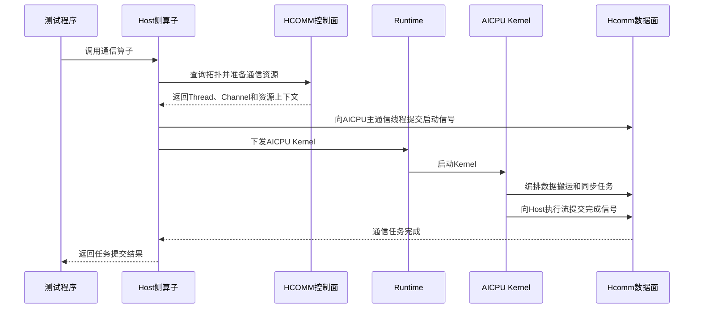

# Hcomm算子的实现

直驱模式下，Host侧使用HCOMM控制面准备通信资源，并通过Runtime下发Kernel；Device侧或通信执行端直接调用Hcomm数据面接口编排通信任务。本章介绍Hcomm算子的实现和编译运行流程，并以HCCL仓中的[AICPU AllGather自定义通信算子样例](https://gitcode.com/cann/hccl/tree/master/examples/05_custom_ops_allgather/aicpu)说明完整实现。

HCOMM控制面接口资料由[HCOMM仓](https://gitcode.com/cann/hcomm)维护，Hcomm数据面接口请参见[HCOMM数据面API](../../api/hcomm/概述.md)。

## Hcomm算子实现概述

### 能力与适用场景

HCOMM将通信能力划分为控制面和数据面。控制面查询Rank拓扑，准备Thread、Channel、HCCL Buffer和通信引擎上下文；数据面消费这些资源，执行本地数据处理、远端数据操作和同步任务。

AICPU数据面能力主要包括：

| 能力 | 作用 |
| --- | --- |
| 任务管理 | 以批量模式等方式组织和提交通信任务。 |
| 本地数据操作 | 在本地Device内存之间执行数据拷贝或规约。 |
| 远端数据操作 | 通过Channel执行远端读写、规约、带Notify写或批量传输。 |
| 同步控制 | 协调通信线程、Runtime任务和Channel两端的执行顺序与完成状态。 |

本章聚焦Host侧准备资源、AICPU_TS编排数据面任务的直驱实现。AIV、CCU或代理模式的资源模型和执行流程不在本章范围内。具体接口支持的产品、调用侧和通信协议以对应API的产品支持情况和约束说明为准。

### 算子实现前提

实现Hcomm算子前，需要完成以下准备：

1. 明确算子的输入输出、Rank间数据关系、算法拓扑和同步点。
2. 明确目标产品、数据面发起方和通信协议，确认所需Hcomm接口的支持范围一致。
3. 安装与目标环境配套的CANN Toolkit，配置CANN环境变量，并准备HCCL样例工程所需的构建工具。
4. 确认各Rank的数据类型、元素数量、通信域配置和软件版本一致。

本章使用的AllGather样例支持<term>Ascend 950PR</term>/<term>Ascend 950DT</term>，采用AICPU_TS数据面和UB_CTP通信协议，组网方式为单机N卡，N不小于2。

### Host与Device实现关系

Hcomm直驱算子的Host侧和Device侧职责如下：

| 组成 | 主要职责 |
| --- | --- |
| Host侧HCOMM控制面 | 查询通信域和Rank拓扑，创建或获取Thread、Channel、HCCL Buffer及通信引擎上下文。 |
| Host侧Runtime | 准备Kernel参数，管理执行流，下发AICPU Kernel并等待任务完成。 |
| AICPU Kernel | 解析资源上下文，调用Hcomm数据面接口编排数据搬运和同步任务。 |
| 测试程序 | 初始化Device和通信域，构造输入，调用算子，同步执行流并验证输出。 |

控制面准备的资源由数据面消费，Runtime负责连接Host侧调用与AICPU Kernel执行：



## 算子实现流程

### 1. 确定算子实现范围

#### 明确通信功能与原语需求

首先确定算子的数据语义和Rank关系，再将算法步骤映射为Hcomm数据面操作。以AllGather样例为例：

| 设计项 | AllGather样例的选择 |
| --- | --- |
| 通信功能 | 收集通信域内每个Rank的输入，按Rank编号顺序拼接到每个Rank的输出。 |
| Rank关系 | 每个Rank都与其他Rank交换数据。 |
| 数据通路 | 输入先拷贝到本地HCCL Buffer，再通过Channel写入对端HCCL Buffer，最后拷贝到输出。 |
| 数据操作 | 使用`HcommLocalCopyOnThread`和`HcommWriteOnThread`。 |
| 同步操作 | 使用Thread Notify完成Host/AICPU和主从通信线程同步，使用Channel Notify完成对端同步。 |
| 任务组织 | 使用`HcommBatchModeStart`和`HcommBatchModeEnd`批量编排数据面任务。 |

如果算法需要远端读、边传输边规约、带Notify写或批量传输，应根据对应数据面API重新设计Channel资源、参数和同步顺序，不能直接沿用本样例的编排流程。

#### 选择数据面发起方与通信路径

数据面发起方、通信引擎和Channel协议必须与目标产品能力匹配。AllGather样例中：

| 环节 | 选择 |
| --- | --- |
| Host侧执行流 | 将`aclrtStream`转换为CPU_TS Thread，用于Host与AICPU同步。 |
| 数据面发起方 | AICPU_TS通信线程。 |
| 通信路径 | 每个对端Rank对应1个UB_CTP Channel。 |
| 运行方式 | Host侧下发AICPU Kernel，Kernel编排通信任务。 |

Host侧会检查当前产品类型，不是<term>Ascend 950PR</term>/<term>Ascend 950DT</term>时直接返回不支持。

### 2. 实现Host侧流程

#### 准备HCOMM控制面资源

Host侧首先调用[HcclGetRankId](https://gitcode.com/cann/hcomm/blob/master/docs/zh/api_ref/comm_opdev/control_plane_api/topo_info_query/HcclGetRankId.md)和[HcclGetRankSize](https://gitcode.com/cann/hcomm/blob/master/docs/zh/api_ref/comm_opdev/control_plane_api/topo_info_query/HcclGetRankSize.md)获取本地Rank和通信域大小。

与执行流绑定的同步资源在每次算子调用时准备：

1. 调用[HcclThreadAcquireWithStream](https://gitcode.com/cann/hcomm/blob/master/docs/zh/api_ref/comm_opdev/control_plane_api/comms_domain_resource_mgmt/HcclThreadAcquireWithStream.md)，将当前执行流转换为CPU_TS通信线程。
2. 将CPU_TS通信线程导出到AICPU_TS通信引擎，使AICPU主通信线程可以向Host执行流发送完成信号。

标签`hccl_custom_allgather`对应的通信引擎上下文按通信域复用。首次调用时，Host侧执行以下操作：

1. 调用[HcclGetHcclBuffer](https://gitcode.com/cann/hcomm/blob/master/docs/zh/api_ref/comm_opdev/control_plane_api/comms_domain_resource_mgmt/HcclGetHcclBuffer.md)获取本地HCCL Buffer。样例没有单独分配或注册通信内存。
2. 申请`rankSize - 1`个AICPU_TS通信线程；当`rankSize`为1时，至少申请1个通信线程。其中第1个作为主通信线程，其余为从通信线程。
3. 为每个对端Rank调用[HcclChannelAcquire](https://gitcode.com/cann/hcomm/blob/master/docs/zh/api_ref/comm_opdev/control_plane_api/comms_domain_resource_mgmt/HcclChannelAcquire.md)创建1个AICPU_TS Channel。每个Channel申请3个Notify资源。
4. 调用[HcclChannelGetHcclBuffer](https://gitcode.com/cann/hcomm/blob/master/docs/zh/api_ref/comm_opdev/control_plane_api/comms_domain_resource_mgmt/HcclChannelGetHcclBuffer.md)获取每个对端的HCCL Buffer地址和长度。
5. 将资源上下文序列化，调用[HcclEngineCtxCreate](https://gitcode.com/cann/hcomm/blob/master/docs/zh/api_ref/comm_opdev/control_plane_api/comms_domain_resource_mgmt/HcclEngineCtxCreate.md)创建AICPU_TS通信引擎上下文，再调用[HcclEngineCtxCopy](https://gitcode.com/cann/hcomm/blob/master/docs/zh/api_ref/comm_opdev/control_plane_api/comms_domain_resource_mgmt/HcclEngineCtxCopy.md)将上下文复制到Device侧。
6. 将AICPU主通信线程导出到CPU_TS通信引擎，并将其句柄缓存到CPU_TS通信引擎上下文中。

后续调用通过[HcclEngineCtxGet](https://gitcode.com/cann/hcomm/blob/master/docs/zh/api_ref/comm_opdev/control_plane_api/comms_domain_resource_mgmt/HcclEngineCtxGet.md)取回上下文，复用AICPU Thread、Channel和HCCL Buffer信息；与当前执行流绑定的CPU_TS Thread仍需每次刷新。

AllGather样例的通信资源关系如下：

| 资源 | 数量 | 用途 |
| --- | --- | --- |
| AICPU通信线程 | `max(rankSize - 1, 1)` | 主通信线程负责本地拷贝、Host/AICPU同步和1个对端任务，其余通信线程分别负责其他对端任务。 |
| Channel | `rankSize - 1` | 连接本地Rank与每个对端Rank。 |
| Channel Notify | 每个Channel 3个 | 当前算法使用索引0和1完成数据就绪和传输完成同步。 |

#### 准备数据面运行参数

样例对外提供`HcclAllGatherCustom`接口，输入和输出地址均为Device内存地址：

```cpp
HcclResult HcclAllGatherCustom(
    void *sendBuf, void *recvBuf, uint64_t sendCount,
    HcclDataType dataType, HcclComm comm, aclrtStream stream);
```

Host侧和AICPU侧共享`OpParam`和`AlgResourceCtx`的定义：

| 结构 | 内容 |
| --- | --- |
| `OpParam` | 输入输出地址、元素数量、数据类型、通信域名称、Rank信息、Host/AICPU同步Thread、Notify索引以及Device侧资源上下文地址和长度。 |
| `AlgResourceCtx` | 本地HCCL Buffer、AICPU通信线程、对端Channel、对端HCCL Buffer地址和各Thread的Notify资源信息。 |

Host侧对`AlgResourceCtx`序列化，AICPU Kernel再反序列化使用。Host侧和AICPU侧必须保持公共结构的字段定义、顺序和字节布局一致。

#### 启动通信任务并释放资源

Host侧在Kernel下发前调用[HcommThreadNotifyRecordOnThread](../../api/hcomm/aicpu/同步控制/HcommThreadNotifyRecordOnThread.md)，向执行流提交发送AICPU启动信号的任务；Kernel下发后，再调用[HcommThreadNotifyWaitOnThread](../../api/hcomm/aicpu/同步控制/HcommThreadNotifyWaitOnThread.md)，向同一执行流提交等待AICPU完成信号的任务：

```cpp
HcommThreadNotifyRecordOnThread(
    param.cpuThread, param.aicpuThreadOnCpu,
    param.aicpuRecordCpuIdx);

LaunchKernel(param, stream);

HcommThreadNotifyWaitOnThread(
    param.cpuThread, 0, CUSTOM_TIMEOUT);
```

上述Hcomm接口调用成功只表示任务已提交到执行流，不表示通信操作已在Device侧执行完成。调用方必须在使用输出数据或释放资源前调用`aclrtSynchronizeStream`同步执行流。

Thread、Channel和通信引擎上下文由通信域管理。样例结束时先同步执行流，再销毁通信域，释放Device和Host内存，销毁执行流并重置Device。不能使用普通内存释放接口自行释放Thread、Channel或通信引擎上下文。

### 3. 实现Hcomm数据面代码

#### 解析Hcomm数据面资源上下文

AICPU Kernel从`OpParam`中取得序列化的资源上下文，反序列化为`AlgResourceCtx`，然后开启批量模式并等待Host执行流的启动信号：

```cpp
AlgResourceCtx resCtxDevice;
resCtxDevice.DeSerialize(seq);

HcommBatchModeStart(param->tag);
HcommThreadNotifyWaitOnThread(
    resCtxDevice.threads[0],
    param->aicpuRecordCpuIdx, CUSTOM_TIMEOUT);
```

样例不会在AICPU Kernel中重新初始化通信域，也没有调用`HcommAcquireComm`或`HcommReleaseComm`。Kernel直接使用Host侧已准备并传入的Thread、Channel和HCCL Buffer信息。

#### 调用Hcomm原语完成数据传输

AICPU Kernel调用`ExecOp`编排AllGather算法。样例使用的Hcomm接口如下：

| 接口 | 作用 |
| --- | --- |
| [HcommLocalCopyOnThread](../../api/hcomm/aicpu/本地数据操作/HcommLocalCopyOnThread.md) | 将本地输入拷贝到HCCL Buffer，并将HCCL Buffer中收集完成的分片拷贝到输出。 |
| [HcommWriteOnThread](../../api/hcomm/aicpu/远端数据操作/HcommWriteOnThread.md) | 将本Rank的HCCL Buffer分片写入对端HCCL Buffer的对应位置。 |
| [HcommChannelNotifyRecordOnThread](../../api/hcomm/aicpu/同步控制/HcommChannelNotifyRecordOnThread.md) / [HcommChannelNotifyWaitOnThread](../../api/hcomm/aicpu/同步控制/HcommChannelNotifyWaitOnThread.md) | 确认Channel两端的数据就绪和传输完成状态。 |
| [HcommThreadNotifyRecordOnThread](../../api/hcomm/aicpu/同步控制/HcommThreadNotifyRecordOnThread.md) / [HcommThreadNotifyWaitOnThread](../../api/hcomm/aicpu/同步控制/HcommThreadNotifyWaitOnThread.md) | 协调Host与AICPU、AICPU主从通信线程之间的执行顺序。 |
| [HcommBatchModeStart](../../api/hcomm/aicpu/任务管理/HcommBatchModeStart.md) / [HcommBatchModeEnd](../../api/hcomm/aicpu/任务管理/HcommBatchModeEnd.md) | 批量编排并提交本次数据面任务。 |

当通信域只有1个Rank时，样例不创建Channel，仅调用`HcommLocalCopyOnThread`将输入拷贝到输出。

#### 处理完成、同步和执行状态

AllGather样例包含三层同步：

| 同步层次 | 实现方式 |
| --- | --- |
| Host执行流与AICPU主通信线程 | 使用Thread Notify传递Kernel启动和通信完成信号。 |
| AICPU主通信线程与从通信线程 | 使用Thread Notify保证本地输入已写入HCCL Buffer，并等待所有对端任务完成。 |
| Channel两端 | 使用Channel Notify确认当前分片就绪和远端写完成。 |

`ExecOp`编排成功后，AICPU主通信线程向Host执行流发送完成信号，再结束批量模式：

```cpp
ExecOp(*param, resCtxDevice);

HcommThreadNotifyRecordOnThread(
    resCtxDevice.threads[0],
    param->cpuThreadOnAicpu, 0);
HcommBatchModeEnd(param->tag);
```

样例使用Hcomm接口返回值和AICPU Kernel返回值报告编排失败，不使用Event、Barrier或额外的执行状态内存。实现其他算子时，应根据实际错误传递和同步需求设计完成机制。

### 4. 验证算子

算子验证需要覆盖以下内容：

1. **通信结果**：检查每个Rank的输出内容和Rank顺序是否正确。
2. **同步正确性**：确认Host执行流、AICPU主从通信线程和Channel两端未出现Notify等待超时。
3. **多Rank一致性**：确认各Rank使用相同的数据类型和元素数量，并得到一致输出。
4. **资源复用**：在同一通信域中重复调用算子，验证通信引擎上下文的首次创建和后续复用路径。
5. **资源释放**：确认执行流同步完成后再销毁通信域和释放输入输出内存。

## 算子编译运行流程

### 1. 准备算子工程

AllGather样例工程的主要目录如下：

```text
05_custom_ops_allgather/aicpu/
├── inc/
│   ├── common.h                                   # Host与AICPU共用的参数和资源结构
│   └── hccl_custom_allgather.h                    # AllGather对外接口
├── op_host/
│   ├── allgather.cc                              # Host侧接口和资源复用
│   ├── utils.cc                                  # 拓扑、Thread、Channel和上下文准备
│   ├── load_kernel.cc                            # AICPU Kernel加载
│   └── launch_kernel.cc                          # Kernel下发及Host/AICPU同步
├── op_kernel_aicpu/
│   ├── aicpu_kernel.cc                           # C++模式AICPU Kernel入口
│   ├── aicpu_kernel_asc.aicpu                    # ASC模式AICPU Kernel入口
│   ├── exec_op.cc                                # AllGather数据面编排
│   └── libcustom_allgather_aicpu_kernel.json     # AICPU Kernel描述文件
├── scripts/
│   └── hccl_custom_allgather_aicpu_check_cfg.xml # 算子包签名配置
├── testcase/
│   ├── main.cc                                   # 单机多卡测试程序
│   └── Makefile                                  # 测试程序编译和运行入口
└── CMakeLists.txt                                     # 自定义算子编译和打包配置
```

扩展其他Hcomm算子时，可以复用Host侧资源准备、Kernel下发和测试框架，根据算法需要替换对外接口、Channel拓扑、缓冲区分片方式以及AICPU侧的数据搬运和同步顺序。

### 2. 配置并编译算子

#### 编译配置

编译样例前需要安装配套版本的CANN Toolkit，并准备以下构建工具：

- GCC/G++ 7.3.0至13.3.x。
- CMake 3.16.0及以上版本。

配置CANN环境变量。以root用户默认安装路径为例：

```bash
source /usr/local/Ascend/cann/set_env.sh
```

样例工程使用C++编译Host动态库，使用AICPU和ASC编译方式生成AICPU Kernel。Host动态库链接HCOMM、Runtime和日志等依赖库。

#### 编译命令

样例依赖HCCL仓中的构建和打包脚本，需要在HCCL仓根目录执行：

```bash
cd hccl
bash build.sh --vendor=cust --ops=allgather_aicpu \
    --custom_ops_path=./examples/05_custom_ops_allgather/aicpu
```

#### 编译产物

编译过程会生成自定义算子安装包，并将Host和AICPU侧产物打包到安装包中：

| 产物 | 作用 |
| --- | --- |
| `cann-hccl_custom_allgather_aicpu_linux-<arch>.run` | 自定义算子安装包，生成在HCCL仓的`build_out`目录中。 |
| `hccl_custom_allgather.h` | 向应用程序提供`HcclAllGatherCustom`接口声明。 |
| `libhccl_custom_allgather_aicpu.so` | 实现Host侧资源准备和AICPU Kernel下发。 |
| `libcustom_allgather_aicpu_kernel.json` | 描述AICPU Kernel加载信息。 |
| `aicpu_hccl_custom_allgather.tar.gz` | 封装AICPU Kernel二进制。 |

### 3. 部署算子

在HCCL仓根目录执行以下命令安装自定义算子包：

```bash
./build_out/cann-hccl_custom_allgather_aicpu_linux-<arch>.run \
    --install --install-path=<ascend_cann_path>
```

其中，`<arch>`为编译环境的系统架构，`<ascend_cann_path>`为CANN软件包安装目录。

安装后的主要文件如下：

| 产物 | 安装位置 |
| --- | --- |
| 对外头文件 | `${ASCEND_HOME_PATH}/opp/vendors/cust/include/hccl_custom_allgather.h` |
| Host动态库 | `${ASCEND_HOME_PATH}/opp/vendors/cust/lib64/libhccl_custom_allgather_aicpu.so` |
| AICPU Kernel描述文件 | `${ASCEND_HOME_PATH}/opp/vendors/cust/aicpu/config/libcustom_allgather_aicpu_kernel.json` |
| AICPU Kernel包 | `${ASCEND_HOME_PATH}/opp/vendors/cust/aicpu/kernel/aicpu_hccl_custom_allgather.tar.gz` |

自行编译的AICPU算子包需要满足运行环境的安全验签和白名单要求。以root用户默认安装路径为例，在`/usr/local/Ascend/cann/conf/ascend_package_load.ini`中增加：

```ini
name:aicpu_hccl_custom_allgather.tar.gz
install_path:2
optional:true
package_path:opp/vendors/cust/aicpu/kernel
load_as_per_soc:false
```

样例README提供了开发环境中的验签配置方式。关闭自定义算子验签会降低系统安全性，仅应在确认算子包来源和内容可信的开发环境中使用。验签配置方式及对应的HDK版本要求请参见[样例README](https://gitcode.com/cann/hccl/blob/master/examples/05_custom_ops_allgather/aicpu/README.md)。

### 4. 配置多Rank运行环境

本样例采用单机多卡、单进程多线程运行方式，不需要单独准备Rank配置文件或分别启动多个Rank进程。测试程序执行以下操作：

1. 查询当前可用Device数量，将每个Device的ID作为对应Rank ID。
2. 由Rank 0创建RootInfo，各Host线程使用同一份RootInfo初始化通信域。
3. 为每个Device创建1个Host线程，线程内设置Device，创建执行流和输入输出内存。
4. 通过`LD_LIBRARY_PATH`使测试程序可以加载安装后的Host动态库。

样例的运行范围是单机组网，不涉及多机网络配置和多进程启动顺序。

### 5. 启动算子

进入测试目录编译并运行：

```bash
cd examples/05_custom_ops_allgather/aicpu/testcase
make
make test
```

`make test`在当前进程中启动所有Rank的Host线程。运行期间应确认所有Host线程和AICPU Kernel正常返回，未出现Notify等待超时。

### 6. 检查运行结果

每个Rank将`sendCount`个`float32`输入元素初始化为本Rank编号。以2卡为例，预期输出如下：

```text
Found 2 NPU device(s) available
rankId: 1, input: [ 1 1 ]
rankId: 0, input: [ 0 0 ]
rankId: 0, output: [ 0 0 1 1 ]
rankId: 1, output: [ 0 0 1 1 ]
AllGatherCustom test completed successfully
```

多线程日志的输出顺序可能不同，但每个Rank的输出都应按Rank编号顺序包含全部输入。测试程序在同一通信域和执行流上连续调用两次自定义AllGather，两次输出应保持一致，第二次调用用于验证通信引擎上下文的复用路径。

## 示例：使用Hcomm实现AllGather算子

### 算法设计

AllGather收集通信域内每个Rank的输入，并按Rank编号顺序将数据拼接到每个Rank的输出中。假设通信域包含`rankSize`个Rank，每个Rank输入`sendCount`个元素，则每个Rank的输出包含`sendCount * rankSize`个元素。

样例使用Mesh方式交换数据。若`rankSize`为N，每个Rank的HCCL Buffer按Rank划分为N个分片：

```text
Rank 0 HCCL Buffer:   [Rank 0分片][Rank 1分片] ... [Rank N-1分片]
Rank 1 HCCL Buffer:   [Rank 0分片][Rank 1分片] ... [Rank N-1分片]
...
Rank N-1 HCCL Buffer: [Rank 0分片][Rank 1分片] ... [Rank N-1分片]
```

每个Rank先将本地输入复制到属于自身的分片，再将该分片写入所有对端Rank的同一位置。全部远端写完成后，每个Rank的HCCL Buffer都包含完整数据，再将各分片拷贝到输出的对应位置。

### 分片和多通信线程处理

样例根据HCCL Buffer容量对输入数据分片，每次循环执行以下步骤：

1. 将HCCL Buffer容量按Rank数量等分，将单Rank可用长度向下按128字节对齐。
2. 将单次处理的数据长度限制为不超过256 MB，且不超过单Rank可用的HCCL Buffer分片长度。
3. 将本轮输入拷贝到本地HCCL Buffer中属于本Rank的分片。
4. 主通信线程通知从通信线程开始执行。每个通信线程向不同对端编排通信任务，批量提交后可并行执行。
5. 对端任务完成后，从通信线程向主通信线程发送完成信号。
6. 主通信线程按Rank顺序将HCCL Buffer中的各分片拷贝到输出。

为每个对端分配1个Channel和1个AICPU通信线程，可以将全对端写任务分散到不同通信线程。主通信线程同时负责本地拷贝、Host/AICPU同步和1个对端的通信任务。

### Channel同步和远端写

每个对端Channel使用两个Notify索引完成当前分片的同步：

| Notify索引 | 发送时机 | 作用 |
| --- | --- | --- |
| 0 | 本地数据已写入本地HCCL Buffer | 确认通信双方的当前分片均已就绪，可以开始远端写。 |
| 1 | 本地向对端的远端写完成 | 确认通信双方的当前分片传输完成，保证输出拷贝前数据已齐备。 |

对每个对端编排的核心任务如下：

```cpp
HcommChannelNotifyRecordOnThread(
    thread, channel, NOTIFY_IDX_ACK);
HcommChannelNotifyWaitOnThread(
    thread, channel, NOTIFY_IDX_ACK, CUSTOM_TIMEOUT);

HcommWriteOnThread(
    thread, channel, remoteCclBufferForMyRank,
    localCclBufferForMyRank, sliceSize);

HcommChannelNotifyRecordOnThread(
    thread, channel, NOTIFY_IDX_DATA_SIGNAL);
HcommChannelNotifyWaitOnThread(
    thread, channel, NOTIFY_IDX_DATA_SIGNAL, CUSTOM_TIMEOUT);
```

`remoteCclBufferForMyRank`是对端HCCL Buffer中属于本Rank的分片地址。因此，每个Rank都将自身分片写入所有对端的相同分片位置。

### 资源复用与扩展

样例在首次调用时创建AICPU Thread、Channel和通信引擎上下文，后续在同一通信域中复用这些通信域级资源。与当前执行流绑定的CPU_TS Thread不随通信引擎上下文复用，每次算子调用都需要重新获取和导出。

将该工程扩展为其他Hcomm集合通信算子时，需要重新评估以下内容：

- 算法拓扑与Rank数量增长后的Channel、Thread和通信次数。
- HCCL Buffer的分片方式、对齐要求和单轮可用容量。
- Channel和Thread的Notify数量是否覆盖算法使用的最大索引。
- 各数据面接口的产品、调用侧、通信协议和参数约束。
- `HcommBatchModeStart`与`HcommBatchModeEnd`的成对调用，以及失败路径中的错误返回和资源处理。

本章的产品范围以样例README和Host侧运行时检查为准，不能因构建文件中存在其他架构选项而扩大声明的支持范围。
