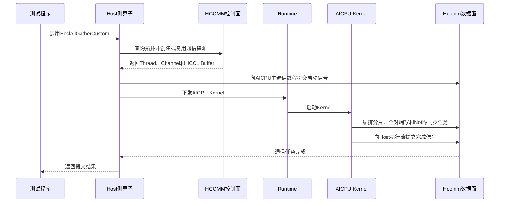

# Hcomm算子的实现

直驱模式下，Host侧使用HCOMM控制面准备通信资源并下发AICPU Kernel，AICPU Kernel直接调用Hcomm数据面接口编排集合通信任务。本章以HCCL仓中的[AICPU AllGather自定义通信算子样例](https://gitcode.com/cann/hccl/tree/master/examples/05_custom_ops_allgather/aicpu)为例，介绍Hcomm算子的实现、编译、安装和验证流程。

本章只解析实现Hcomm算子所需的关键流程和算法。HCOMM控制面接口资料由[HCOMM仓](https://gitcode.com/cann/hcomm)维护，Hcomm数据面接口请参见[HCOMM数据面API](../../api/hcomm/概述.md)。

## 实现概述

### 直驱模式

Hcomm直驱算子由Host侧算子实现和AICPU Kernel组成：

| 组成 | 主要职责 |
| --- | --- |
| Host侧算子实现 | 定义对外算子接口，查询通信域和拓扑信息，准备Thread、Channel和HCCL Buffer，将资源上下文传递到Device侧，并下发AICPU Kernel。 |
| AICPU Kernel | 解析资源上下文，使用Hcomm数据面接口编排本地拷贝、远端写和同步任务，并将完成信号返回Host执行流。 |
| 测试程序 | 初始化通信域和Device资源，构造输入数据，调用自定义AllGather算子并验证各Rank输出。 |

控制面创建的Thread、Channel和HCCL Buffer由数据面消费，两者的关系如下：



### 样例功能

AllGather收集通信域内每个Rank的输入，并按Rank编号顺序将数据拼接到每个Rank的输出中。假设通信域包含`rankSize`个Rank，每个Rank输入`sendCount`个元素，则每个Rank的输出包含`sendCount * rankSize`个元素。

样例使用Mesh方式交换数据。若`rankSize`为N，每个Rank的HCCL Buffer按Rank划分为N个分片：

```text
Rank 0 HCCL Buffer: [Rank 0分片][Rank 1分片] ... [Rank N-1分片]
Rank 1 HCCL Buffer: [Rank 0分片][Rank 1分片] ... [Rank N-1分片]
...
Rank N-1 HCCL Buffer: [Rank 0分片][Rank 1分片] ... [Rank N-1分片]
```

每个Rank先将本地输入复制到属于自身的分片，再将该分片写入所有对端Rank的同一位置。全部远端写完成后，每个Rank的HCCL Buffer都包含完整数据，再将各分片拷贝到输出的对应位置。

样例README和Host侧产品检查表明，当前样例支持<term>Ascend 950PR</term>/<term>Ascend 950DT</term>，组网方式为单机N卡，N不小于2。

## 算子实现流程

### 1. 定义算子接口和公共参数

样例对外提供`HcclAllGatherCustom`接口，输入和输出地址均为Device内存地址：

```cpp
HcclResult HcclAllGatherCustom(
    void *sendBuf, void *recvBuf, uint64_t sendCount,
    HcclDataType dataType, HcclComm comm, aclrtStream stream);
```

Host侧通过`OpParam`向AICPU Kernel传递以下信息：

| 信息 | 作用 |
| --- | --- |
| 输入输出信息 | 输入地址、输出地址、元素数量和数据类型。 |
| 通信域信息 | 通信域名称、本地Rank和Rank数量。 |
| Host/AICPU同步信息 | Host绑定执行流的Thread、导出后的AICPU主Thread以及两者使用的Notify索引。 |
| 算法资源上下文 | Device侧资源上下文地址和长度。 |

`AlgResourceCtx`保存本地HCCL Buffer、AICPU通信线程、对端Channel和对端HCCL Buffer信息。Host侧对该结构序列化，AICPU Kernel再反序列化使用。实现自定义算子时，Host侧和AICPU侧必须共享公共结构的定义，并保证字段布局一致。

### 2. 准备Host侧通信资源

Host侧首先调用[HcclGetRankId](https://gitcode.com/cann/hcomm/blob/master/docs/zh/api_ref/comm_opdev/control_plane_api/topo_info_query/HcclGetRankId.md)和[HcclGetRankSize](https://gitcode.com/cann/hcomm/blob/master/docs/zh/api_ref/comm_opdev/control_plane_api/topo_info_query/HcclGetRankSize.md)获取本地Rank和通信域大小。

与执行流绑定的同步资源在每次调用时创建：

1. 调用[HcclThreadAcquireWithStream](https://gitcode.com/cann/hcomm/blob/master/docs/zh/api_ref/comm_opdev/control_plane_api/comms_domain_resource_mgmt/HcclThreadAcquireWithStream.md)，将当前执行流转换为CPU_TS通信线程。
2. 将CPU_TS通信线程导出到AICPU_TS通信引擎，使AICPU主通信线程可以向Host执行流发送完成信号。

标签`hccl_custom_allgather`对应的通信引擎上下文按通信域复用。首次调用时，样例完成以下操作：

1. 调用[HcclGetHcclBuffer](https://gitcode.com/cann/hcomm/blob/master/docs/zh/api_ref/comm_opdev/control_plane_api/comms_domain_resource_mgmt/HcclGetHcclBuffer.md)获取本地HCCL Buffer。
2. 申请`rankSize - 1`个AICPU_TS通信线程；当`rankSize`为1时，至少申请1个通信线程。其中第1个作为主通信线程，其余为从通信线程。
3. 为每个对端Rank调用[HcclChannelAcquire](https://gitcode.com/cann/hcomm/blob/master/docs/zh/api_ref/comm_opdev/control_plane_api/comms_domain_resource_mgmt/HcclChannelAcquire.md)创建1个AICPU_TS Channel。样例选择UB_CTP通信协议，每个Channel申请3个Notify资源。
4. 调用[HcclChannelGetHcclBuffer](https://gitcode.com/cann/hcomm/blob/master/docs/zh/api_ref/comm_opdev/control_plane_api/comms_domain_resource_mgmt/HcclChannelGetHcclBuffer.md)获取每个对端的HCCL Buffer地址和长度。
5. 将资源上下文序列化，调用[HcclEngineCtxCreate](https://gitcode.com/cann/hcomm/blob/master/docs/zh/api_ref/comm_opdev/control_plane_api/comms_domain_resource_mgmt/HcclEngineCtxCreate.md)创建AICPU_TS通信引擎上下文，再调用[HcclEngineCtxCopy](https://gitcode.com/cann/hcomm/blob/master/docs/zh/api_ref/comm_opdev/control_plane_api/comms_domain_resource_mgmt/HcclEngineCtxCopy.md)将上下文复制到Device侧。
6. 将AICPU主通信线程导出到CPU_TS通信引擎，并将其句柄缓存到CPU_TS通信引擎上下文中。

后续调用通过[HcclEngineCtxGet](https://gitcode.com/cann/hcomm/blob/master/docs/zh/api_ref/comm_opdev/control_plane_api/comms_domain_resource_mgmt/HcclEngineCtxGet.md)取回上下文，复用AICPU Thread、Channel和HCCL Buffer信息；与当前执行流绑定的CPU_TS Thread仍需每次刷新。

样例为每个对端分配一个Channel和一个AICPU通信线程，资源关系如下：

| 资源 | 数量 | 用途 |
| --- | --- | --- |
| AICPU通信线程 | `max(rankSize - 1, 1)` | 主通信线程负责本地拷贝、Host/AICPU同步和1个对端任务，其余通信线程分别负责其他对端任务。 |
| Channel | `rankSize - 1` | 连接本地Rank与每个对端Rank。 |
| Channel Notify | 每个Channel 3个 | 当前算法使用索引0和1完成数据就绪和传输完成同步。 |

### 3. 下发AICPU Kernel

Host侧在Kernel下发前调用[HcommThreadNotifyRecordOnThread](../../api/hcomm/aicpu/同步控制/HcommThreadNotifyRecordOnThread.md)，向执行流提交发送AICPU启动信号的任务；Kernel下发后，再调用[HcommThreadNotifyWaitOnThread](../../api/hcomm/aicpu/同步控制/HcommThreadNotifyWaitOnThread.md)，向同一执行流提交等待AICPU完成信号的任务：

```cpp
HcommThreadNotifyRecordOnThread(
    param.cpuThread, param.aicpuThreadOnCpu,
    param.aicpuRecordCpuIdx);

LaunchKernelAsc(param, stream);  // 或使用aclrtLaunchKernelWithConfig下发。

HcommThreadNotifyWaitOnThread(
    param.cpuThread, 0, CUSTOM_TIMEOUT);
```

样例支持两种Kernel下发方式：

- 默认加载AICPU Kernel二进制，通过`aclrtLaunchKernelWithConfig`下发。
- 将环境变量`HCCL_CUSTOM_KERNEL_LAUNCH_ASC`设置为`1`时，通过ASC编译的包装函数使用`<<<>>>`语法下发。

这些Hcomm接口调用成功只表示相关任务已提交到执行流，不表示通信操作已在Device侧执行完成。调用方必须在使用输出数据或释放资源前调用`aclrtSynchronizeStream`同步执行流。

### 4. 实现AICPU Kernel入口

AICPU Kernel反序列化算法资源上下文，开启批量模式，再等待Host执行流发送启动信号。数据面任务编排完成后，Kernel向Host执行流发送完成信号，并结束批量模式：

```cpp
AlgResourceCtx resCtxDevice;
resCtxDevice.DeSerialize(seq);

HcommBatchModeStart(param->tag);
HcommThreadNotifyWaitOnThread(
    resCtxDevice.threads[0],
    param->aicpuRecordCpuIdx, CUSTOM_TIMEOUT);

ExecOp(*param, resCtxDevice);

HcommThreadNotifyRecordOnThread(
    resCtxDevice.threads[0],
    param->cpuThreadOnAicpu, 0);
HcommBatchModeEnd(param->tag);
```

其中，[HcommBatchModeStart](../../api/hcomm/aicpu/任务管理/HcommBatchModeStart.md)与[HcommBatchModeEnd](../../api/hcomm/aicpu/任务管理/HcommBatchModeEnd.md)成对使用，用于批量编排和提交本次数据面任务。

### 5. 编排AllGather数据面任务

样例根据HCCL Buffer容量对输入数据分片，每次循环处理一个分片：

1. 将HCCL Buffer容量按Rank数量等分，将单Rank可用长度向下按128字节对齐。
2. 单次循环处理的数据长度不超过256 MB，也不超过该Rank的HCCL Buffer分片长度。
3. 调用[HcommLocalCopyOnThread](../../api/hcomm/aicpu/本地数据操作/HcommLocalCopyOnThread.md)，将本轮输入复制到本地HCCL Buffer中属于本Rank的分片。
4. 主通信线程通知从通信线程开始执行。每个通信线程向不同对端编排通信任务，批量提交后可并行执行。
5. 对端任务完成后，从通信线程向主通信线程发送完成信号。
6. 主通信线程调用`HcommLocalCopyOnThread`，按Rank顺序将HCCL Buffer中的各分片拷贝到输出。

每个对端Channel使用两个Notify索引完成轮次同步：

| Notify索引 | 发送时机 | 作用 |
| --- | --- | --- |
| 0 | 本地数据已写入本地HCCL Buffer | 确认通信双方的当前分片均已就绪，可以开始远端写。 |
| 1 | 本地向对端的远端写完成 | 确认通信双方的当前分片传输完成，保证输出拷贝前数据已齐备。 |

对每个对端编排的核心任务如下：

```cpp
HcommChannelNotifyRecordOnThread(
    thread, channel, NOTIFY_IDX_ACK);
HcommChannelNotifyWaitOnThread(
    thread, channel, NOTIFY_IDX_ACK, CUSTOM_TIMEOUT);

HcommWriteOnThread(
    thread, channel, remoteCclBufferForMyRank,
    localCclBufferForMyRank, sliceSize);

HcommChannelNotifyRecordOnThread(
    thread, channel, NOTIFY_IDX_DATA_SIGNAL);
HcommChannelNotifyWaitOnThread(
    thread, channel, NOTIFY_IDX_DATA_SIGNAL, CUSTOM_TIMEOUT);
```

上述任务中，[HcommChannelNotifyRecordOnThread](../../api/hcomm/aicpu/同步控制/HcommChannelNotifyRecordOnThread.md)和[HcommChannelNotifyWaitOnThread](../../api/hcomm/aicpu/同步控制/HcommChannelNotifyWaitOnThread.md)用于对端同步，[HcommWriteOnThread](../../api/hcomm/aicpu/远端数据操作/HcommWriteOnThread.md)用于将本Rank分片写入对端HCCL Buffer的对应位置。主从通信线程之间使用[HcommThreadNotifyRecordOnThread](../../api/hcomm/aicpu/同步控制/HcommThreadNotifyRecordOnThread.md)和[HcommThreadNotifyWaitOnThread](../../api/hcomm/aicpu/同步控制/HcommThreadNotifyWaitOnThread.md)进行同步。

当通信域只有1个Rank时，不创建Channel，算法直接将输入拷贝到输出。

### 6. 验证并释放资源

测试程序为每个Device创建一个Host线程、一个通信域和一条执行流。每个Rank将输入数据初始化为本Rank编号，调用`HcclAllGatherCustom`后，通过`aclrtSynchronizeStream`等待任务完成，再将输出拷贝到Host内存并打印。

样例在同一通信域和执行流上连续调用两次自定义AllGather，用于验证通信引擎上下文和通信资源的复用路径。

验证完成后，测试程序依次销毁通信域，释放Device和Host内存，销毁执行流并重置Device。Thread、Channel和通信引擎上下文由通信域管理，不能使用普通内存释放接口自行释放。

## 算子工程

样例工程的主要目录如下：

```text
05_custom_ops_allgather/aicpu/
├── inc/
│   ├── common.h                                  # Host与AICPU共用的参数和资源结构
│   └── hccl_custom_allgather.h                   # AllGather对外接口
├── op_host/
│   ├── allgather.cc                             # Host侧接口和资源复用
│   ├── utils.cc                                 # 拓扑、Thread、Channel和上下文准备
│   ├── load_kernel.cc                           # AICPU Kernel加载
│   └── launch_kernel.cc                         # Kernel下发及Host/AICPU同步
├── op_kernel_aicpu/
│   ├── aicpu_kernel.cc                          # C++模式AICPU Kernel入口
│   ├── aicpu_kernel_asc.aicpu                   # ASC模式AICPU Kernel入口
│   ├── exec_op.cc                               # AllGather数据面编排
│   └── libcustom_allgather_aicpu_kernel.json    # AICPU Kernel描述文件
├── scripts/
│   └── hccl_custom_allgather_aicpu_check_cfg.xml # 算子包签名配置
├── testcase/
│   ├── main.cc                                  # 单机多卡测试程序
│   └── Makefile                                 # 测试程序编译和运行入口
└── CMakeLists.txt                                    # 自定义算子编译和打包配置
```

扩展其他Hcomm集合通信算子时，可以复用Host侧资源准备、Kernel下发和测试框架，主要替换Channel拓扑、HCCL Buffer分片方式以及AICPU侧的数据搬运和同步顺序。

## 算子编译运行流程

### 1. 准备环境

编译样例前需要安装配套版本的CANN Toolkit，并准备以下构建工具：

- GCC/G++ 7.3.0至13.3.x。
- CMake 3.16.0及以上版本。

配置CANN环境变量。以root用户默认安装路径为例：

```bash
source /usr/local/Ascend/cann/set_env.sh
```

### 2. 编译自定义算子包

样例依赖HCCL仓中的构建和打包脚本，需要在HCCL仓根目录执行：

```bash
cd hccl
bash build.sh --vendor=cust --ops=allgather_aicpu \
    --custom_ops_path=./examples/05_custom_ops_allgather/aicpu
```

编译过程会生成Host动态库、AICPU Kernel、Kernel描述文件和自定义算子安装包。

### 3. 安装自定义算子包

在HCCL仓根目录执行以下命令：

```bash
./build_out/cann-hccl_custom_allgather_aicpu_linux-<arch>.run \
    --install --install-path=<ascend_cann_path>
```

其中，`<arch>`为编译环境的系统架构，`<ascend_cann_path>`为CANN软件包安装目录。安装后的主要文件如下：

| 产物 | 安装位置 |
| --- | --- |
| 对外头文件 | `${ASCEND_HOME_PATH}/opp/vendors/cust/include/hccl_custom_allgather.h` |
| Host动态库 | `${ASCEND_HOME_PATH}/opp/vendors/cust/lib64/libhccl_custom_allgather_aicpu.so` |
| AICPU Kernel描述文件 | `${ASCEND_HOME_PATH}/opp/vendors/cust/aicpu/config/libcustom_allgather_aicpu_kernel.json` |
| AICPU Kernel包 | `${ASCEND_HOME_PATH}/opp/vendors/cust/aicpu/kernel/aicpu_hccl_custom_allgather.tar.gz` |

### 4. 配置AICPU Kernel加载

自行编译的AICPU算子包需要满足运行环境的安全验签和白名单要求。样例README提供了开发环境中的验签配置方式。关闭自定义算子验签会降低系统安全性，仅应在确认算子包来源和内容可信的开发环境中使用。

以root用户默认安装路径为例，在`/usr/local/Ascend/cann/conf/ascend_package_load.ini`中增加：

```ini
name:aicpu_hccl_custom_allgather.tar.gz
install_path:2
optional:true
package_path:opp/vendors/cust/aicpu/kernel
load_as_per_soc:false
```

验签配置方式及对应的HDK版本要求请参见[样例README](https://gitcode.com/cann/hccl/blob/master/examples/05_custom_ops_allgather/aicpu/README.md)，不要直接沿用与当前环境不匹配的安全配置。

### 5. 编译并运行测试程序

进入测试目录编译并运行：

```bash
cd examples/05_custom_ops_allgather/aicpu/testcase
make
make test
```

测试程序在一个进程中为每个可用Device创建一个Host线程，所有线程使用同一份RootInfo初始化通信域。

### 6. 检查运行结果

每个Rank将`sendCount`个`float32`输入元素初始化为本Rank编号。以2卡为例，预期输出如下：

```text
Found 2 NPU device(s) available
rankId: 1, input: [ 1 1 ]
rankId: 0, input: [ 0 0 ]
rankId: 0, output: [ 0 0 1 1 ]
rankId: 1, output: [ 0 0 1 1 ]
AllGatherCustom test completed successfully
```

多线程日志的输出顺序可能不同，但每个Rank的输出都应按Rank编号顺序包含全部输入。除输出数据外，还需要确认以下状态：

- 所有Host线程和AICPU Kernel正常返回，未出现Notify等待超时。
- 各Rank使用相同的数据类型和元素数量。
- 每个分片的数据长度未超过本地和对端HCCL Buffer的可用长度。
- 第二次调用成功走通信引擎上下文复用路径，且输出与第一次一致。
- 所有执行流同步完成后再释放输入输出内存和通信域。

## 开发注意事项

- 本章介绍的是AllGather样例的当前实现，产品范围以样例README和Host侧运行时检查为准，不能因构建文件中存在其他架构选项而扩大声明的支持范围。
- Host侧创建的Thread和Channel必须与AICPU侧调用的数据面接口使用相同的通信引擎和协议能力。
- Mesh算法为每个对端创建Channel和编排远端写任务，资源数量和通信次数会随Rank数量增长。扩展到更大集群时，需要重新评估算法和拓扑。
- Channel的Notify数量必须覆盖算法使用的最大索引，Thread的Notify数量必须同时覆盖主从通信线程同步和Host/AICPU同步。
- HCCL Buffer需要按Rank划分并预留对齐空间；输入超出单轮可用容量时，必须分片处理，并保证输出偏移按完整输入长度计算。
- `HcommBatchModeStart`与`HcommBatchModeEnd`必须成对调用。算子实现还应在失败路径中停止后续编排，并按资源生命周期处理已获取的资源。
- Hcomm数据面接口的支持产品、调用侧、通信协议和参数范围可能不同，开发前应逐项检查对应API的产品支持情况和约束说明。
