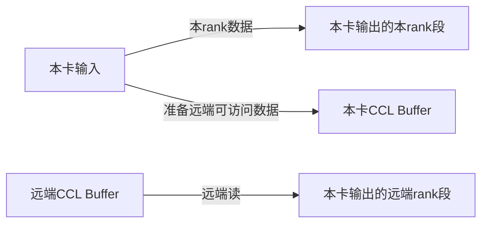

# MC2编程模型源码核查与修改报告

## 1. 核查范围

本文记录 `AllGatherMatmulV2` 在 Ascend 950（dav3510）上使用 AI CPU 通信服务端时，对现有 MC2 编程模型文档的源码核查结果。

核查日期：2026-08-03。

涉及文档：

- `docs/zh/编程模型/MC2编程模型/概述.md`
- `docs/zh/编程模型/MC2编程模型/通信模型.md`
- `docs/zh/编程模型/MC2编程模型/内存模型.md`

涉及源码仓：

| 简称 | 仓路径 | 核查内容 |
| --- | --- | --- |
| OPS | `ops-transformer` | aclnn、Tiling、GenTask、Device Kernel |
| DEVKIT | `asc-devkit` | HCCL高阶API、Host通信资源准备、AICPU Server |
| HCCL | `hccl` | AllGather算法选择、executor、template |
| HCOMM | `hcomm` | 通信原语、transport、RTSQ任务下发 |

本文中的行号基于核查时的工作区版本。正文修改后行号可能变化，应同时按章节标题和关键字定位。

## 2. 总体结论

现有文档对以下主干关系的描述是正确的：

- AI Core上的HCCL高阶API是客户端，AI CPU上的Server是服务端。
- 客户端与服务端通过GM消息区协作，不存在跨核函数调用。
- Host侧在Kernel启动前完成算法选择和通信资源准备。
- HCCL负责算法编排，HCOMM负责通信原语和具体链路任务下发。
- AllGatherMatmulV2先下发通信，再计算本卡数据，随后逐块等待并计算远端数据。

需要修改的内容共9项，其中6项来自前次核查，3项是根据当前扩展版《内存模型》重新检索后新增。

| 编号 | 优先级 | 结论 |
| --- | --- | --- |
| R1 | 必须修改 | Kernel初始化示例缺少`SetCcTilingV2`，且`InitV2`入参错误 |
| R2 | 必须修改 | 消息区复用范围不能简化为“同一通信域固定一块” |
| R3 | 必须修改 | CCL Buffer与通信窗口不能固定描述为两块独立内存 |
| R4 | 必须修改 | 当前AllGather数据流图不符合A5单层Mesh代表路径 |
| R5 | 建议修改 | Host资源准备不能统一描述为“新申请中转内存” |
| R6 | 必须修改 | `Finalize`不能描述成“清空整个消息区” |
| R7 | 必须修改 | 消息槽位在单次算子内不会被循环复用 |
| R8 | 建议修改 | “Wait必须与Prepare同序”缺少实现依据，且“等到错误任务”与源码不符 |
| R9 | 建议补充 | A5消息中的`ccOpTilingData`是`opParamKey`，不是`Mc2CcTiling`地址 |

## 3. 修改项明细

### R1 Kernel初始化示例不完整

#### 当前文档位置

`通信模型.md:221-226`中的示例为：

```cpp
GM_ADDR contextGM = AscendC::GetHcclContext<0>();
hccl.InitV2(contextGM, &tilingData);
```

问题包括：

1. `InitV2`第二个参数应指向`mc2InitTiling`，不能传整个TilingData地址。
2. 缺少`SetCcTilingV2`，客户端无法建立通信类型到预创建`OpParam`的映射。

#### 源码依据

| 仓 | 文件与位置 | 证据 |
| --- | --- | --- |
| OPS | `mc2/all_gather_matmul_v2/op_kernel/arch35/all_gather_matmul_fp16_bf16.h:94-95` | 算子依次调用`InitV2`和`SetCcTilingV2` |
| DEVKIT | `impl/adv_api/detail/hccl/impl/platform_v310/hccl_aicpu.h:30-44` | `InitV2`读取`Mc2InitTilingInner`并取得`OpResCtx.workspace` |
| DEVKIT | 同文件`:48-63` | `SetCcTilingV2`按offset匹配`OpResCtx.algInfo` |

#### 建议修改

将示例改为：

```cpp
GM_ADDR contextGM = AscendC::GetHcclContext<0>();
hccl.InitV2(contextGM, &tilingData->mc2InitTiling);
hccl.SetCcTilingV2(
    offsetof(AllGatherMatmulTilingDataV2, mc2CcTiling));
```

同时在代码后说明：`InitV2`定位消息区，`SetCcTilingV2`指定本次通信配置并关联Host侧预创建的执行参数。

### R2 消息区复用范围表述过宽

#### 当前文档位置

- `内存模型.md:17`：消息区的存活范围写为“通信域”，大小写为“框架固定”。
- `内存模型.md:59-61`：写成首个MC2算子分配后被域内后续算子统一复用。
- `内存模型.md:172`、`:279-281`：写成同一通信域内多个MC2算子共用消息区。
- `通信模型.md:210`：写成消息区属于通信域并被域内多个MC2算子复用。
- `概述.md:213`：写成同一通信域的多个MC2算子共用消息区。

这些表述容易被理解为“一个通信域只有一个消息区”。A5实现实际按通信资源签名创建或复用`OpResCtx`及其workspace。

#### 源码依据

| 仓 | 文件与位置 | 证据 |
| --- | --- | --- |
| DEVKIT | `impl/adv_api/detail/hccl/cc/src/common/hccl_mc2.cc:219-242` | `ctxTag`包含group、opType、algConfig、commEngine及后续通信配置 |
| DEVKIT | `impl/adv_api/detail/hccl/cc/src/common/hccl_alloc_ctx_res.h:174-199` | `OpParam`按`ctxTag + index`创建或复用 |
| DEVKIT | 同文件`:202-220` | 消息workspace按`ctxTag + "_workSpace"`创建或复用 |
| DEVKIT | 同文件`:230-244` | `OpResCtx`按`ctxTag + "_opResCtx"`创建或复用 |

#### 建议修改

统一改成：

> 消息区属于通信域下缓存的MC2通信上下文。通信域和通信配置共同形成资源签名；命中同一`OpResCtx`时复用同一消息区，不同资源签名可能对应不同消息区。消息区不随单次算子执行释放。

“消息区跨算子复用”这条约束可以保留，但应加上“命中相同资源上下文”的前提。

### R3 CCL Buffer与通信窗口被错误拆成固定的独立内存

#### 当前文档位置

- `内存模型.md:13-34`：将“中转内存”和“通信窗口”列为两类独立内存。
- `内存模型.md:53-61`：分别描述两者的分配和释放。
- `内存模型.md:284-306`：分别设置“中转内存”和“通信窗口”章节。
- `内存模型.md:300`：断言每卡固定分输入窗口和输出窗口。
- `通信模型.md:165-170`和`:184`：将中转内存列为Host侧单独申请的资源。

在A5 OPBASE AllGather路径中，通信域提供的CCL Buffer既是本地scratch，也是对端通过channel访问的通信内存。它不是“中转内存”和“通信窗口”两次独立分配。

#### 源码依据

| 仓 | 文件与位置 | 证据 |
| --- | --- | --- |
| HCCL | `src/ops/op_common/op_common.cc:1334-1340` | 从通信域取得CCL Buffer，并明确注释其就是scratch buffer |
| HCCL | 同文件`:1653-1656` | channel中的`remoteCclMem`来自远端CCL Buffer |
| HCCL | `src/ops/all_gather/executor/ins_v2_all_gather_sole_executor.cc:109-118` | executor把`resCtx.cclMem`作为template的HCCL Buffer |
| DEVKIT | `impl/adv_api/detail/hccl/cc/src/common/hccl_alloc_ctx_res.h:88-95` | A5顶层`OpResCtx`仅含workspace、rank和`algInfo`，不含固定输入/输出窗口字段 |

#### 建议修改

内存总览建议改用以下概念：

| 概念 | 建议定义 |
| --- | --- |
| CCL Buffer | 通信域提供的通信缓冲区，可被算法用作scratch，也可通过channel形成远端可访问视图 |
| 通信窗口视图 | 对本卡或对端可访问内存的逻辑视图，不保证对应另一块独立分配的内存 |
| 用户输入/输出注册内存 | 仅在支持直接远端访问、图模式或对称内存等模式下由算法直接使用 |

`内存模型.md:300`的“每卡固定分输入窗口与输出窗口”应删除或改为产品、模式相关描述。

`内存模型.md:306`关于A5 AICPU Kernel不能取得窗口地址的结论可以保留。DEVKIT的`platform_v310/hccl_aicpu.h:90-99`中，`GetWindowsInAddr`和`GetWindowsOutAddr`均返回0。

### R4 AllGather数据流图不准确

#### 当前文档位置

`内存模型.md:312-344`的图3及说明把数据流固定描述为：

```text
本卡输入 → 本卡通信窗口
远端通信窗口 → 本卡中转内存 → 本卡输出
```

该图不符合A5单层Mesh template的代表路径。远端数据的接收目标直接是本卡output，并不先落本卡CCL Buffer。

#### 源码依据

| 仓 | 文件与位置 | 证据 |
| --- | --- | --- |
| HCCL | `src/ops/all_gather/template/aicpu/ins_temp_all_gather_mesh_1D.cc:127-128` | 取得对端`remoteCclMem` |
| HCCL | 同文件`:156-183` | `rxSrcPtr`为远端CCL Buffer，`rxDstPtr`为本卡output |
| HCCL | 同文件`:202-205` | 通过`SendRecvBatchRead`执行批量远端读 |
| HCCL | 同文件`:211-260` | 本卡input复制到本卡output及本卡CCL Buffer |
| HCCL | `src/ops/op_common/template/wrapper/alg_data_trans_wrapper.cc:656-666` | Batch Read描述符的dst/src来自上述接收切片 |

#### 建议修改

图3应明确标注为“单层Mesh代表路径”，建议改为：



图后补充：多级、Sequence或OmniPipe算法可能将CCL Buffer作为阶段间中转，因此不同拓扑下的完整路径可以不同，Kernel只关心通信源地址和最终目的地址。

### R5 Host资源准备不等于全部重新申请

#### 当前文档位置

- `通信模型.md:163-170`：把中转内存列为需要准备的独立资源。
- `通信模型.md:176-192`：第⑤步写成“申请线程、通道、中转内存、消息区”。
- `概述.md:181`：图中统一标注“申请资源”。

Host流程同时包含选择、获取、创建和缓存复用，不能都概括成“申请”。尤其CCL Buffer直接从通信域获取。

#### 源码依据

| 仓 | 文件与位置 | 证据 |
| --- | --- | --- |
| DEVKIT | `impl/adv_api/detail/hccl/cc/src/common/hccl_alloc_ctx_res.h:542-610` | 处理指定算法或运行默认selector |
| DEVKIT | 同文件`:645-672` | 获取executor、线程和算法资源上下文，并记录是否复用 |
| HCCL | `src/ops/op_common/op_common.cc:1337-1345` | 获取通信域已有CCL Buffer，再准备线程和channel |
| DEVKIT | `impl/adv_api/detail/hccl/cc/src/common/hccl_alloc_ctx_res.h:180-238` | `OpParam`、workspace和`OpResCtx`均先Get，未命中才Create |

#### 建议修改

将第⑤步改成：

> 准备、获取或复用执行线程、跨卡通道、CCL Buffer和消息区，并将资源描述打包为通信上下文。

“跨卡协商在Kernel前完成”的结论可以保留。

### R6 Finalize不是清空整个消息区

#### 当前文档位置

- `内存模型.md:90-95`：写成收尾接口清零消息区状态。
- `内存模型.md:279-281`：写成每个算子结束前必须把状态清零。
- `通信模型.md:283-290`：收尾阶段写“状态清零”。
- `通信模型.md:329-334`：时序图写“清零状态，归还消息区”。
- `通信模型.md:367-376`：把`Finalize`第二项职责写成“把消息区的状态清零”。
- `概述.md:213`：写成收尾时必须归还消息区。

这些表述把多个状态的恢复时机混在了`Finalize`里。

#### 源码依据

| 仓 | 文件与位置 | 证据 |
| --- | --- | --- |
| DEVKIT | `impl/adv_api/detail/hccl/cc/src/aicpu_kfc/framework/device/aicpu_kfc/common/aicpu_kfc_utils.cc:578-606` | Server读走请求后立即清请求槽位的`valid` |
| DEVKIT | `impl/adv_api/detail/hccl/common/hccl_aicpu_impl.h:498-510` | Client Finalize先等待最后任务，再发送Finalize消息 |
| DEVKIT | 同文件`:512-522` | 等待服务端完成魔数后，仅调用`ResetFinishedTurnCnt` |
| DEVKIT | `impl/adv_api/detail/hccl/cc/src/aicpu_kfc/framework/device/aicpu_kfc/decoupler/comm_kfc_aicpu_server.cc:665-680` | Server写`FINALIZE_FINISH_CNT`放行Client |

#### 建议修改

统一改成：

> `Finalize`等待已下发通信任务完成，向服务端发送结束消息，并在服务端确认后复位客户端维护的完成计数，使消息上下文可以被后续执行复用。请求有效位在服务端读取请求时已经释放，不能笼统描述为`Finalize`清空整个消息区。

“收尾前必须全核同步”仍然成立。AllGatherMatmulV2在`all_gather_matmul_fp16_bf16.h:170-176`先执行跨核同步，再由block 0调用`Finalize`。

### R7 单次算子内的消息槽位不会循环复用

#### 当前文档位置

`内存模型.md:273-275`写道：

> 槽位循环使用，一个槽位在服务端读走请求之后才能被下一个任务占用。

该描述混淆了Server侧环形读位置和Client单次执行的下发位置。Client在一个HCCL实例内单调增加`curMsgPosition_`，达到上限后直接返回无效句柄，不会回绕覆盖本次算子前面的槽位。

#### 源码依据

| 仓 | 文件与位置 | 证据 |
| --- | --- | --- |
| DEVKIT | `include/adv_api/hccl/internal/hccl_msg.h:31` | `HCCL_MAX_HANDLE_ID`为63 |
| DEVKIT | 同文件`:128-149` | 单队列消息区有64个消息槽位 |
| DEVKIT | `impl/adv_api/detail/hccl/common/hccl_aicpu_impl.h:250-280` | Prepare后递增`curMsgPosition_`并检查上限，没有取模回绕 |
| DEVKIT | 同文件`:285-293` | Finalize阶段复位已使用槽位的完成计数 |

#### 建议修改

改成：

> 消息槽位会在不同算子执行之间复用，但单次HCCL实例执行期间按下发顺序单调占用，不在本次执行内循环覆盖。单算子可成功创建的任务句柄数还受`HCCL_MAX_HANDLE_ID`限制。

### R8 Wait顺序约束与源码不符

#### 当前文档位置

- `通信模型.md:361-365`：要求等待顺序必须与下发顺序一致，否则会等到错误任务。
- `通信模型.md:512-518`：在约束表中重复该要求。

Server确实按消息序号读取请求，但Client的`Wait(handleId)`会根据handle查找对应消息槽位，不会因为Wait调用顺序不同而读取另一个任务的进度。

#### 源码依据

| 仓 | 文件与位置 | 证据 |
| --- | --- | --- |
| DEVKIT | `impl/adv_api/detail/hccl/common/hccl_aicpu_impl.h:271-273` | Prepare记录`handleIdMsgPosition_[handleId]` |
| DEVKIT | 同文件`:416-452` | Wait按传入handle取得对应`curMsgPos`并等待该槽位 |
| DEVKIT | `impl/adv_api/detail/hccl/cc/src/aicpu_kfc/framework/device/aicpu_kfc/decoupler/comm_kfc_dispatcher.cc:120-130` | Server按消息序号处理请求 |

#### 建议修改

如果接口手册没有额外规定，应删除“Wait必须与Prepare同序”和“等待到错误任务上”。保留并强化以下真实约束：

- Wait必须使用Prepare返回的有效handle。
- 每个handle的Commit和Wait次数不能超过该任务允许的轮数。
- 服务端按Prepare消息顺序组织硬件任务；等待后发任务可能因前序任务尚未完成而阻塞更久，但不会关联到错误任务。

### R9 补充A5中Mc2CcTiling到opParamKey的转换

#### 当前文档位置

- `内存模型.md:104-118`只写`Mc2CcTiling`被客户端下发时引用。
- `通信模型.md:212-226`只写通信配置和通信上下文被传给Client。
- `通信模型.md:270`虽然列出`SetCcTilingV2`，但未说明其作用。

在A5解耦路径中，Host已经根据`Mc2CcTiling`选择算法并创建基础`OpParam`。Device Client写入消息的不是`Mc2CcTiling`地址，而是预创建`OpParam`的设备地址，即`opParamKey`。

#### 源码依据

| 仓 | 文件与位置 | 证据 |
| --- | --- | --- |
| DEVKIT | `impl/adv_api/detail/hccl/cc/src/common/hccl_alloc_ctx_res.h:197-199` | `OpResCtx.algInfo`建立`offset -> opParam`映射 |
| DEVKIT | `impl/adv_api/detail/hccl/impl/platform_v310/hccl_aicpu.h:48-63` | `SetCcTilingV2`按offset填充`ccOpParamTable_` |
| DEVKIT | `impl/adv_api/detail/hccl/common/hccl_aicpu_impl.h:125-135` | 解耦版本组消息时使用`ccOpParamTable_` |
| DEVKIT | `impl/adv_api/detail/hccl/cc/src/aicpu_kfc/framework/device/aicpu_kfc/decoupler/comm_kfc_aicpu_server.cc:534-541` | Server将`ccOpTilingData`解释为`opParamKey`并匹配执行上下文 |

#### 建议补充

在初始化示例之后增加：

> A5的`SetCcTilingV2`使用`Mc2CcTiling`在TilingData中的offset查找Host侧预创建的`OpParam`。后续通信消息携带的是该`OpParam`的key，服务端据此取得已经选择好的算法和资源上下文。

## 4. 已核实且无需修改的内容

### 4.1 算法由框架按拓扑和数据量选择

`通信模型.md:450-458`的抽象正确。虽然AllGatherMatmulV2的Tiling写入`AllGather=level0:fullmesh`，但A5 Host代码把含`=`的配置识别为legacy配置并继续运行默认selector：

- OPS：`mc2/all_gather_matmul_v2/op_host/op_tiling/arch35/all_gather_matmul_tiling_v2.cpp:212`
- DEVKIT：`impl/adv_api/detail/hccl/cc/src/common/hccl_alloc_ctx_res.h:542-551`
- HCCL：`src/ops/all_gather/selector/all_gather_auto_selector.cc:258-345`

因此正文不应固定写某一个executor名称，当前的通用表述可以保留。

### 4.2 HCCL与HCOMM职责边界

`通信模型.md:446-499`中“HCCL负责算法，HCOMM提供数据面接口”的分层正确。

A5的HCOMM transport会按链路类型产生不同任务：

- HCOMM：`src/base_comm/primitives/api_c_adpt/aicpu_ts_primitives_c_adpt.cc:650-678`，远端读进入具体transport。
- HCOMM：`src/legacy/ascend950/unified_platform/resource/transport/aicpu/p2p_transport_lite_impl.cc:219-252`，P2P读生成SDMA任务。
- HCOMM：`src/legacy/ascend950/unified_platform/resource/transport/aicpu/ub_transport_lite_impl.cc:531-541`，UB读构造WQE并发送doorbell。
- HCOMM：`src/legacy/ascend950/unified_platform/resource/stream/aicpu/rtsq_a5.cc:162-183`，最终写入RTSQ并更新tail。

正文应继续保持“通信原语和硬件任务”的抽象，不要收窄为“所有数据面都是SDMA”。

### 4.3 算子Workspace中的通信结果落点

`内存模型.md:121-168`描述的基本机制正确：未提供`gatherOut`时，Tiling通过`gatherLen`为通信结果预留Workspace，Kernel将通信目的地址重定向到Workspace。

源码位置：

- OPS：`mc2/all_gather_matmul_v2/op_host/op_tiling/all_gather_matmul_tiling_base.cpp:719-734`
- OPS：`mc2/all_gather_matmul_v2/op_kernel/arch35/all_gather_matmul_fp16_bf16.h:107-112`

## 5. 建议修改顺序

1. 先修改`通信模型.md`的初始化示例和A5 `opParamKey`说明，解决R1、R9。
2. 重构`内存模型.md`的内存分类、CCL Buffer/窗口定义和AllGather数据流图，解决R2、R3、R4。
3. 统一修改三篇文档中的消息区生命周期与Finalize表述，解决R2、R6。
4. 修改消息容量和Wait约束，解决R7、R8。
5. 最后统一图中的“申请资源”“中转内存”“归还消息区”等用词，解决R5及跨文档一致性。

## 6. 修改完成后的检查项

| 检查项 | 预期结果 |
| --- | --- |
| 初始化示例 | 同时出现`InitV2`和`SetCcTilingV2`，参数与算子源码一致 |
| 消息区归属 | 不再出现“同一通信域固定共用一块消息区”的绝对表述 |
| 内存分类 | CCL Buffer与通信窗口视图的关系清楚，不宣称必然独立分配 |
| AllGather图 | 单层Mesh中远端CCL Buffer直接到本卡output，多级算法差异有说明 |
| 资源准备 | 使用“准备/获取/创建/复用”，不把所有动作统称为申请 |
| Finalize | 明确只复位相应完成状态，不写成清空整个消息区 |
| 消息容量 | 不宣称单次算子内循环覆盖槽位，并同时说明handle上限 |
| Wait约束 | 以handle和轮次约束为准，不再声称乱序Wait会等待错误任务 |
| A5配置语义 | 说明`SetCcTilingV2`建立offset到`opParamKey`的映射 |

