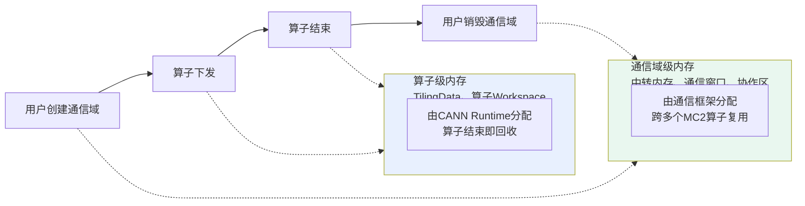
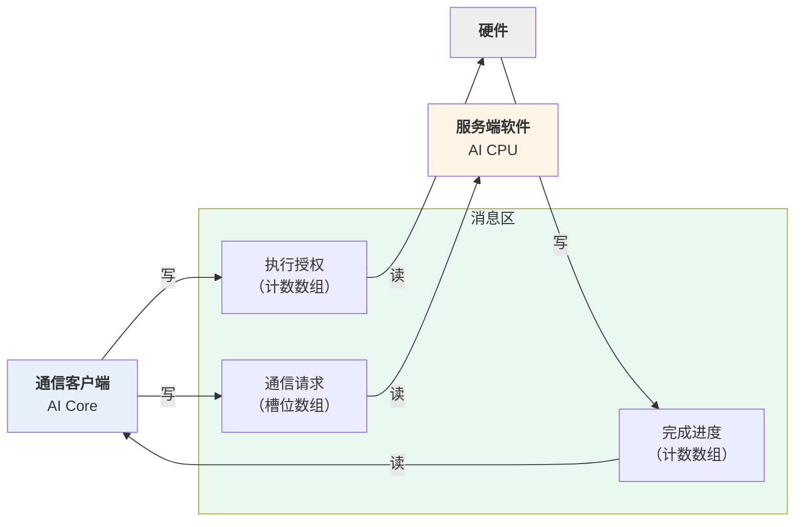
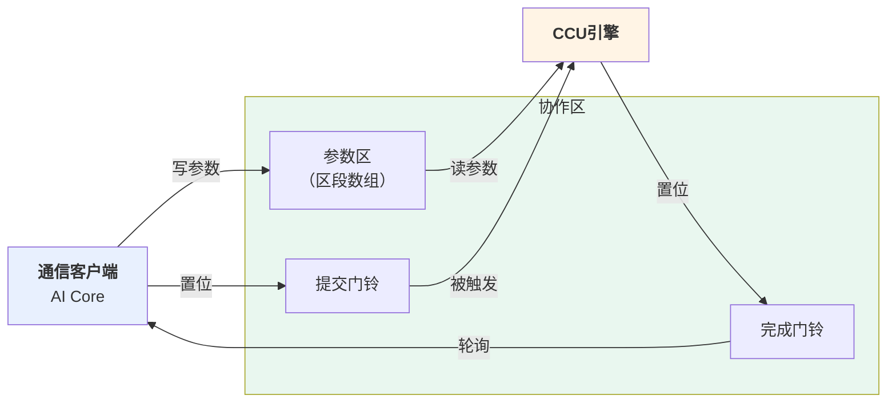
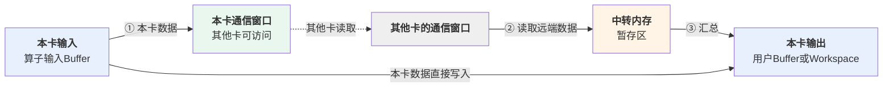

# MC2内存模型

## 概述

本章介绍MC2算子涉及的各类内存：位于哪里、存活多久、由谁分配与释放，以及开发者需要为内存做什么。

本章覆盖**AI CPU模式**与**CCU模式**两种通信模式。五类内存中四类在两种模式下完全相同，只有协作区的形态不同，会并列展开。

本章以AllGatherMatmul算子为例。

## 内存区域总览

MC2算子运行时涉及五类内存，它们**全部位于Device的全局内存（GM）上**。AI Core内部的片上缓冲不在此列，那部分由算子的计算逻辑管理。

| 内存 | 存活范围 | 大小由谁决定 | 读写方 |
| --- | --- | --- | --- |
| TilingData | 单次算子执行 | 算子的TilingData结构体大小 | AI Core |
| 算子Workspace | 单次算子执行 | Tiling侧申报 | AI Core |
| 协作区 | 通信域 | 框架固定 | AI Core、通信服务端、硬件 |
| 中转内存 | 通信域 | 通信域创建时的配置 | 通信算法、硬件 |
| 通信窗口 | 通信域 | 通信域创建时的配置 | 通信算法、硬件（含其他卡） |

五类内存各自的用途：

- **TilingData** 承载切分参数与通信配置，Kernel从中读取。
- **算子Workspace** 供算子自用，MC2算子在其中划出一段存放通信结果（见后文）。
- **协作区** 是客户端与服务端协作的共享内存，两种模式下形态不同，详见[协作区](#协作区)一节。
- **中转内存** 是数据跨卡搬运过程中的暂存区，由通信算法使用，Kernel不访问。
- **通信窗口** 是本卡向其他卡开放访问的一段内存，跨卡数据搬运的读写目标，Kernel不访问。

表中的"存活范围"把五类内存分成了两组，这个划分决定了后文的全部管理规则：

| 分组 | 包含 | 含义 |
| --- | --- | --- |
| **算子级内存** | TilingData、算子Workspace | 随单次算子执行存在，算子结束即回收 |
| **通信域级内存** | 协作区、中转内存、通信窗口 | 与通信域同生命周期，被域内的多个MC2算子依次复用 |

## 内存管理策略与生命周期

### 三条策略

**分层管理。** 算子级内存由CANN Runtime按算子申报的大小分配，算子执行结束即回收。通信域级内存在通信域生命周期内长期存在，不随单个算子的开始与结束而变化。

**预分配。** 所有与通信相关的内存都在Kernel启动之前准备完毕，通信过程中不做任何内存申请。原因是通信内存的准备需要各卡交换内存描述符才能互相访问，属于跨卡协商动作，必须在所有卡都尚未开始通信时统一完成。

**复用与缓存。** 通信域级内存按通信域与通信任务的特征缓存。同一通信域内特征相同的算子重复执行时，直接使用已有的内存，不重新分配。

### 分配与释放的责任

下表中涉及两个角色：

- **CANN Runtime** 是CANN的执行框架，运行在Host上。用户调用aclnn接口后，由它调用算子的Tiling、按Tiling申报的大小分配算子级内存、触发通信资源的准备、下发Task。
- **通信框架** 指HCCL与HCOMM，负责通信相关内存的分配与管理。

| 内存 | 谁分配 | 何时分配 | 谁释放 | 何时释放 |
| --- | --- | --- | --- | --- |
| TilingData | CANN Runtime | 算子下发时 | CANN Runtime | 算子执行结束 |
| 算子Workspace | CANN Runtime | 算子下发时 | CANN Runtime | 算子执行结束 |
| 中转内存 | 通信框架 | 用户创建通信域时 | 通信框架 | 用户销毁通信域时 |
| 通信窗口 | 通信框架 | 用户创建通信域时 | 通信框架 | 用户销毁通信域时 |
| 协作区 | 通信框架 | 首个MC2算子准备通信资源时 | 通信框架 | 用户销毁通信域时 |

三类通信域级内存的产生时机不同：中转内存与通信窗口在用户创建通信域时就已分配，即使之后不执行任何MC2算子也会占用；协作区则由首个使用该通信域的MC2算子在准备通信资源时触发分配，此后被域内的后续算子复用。

以上分配与释放的责任在两种通信模式下一致。

**图1** 各类内存的存活区间



### 开发者的介入点

内存的分配与释放全部由CANN Runtime与通信框架完成，**开发者不需要编写任何内存申请或释放代码**。需要开发者参与的只有两处：

| 动作 | 在哪里做 | 作用 |
| --- | --- | --- |
| 申报Workspace大小 | Tiling侧 | 告知CANN Runtime本算子需要多大的Workspace |
| 调用收尾接口 | Kernel侧 | 把协作区的状态清零，交还给下一个算子 |

第二项容易被忽略。收尾接口清零协作区状态，**并不释放内存** —— 协作区属于通信域，本算子结束后它依然存在，只是使用权交给下一个MC2算子。若不调用收尾接口，协作区会残留本算子的状态，导致下一个算子的通信进度判断出错。

这两处介入点在两种通信模式下相同。

后续五节按内存分类逐一展开，说明每类内存的内部构成与使用方式。

## TilingData

TilingData属于算子级内存，由CANN Runtime在算子下发时按结构体大小分配，把Host侧算好的内容拷入，Kernel启动后由AI Core读取。**Kernel只读不写。**

MC2算子的TilingData由三部分构成：

```cpp
struct AllGatherMatmulTilingData {
    Mc2InitTiling mc2InitTiling;   // 通信整体配置，必须是第一个成员
    Mc2CcTiling   mc2CcTiling;     // 单个通信任务的配置
    RCSTiling     param;           // 算子自己的切分参数
    // ... Matmul的Tiling参数
};
```

| 部分 | 内容 | 谁使用 |
| --- | --- | --- |
| `Mc2InitTiling` | 通信的整体配置 | 客户端初始化时读取 |
| `Mc2CcTiling` | 单个通信任务的配置：通信域、通信操作类型、数据类型等 | 客户端下发任务时引用 |
| 算子自定义部分 | 切分参数、各内存段的长度、通信数据量等 | Kernel直接读取字段 |


## 算子Workspace

算子Workspace属于算子级内存，由Tiling侧申报大小、CANN Runtime在算子下发时分配、算子结束后回收。

### Workspace的划分

Workspace由Tiling侧申报总量，Kernel侧按约定自行切分使用。以AllGatherMatmul为例，申报的总量由三段构成：

```
Workspace 总量 = 框架预留段 + 通信结果段 + 算子中间结果段
```

| 段 | 长度来源 | 用途 |
| --- | --- | --- |
| 框架预留段 | 平台固定值 | 供框架的库函数使用 |
| 通信结果段 | `gatherLen` | 存放AllGather的通信结果 |
| 算子中间结果段 | `nd2NzWorkLen`、`biasLen` 等 | 存放格式转换、类型转换的中间结果 |

各段的长度都由Tiling侧算出，写进TilingData，Kernel据此确定每段的起始地址。

### 通信结果的落点

以AllGatherMatmul为例，算子有一个可选输出用于返回AllGather的结果。通信结果写到哪里，取决于用户是否提供了这个输出。

| 情况 | 通信结果写到哪 | `gatherLen` |
| --- | --- | --- |
| 用户提供了该输出 | 直接写入用户提供的Buffer | 为0 |
| 用户未提供 | 写入Workspace的通信结果段 | 为预留的字节数 |

第二种情况下，通信结果只是计算的中间数据，算完即弃，因此放在Workspace里最合适。

### Tiling与Kernel的约定

这件事需要Tiling侧与Kernel侧配合，两侧的判断规则必须一致：

- **Tiling侧**：判断用户是否提供了输出。未提供时算出需要预留的字节数，写入 `gatherLen`，并计入Workspace申报总量。
- **Kernel侧**：读出 `gatherLen`。若非零，说明通信结果落在Workspace，据此确定通信的目的地址，并把Workspace指针往后推移相应字节数，供后续段使用。

```cpp
// Kernel侧
gatherAddr_ = gatherOut;                                   // 默认用用户提供的输出
if ((cfg.gatherLen != 0) || (!gatherOut)) {                // 需要预留
    gatherAddr_ = workspaceGM_;                            // 通信结果落在Workspace
    workspaceGM_ += cfg.gatherLen;                         // 推移指针，供后续段使用
}
```

`gatherLen` 同时充当两个角色：**是否落Workspace的开关**、**占用的字节数**。Tiling侧算多大，Kernel侧就推移多少，两侧不能对不上。

## 协作区

协作区属于通信域级内存，由通信框架在首个MC2算子准备通信资源时分配，与通信域同生命周期。它的用途是承载客户端与服务端之间的协作信息。

无论哪种通信模式，协作区中都承载三类信息：**通信任务**（这一次要搬什么）、**执行许可**（客户端允许服务端开始执行的标志）、**完成进度**（执行的进展）。但两种模式的组织方式差异较大，下面分别说明。

### AI CPU模式：消息区

AI CPU模式下的协作区称为**消息区**，其中有三段内容，各段的读写方不同。

| 段 | 内容 | 写入方 | 读取方 |
| --- | --- | --- | --- |
| 通信请求 | 一组槽位，每个槽位存放一条通信任务的描述 | 客户端 | 服务端软件 |
| 执行授权 | 一组计数，记录客户端允许执行到第几轮 | 客户端 | 硬件 |
| 完成进度 | 一组计数，记录已经完成到第几轮 | 硬件 | 客户端 |

注意读取方的差异：**通信请求由服务端软件读取，而授权与进度由硬件读写**，服务端软件并不参与。这是因为服务端把"等授权"与"报进度"作为指令交给硬件执行，自己不停在那里等，详见[通信模型](通信模型.md)。

三段都是**数组形式**，按任务槽位一一对应：客户端下发的第i个任务，其请求写在请求数组的第i个槽位，授权与进度也记在对应位置的计数里。这使得每个通信任务的状态可以独立跟踪。

**图2** 消息区的结构与读写方向



**数据结构**

请求槽位数 `HCCL_MSG_CNT` 是一个固定值，三段的数组长度都是它。

```cpp
struct HcclMsgArea {
    union {
        SingleQueueMsg singleMsg;    // 单队列模式
        MultiQueueMsg  multiMsg;     // 多队列模式，仅特定通信操作使用
    } commMsg;
    ControlHcclMsg controlMsg;       // 控制信息
    ApiStates      apiStats;         // 接口调用统计，用于维测
};

struct SingleQueueMsg {
    HcclMsg    sendMsgs[HCCL_MSG_CNT];          // 通信请求
    HcclMsg    recvMsgs[HCCL_MSG_CNT];
    uint8_t    reserved0[...];
    TurnCnt    commitTurnCnt[HCCL_MSG_CNT];     // 执行授权
    TurnCnt    finishedTurnCnt[HCCL_MSG_CNT];   // 完成进度
    uint8_t    reserved1[...];
    HcclMsgExt paramExtMsgList[HCCL_MSG_CNT];   // 扩展参数，仅AlltoAllV使用
};
```

其中执行授权与完成进度的元素结构相同，都是一个计数加一个有效标志：

```cpp
struct TurnCnt {
    uint64_t valid;         // 有效标志
    uint64_t cnt;           // 轮次计数
    uint64_t reserved[6];   // 补齐到Cacheline边界
};
```

`reserved` 的作用是让每个计数独占一个Cacheline。因为授权与进度分别由不同的执行体读写，若多个计数落在同一Cacheline上会相互干扰。

请求槽位的结构如下，各字段的内容与客户端下发接口的入参一一对应：

```cpp
struct HcclMsg {
    HcclCommType commType;      // 通信操作类型（AllGather、AllReduce等，或控制类型）
    HcclReduceOp opType;        // 归约操作类型
    uint64_t     sendBuffer;    // 源地址
    uint64_t     recvBuffer;    // 目的地址
    uint64_t     dataCnt;       // 数据量
    uint64_t     strideCount;   // 数据布局参数
    union {                     // 附加信息，按协议版本区分
        V0MsgAdditionInfo v0Msg;
        V1MsgAdditionInfo v1Msg;
    } addMsg;
};
```

附加信息中记录的是任务的元信息，例如数据类型、本次下发代表几轮通信、任务标识、消息序号、以及用于校验消息完整性的校验和。服务端凭序号保证请求按发出顺序处理，凭校验和确认读到的是一条完整的请求。

**容量与任务数上限**

请求槽位的数量是固定的，这直接决定了**单个算子能下发的通信任务数上限**。槽位循环使用，一个槽位在服务端读走请求之后才能被下一个任务占用。若下发的任务数超出上限，下发接口会返回无效的任务标识。

### CCU模式：参数区与门铃区

CCU模式下的协作区由**参数区**与**门铃区**两部分构成。三类信息的承载方式与AI CPU模式不同。

| 段 | 内容 | 写入方 | 读取方 |
| --- | --- | --- | --- |
| 参数区 | 一组区段，每段存放一次通信的参数值 | 客户端 | CCU引擎 |
| 提交门铃 | 客户端置位后触发引擎开始执行 | 客户端 | CCU引擎 |
| 完成门铃 | 引擎置位后表示本次通信完成 | CCU引擎 | 客户端 |

与AI CPU模式相比有三点不同：

- **没有软件参与。** 三段全部由客户端与CCU引擎直接读写，不经过任何服务端软件。
- **通信任务以参数值形式存放**，不是结构化消息。因为CCU引擎执行的是Kernel启动前已装载好的算法，运行时只需补上地址、数据量这些动态参数。
- **用门铃而非计数。** 客户端写提交门铃触发引擎；引擎写完成门铃告知客户端。门铃是触发式的，不像计数那样记录"到第几轮"。

**图3** 参数区与门铃区的读写方向



**容量与任务数上限**

参数区中的区段数量固定，同样决定了**单个算子能下发的通信任务数上限**。区段循环使用，超出上限时下发接口会返回无效的任务标识。

参数区的具体结构定义在框架的内部头文件中，算子代码不直接访问。

### 跨算子复用与归还

以下内容对两种模式一致。

协作区被同一通信域内的多个MC2算子依次使用，不为每个算子单独分配。这带来两点：

- **每个算子必须在结束前把状态清零**，通过调用收尾接口完成。清零不释放内存，只是把使用权交还。
- **多核场景下必须在全核同步之后再收尾**。否则先跑完的核清零状态时，其他还在等待通信完成的核将永远等不到进度。详见[执行模型](执行模型.md)。

三类信息的协作流程见[通信模型](通信模型.md)。

## 中转内存

中转内存属于通信域级内存，由通信框架在用户创建通信域时分配，大小来自通信域的配置。

它的用途是**数据跨卡搬运过程中的暂存区**。当一次通信的数据量超过中转内存的容量时，通信算法会把数据分成多轮搬运，每轮用中转内存暂存。

中转内存由通信算法在执行过程中使用，**Kernel侧不直接访问**。它的内部划分方式由算法决定 —— 算法按每轮搬运的数据量切分使用，不是预设的固定布局。

## 通信窗口

通信窗口属于通信域级内存，由通信框架在用户创建通信域时分配，大小来自通信域的配置。

它的用途是**向其他卡开放访问**。跨卡数据搬运的读写目标就是通信窗口：本卡把数据放入自己的窗口供其他卡读取，也从其他卡的窗口读取数据。跨卡访问之所以可行，是因为通信资源准备阶段各卡交换了内存描述符（见[通信模型](通信模型.md)）。

### 每卡一段，分输入与输出

通信域内每张卡都有自己的一段通信窗口，且分为输入窗口与输出窗口两类，分别用于通信的输入侧与输出侧。两类窗口的大小都由通信域创建时的配置决定，域内各卡一致。

通信窗口的地址信息记录在通信上下文中，供服务端在执行通信时使用。窗口内部没有预设的划分方式，由通信算法按每次通信的数据布局决定往哪一段写、从哪一段读。

### Kernel侧不直接访问

两种通信模式下，**通信窗口对Kernel侧都不可见**，Kernel无法获取窗口地址，也不需要关心数据在窗口中的位置。Kernel只需给出通信的源地址与目的地址，数据经过窗口的过程由通信算法完成。

> [!NOTE]说明
> HCCL高阶API提供了`GetWindowsInAddr`与`GetWindowsOutAddr`两个接口，可在部分产品上获取窗口地址、把窗口直接作为计算的输入或输出以省去一次拷贝。这两个接口在Ascend 950PR/Ascend 950DT上不支持，具体产品支持情况参见接口手册。

## 通信过程中的数据流转

前面几节分别介绍了各类内存，本节把它们串起来，说明一次通信中数据经过哪些内存。以AllGather为例。

**图4** AllGather的数据流转



三个环节：

1. 本卡数据放入自己的通信窗口，供其他卡读取。
2. 从其他卡的通信窗口读取数据，经中转内存汇总。数据量大时分多轮进行，中转内存作为每轮的暂存区。
3. 汇总后的数据连同本卡数据一起写入输出。输出的位置由 `gatherLen` 决定 —— 用户提供的Buffer或Workspace的通信结果段。

整个流转过程由通信算法驱动，Kernel侧只需给出输入地址与输出地址。两种通信模式下算法可能选择不同的搬运路径，但对Kernel而言没有区别。

## 一致性与可见性

协作区被客户端与服务端两侧同时读写，两侧看到的内容需要保持一致。这件事由框架的接口内部处理，**开发者不需要自行插入任何同步指令**。

有一点需要理解：由于两侧是并行运行的独立执行体，客户端确认通信是否完成的方式是**反复查看协作区**（AI CPU模式查完成进度、CCU模式查完成门铃），而不是被动等待通知。这就是等待接口表现为轮询的原因。
