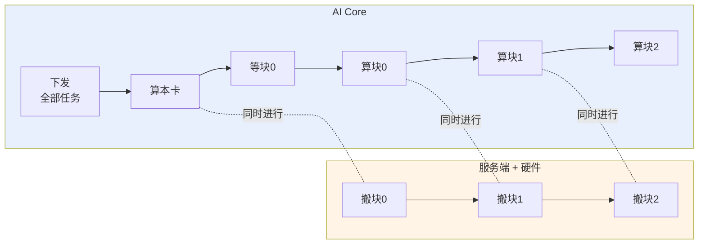
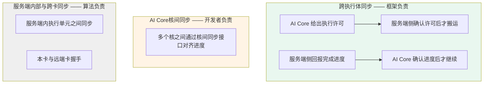
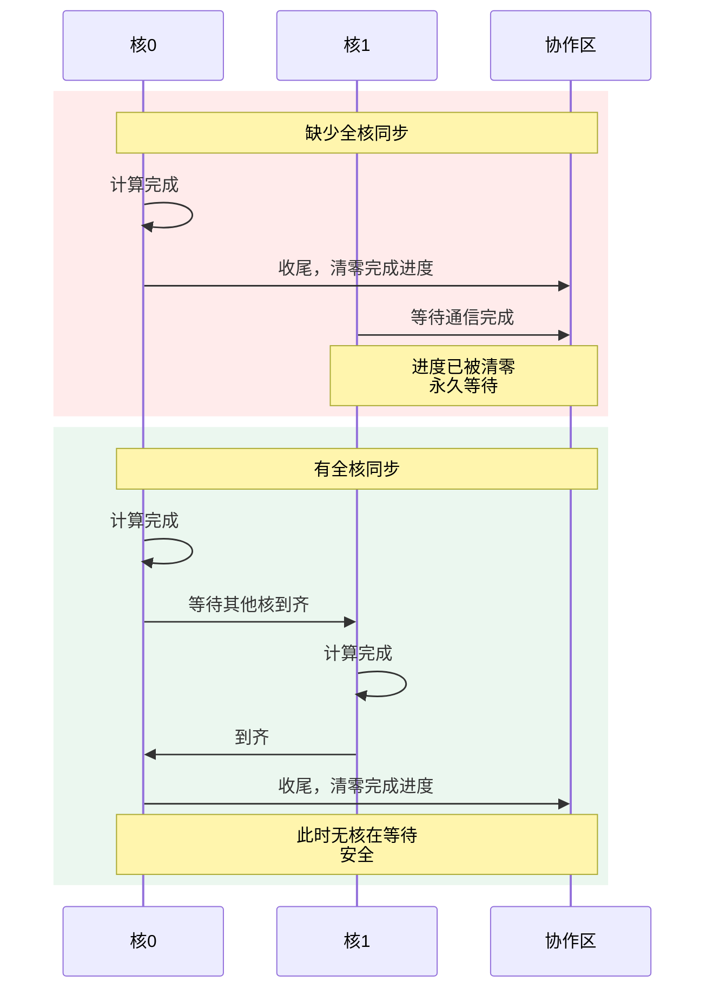
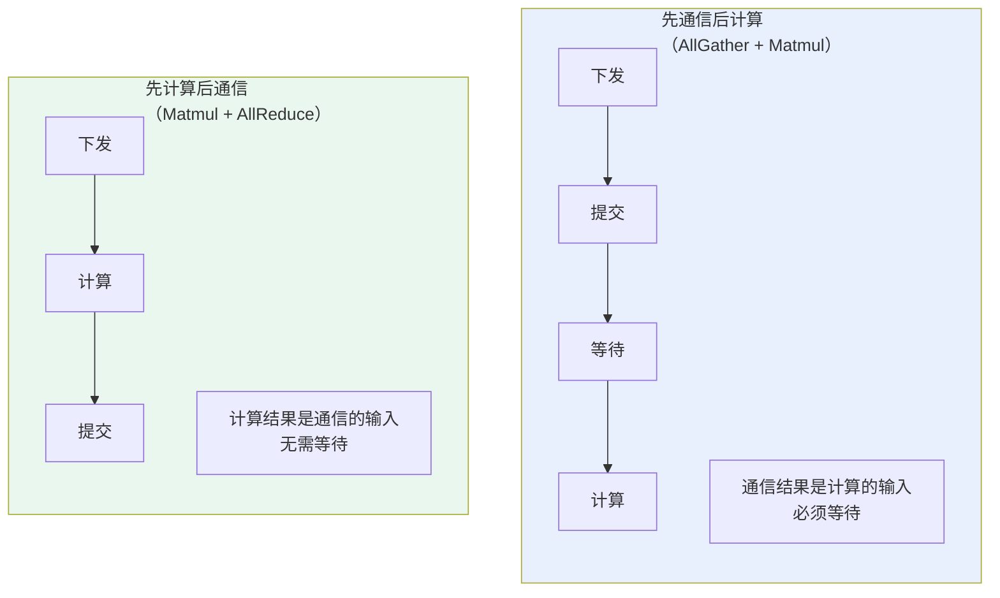

# MC2执行模型

## 概述

本章介绍MC2算子中通信与计算如何并行执行：Kernel里的编排顺序、分块的粒度、以及靠哪几级同步保证正确性。

三篇之中本章最贴近实际编码。[通信模型](通信模型.md)讲的是**单个通信任务**如何下发与执行，本章讲的是**多个任务与多个核**如何编排在一起。前两章多次提到的"详见执行模型"都指向本章的[多核场景的两条约束](#多核场景的两条约束)一节。

**本章内容在AI CPU模式与CCU模式下几乎完全相同**：编排形态、分块流水、两条多核约束都不区分模式。仅三级同步中的跨执行体一级机制不同，会在对应处并列说明。

本章不重复以下内容：

| 内容 | 见 |
| --- | --- |
| 客户端与服务端各自为什么"下发即返回" | [通信模型](通信模型.md) |
| 协作区的结构与跨算子复用机制 | [内存模型](内存模型.md) |
| 分块大小的具体计算方法、Kernel完整代码 | 后续"算子实现"章节 |

本章以AllGatherMatmul算子为例。

## 融合的编排形态

### 四段编排

AllGatherMatmul的Kernel按四段组织：

| 顺序 | 做什么 | 是否等待通信 |
| --- | --- | --- |
| ① | 一次性下发全部分块的通信任务 | 不等待 |
| ② | 计算本卡数据 | 不需要 |
| ③ | 逐块等待并计算远端数据 | 每块等一次 |
| ④ | 全核同步后收尾 | — |

### 为什么这样排

**第①段一次性发完，不等待。** 下发接口把任务交出去就返回，此时服务端已经开始处理第一个任务。如果边发边等，通信与计算就串行了。

**第②段插在中间，是因为本卡数据不依赖通信。** 每张卡持有的那一份x1本来就在本地，可以立刻参与计算。这段计算的时间里，服务端正在搬运第一块远端数据。

**第③段逐块等待，而非一次等全部。** 第i块到达就计算第i块；计算第i块的同时，第i+1块还在传输。若等全部数据到齐再算，后面所有块的通信耗时都会暴露。

**图1** 通算流水时间线



如图，只有"等块0"这一段是真正暴露的等待，其余各块的通信都被前一块的计算掩盖。这也解释了分块大小的选取原则，见下一节。

## 分块的粒度

**为什么要分块。** 若一次通信搬完全部数据，AI Core必须等所有数据到齐才能开始计算远端部分，通信耗时完全暴露在端到端时延中。分块之后，每块的通信可以与上一块的计算重叠。

**分块大小的原则。** 让第一块的通信耗时与本卡计算耗时相当，使第一块数据在本卡算完的那一刻刚好到达。这样图1中唯一暴露的那段等待被压到最短。

**块数的权衡。** 块数越多，流水越平滑，单块的等待时间越短。但每块通信都有固定开销：客户端写任务、服务端接收并准备执行、以及通信本身的启动开销。块数过多时这些固定开销累积起来会抵消收益。因此块数需要在两者之间取平衡。

两种通信模式的固定开销不同，因此Tiling侧的切分取向也不同：AI CPU模式下服务端需要软件读取并组织任务，单次开销较大，倾向于切得少一些；CCU模式下没有软件参与，单次开销较小，但受单次通信数据量上限的约束。

分块的具体计算由Tiling的性能模型完成，开发者通常不需要手工干预。计算方法见后续"算子实现"章节。

## 三级同步

MC2算子的执行涉及三级同步。

| 层级 | 同步双方 | 机制 | 谁负责 |
| --- | --- | --- | --- |
| 跨执行体 | AI Core ↔ 通信服务端 | 通过协作区握手，两种模式的机制不同 | 框架（提交与等待接口内部） |
| AI Core核间 | 多个AI Core核之间 | 核间同步接口 | **开发者显式调用** |
| 服务端内部与跨卡 | 服务端内的执行单元之间、本卡与远端卡之间 | 单元间同步、跨卡握手 | 通信算法内部 |

**图2** 三级同步关系



**跨执行体同步**由提交与等待接口内部完成。客户端调用提交接口时给出执行许可，服务端侧据此决定何时开始搬运；搬完后回报完成进度，客户端的等待接口据此决定何时返回。这一级在两种模式下的机制不同：

| | AI CPU模式 | CCU模式 |
| --- | --- | --- |
| 许可的形式 | 执行授权计数，由硬件读取 | 提交门铃，由CCU引擎读取 |
| 进度的形式 | 完成进度计数，由硬件写入 | 完成门铃，由CCU引擎置位 |

无论哪种形式，开发者只需按规则调用提交与等待接口，不接触底层机制。详见[通信模型](通信模型.md)。

**服务端内部与跨卡同步**由通信算法保证，开发者不感知。两种模式下算法内部的同步方式不同，但都不需要开发者介入。

**AI Core核间同步是唯一需要开发者显式处理的一级。** 下一节的两条约束都属于这一级，且在两种模式下要求完全相同。

## 多核场景的两条约束

MC2算子的Kernel运行在多个AI Core核上，各核并行执行同一份代码。这带来两条必须遵守的约束，两种通信模式下要求相同。

### 收尾前必须全核同步

**原因。** 收尾接口除了通知服务端后续没有通信任务，还会把协作区的状态清零，把协作区交还给下一个算子（见[内存模型](内存模型.md)）。若某个核提前收尾清零了状态，其他还在等待通信完成的核将永远读不到完成进度，导致永久等待。

**图3** 有无全核同步的对比



**两种写法。** 根据通信任务在哪类核上下发，选择对应的同步接口。

在Vector核上下发通信时，使用全核同步接口：

```cpp
AscendC::SyncAll<true>();       // 全AIV核同步
hccl.Finalize();
```

在Cube核上下发通信时，使用跨核标志同步接口：

```cpp
AscendC::CrossCoreSetFlag<0, PIPE_FIX>(EVENT_ID);
AscendC::CrossCoreWaitFlag(EVENT_ID);       // 等所有核到齐

if (AscendC::GetBlockIdx() == 0) {
    hccl.Finalize();                        // 由0号核收尾
}
```

AllGatherMatmul在Cube核上下发通信，采用后一种写法。

**这条约束对Tiling侧的要求。** 核间同步要求参与同步的核都在执行本算子。因此Tiling侧需要设置独占全核的调度模式，否则部分核被其他算子占用时，同步将无法完成。

### 未分配计算任务的核也必须等待

**出现场景。** 以下两种情况会出现某些核没有计算任务：

- 本次计算使用的核数少于总核数，超出的核没有分到计算任务
- 某路输出为空，本次只做通信不做计算

**原因。** 一个通信任务下发时指定了几轮，就必须调用相同次数的等待接口。这个次数由各核独立记录，与本核是否使用通信数据无关。因此没有计算任务的核同样要把等待接口调够次数。

**写法。** 这些核跳过计算，但等待接口必须按相同次数调用：

```cpp
if (本核不参与计算) {
    for (uint32_t i = 0; i < count; ++i) {
        hccl.Wait(handles[i]);      // 只等待，不计算
    }
    return;
}

// 参与计算的核
for (uint32_t i = 0; i < count; ++i) {
    hccl.Wait(handles[i]);
    ComputeTile(i);
}
```

## 另一种编排：先计算后通信

前面讲的AllGatherMatmul属于**先通信后计算**：通信结果是计算的输入，因此必须等通信完成才能计算。

另一类算子的形态相反，**计算结果是通信的输入**，例如Matmul与AllReduce的融合。此时的编排是：

| 顺序 | 做什么 |
| --- | --- |
| ① | 下发通信任务，但不提交 |
| ② | 执行计算 |
| ③ | 计算完成后提交，无需等待 |

**图4** 两种编排的调用顺序对比



两种编排的差异：

| | 先通信后计算 | 先计算后通信 |
| --- | --- | --- |
| 提交时机 | 下发后立即提交 | 计算完成后提交 |
| 是否需要等待 | 需要，每块等一次 | 不需要 |
| 重叠的是什么 | 后续块的通信与前一块的计算 | 服务端准备任务的耗时与本卡计算 |

先计算后通信的重叠幅度较小 —— 只能掩盖服务端准备任务的时间，实际的数据搬运仍在计算之后。但它的编排更简单，不需要处理等待与分块。

**这种编排的收益在两种模式下不同。** 因为它依赖"下发之后、提交之前服务端已在准备任务"这一点：

| | AI CPU模式 | CCU模式 |
| --- | --- | --- |
| 下发之后服务端在做什么 | 已读到任务，正在组织执行 | 尚不知道有任务 |
| 推迟提交的收益 | 组织任务的耗时被计算掩盖 | 无此收益 |

因此CCU模式下这种编排的意义仅在于代码结构更清晰，不带来性能收益。这一差异的机制见[通信模型](通信模型.md)。

