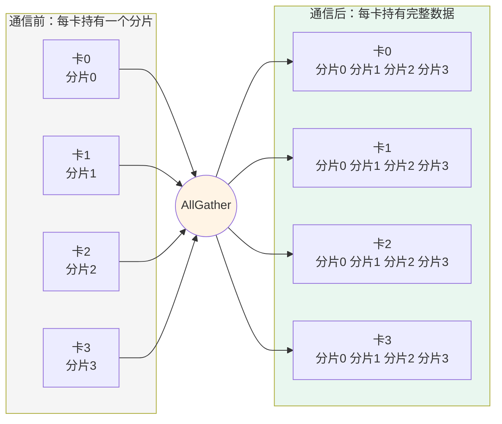
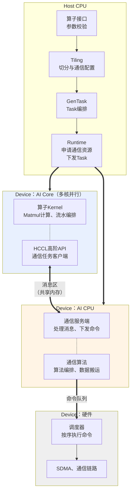
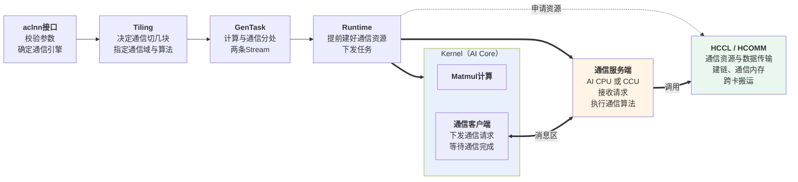

# MC2编程模型概述

MC2（Merged Compute and Communication）指通信与计算融合的算子。传统做法是先执行一个通信算子，等它结束再执行一个计算算子，通信耗时完全暴露在端到端时延中。MC2算子把通信任务切成多块下发，让每一块数据的通信与上一块数据的计算在时间上重叠，从而把通信耗时隐藏在计算流水中。

本章以AllGatherMatmul算子为例介绍MC2编程模型。该算子完成AllGather通信与Matmul计算的融合：

$$
y = AllGather(x1) @ x2 + bias
$$

每张卡持有x1的一个分片，通信负责把所有卡的分片收集齐，计算负责把收集后的完整矩阵与x2相乘。以4卡为例，AllGather的语义如下图：每张卡把自己的分片发给其他所有卡，通信结束后每张卡都持有一份按卡号顺序排列的完整数据。

回到AllGatherMatmul，每张卡拿到完整的x1之后与本卡的x2相乘，得到本卡的输出。这个算子存在两个天然的重叠机会：

- **本卡自己的那一份x1不需要等通信**，可以在通信进行的同时先算出来。
- **远端数据可以分块到达**，第一块到了就可以开始算第一块，不必等全部数据齐备。

MC2编程模型要解决的核心问题，就是如何组织通信与计算的下发和同步，把这两个重叠机会用起来。

本套资料按四个视角组织：

| 章节 | 回答的问题 |
| --- | --- |
| **概述**（本章） | MC2算子由哪几部分组成，端到端怎么跑起来 |
| [内存模型](内存模型.md) | 数据放在哪块内存，谁申请，生命周期多长 |
| [通信模型](通信模型.md) | 通信任务怎么下发，Kernel里要调哪些接口 |
| [执行模型](执行模型.md) | 通信与计算怎么并行，需要做哪些同步 |

本套资料描述AI CPU作为通信服务端的场景。CCU服务端的差异部分将在后续补充。

## 执行体划分

一个MC2算子在运行时涉及四个执行体，分布在Host和Device两侧。

图中的AI Core与AI CPU是**两个并行运行的执行体**，两者之间没有函数调用关系，全部协作通过一块共享内存（消息区）完成。因此从AI Core的角度看，它面前有两道边界：

| 边界 | 位置 | 跨越方式 |
| --- | --- | --- |
| 计算与通信之间 | AI Core ↔ AI CPU | AI Core往消息区写一条通信请求，服务端从消息区读取 |
| 通信下发与通信执行之间 | AI CPU ↔ 硬件 | 服务端往命令队列写命令，硬件调度器按序执行 |

这两道边界的跨越方式有一个共同特征：**写入方写完就返回，不等待对方处理完成**。因此：

- AI Core发出通信请求后立即返回，可以马上去做计算，不必等通信结束。
- 服务端下发命令后立即返回，可以马上处理下一条请求，不会被硬件的搬运进度拖住。

这两处"不等待"就是通信与计算能够重叠的基础。AI Core把所有分块的通信请求一次性发完，然后先计算不依赖通信的本卡数据；此时服务端已经在搬第一块数据。等本卡算完，第一块数据也差不多到了，接着算第一块；算第一块的同时第二块还在传。以此类推，除了第一块的等待，其余分块的通信耗时都被计算掩盖。

## 通信引擎

MC2算子的通信可以由不同的执行部件承担，称为通信引擎。通信引擎由算子属性`comm_mode`指定。

| comm_mode | 通信执行者 | 支持产品 |
| --- | --- | --- |
| `ai_cpu` | AI CPU上的通信服务端 | Ascend 950PR/Ascend 950DT |
| `ccu` | CCU硬件通信引擎 | Ascend 950PR/Ascend 950DT |
| `aiv` | AI Core的Vector核自行搬运 | Atlas A2/A3系列产品 |

各引擎的能力边界与约束不同，选择时需要参考具体算子的接口说明。算子Kernel中的通信编排代码对引擎类型无感，切换引擎不需要改写编排逻辑。

本套资料以`ai_cpu`为例。

## 一个MC2算子的组成

MC2算子的实现代码分为四部分。

| 部分 | 职责 | 与通信相关的产出 |
| --- | --- | --- |
| `op_api` | aclnn接口，参数校验与平台分流 | 校验`comm_mode`，向Runtime声明通信服务端类型 |
| `op_host` | Tiling，计算切分与通信切分 | 生成通信配置（通信域名、算法名、数据类型、引擎类型）；决定通信切成几块、每块多大；申报Workspace大小 |
| `op_graph` | GenTask，Task编排 | 申请AI CPU专用Stream；把一个算子节点展开为多个Task；预留通信上下文槽位 |
| `op_kernel` | Device Kernel，计算实现与流水编排 | 调用HCCL高阶API下发通信任务、等待通信完成 |

开发者在通信方面需要关注的工作集中在两处：

- **Tiling里生成通信配置并决定切分**——决定通信怎么切、用什么通信算法。
- **Kernel里编排通信与计算的顺序**——决定什么时候下发、什么时候等待、什么时候计算。

通信资源的申请、通信算法的执行都由框架完成，开发者不需要自行建链或编写数据搬运逻辑。

## 端到端实现流程

下图串起从aclnn接口到通信完成的完整链路，标出每个环节在通算融合中承担的角色。通信与计算之间的同步细节见[执行模型](执行模型.md)。

流程中有五个关键时机值得单独说明。

**① 通信配置在Tiling阶段生成。** Tiling侧调用Tiling接口，把通信域名、算法名、数据类型、引擎类型打包成两份配置结构体，随TilingData一起下发。这两份配置有两个消费方：Host侧的Runtime用它申请通信资源，Device侧的通信客户端用它标识任务对应的资源。

**② 通信资源在Kernel启动之前就已备好。** 建链、注册内存、申请执行线程都是重量级动作，涉及跨卡协商，不可能在通信过程中临时完成。Runtime依据通信配置提前把这些资源建好，序列化后交给Device侧。服务端启动时只是"认领"这些已有资源，不做任何申请动作。

**③ 计算Task与服务端Task拿到同一份通信上下文。** GenTask在两个Task中各预留一个通信上下文槽位，Runtime往两个槽位填入同一个值。这是AI Core与AI CPU能够访问同一块消息区的前提。

**④ 通信任务一次性全部下发，然后立即去算本卡数据。** 下发是异步的，写完消息就返回。此时服务端已经开始处理第一条消息、硬件已经开始搬运第一块数据，而AI Core正在计算不依赖通信的本卡部分。

**⑤ 计算与通信逐块交错。** AI Core每等到一块数据就计算一块，等待下一块的同时上一块的计算已完成。分块的大小与数量由Tiling按照"通信耗时与计算耗时相当"的原则确定，详见[执行模型](执行模型.md)。

## 开发者视角的关键约定

MC2算子的开发需要遵循以下约定，具体机制见后续章节。

| 约定 | 说明 | 详见 |
| --- | --- | --- |
| 通信配置由Tiling生成 | Tiling侧调用Tiling接口生成通信配置，随TilingData下发 | [通信模型](通信模型.md) |
| Kernel只调用固定的几类接口 | 初始化、下发、等待、收尾四类 | [通信模型](通信模型.md) |
| 下发次数与等待次数必须匹配 | 每个通信任务的提交次数与等待次数必须一致 | [通信模型](通信模型.md) |
| 单算子的通信任务数有上限 | 消息区槽位数量有限 | [通信模型](通信模型.md) |
| 通信结果的落点由Tiling决定 | 用户提供输出Buffer时直接写入，否则落在算子Workspace | [内存模型](内存模型.md) |
| 消息区跨算子复用 | 同一通信域的多个MC2算子共用消息区，收尾时必须归还 | [内存模型](内存模型.md) |
| 收尾前必须全核同步 | 防止部分核提前收尾导致其他核卡死 | [执行模型](执行模型.md) |
| 不参与计算的核也要调用等待接口 | 每个核各自维护通信任务的计数状态 | [执行模型](执行模型.md) |
