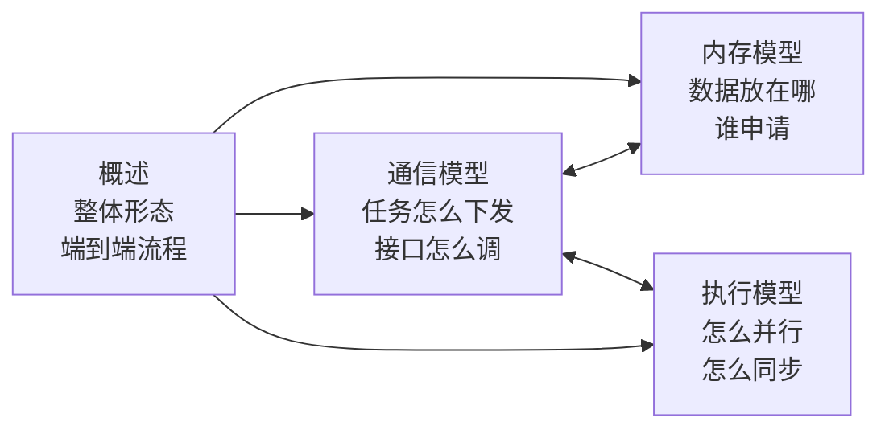

# MC2编程模型资料编写方案

> 本文是《MC2编程模型》四篇资料的编写方案，用于评审确认大纲、图规划与写作尺度。方案确认后按此落笔，本文不作为最终交付资料。

## 一、总体定位

### 1.1 读者与目标

读者是**准备开发MC2算子的Kernel开发者**。读完四篇后应当能回答：

- MC2算子由哪几部分组成，通信是怎么发生的
- 我的Kernel代码里要调哪些接口、按什么顺序调
- 数据放在哪块内存、谁负责申请
- 通信和计算怎么并行起来的，我需要做什么同步

### 1.2 写作尺度

对标 `asc-devkit/docs/zh/api/SIMD-API/高阶API/HCCL通信类/HCCL-Kernel侧接口/HCCL使用说明.md` 的风格：

| 要写 | 不写 |
| --- | --- |
| 机制、流程、概念、约定 | 接口内部的实现细节 |
| 开发者需要自己写的代码 | 框架内部代码的逐行讲解 |
| 数据结构中开发者能感知的字段 | 内部结构体的完整字段列表 |
| 约束与常见错误 | 具体的函数名、文件路径、行号溯源 |

代码片段只出现在"开发者要这样写"的场合，形态类似 `HCCL使用说明.md` 里的六步示例。不引用框架内部源码路径与行号。

算子的详细实现（Tiling切分算法、Matmul编排细节、通信算法实现）后续在"算子实现"章节补充，本套资料不展开。

### 1.3 示例与范围

- 统一以 **AllGatherMatmul** 算子为例
- 平台范围：**Ascend 950PR/Ascend 950DT**
- 通信引擎：**AI CPU 与 CCU 并列**，两者在资料中地位对等，不设主次

两种模式的完整名称与简称：

| 完整名称 | 简称 | comm_mode取值 | 含义 |
| --- | --- | --- | --- |
| AI Core + AI CPU | AI CPU模式 | `ai_cpu` | AI Core作为客户端，AI CPU作为服务端 |
| AI Core + CCU | CCU模式 | `ccu` | AI Core作为客户端，CCU作为服务端 |

两种模式下客户端都在AI Core上，差异在服务端。首次出现时用完整名称，后文用简称。

Atlas A2/A3系列的`aiv`模式不在本套资料范围内，仅在概述的引擎对照表中列出。

### 1.4 绘图约定

- 全部使用 Mermaid，不引用图片文件（跨仓相对路径不可靠）
- 图类型：`flowchart` 画结构与内存布局，`sequenceDiagram` 画时序，必要时用 `stateDiagram`
- 与 `asc-comm` 仓已有资料（`docs/zh/算子实现/直驱/Hcomm算子的实现.md`）风格保持一致

### 1.5 术语统一

| 术语 | 含义 | 避免使用 |
| --- | --- | --- |
| 通信任务客户端 | 运行在AI Core上的HCCL高阶API | 第5层 |
| 通信服务端 | 接收并执行通信任务的一方，AI CPU或CCU | 第6层、AICPU Server |
| 消息区 | 客户端与服务端之间的共享内存 | HcclMsgArea（首次出现可标注） |
| 通信上下文 | Runtime申请通信资源后交给双方的句柄 | OpResCtx、kHcom |
| 通信配置 | Tiling侧生成、随TilingData下发的通信参数 | mc2InitTiling、mc2CcTiling（首次出现可标注） |
| 分块 | 通信切分后的单块数据 | tile |
| 任务标识 | Prepare接口返回的通信任务句柄 | handleId（首次出现可标注） |
| 通信微码 | CCU执行的通信算法程序 | CCU Kernel（首次出现可标注） |
| 参数区 | CCU模式下客户端写入任务参数的内存 | xn、寄存器 |
| 门铃 | CCU模式下客户端通知与硬件回报的标志 | CKE |
| 协作区 | 客户端与服务端协作的共享内存的统称 | 两种模式下的具体形态不同：AI CPU模式为消息区，CCU模式为参数区与门铃区 |

---

## 二、概述.md

### 定位

MC2算子的整体形态与端到端流程。作为四篇的入口，建立全局认知，不深入任何单一维度。

### 章节大纲

**1. 什么是MC2算子**
- 通算融合的动机：通信耗时暴露 vs 通信耗时被计算掩盖
- 以AllGatherMatmul为例：计算公式、每卡持有x1分片、本卡数据不依赖通信、远端数据可分块到达
- 四篇资料的组织与相互关系

**2. 执行体划分**
- Host CPU / AI Core / AI CPU / 硬件调度器 四者分工
- 强调两个事实：
  - HCCL高阶API与算子Kernel编译为同一份二进制，运行在同一AI Core上
  - 整条链路只有两处真实执行体边界：AI Core↔AI CPU（共享内存）、AI CPU↔硬件（命令队列）
- 引出核心结论：**通信任务的"下发"与"执行"分离，下发方都不阻塞，这是通算重叠的前提**

**3. 通信引擎的选择**
- `comm_mode` 属性三种取值与对应执行者、支持产品
- 引擎选择影响的四件事：Tiling切分策略、TilingKey、AI CPU Task入口、Kernel中的服务端类型模板参数
- CCU模式需要额外配置的环境变量 `HCCL_OP_EXPANSION_MODE=CCU_SCHED`，及其必须在创建通信域之前设置的原因

**4. 一个MC2算子的组成**
- op_api / op_host / op_graph / op_kernel 四部分的职责与通信相关产出物（表格）
- 指出开发者在通信方面的工作集中在两处：Tiling里生成通信配置与决定切分、Kernel里编排通信与计算顺序

**5. 端到端流程**
- 图编译期 → 执行期的完整时序
- 三个关键时机的说明：
  - 通信资源在Kernel启动前已备好（重资源不能在通信过程中申请）
  - 两个Task并行启动，通信任务一次性全部下发
  - 计算与通信逐块交错

**6. 开发者视角的关键约定**
- 汇总表：约定 + 一句话说明 + 指向详述章节的链接
- 约定项：通信配置由Tiling生成、Kernel只调固定几个接口、下发与等待次数必须匹配、通信结果落点由Tiling决定、消息区跨算子复用、收尾前必须全核同步、不参与计算的核也要调等待接口

### 图规划

| 编号 | 标题 | 类型 | 内容要点 |
| --- | --- | --- | --- |
| 图1 | 执行体划分与边界 | flowchart TB | 四个分区（Host CPU / AI Core / AI CPU / 硬件）；AI Core内标注Kernel与高阶API内联关系；AI CPU内标注服务端与算法的函数调用关系；两处边界用粗箭头并标注"共享内存·消息区""命令队列" |
| 图2 | 端到端时序 | sequenceDiagram | participant：应用程序、aclnn接口、Tiling、GenTask、Runtime、AI Core Kernel、AI CPU服务端、硬件；用Note分隔"图编译期"与"执行期"；体现通信任务一次性下发、本卡计算与通信重叠、逐块交错 |
| 图3 | MC2算子的四部分与产出物 | flowchart LR | 四个目录节点 → 各自产出 → 消费方；虚线标注通信配置流向Runtime、通信上下文流向Kernel与服务端 |

---

## 三、内存模型.md

### 定位

MC2算子涉及的所有内存区域：谁申请、谁读写、生命周期多长、开发者需要做什么。

### 章节大纲

**1. 内存区域总览**
- 五类内存的对照表：算子Workspace、消息区、CCL Buffer、通信窗口（对端可访问内存）、TilingData
- 每类给出：申请者、大小来源、生命周期、读写方
- 归纳两条原则：
  - **通信域级资源跨算子复用**（消息区、CCL Buffer、通信窗口的生命周期与通信域一致）
  - **算子级内存按需申报、由Runtime统一分配**（Workspace、TilingData的生命周期与单次算子执行一致）

**2. 算子Workspace的划分**
- Workspace = 框架预留 + 通信结果暂存 + 其他算子自用
- **通信结果落点的决策**：用户提供输出Buffer时通信结果直接写入该Buffer；未提供时Tiling侧申报一段Workspace，Kernel侧使用这段Workspace
- 开发者要做的事：Tiling侧把这段大小计入Workspace申报；Kernel侧按同样规则决定地址并推进Workspace指针
- 这是Tiling与Kernel之间的一个约定，两侧必须一致

**3. 消息区**
- 作用：AI Core与AI CPU之间传递通信任务与执行进度的唯一通道
- 来源：属于通信域，由Runtime在申请通信资源时一并分配；地址通过通信上下文交给双方
- 三段结构与读写方向：
  - 任务消息数组：客户端写、服务端读
  - 授权计数数组：客户端写、硬件读
  - 完成计数数组：硬件写、客户端读
- **环形复用**：消息槽位数量有限，槽位循环使用，因此单个算子的通信任务数量有上限
- **跨算子复用**：同一通信域的多个MC2算子共用消息区，收尾时必须把完成计数归零交还给下一个算子。这是收尾接口的一项隐含职责，也是收尾前必须全核同步的原因

**4. 通信过程中的数据流转**
- 以AllGather为例说明数据经过哪些内存：本卡输入 → 通信窗口/CCL Buffer → 各卡输出
- CCL Buffer的作用：中转与分块，当单次通信数据量超过CCL Buffer容量时算法内部会分多轮
- 说明这部分由通信算法自行管理，开发者不直接操作

**5. 一致性与可见性**
- 两个执行体读写同一块内存，需要保证可见性
- 客户端侧：写入后需刷新Cache，读取前需失效Cache
- 服务端侧：使用内存屏障
- 消息有效标志位必须最后写入的原因
- 说明这些由框架接口内部处理，开发者无需自行插入同步指令；但需要理解为什么等待接口是轮询而非阻塞

**6. 开发者检查项**
- Workspace大小申报是否包含通信结果暂存段
- Kernel侧通信结果地址的决策规则是否与Tiling一致
- 单算子通信任务数是否在上限内
- 收尾接口是否被调用（否则消息区不会归还）

### 图规划

| 编号 | 标题 | 类型 | 内容要点 |
| --- | --- | --- | --- |
| 图1 | 内存区域全景 | flowchart TB | 按"通信域级"与"算子级"两个生命周期分组；标出各区域的申请者与读写方；用不同边框区分两类生命周期 |
| 图2 | 消息区结构与读写方向 | flowchart LR | 三段内存作为中间节点；左侧AI Core（客户端）、右侧AI CPU（服务端）与硬件；箭头标注"写任务""读任务并清标志""写授权""读授权""写完成""读完成" |
| 图3 | 算子Workspace划分与通信结果落点 | flowchart TB | Workspace分段示意；两个分支：用户提供输出Buffer → 直接写入；未提供 → 落Workspace |
| 图4 | AllGather的数据流转 | flowchart LR | 本卡输入 → 通信窗口 → 远端读取 → 本卡输出；标注CCL Buffer作为中转的位置 |

---

## 四、通信模型.md

### 定位

**四篇中的核心篇。** 讲清MC2算子的通信是怎么组织起来的：Host侧准备了什么、AI Core侧怎么下发、AI CPU侧怎么执行。对标 `HCCL使用说明.md` 图1所表达的内容。

按执行位置与时机分三段组织（Host侧 / 客户端 / 服务端），与读者的认知顺序一致。

不在本篇讲的内容：
- 通信与计算的宏观编排（先通信后计算、先计算后通信）→ 执行模型
- 内存布局与生命周期 → 内存模型
- 通信原语参数的填法（如`strideCount`在分块场景下的取值）、Kernel代码骨架 → 后续"算子实现"章节

### 章节大纲

**1. 概述**
- 本章讲什么：通信任务如何从Host侧的准备、经AI Core的下发、到AI CPU的执行
- 与另三篇的分工
- 范围：以AllGatherMatmul算子、AI CPU服务端为例

**2. 通信模型总览**

MC2算子的通信涉及三个部分：

| 部分 | 时机 | 职责 |
| --- | --- | --- |
| Host侧 | Kernel启动前 | 生成通信配置、依据配置准备通信资源 |
| 客户端（AI Core） | Kernel运行时 | 下发通信任务、等待任务完成 |
| 服务端（AI CPU） | Kernel运行时 | 接收任务、按算法执行通信、回报进度 |

- 客户端与服务端是**并行运行的两个执行体**，通过消息区协作，没有函数调用关系
- 服务端类型通过模板参数指定（`HCCL_SERVER_TYPE_AICPU`），客户端本身始终运行在AI Core上
- 消息区里的三样东西：**通信请求**、**执行授权**、**完成进度**，给出各自的写入方与读取方（表格）
- 模型的两个贯穿全篇的特征：
  - **下发即返回** —— 客户端写完请求就走，服务端安排完硬件就走，双方都不等待对方
  - **等待靠轮询** —— 客户端确认某次通信是否完成时，反复查看完成进度

**3. Host侧的通信准备**

**3.1 通信配置的生成**
- 为什么必须在Tiling阶段确定：通信资源的准备涉及跨卡协商、耗时长，必须在Kernel启动前完成，而准备的依据就是这些配置
- 两个结构体：`Mc2InitTiling`（整体配置，必须是TilingData第一个成员）、`Mc2CcTiling`（单个通信任务的配置，最多8个）
- 配置项按功能分组：

| 组 | 配置项 | 说明 |
| --- | --- | --- |
| 通信任务描述 | `groupName`、`opType`、`srcDataType`、`dstDataType`、`reduceType` | 必填或按算子语义确定 |
| 通信引擎 | `commEngine` | 由算子属性决定 |
| 算法配置 | `algConfig` | 部分产品上为预留字段 |
| 行为开关 | `skipLocalRankCopy`、`skipBufferWindowCopy`、`stepSize` | 可选，特定场景生效 |
| 调测 | `debugMode` | 可选 |
| BatchWrite专用 | `queueNum`、`commBlockNum` | 仅BatchWrite场景 |

- 各项的完整取值与产品差异指向 asc-devkit 手册
- 代码示例：三步生成配置（创建对象 → 可选设置 → `GetTiling`），强调必须先生成`Mc2InitTiling`

**3.2 通信资源的准备**
- 框架依据通信配置准备三类资源：执行线程、跨卡通道、中转内存
- **为什么必须提前**：通道的建立需要各卡交换内存描述符才能互相访问对端内存，属于跨卡协商动作，必须在所有卡都尚未开始通信时统一完成
- 资源按通信域与通信任务的特征缓存，同一通信域内特征相同的算子重复执行时直接复用，不重复申请
- 消息区也在这一步分配，它属于通信域，被同一通信域内的多个MC2算子复用

**3.3 配置与资源的传递**

| 内容 | 传递方式 | 使用方 |
| --- | --- | --- |
| 通信配置 | 随TilingData下发 | 客户端（`InitV2` / `SetCcTilingV2`） |
| 通信资源 | 打包为通信上下文，填入Task的隐藏输入槽位 | 客户端与服务端 |
| 消息区地址 | 包含在通信上下文中 | 客户端与服务端 |

- 计算Task与服务端Task拿到的是同一份通信上下文，这是双方能访问同一块消息区的前提

**4. 客户端：通信任务的下发**

**4.1 客户端的接口**

六类接口分组表，每类给出作用与调用时机：

| 类别 | 接口 | 作用 |
| --- | --- | --- |
| 初始化 | `InitV2`、`SetCcTilingV2` | 建立与服务端的连接、指定通信配置 |
| 任务下发（Prepare） | `AllGather`、`AllReduce`、`ReduceScatter`、`AlltoAll`、`AlltoAllV`、`AlltoAllvWrite`、`BatchWrite` | 提交一个通信请求，返回任务标识 |
| 提交 | `Commit`（或Prepare的commit模板参数） | 授权任务可以执行 |
| 等待 | `Wait`、`Query` | 阻塞等待、查询完成进度 |
| 信息查询 | `GetRankId`、`GetRankDim`、`GetWindowsInAddr`、`GetWindowsOutAddr` | 查询本卡编号、卡数、通信内存地址 |
| 收尾 | `Finalize` | 通知无后续任务并归还消息区 |

- 完整参数说明指向 asc-devkit 接口手册

**4.2 一次通信任务的六个阶段**

| 阶段 | 客户端做什么 | 消息区状态 | 服务端做什么 |
| --- | --- | --- | --- |
| 初始化 | 建立与服务端的连接，指定通信配置 | — | — |
| 下发 | 调用Prepare接口提交请求，拿到任务标识 | 出现一条待处理请求 | 取出请求，准备执行 |
| 提交 | 调用`Commit`授权任务可执行 | 授权计数增加 | — |
| 执行 | — | — | 把任务安排给硬件 |
| 等待 | 调用`Wait`轮询完成进度 | 完成进度更新 | 硬件搬完后回报进度 |
| 收尾 | 调用`Finalize`通知无后续任务 | 状态清零 | 确认全部执行完毕 |

**4.3 四个关键机制**
- **下发与执行分离**：Prepare接口把请求写进消息区就返回，返回时通信尚未开始，返回值是任务标识。这是通算重叠的起点
- **提交可以与下发合并**：Prepare接口的commit模板参数为true时，下发的同时给出授权；分开调用则可以推迟授权时机，让服务端提前组装任务
- **请求按发出顺序处理**：服务端按客户端发出的顺序逐条处理，因此`Wait`的顺序必须与下发顺序一致
- **收尾包含归还消息区**：消息区被同一通信域的多个MC2算子复用，收尾时必须清零状态。这是"收尾前必须全核同步"这条约束的来源，详见执行模型

**5. 服务端：通信任务的执行**

侧重点：让开发者理解**服务端是怎么把一条请求变成实际的跨卡数据搬运的**，以及为什么这个过程不会阻塞客户端。不讲算法实现与命令格式。

**5.1 服务端的工作模式**
- 服务端是一个循环：读取一条请求 → 执行 → 读下一条，直到收到收尾请求
- 服务端本身不搬运数据，而是把要做的事安排给硬件，安排完立即返回

**5.2 一次通信任务的三段安排**

服务端为每次通信向硬件安排三件事，硬件按顺序执行：
1. **等授权** —— 等到客户端给出的执行授权满足，才允许往下走
2. **搬数据** —— 按通信算法执行跨卡数据搬运
3. **报进度** —— 把完成进度写回消息区

- 第1段是与客户端的同步点。**等待这件事是交给硬件完成的**，服务端并不停在这里，这是服务端能连续安排多轮的原因
- 第2段由通信算法展开，包含本卡数据的准备、与远端卡的握手、数据的实际搬运
- 第3段执行完毕后，客户端的`Wait`才会返回

**5.3 多轮请求的流水叠加**

- 服务端连续处理多条请求时，各轮的安排在硬件上是叠加的：第N轮的数据还在搬运时，第N+1轮的安排已经排好并在等待授权
- 因此只要客户端的授权及时给出，通信就能连续不断地进行，不会出现"搬完一块才安排下一块"的空隙
- 这是MC2算子把通信切成多块下发之后仍能保持带宽利用率的原因

**5.4 通信算法的角色**
- 算法负责的事：按通信域的拓扑层级展开、把数据切成适合链路与中转内存的片、决定每片从哪读到哪
- 算法由框架依据拓扑与数据量选择，Kernel侧不感知
- 算法的具体实现不在本章范围

**6. 约束与常见错误**

| 约束 | 违反后果 |
| --- | --- |
| 单个算子的通信任务数有上限 | Prepare接口返回无效任务标识 |
| `Commit`与`Wait`的调用次数必须等于`repeat` | `Wait`报错或任务状态错乱 |
| `Wait`的调用顺序必须与下发顺序一致 | 等待到错误的任务上 |
| 未通过模板参数指定下发核时，Prepare接口只能在AIC或AIV之一上运行 | 同一个任务被重复下发 |
| 收尾前必须全核同步 | 部分核永久等待 |
| 不参与计算的核也必须调用`Wait` | 任务状态在各核之间不一致 |

- 调测编译选项 `-DASCENDC_DEBUG` 的提示

**7. CCU模式差异（占位）**

### 图规划

| 编号 | 标题 | 类型 | 内容要点 |
| --- | --- | --- | --- |
| 图1 | MC2通信模型总览 | flowchart LR | 对标 `HCCL使用说明.md` 图1。三个分区横向排列：Host侧（通信配置 + 通信资源）、AI Core（算子Kernel + 通信客户端）、AI CPU（通信服务端），中间夹消息区（三段），右侧接硬件。箭头标注：Host把资源交给两侧、客户端写请求与授权、服务端读请求、服务端安排硬件、硬件写进度、客户端读进度 |
| 图2 | Kernel启动前后的分界 | flowchart LR | 以"Kernel启动"为竖线。左侧（Host）：生成配置 → 准备资源 → 打包上下文；右侧（Device）：客户端与服务端使用已备好的资源，不做资源申请 |
| 图3 | 一次通信任务的完整时序 | sequenceDiagram | **本篇核心图**。participant：算子Kernel、通信客户端、消息区、通信服务端、硬件。覆盖初始化→下发→提交→服务端安排→硬件执行→等待→收尾；用Note标注"立即返回""轮询等待" |
| 图4 | 服务端处理请求与多轮流水叠加 | flowchart TB | 左侧服务端的循环（读请求 → 安排 → 立即返回）；右侧硬件上多轮安排的叠加：第N轮搬运中、第N+1轮等授权中；标注"安排完立即返回"与"多轮叠加" |

---

## 五、执行模型.md

### 定位

通信与计算如何并行、靠什么同步、开发者需要做哪些同步。

三篇之中本篇最贴近开发者的实际编码：**通信模型讲单个通信任务怎么下发，本篇讲多个任务与多个核如何编排在一起。** 前两篇多次出现的"详见执行模型"都指向本篇的第5节。

不在本篇重复的内容：
- 客户端与服务端各自为什么"下发即返回"→ 通信模型已讲
- 消息区的结构与跨算子复用机制 → 内存模型已讲
- 分块大小的具体计算方法、Kernel代码骨架 → 后续"算子实现"章节

### 章节大纲

**1. 概述**
- 本章讲什么：通信与计算怎么并行、靠哪几级同步、开发者需要显式做哪些同步
- 与另两篇的分工
- 范围：以AllGatherMatmul算子、AI CPU服务端为例

**2. 融合的编排形态**

**2.1 AllGatherMatmul的四段编排**
1. 一次性下发全部分块的通信任务（不等待）
2. 计算本卡数据（不依赖通信）
3. 逐块等待并计算远端数据
4. 全核同步后收尾

**2.2 为什么这样排**
- 先下发再算本卡：让服务端在AI Core计算本卡数据期间就开始搬运第一块
- 本卡数据不依赖通信，是唯一可以无条件先算的部分
- 逐块等待而非一次等全部：第i块到了就算第i块，等待第i+1块的同时第i块的计算已完成

**图1** 通算流水时间线（**本篇核心图**）

**3. 分块的粒度**
- 为什么要分块：一次搬完全部数据会让通信耗时完全暴露
- 分块大小的原则：**让第一块的通信耗时与本卡计算耗时相当**，使第一块在本卡算完时刚好到达
- 块数的权衡：块数越多流水越平滑，但每块都有固定开销（写请求、读请求、组织任务、下发硬件），块数需要收敛
- 这部分由Tiling的性能模型完成，开发者通常不需要手工干预。具体算法见后续"算子实现"章节

**4. 三级同步**

| 层级 | 同步双方 | 机制 | 谁负责 |
| --- | --- | --- | --- |
| 跨执行体 | AI Core ↔ 硬件 | 执行授权 + 完成进度 | 框架（提交与等待接口内部） |
| AI Core核间 | 多个AI Core核之间 | 核间同步接口 | **开发者显式调用** |
| 服务端内部与跨卡 | 服务端的多个执行线程之间、本卡与远端卡之间 | 线程间同步、跨卡握手 | 通信算法内部 |

逐级一段话说明，重点落在第二级 —— 这是唯一需要开发者动手的一级。

**图2** 三级同步关系

**5. 多核场景的两条约束**（**本篇重点**）

**5.1 收尾前必须全核同步**
- 原因：收尾接口会把消息区状态清零，若部分核提前收尾，还在等待的核将永远等不到完成进度
- 两种写法及适用场景：
  - `SyncAll` —— 全核同步，适用于在Vector核上下发通信的场景
  - `CrossCoreSetFlag` / `CrossCoreWaitFlag` —— 跨核标志同步，适用于在Cube核上下发通信的场景
- 代码示例（两种各一段）
- 这条约束还反向要求Tiling侧设置独占全核的调度模式，否则部分核被其他算子占用会导致同步无法完成

**图3** 有无全核同步的对比

**5.2 不参与计算的核也必须等待**
- 出现场景：使用核数少于总核数、或某路输出为空只做通信
- 原因：每个核各自维护通信任务的等待计数，且收尾会清零共享的完成进度
- 开发者要做的：这些核跳过计算，但等待接口必须按相同次数调用
- 代码示例

**6. 另一种编排：先计算后通信**
- 形态：先下发通信任务但不提交，转而执行计算，计算完成后再提交，无需等待
- 适用场景：计算结果是通信的输入（如Matmul + AllReduce）
- 与"先通信后计算"的对比：是否需要等待、提交时机、重叠的是什么

**图4** 两种编排的调用顺序对比

**7. CCU模式差异（占位）**

### 图规划

| 编号 | 标题 | 类型 | 内容要点 |
| --- | --- | --- | --- |
| 图1 | 通算流水时间线 | flowchart LR | **本篇核心图**。两条泳道（AI Core / 服务端+硬件），横向表示时间；体现"下发全部任务 → 算本卡 → 等块0 → 算块0 → 等块1 → 算块1"的交错；标注重叠区间与唯一暴露的等待（第一块） |
| 图2 | 三级同步关系 | flowchart TB | 三个分组框，每组标出同步双方与机制；用颜色区分"框架负责"与"开发者负责" |
| 图3 | 有无全核同步的对比 | sequenceDiagram | participant：核0、核1、消息区。左半：核0提前收尾清零，核1永久等待；右半：全核同步后收尾，正常结束 |
| 图4 | 两种编排的调用顺序对比 | flowchart TB | 左右并列：先通信后计算（下发 → 提交 → 等待 → 计算）vs 先计算后通信（下发 → 计算 → 提交，无需等待） |

---

## 六、四篇之间的关系



- **概述**是入口，建立全局认知，指向另三篇
- **通信模型**是核心，另两篇都会引用它的机制说明
- **内存模型**与**通信模型**在消息区一节交叉：内存模型讲结构与生命周期，通信模型讲协议与流程
- **执行模型**与**通信模型**在同步机制一节交叉：通信模型讲单个任务的下发与等待，执行模型讲多个任务与多个核的整体编排

## 七、代码片段规划

本套资料以机制与流程为主，代码只在必要处出现，形态对标 `HCCL使用说明.md`：

| 位置 | 内容 | 目的 |
| --- | --- | --- |
| 通信模型 · 通信配置的生成 | Tiling接口的三步调用示例 | 让开发者知道通信配置怎么产生 |
| 通信模型 · 配置与资源的传递 | 获取通信上下文并初始化 | 把通信上下文与`GetHcclContext`挂上 |
| 内存模型 · TilingData | TilingData的结构体定义 | 说明三部分构成 |
| 内存模型 · 消息区 | 消息区的数据结构 | 说明三段的组织方式 |
| 内存模型 · Tiling与Kernel的约定 | 通信结果落点的判断写法 | 说明两侧必须一致 |
| 执行模型 · 收尾前必须全核同步 | 两种全核同步写法 | 开发者必须显式调用 |
| 执行模型 · 不参与计算的核也必须等待 | 只等待不计算的分支写法 | 提示易错点 |

Kernel侧的完整代码骨架、通信原语参数的填法归入后续"算子实现"章节，本套资料不给。其余章节以文字和图为主，不出现代码。

## 八、写作边界说明

通信模型一篇最容易越界，此处单列判据：**开发者调接口时能观察到、能踩到坑的写；只有读源码才会遇到的不写。**

| 要写：机制 | 不写：代码层面的实现 |
| --- | --- |
| 客户端把请求放进消息区、服务端取走的过程 | 有效标志位的取值、校验和算法、写入顺序的内存语义 |
| 服务端按序处理请求 | 序号字段名、重试计数的实现 |
| 服务端安排硬件执行、安排完立即返回 | 命令描述符的位域、队列的环形回绕、Cache与屏障指令 |
| 授权与完成两个计数如何形成闭环 | 计数器的内存布局与对齐要求 |
| 任务数上限的存在及后果 | 上限来自槽位数量这一实现事实 |

## 九、已确认事项

1. CCU部分在各篇留"CCU模式差异"小节，不单独成篇（方案见第十一章）
2. 不写"常见问题与调测"
3. 概述的执行体划分图保留四执行体完整结构，图后文字精简为两道边界的说明
4. 通信模型按执行位置分三段组织（Host侧 / 客户端 / 服务端），总览图前置
5. 通信原语参数的填法（如`strideCount`）、任务标识与`repeat`的编排方式、Kernel代码骨架均归入后续"算子实现"章节，通信模型不写
6. 内存模型按五类内存平铺，各类均独立成节并说明内部构成；消息区贴出数据结构，中转内存与通信窗口无内部结构可贴
7. 执行模型删去"两种等待形态""调测模式""小结"三节（前者通信模型已讲，后两者不属本篇），"两种典型编排"从首节移至末节
8. 图统计（AI CPU主线）：概述3张、内存模型3张、通信模型6张、执行模型4张

## 十、已完成情况

| 文档 | 现状 | 行数 | 待做 |
| --- | --- | --- | --- |
| 概述.md | 仅AI CPU | 215 | 按第十一章改为两种模式并列 |
| 通信模型.md | 仅AI CPU（完整版） | 525 | 同上 |
| 通信模型planB.md | 仅AI CPU（简略版） | 380 | 同上 |
| 内存模型.md | 仅AI CPU | 361 | 同上 |
| 执行模型.md | 仅AI CPU | 299 | 同上 |

四篇现有内容均以AI CPU为唯一模式写就，各篇末尾留有"CCU模式差异"占位小节。按第十一章的并列组织方案调整后，占位小节取消，CCU内容并入正文。

通信模型有完整版与简略版两份，最终采用哪一份待定；并列改造需同时应用到被选定的那一份。

---

## 十一、两种通信模式的并列组织方案

### 11.1 组织原则

MC2算子的通信有两种模式，在资料中**地位对等**：

| 模式 | 客户端 | 服务端 | comm_mode |
| --- | --- | --- | --- |
| AI Core + AI CPU | AI Core | AI CPU核上运行的软件 | `ai_cpu` |
| AI Core + CCU | AI Core | 专用通信硬件引擎 | `ccu` |

两者共享大量内容（客户端接口、Kernel编排、Host侧准备流程、算子级内存管理），差异集中在**服务端形态**与**客户端与服务端的协作载体**。

因此组织原则是：**共同部分写在主干，差异点并列展开，不设主次**。具体做法：

- 凡两种模式一致的内容，正文直接写，不区分模式
- 凡存在差异的内容，用**并列小节**或**对照表**展开，两种模式各占一栏
- 涉及模式切换的配置项（如环境变量），在概述统一交代

避免的写法：把某一种作为默认、另一种作为"差异补充"；或在正文中大量出现"AI CPU模式下……而CCU模式下……"的行内对比。

### 11.2 两种模式的完整对照

这张表是后续各篇拆分内容的依据。

| 维度 | AI Core + AI CPU | AI Core + CCU | 是否影响开发者 |
| --- | --- | --- | --- |
| **客户端** | | | |
| 运行位置 | AI Core | AI Core | 否 |
| 接口用法 | 五类接口 | 完全相同 | 否 |
| 服务端类型指定 | `HCCL_SERVER_TYPE_AICPU` | `HCCL_SERVER_TYPE_CCU` | **是**，模板参数不同 |
| **协作载体** | | | |
| 形态 | 消息区：请求槽位 + 执行授权 + 完成进度 | 参数区 + 提交门铃 + 完成门铃 | 否，接口已封装 |
| 服务端如何得知有新任务 | 循环轮询请求槽位的有效标志 | 被提交门铃触发 | 否 |
| 客户端如何得知任务完成 | 轮询完成进度计数 | 轮询完成门铃 | 否 |
| 任务参数何时写入 | 下发时写入 | **提交时写入** | **是**，影响下发与提交分开调用的收益 |
| **服务端** | | | |
| 形态 | AI CPU核上的软件循环 | 硬件引擎被触发执行 | 否 |
| 内部分层 | 服务端框架 + 通信算法 + 数据面接口 | 通信微码 + 微码原语 | 否 |
| 算法形态 | 软件代码 | 通信微码 | 否 |
| 等待授权的执行者 | 硬件（服务端下发等待指令） | 硬件（门铃机制） | 否 |
| **Host侧准备** | | | |
| 流程 | 解析配置 → 读拓扑 → 选算法 → 算资源 → 申请并打包 | 相同 | 否 |
| 资源种类 | 执行线程、跨卡通道、中转内存、消息区 | 执行线程、跨卡通道、中转内存、参数区与门铃区、**通信微码** | 否 |
| 通道申请粒度 | 按算法整体 | **按微码** | 否 |
| 额外准备动作 | — | **微码注册到CCU实例** | 否 |
| **前置条件** | | | |
| 环境变量 | 不需要 | **`HCCL_OP_EXPANSION_MODE=CCU_SCHED`，须在创建通信域前设置** | **是** |
| 引擎实例 | — | CCU实例在创建通信域时申请 | 否 |
| **Kernel编排** | | | |
| 四段编排 | 下发 → 算本卡 → 逐块等待并算 → 全核同步收尾 | 完全相同 | 否 |
| 分块流水 | 相同 | 相同 | 否 |
| 全核同步要求 | 必须 | 必须 | 否 |
| 分块策略取向 | 单次固定开销较大，倾向少切 | 受单次数据量上限约束，倾向多切 | 否，由Tiling决定 |
| **内存** | | | |
| TilingData | 相同 | 相同 | 否 |
| 算子Workspace | 相同 | 相同 | 否 |
| 中转内存 | 相同 | 相同 | 否 |
| 通信窗口 | Kernel不可访问 | Kernel不可访问 | 否 |

从"是否影响开发者"一列可以看出：**两种模式对开发者的差异只有三处** —— 模板参数、环境变量、以及下发与提交分开调用的收益。其余差异都在框架内部。这一点应当在概述中明确告知，让开发者知道切换模式的成本很低。

### 11.3 各篇的调整方案

#### 概述.md

**通信引擎一节改为「两种通信模式」**，与现有内容的差异：

- 现有的三行引擎对照表保留，但把 `ai_cpu` 与 `ccu` 两行的说明补全（各自的服务端形态、特点）
- 新增一段说明两种模式的关系：客户端相同、差异在服务端；对开发者只有三处差异
- 环境变量的说明放在这里统一交代，包括未设置时会回退到AI CPU这一点
- `aiv` 模式说明不在本套资料范围

**执行体划分图（图1）** 改为并列画出两种服务端：AI Core 一侧不变，Device 侧画两个并列的服务端框（AI CPU / CCU），各自连到硬件。协作载体标注为"协作区"。

**端到端流程图** 的服务端节点标注为"通信服务端（AI CPU 或 CCU）"，不区分。

#### 通信模型.md

调整为：共同流程写在主干，服务端一章按模式并列。

```
1. 概述
2. 通信模型总览                    ← 补两种模式的对照
3. Host侧的通信准备
   3.1 通信配置的生成              ← 共同
   3.2 通信资源的准备              ← 共同流程 + 两种模式的资源差异
   3.3 配置与资源的传递            ← 共同
4. 客户端：通信任务的下发
   4.1 客户端的接口                ← 共同
   4.2 一次通信任务的六个阶段       ← 六阶段共同，协作载体状态一列分两栏
   4.3 三个需要注意的机制          ← 共同，其中"下发与提交"补模式差异
5. 服务端：通信任务的执行          ← 本章按模式并列
   5.1 两种服务端形态的对比
   5.2 AI CPU服务端：工作循环
   5.3 CCU服务端：门铃触发与微码执行
   5.4 共同点：三段协作与算法的角色
6. 约束与常见错误                  ← 共同
```

第5章是唯一按模式拆开的一章，因为服务端形态的差异无法用对照表表达清楚。5.4 收束两者的共同点（都是"下发即返回"、都把等待交给硬件、算法都由框架提供）。

**图的调整**：
- 图1（总览）改为并列画两种服务端
- 图5（AI CPU工作循环）保留，归入 5.2
- 新增 CCU 执行流程图，归入 5.3
- 图6（服务端分层）改为左右并列：AI CPU 三层 / CCU 两层

#### 内存模型.md

五类内存中四类完全相同，只有协作区有差异：

- **总览表**中"消息区"一行改为"协作区"，并在"内部构成"列注明两种形态
- **协作区一节**改为两个并列小节：「AI CPU模式：消息区」与「CCU模式：参数区与门铃区」，各自讲结构与内部构成
- **跨算子复用与归还**一节合并写，因为两种模式都需要收尾归还
- 其余四节（TilingData、算子Workspace、中转内存、通信窗口）不区分模式
- 数据流转一节补一句：具体路径由算法或微码决定，两种模式的路径可能不同

#### 执行模型.md

差异只在三级同步的第一级：

- **三级同步表**的"机制"列分两栏，或在表下补一段说明第一级在两种模式下的实现不同
- 编排形态、分块粒度、两条多核约束全部共同，不区分模式
- 分块粒度一节补一句两种模式的切分取向差异

### 11.4 工作量

| 文档 | 改动性质 | 预估行数变化 |
| --- | --- | --- |
| 概述.md | 引擎一节重写、两张图改并列 | +25 |
| 通信模型.md | 第5章拆为并列结构、总览补对照、图调整 | +90 |
| 内存模型.md | 协作区一节拆为并列、总览表调整 | +35 |
| 执行模型.md | 三级同步表补一栏、分块补一句 | +15 |

**新增图 2 张**（CCU 执行流程、服务端分层并列），**改动图 4 张**（概述图1与端到端流程图、通信模型图1与图6）。

### 11.5 待确认事项

1. **参数区与门铃是否贴数据结构。** 内存模型里消息区贴了结构。CCU 的参数区与门铃相关定义同样在框架内部头文件中，是否对称处理。
2. **微码原语是否列类别表。** HCOMM 提供的 CCU 微码原语分远端写、远端读、本地拷贝、本地归约、事件同步、通知同步等类别，是否列出类别与作用（不列具体接口名）。
3. **是否给两种模式的选择建议。** 例如何时用 CCU、何时用 AI CPU。这属于性能调优范畴，倾向不写在编程模型资料里，仅客观陈述两者的机制差异。
4. **通信模型第5章的拆分粒度。** 当前方案是 5.1 对比 + 5.2/5.3 分述 + 5.4 收束共同点。另一种做法是完全并列（5.1 AI CPU、5.2 CCU），不设对比与收束节。前者更连贯，后者更简洁。
