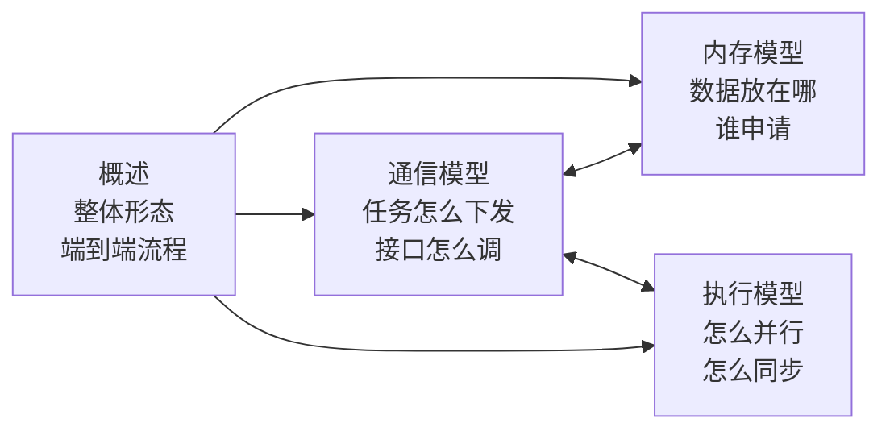

# MC2编程模型资料编写方案

> 本文是《MC2编程模型》四篇资料的编写方案，用于评审确认大纲、图规划与写作尺度。方案确认后按此落笔，本文不作为最终交付资料。

## 一、总体定位

### 1.1 读者与目标

读者是**准备开发MC2算子的Kernel开发者**。读完四篇后应当能回答：

- MC2算子由哪几部分组成，通信是怎么发生的
- 我的Kernel代码里要调哪些接口、按什么顺序调
- 数据放在哪块内存、谁负责申请
- 通信和计算怎么并行起来的，我需要做什么同步

### 1.2 写作尺度

对标 `asc-devkit/docs/zh/api/SIMD-API/高阶API/HCCL通信类/HCCL-Kernel侧接口/HCCL使用说明.md` 的风格：

| 要写 | 不写 |
| --- | --- |
| 机制、流程、概念、约定 | 接口内部的实现细节 |
| 开发者需要自己写的代码 | 框架内部代码的逐行讲解 |
| 数据结构中开发者能感知的字段 | 内部结构体的完整字段列表 |
| 约束与常见错误 | 具体的函数名、文件路径、行号溯源 |

代码片段只出现在"开发者要这样写"的场合，形态类似 `HCCL使用说明.md` 里的六步示例。不引用框架内部源码路径与行号。

算子的详细实现（Tiling切分算法、Matmul编排细节、通信算法实现）后续在"算子实现"章节补充，本套资料不展开。

### 1.3 示例与范围

- 统一以 **AllGatherMatmul** 算子为例
- 平台范围：**Ascend 950PR/Ascend 950DT**
- 通信引擎：**AI CPU**（`comm_mode = "ai_cpu"`）
- CCU部分在各篇留占位小节，后续补充

### 1.4 绘图约定

- 全部使用 Mermaid，不引用图片文件（跨仓相对路径不可靠）
- 图类型：`flowchart` 画结构与内存布局，`sequenceDiagram` 画时序，必要时用 `stateDiagram`
- 与 `asc-comm` 仓已有资料（`docs/zh/算子实现/直驱/Hcomm算子的实现.md`）风格保持一致

### 1.5 术语统一

| 术语 | 含义 | 避免使用 |
| --- | --- | --- |
| 通信任务客户端 | 运行在AI Core上的HCCL高阶API | 第5层 |
| 通信服务端 | 运行在AI CPU上的通信任务执行方 | 第6层、AICPU Server |
| 消息区 | AI Core与AI CPU之间的共享内存 | HcclMsgArea（首次出现可标注） |
| 通信上下文 | Runtime申请通信资源后交给双方的句柄 | OpResCtx、kHcom |
| 通信配置 | Tiling侧生成、随TilingData下发的通信参数 | mc2InitTiling、mc2CcTiling（首次出现可标注） |
| 分块 | 通信切分后的单块数据 | tile |
| 任务标识 | Prepare接口返回的通信任务句柄 | handleId（首次出现可标注） |

---

## 二、概述.md

### 定位

MC2算子的整体形态与端到端流程。作为四篇的入口，建立全局认知，不深入任何单一维度。

### 章节大纲

**1. 什么是MC2算子**
- 通算融合的动机：通信耗时暴露 vs 通信耗时被计算掩盖
- 以AllGatherMatmul为例：计算公式、每卡持有x1分片、本卡数据不依赖通信、远端数据可分块到达
- 四篇资料的组织与相互关系

**2. 执行体划分**
- Host CPU / AI Core / AI CPU / 硬件调度器 四者分工
- 强调两个事实：
  - HCCL高阶API与算子Kernel编译为同一份二进制，运行在同一AI Core上
  - 整条链路只有两处真实执行体边界：AI Core↔AI CPU（共享内存）、AI CPU↔硬件（命令队列）
- 引出核心结论：**通信任务的"下发"与"执行"分离，下发方都不阻塞，这是通算重叠的前提**

**3. 通信引擎的选择**
- `comm_mode` 属性三种取值与对应执行者、支持产品
- 引擎选择影响的四件事：Tiling切分策略、TilingKey、AI CPU Task入口、Kernel中的服务端类型模板参数
- CCU模式需要额外配置的环境变量 `HCCL_OP_EXPANSION_MODE=CCU_SCHED`，及其必须在创建通信域之前设置的原因

**4. 一个MC2算子的组成**
- op_api / op_host / op_graph / op_kernel 四部分的职责与通信相关产出物（表格）
- 指出开发者在通信方面的工作集中在两处：Tiling里生成通信配置与决定切分、Kernel里编排通信与计算顺序

**5. 端到端流程**
- 图编译期 → 执行期的完整时序
- 三个关键时机的说明：
  - 通信资源在Kernel启动前已备好（重资源不能在通信过程中申请）
  - 两个Task并行启动，通信任务一次性全部下发
  - 计算与通信逐块交错

**6. 开发者视角的关键约定**
- 汇总表：约定 + 一句话说明 + 指向详述章节的链接
- 约定项：通信配置由Tiling生成、Kernel只调固定几个接口、下发与等待次数必须匹配、通信结果落点由Tiling决定、消息区跨算子复用、收尾前必须全核同步、不参与计算的核也要调等待接口

### 图规划

| 编号 | 标题 | 类型 | 内容要点 |
| --- | --- | --- | --- |
| 图1 | 执行体划分与边界 | flowchart TB | 四个分区（Host CPU / AI Core / AI CPU / 硬件）；AI Core内标注Kernel与高阶API内联关系；AI CPU内标注服务端与算法的函数调用关系；两处边界用粗箭头并标注"共享内存·消息区""命令队列" |
| 图2 | 端到端时序 | sequenceDiagram | participant：应用程序、aclnn接口、Tiling、GenTask、Runtime、AI Core Kernel、AI CPU服务端、硬件；用Note分隔"图编译期"与"执行期"；体现通信任务一次性下发、本卡计算与通信重叠、逐块交错 |
| 图3 | MC2算子的四部分与产出物 | flowchart LR | 四个目录节点 → 各自产出 → 消费方；虚线标注通信配置流向Runtime、通信上下文流向Kernel与服务端 |

---

## 三、内存模型.md

### 定位

MC2算子涉及的所有内存区域：谁申请、谁读写、生命周期多长、开发者需要做什么。

### 章节大纲

**1. 内存区域总览**
- 五类内存的对照表：算子Workspace、消息区、CCL Buffer、通信窗口（对端可访问内存）、TilingData
- 每类给出：申请者、大小来源、生命周期、读写方
- 归纳两条原则：
  - **通信域级资源跨算子复用**（消息区、CCL Buffer、通信窗口的生命周期与通信域一致）
  - **算子级内存按需申报、由Runtime统一分配**（Workspace、TilingData的生命周期与单次算子执行一致）

**2. 算子Workspace的划分**
- Workspace = 框架预留 + 通信结果暂存 + 其他算子自用
- **通信结果落点的决策**：用户提供输出Buffer时通信结果直接写入该Buffer；未提供时Tiling侧申报一段Workspace，Kernel侧使用这段Workspace
- 开发者要做的事：Tiling侧把这段大小计入Workspace申报；Kernel侧按同样规则决定地址并推进Workspace指针
- 这是Tiling与Kernel之间的一个约定，两侧必须一致

**3. 消息区**
- 作用：AI Core与AI CPU之间传递通信任务与执行进度的唯一通道
- 来源：属于通信域，由Runtime在申请通信资源时一并分配；地址通过通信上下文交给双方
- 三段结构与读写方向：
  - 任务消息数组：客户端写、服务端读
  - 授权计数数组：客户端写、硬件读
  - 完成计数数组：硬件写、客户端读
- **环形复用**：消息槽位数量有限，槽位循环使用，因此单个算子的通信任务数量有上限
- **跨算子复用**：同一通信域的多个MC2算子共用消息区，收尾时必须把完成计数归零交还给下一个算子。这是收尾接口的一项隐含职责，也是收尾前必须全核同步的原因

**4. 通信过程中的数据流转**
- 以AllGather为例说明数据经过哪些内存：本卡输入 → 通信窗口/CCL Buffer → 各卡输出
- CCL Buffer的作用：中转与分块，当单次通信数据量超过CCL Buffer容量时算法内部会分多轮
- 说明这部分由通信算法自行管理，开发者不直接操作

**5. 一致性与可见性**
- 两个执行体读写同一块内存，需要保证可见性
- 客户端侧：写入后需刷新Cache，读取前需失效Cache
- 服务端侧：使用内存屏障
- 消息有效标志位必须最后写入的原因
- 说明这些由框架接口内部处理，开发者无需自行插入同步指令；但需要理解为什么等待接口是轮询而非阻塞

**6. 开发者检查项**
- Workspace大小申报是否包含通信结果暂存段
- Kernel侧通信结果地址的决策规则是否与Tiling一致
- 单算子通信任务数是否在上限内
- 收尾接口是否被调用（否则消息区不会归还）

### 图规划

| 编号 | 标题 | 类型 | 内容要点 |
| --- | --- | --- | --- |
| 图1 | 内存区域全景 | flowchart TB | 按"通信域级"与"算子级"两个生命周期分组；标出各区域的申请者与读写方；用不同边框区分两类生命周期 |
| 图2 | 消息区结构与读写方向 | flowchart LR | 三段内存作为中间节点；左侧AI Core（客户端）、右侧AI CPU（服务端）与硬件；箭头标注"写任务""读任务并清标志""写授权""读授权""写完成""读完成" |
| 图3 | 算子Workspace划分与通信结果落点 | flowchart TB | Workspace分段示意；两个分支：用户提供输出Buffer → 直接写入；未提供 → 落Workspace |
| 图4 | AllGather的数据流转 | flowchart LR | 本卡输入 → 通信窗口 → 远端读取 → 本卡输出；标注CCL Buffer作为中转的位置 |

---

## 四、通信模型.md

### 定位

**四篇中的核心篇。** 讲两件事：客户端-服务端模型（谁在什么位置、各自负责什么），以及通信是怎么实现的（一次通信任务从下发到完成，双方与硬件各自做了什么）。对标 `HCCL使用说明.md` 的图1/图2所表达的内容。

通信与计算的宏观编排（先通信后计算、先计算后通信）归入执行模型，本篇不讲。

### 章节大纲

**1. 客户端-服务端模型**
- HCCL高阶API是**通信任务客户端**，运行在AI Core上。它不执行通信，只负责下发任务与等待结果
- **通信服务端**运行在AI CPU上，负责接收任务、选择通信算法、驱动硬件执行
- 服务端类型通过模板参数指定（`HCCL_SERVER_TYPE_AICPU`），客户端本身始终运行在AI Core上
- 两者通过消息区协作，没有函数调用关系
- 消息区里的三样东西：**通信请求**、**执行授权**、**完成进度**，给出各自的写入方与读取方
- 模型的两个特征：**下发即返回**（客户端写完请求就走，服务端安排完硬件就走）、**等待靠轮询**（客户端在AI Core上没有被唤醒的机制）

**2. 接口全景**
- 六类接口分组表，每类给出作用与调用时机：

| 类别 | 接口 | 作用 |
| --- | --- | --- |
| 初始化 | `InitV2`、`SetCcTilingV2` | 建立与服务端的连接、指定通信配置 |
| 任务下发（Prepare） | `AllGather`、`AllReduce`、`ReduceScatter`、`AlltoAll`、`AlltoAllV`、`AlltoAllvWrite`、`BatchWrite` | 提交一个通信请求，返回任务标识 |
| 提交 | `Commit`（或Prepare的commit模板参数） | 授权任务可以执行 |
| 等待 | `Wait`、`Query` | 阻塞等待、查询完成进度 |
| 信息查询 | `GetRankId`、`GetRankDim`、`GetWindowsInAddr`、`GetWindowsOutAddr` | 查询本卡编号、卡数、通信内存地址 |
| 收尾 | `Finalize` | 通知无后续任务并归还消息区 |

- 完整参数说明指向 asc-devkit 接口手册

**3. Tiling侧生成通信配置**
- 通信配置是Tiling侧调用Tiling接口生成的一组结构体，随TilingData下发
- 配置中写明四件事：用哪个通信域、用哪种通信算法、数据类型、用哪个通信引擎
- 两个消费方：
  - Host侧的Runtime依据它申请通信资源（建链、通信内存、执行线程）
  - Device侧的客户端依据它告知服务端"这个任务对应哪份资源"
- 代码示例：Tiling接口的调用方式
- 说明为什么通信配置必须在Tiling阶段确定：通信资源要在Kernel启动前建好

**4. 一次通信任务的下发机制（本篇主干）**

按六个阶段展开，每阶段说明三方各做了什么：

| 阶段 | 客户端做什么 | 消息区状态 | 服务端做什么 |
| --- | --- | --- | --- |
| 初始化 | 建立与服务端的连接 | — | — |
| 下发 | 提交一个通信请求，拿到任务标识 | 出现一条待处理请求 | 取出请求，准备执行 |
| 提交 | 授权这个任务可以执行 | 授权计数增加 | — |
| 执行 | — | — | 安排硬件搬运数据 |
| 等待 | 轮询完成进度 | 完成进度更新 | 搬完后回报进度 |
| 收尾 | 通知无后续任务，归还消息区 | 状态清零 | 确认全部完成 |

重点说明的机制：
- **下发与执行分离**：Prepare接口把请求写进消息区就返回，此时通信尚未开始。这是通算重叠的起点
- **提交可以与下发合并**：Prepare接口的commit模板参数为true时，下发的同时给出授权；分开调用则可以推迟授权时机
- **请求按序处理**：服务端按客户端发出的顺序逐条处理，不会乱序
- **等待是轮询**：客户端反复查看完成进度直到达到期望值，因为对端是另一个执行体，没有唤醒机制
- **收尾包含归还**：消息区被同一通信域的多个MC2算子复用，收尾时必须把完成进度清零。这是"收尾前必须全核同步"这条约束的来源

**5. 分块通信的数据布局参数**

分块通信场景下最容易填错的两个参数，以`AllGather`为例：

| 参数 | 含义 |
| --- | --- |
| `sendCount` | 本次通信本卡发出的元素个数 |
| `strideCount` | 接收缓冲区中，相邻两张卡的数据起始位置相隔多少个元素 |

- 重点讲`strideCount`：不分块时各卡数据紧挨着排，`strideCount`与`sendCount`相等（传0即为此含义）
- 分块后同一张卡的多个分块在接收缓冲区里是连续的，不同卡之间才隔开，此时`strideCount`应为单卡的全部元素数，而非本次通信的`sendCount`
- 配图说明分块后接收缓冲区的排布

**6. 任务标识与repeat**
- Prepare接口返回任务标识，后续Commit与Wait凭它指定任务
- `repeat`的含义：一次下发代表几次通信；Commit次数与Wait次数都必须等于`repeat`
- 两种编排方式的对比：

| | 每块一个任务（repeat=1） | 一个任务（repeat=N） |
| --- | --- | --- |
| Prepare调用 | N次 | 1次 |
| Commit / Wait | 每个任务各1次 | 同一任务各N次 |
| 收发地址 | 每次由调用方自己算 | 服务端按固定步长自动递推 |
| 适用条件 | 任意排布 | 各次通信的收发地址等距连续 |

- AllGatherMatmul采用前者的原因：接收缓冲区的落点由`strideCount`决定，且主块与尾块的数据量不同，不满足等距连续
- 代码对比（沿用 `HCCL使用说明.md` 的两段示例风格）

**7. 服务端如何执行通信**

这一节讲服务端拿到请求之后做了什么，是"通信怎么实现"的下半段。

- **服务端的工作模式**：一个循环，读取请求 → 执行 → 读下一条，直到收到收尾请求。服务端本身不搬数据，而是把要做的事安排给硬件，安排完立即返回去读下一条请求
- **一次通信任务的三段安排**，硬件按顺序执行：
  1. 等授权 —— 等到客户端给出的执行授权满足，才允许往下走
  2. 搬数据 —— 按通信算法执行跨卡数据搬运
  3. 报进度 —— 把完成进度写回消息区
- 第1段是与客户端的同步点。**等待这件事被交给硬件完成**，因此服务端不会被客户端的进度阻塞，可以连续安排多轮
- 第2段由通信算法展开，涉及本卡数据的准备、与远端卡的握手、数据的实际搬运
- 第3段完成后，客户端的等待接口才会返回
- **通信算法的角色**：算法名在通信配置中指定，服务端据此选择对应实现。算法负责按拓扑分级、把数据切成合适的片、决定每片从哪读到哪。算法的具体实现不在本章范围，开发者只需在Tiling侧指定算法名

**8. 开发者要写的代码**
- 沿用 `HCCL使用说明.md` 的分步结构，给出AllGatherMatmul场景下的代码骨架：
  1. Tiling侧生成通信配置
  2. Kernel侧创建通信对象并初始化
  3. 指定通信配置的位置
  4. 逐块下发通信任务，保存任务标识
  5. 计算本卡数据（不依赖通信）
  6. 逐块等待并计算
  7. 全核同步后收尾
- 每步配一小段代码 + 一句为什么这么写

**9. 约束与常见错误**

| 约束 | 违反后果 |
| --- | --- |
| 单算子的通信任务数有上限 | 下发失败，返回无效任务标识 |
| Commit次数与Wait次数必须等于repeat | Wait报错或状态错乱 |
| 未指定下发核时，Prepare只能在AIC或AIV之一上运行 | 重复下发 |
| Wait的调用顺序必须与下发顺序一致 | 等待错误的任务 |
| 收尾前必须全核同步 | 部分核卡死 |
| 不参与计算的核也必须调用等待接口 | 计数状态不一致 |

**10. CCU模式差异（占位）**

### 图规划

| 编号 | 标题 | 类型 | 内容要点 |
| --- | --- | --- | --- |
| 图1 | AI Core下发HCCL通信任务机制 | flowchart LR | 三个分区：AI Core（Kernel + 客户端）、消息区（通信请求 / 执行授权 / 完成进度）、AI CPU（服务端）；右侧接硬件。箭头标注各自的读写动作。对标 `HCCL使用说明.md` 图1 |
| 图2 | 一次通信任务的完整时序 | sequenceDiagram | **本篇核心图**。participant：算子Kernel、通信客户端、消息区、通信服务端、硬件。覆盖初始化→下发→提交→服务端安排→硬件执行→等待→收尾全过程；用Note标注"此处立即返回""此处轮询等待" |
| 图3 | 分块通信的接收缓冲区排布 | flowchart | 以4卡2块为例，画出接收缓冲区排布：同卡的块连续、跨卡之间隔`strideCount`；标注`sendCount`对应哪一段 |
| 图4 | 服务端处理一条请求 | flowchart TB | 读请求 → 三段安排（等授权 / 搬数据 / 报进度）→ 返回读下一条；旁边一列画硬件按序执行；标注"安排完立即返回" |

---

## 五、执行模型.md

### 定位

通信与计算如何并行、靠什么同步、开发者需要做哪些同步。

### 章节大纲

**1. 两种典型编排**（从通信模型移入）
- **先通信后计算**（AllGather + Matmul）：下发后立即提交，等待通信完成再计算
- **先计算后通信**（Matmul + AllReduce）：先下发让服务端提前组装任务，计算完成后再提交，无需等待
- 两种编排的适用场景与是否需要Wait
- 图：两种编排的调用顺序对比

**2. 融合的基本形态**
- AllGatherMatmul的四段编排：
  1. 一次性下发全部分块的通信任务（不等待）
  2. 计算本卡数据（不依赖通信）
  3. 逐块等待并计算远端数据
  4. 全核同步后收尾
- 为什么先下发通信再算本卡：让服务端在AI Core计算本卡数据期间就开始搬运第一块
- 时间线示意，引出通算重叠的效果

**3. 三级同步关系（本篇骨架）**

| 层级 | 同步双方 | 机制 | 谁负责 |
| --- | --- | --- | --- |
| 跨执行体 | AI Core ↔ AI CPU/硬件 | 授权计数 + 完成计数 | 框架（Commit/Wait接口内部） |
| AI Core核间 | 多个AI Core核之间 | 核间同步接口 | **开发者显式调用** |
| 服务端内部与跨卡 | 主/从线程之间、本卡与远端卡之间 | 线程间同步命令、跨卡握手 | 通信算法内部 |

逐级展开：
- **跨执行体同步**：授权计数表示"第N轮可以执行"，完成计数表示"第N轮已完成"。客户端侧的等待是软件轮询，服务端侧的等待被下压到硬件命令
- **核间同步**：收尾接口会归还消息区（把完成计数归零），如果部分核提前收尾，还在等待的核将永远等不到。因此收尾前必须全核同步。这条约束还反向要求Tiling侧设置独占全核的调度模式
- **服务端内部与跨卡同步**：由算法保证，开发者不感知

**4. 流水的量化依据**
- 分块大小的选取原则：**让第一块数据的通信耗时与本卡计算耗时相当**，使第一块在本卡算完时刚好到达
- 分块数量的权衡：块数越多流水越平滑，但每块都有固定开销（写消息、读消息、匹配资源、下发命令），因此块数需要收敛
- 不同通信引擎的取向不同：AI CPU单次固定开销较大，倾向少切；CCU受单次通信数据量上限约束，倾向多切
- 说明这部分由Tiling的性能模型完成，开发者可以感知但通常不需要手工干预

**5. 为什么等待被设计成两种形态**
- 服务端侧：安排完硬件立即返回，等待交给硬件完成。因此可以连续安排多轮
- 客户端侧：只能轮询，因为AI Core没有把等待委托出去的机制
- 两处"下发完立即返回"是通算重叠的前提

**6. 不参与计算的核也必须等待**
- 出现场景：使用核数少于总核数、或输出为空Tensor只做通信
- 原因：每个核各自维护通信任务的授权与等待计数状态；且收尾会归还共享的完成进度
- 开发者要做的：这些核跳过计算，但等待接口必须按相同次数调用

**7. 调测模式对执行流的影响**
- 只计算不通信、只通信不计算两种模式跳过哪些环节
- 用途：定位问题时区分是计算还是通信出错

**8. 执行模型小结**
- 汇总表：三级同步各自的机制、粒度、开发者是否需要介入、缺失后的后果

**9. CCU模式差异（占位）**

### 图规划

| 编号 | 标题 | 类型 | 内容要点 |
| --- | --- | --- | --- |
| 图1 | 两种典型编排的调用顺序对比 | flowchart TB | 左右并列：先通信后计算（下发→提交→等待→计算）vs 先计算后计算（下发→计算→提交，无需等待） |
| 图2 | 通算流水时间线 | flowchart LR | 两条泳道（AI Core / AI CPU+硬件）；横向表示时间；体现"下发全部任务→算本卡→等块0→算块0→等块1→算块1"的交错；标注重叠区间 |
| 图3 | 三级同步关系 | flowchart TB | 三个分组框；每组内标出同步双方、机制与负责方；用颜色区分"框架负责"与"开发者负责" |
| 图4 | 收尾前的全核同步 | sequenceDiagram | participant：核0、核1、核N、消息区；对比两种情况：无全核同步导致核1卡死 vs 有全核同步正常收尾 |
| 图5 | 一次算子执行的完整同步时序 | sequenceDiagram | participant：AI Core各核、通信客户端、消息区、通信服务端、硬件；端到端串起三级同步 |

---

## 六、四篇之间的关系

- **概述**是入口，建立全局认知，指向另三篇
- **通信模型**是核心，另两篇都会引用它的机制说明
- **内存模型**与**通信模型**在消息区一节交叉：内存模型讲结构与生命周期，通信模型讲协议与流程
- **执行模型**与**通信模型**在同步机制一节交叉：通信模型讲单个任务的下发与等待，执行模型讲多个任务与多个核的整体编排

## 七、代码片段规划

代码只在以下位置出现，形态对标 `HCCL使用说明.md`：

| 位置 | 内容 | 目的 |
| --- | --- | --- |
| 通信模型 · Tiling侧生成通信配置 | Tiling接口的调用示例 | 让开发者知道通信配置怎么产生 |
| 通信模型 · 任务标识与repeat | 两种编排方式的代码对比 | 说明repeat的用法差异 |
| 通信模型 · 开发者要写的代码 | Kernel侧完整骨架（初始化→下发→计算→等待→收尾） | 主要交付物，开发者可直接参照 |
| 执行模型 · 不参与计算的核也必须等待 | 只等待不计算的分支写法 | 提示易错点 |
| 内存模型 · 算子Workspace的划分 | 通信结果落点的判断写法 | 说明Tiling与Kernel的约定 |

其余章节以文字和图为主，不出现代码。

## 八、写作边界说明

通信模型一篇最容易越界，此处单列判据：**开发者调接口时能观察到、能踩到坑的写；只有读源码才会遇到的不写。**

| 要写：机制 | 不写：代码层面的实现 |
| --- | --- |
| 客户端把请求放进消息区、服务端取走的过程 | 有效标志位的取值、校验和算法、写入顺序的内存语义 |
| 服务端按序处理请求 | 序号字段名、重试计数的实现 |
| 服务端安排硬件执行、安排完立即返回 | 命令描述符的位域、队列的环形回绕、Cache与屏障指令 |
| 授权与完成两个计数如何形成闭环 | 计数器的内存布局与对齐要求 |
| 任务数上限的存在及后果 | 上限来自槽位数量这一实现事实 |

## 九、已确认事项

1. CCU部分在各篇留占位小节，不单独成篇
2. 不写"常见问题与调测"
3. 概述的执行体划分图保留四执行体完整结构，图后文字精简为两道边界的说明
4. 图统计：概述3张、内存模型4张、通信模型4张、执行模型5张，共16张
