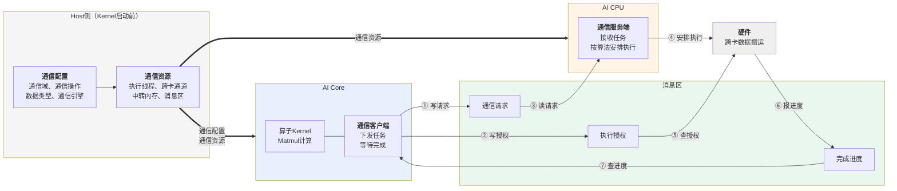
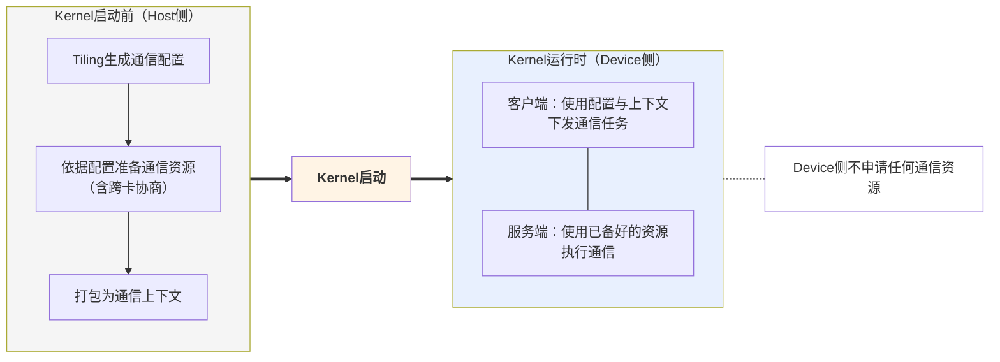
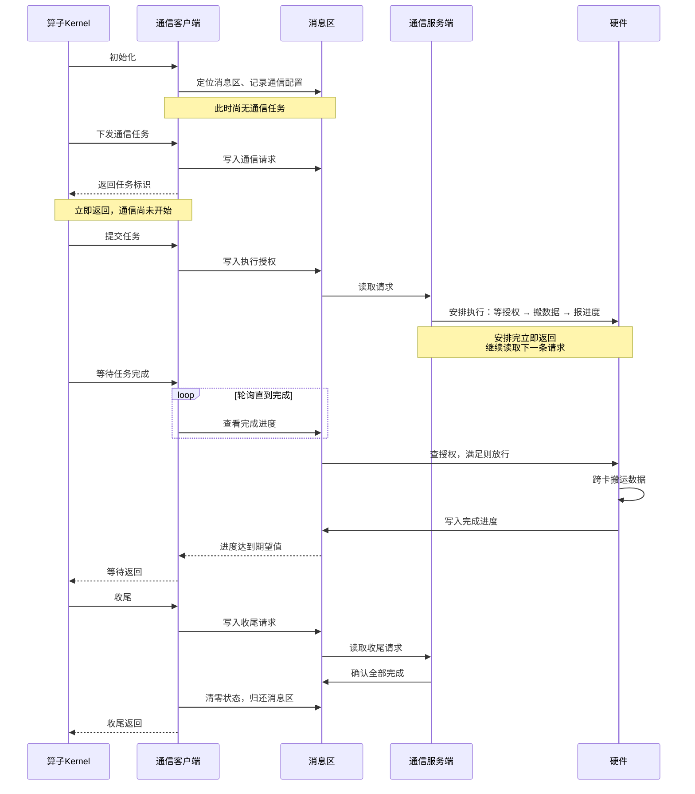
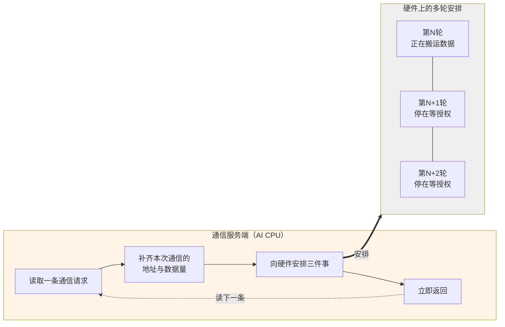

# MC2通信模型

## 概述

本章介绍MC2算子的通信是怎么组织起来的：Host侧在Kernel启动前准备了什么、AI Core侧如何把通信任务下发出去、AI CPU侧如何把任务变成实际的跨卡数据搬运。

本章不涉及以下内容：

| 内容 | 见 |
| --- | --- |
| 各类内存的布局与生命周期 | [内存模型](内存模型.md) |
| 通信与计算的宏观编排、多核同步 | [执行模型](执行模型.md) |
| 通信原语参数的具体填法、Kernel代码示例 | 后续"算子实现"章节 |

本章以AllGatherMatmul算子、AI CPU作为通信服务端为例。

## 通信模型总览

MC2算子的通信由三个部分协作完成。

| 部分 | 时机 | 职责 |
| --- | --- | --- |
| Host侧 | Kernel启动前 | 生成通信配置、依据配置准备通信资源 |
| 通信客户端（AI Core） | Kernel运行时 | 下发通信任务、等待任务完成 |
| 通信服务端（AI CPU） | Kernel运行时 | 接收任务、按通信算法执行、回报进度 |

客户端就是HCCL高阶API。它运行在AI Core上，与算子的计算代码在同一个Kernel里，但**它不执行通信**，只负责把通信任务下发出去、并在需要时等待任务完成。

服务端类型在创建通信对象时通过模板参数指定：

```cpp
Hccl<HcclServerType::HCCL_SERVER_TYPE_AICPU> hccl;   // 指定AI CPU作为服务端
```

无论指定哪种服务端，客户端本身始终运行在AI Core上。

客户端与服务端是**并行运行的两个执行体**，两者之间没有函数调用关系，全部协作通过一块共享内存完成，本章称之为**消息区**。消息区中有三样东西：

| 内容 | 含义 | 写入方 | 读取方 |
| --- | --- | --- | --- |
| 通信请求 | 一次通信任务的描述：做什么操作、数据在哪、有多少 | 客户端 | 服务端 |
| 执行授权 | 客户端允许服务端执行到第几轮 | 客户端 | 硬件 |
| 完成进度 | 已经完成到第几轮 | 硬件 | 客户端 |

**图1** MC2通信模型总览



这个模型有两个贯穿全篇的特征。

**下发即返回。** 客户端把请求写进消息区就返回，此时通信尚未开始；服务端把任务安排给硬件后也立即返回，去处理下一条请求。双方都不阻塞等待对方。

**等待靠轮询。** 客户端需要确认某次通信是否完成时，反复查看完成进度直到达到期望值。因为对端是另一个执行体，客户端没有被唤醒的机制。

正是"下发即返回"让通信与计算得以重叠：客户端发完请求就可以去做计算，服务端此时已经在搬数据。

## Host侧的通信准备

通信任务需要一批在Kernel运行前就必须确定的信息，也需要一批在Kernel运行前就必须建立好的资源。这两件事都在Host侧完成。

### 通信配置的生成

**为什么必须在Tiling阶段确定**

通信资源的准备（建立跨卡通道、申请通信内存）涉及多卡协商，耗时较长，不可能在通信过程中临时完成。因此这些资源必须在Kernel启动之前就准备好，而准备资源的依据就是通信配置。这决定了通信配置只能在Tiling阶段产生。

**配置的载体**

通信配置由两个结构体承载，都定义在算子的TilingData中：

```cpp
struct AllGatherMatmulTilingData {
    Mc2InitTiling mc2InitTiling;   // 必须是TilingData的第一个成员
    Mc2CcTiling   mc2CcTiling;     // 位置无要求
    // ... 算子自己的Tiling参数
};
```

- `Mc2InitTiling` 描述通信的整体配置，**必须定义为TilingData结构体的第一个成员**。
- `Mc2CcTiling` 描述一个通信任务的配置。一个算子中若有多种通信操作，可以定义多个，最多8个。

**配置项**

通信配置的内容通过`Mc2CcTilingConfig`类的构造参数与配置接口给出，按功能分为几组：

| 组 | 配置项 | 说明 |
| --- | --- | --- |
| 通信任务描述 | `groupName`、`opType`、`srcDataType`、`dstDataType`、`reduceType` | 通信域名称、通信操作类型、输入输出数据类型、归约操作类型 |
| 通信引擎 | `commEngine` | 由算子属性决定 |
| 算法配置 | `algConfig` | 通信算法配置，部分产品上为预留字段 |
| 行为开关 | `skipLocalRankCopy`、`skipBufferWindowCopy`、`stepSize` | 可选，控制本卡数据是否输出、输入数据取自何处、细粒度通信步长 |
| 调测 | `debugMode` | 可选，用于关闭通信或打印通信过程信息 |
| BatchWrite专用 | `queueNum`、`commBlockNum` | 仅BatchWrite场景使用 |

各配置项的取值范围与产品差异请参见HCCL Tiling侧接口手册。以AllGatherMatmul为例，需要实际配置的是通信域名称、通信操作类型、数据类型与通信引擎，其余可以使用默认值。

**生成配置的三个步骤**

```cpp
// ① 创建配置对象，指定通信域、通信操作类型、算法配置
const char *group = /* 通信域名称，来自算子属性 */;
uint32_t opType = HCCL_CMD_ALLGATHER;
std::string algConfig = "AllGather=level0:fullmesh";
AscendC::Mc2CcTilingConfig mc2CcTilingConfig(group, opType, algConfig);

// ② 按需设置其他配置项（可选）
mc2CcTilingConfig.SetSkipBufferWindowCopy(0);

// ③ 生成配置，必须先生成 Mc2InitTiling
mc2CcTilingConfig.GetTiling(tilingData->mc2InitTiling);
mc2CcTilingConfig.GetTiling(tilingData->mc2CcTiling);
```

第③步的顺序不能颠倒，因为`Mc2InitTiling`中需要记录`Mc2CcTiling`的位置。

### 通信资源的准备

框架依据通信配置准备三类资源。

| 资源 | 用途 |
| --- | --- |
| 执行线程 | 服务端用于并行处理多路数据搬运 |
| 跨卡通道 | 本卡与其他卡之间的通信路径 |
| 中转内存 | 数据在跨卡搬运过程中的暂存区 |

此外，客户端与服务端协作所需的**消息区**也在这一步分配。

**为什么必须提前准备**

跨卡通道的建立需要各卡交换内存描述符，之后才能互相访问对端的内存。这是一个跨卡协商动作，必须在所有卡都尚未开始通信时统一完成。若放到通信过程中做，各卡的进度不一致会导致协商无法完成。

**资源的缓存与复用**

这些资源按通信域与通信任务的特征缓存。同一通信域内特征相同的算子重复执行时，资源直接复用，不重复申请。消息区也属于通信域，被同一通信域内的多个MC2算子复用 —— 这带来一条约束，见[收尾包含归还消息区](#四个关键机制)。

### 配置与资源的传递

准备好的内容通过三条路径到达Device侧。

| 内容 | 传递方式 | 使用方 |
| --- | --- | --- |
| 通信配置 | 随TilingData下发 | 客户端 |
| 通信资源 | 打包为通信上下文，填入Task的参数槽位 | 客户端与服务端 |
| 消息区地址 | 包含在通信上下文中 | 客户端与服务端 |

**图2** Kernel启动前后的分界



计算Task与服务端Task拿到的是**同一份通信上下文**，这是双方能够访问同一块消息区的前提。这一步由框架完成，算子代码不需要额外处理。

## 客户端：通信任务的下发

### 客户端的接口

客户端接口分六类。

| 类别 | 接口 | 作用 |
| --- | --- | --- |
| 初始化 | `InitV2`、`SetCcTilingV2` | 建立与服务端的连接、指定通信配置的位置 |
| 任务下发 | `AllGather`、`AllReduce`、`ReduceScatter`、`AlltoAll`、`AlltoAllV`、`AlltoAllvWrite`、`BatchWrite` | 提交一个通信请求，返回任务标识 |
| 提交 | `Commit` | 授权某个任务可以执行 |
| 等待 | `Wait`、`Query` | 阻塞等待任务完成、查询已完成的轮次数 |
| 信息查询 | `GetRankId`、`GetRankDim`、`GetWindowsInAddr`、`GetWindowsOutAddr` | 查询本卡编号、通信域卡数、通信内存地址 |
| 收尾 | `Finalize` | 通知服务端无后续任务 |

任务下发接口统称**Prepare接口**，各自对应一种集合通信原语。完整的参数说明与产品支持情况参见HCCL Kernel侧接口手册。

### 一次通信任务的六个阶段

一次通信任务从下发到完成经过六个阶段。下表列出每个阶段中客户端、消息区、服务端三方的状态。

| 阶段 | 客户端做什么 | 消息区状态 | 服务端做什么 |
| --- | --- | --- | --- |
| 初始化 | 建立与服务端的连接，指定通信配置 | — | — |
| 下发 | 调用Prepare接口提交请求，拿到任务标识 | 出现一条待处理请求 | 取出请求，准备执行 |
| 提交 | 调用`Commit`授权任务可以执行 | 授权计数增加 | — |
| 执行 | — | — | 把任务安排给硬件 |
| 等待 | 调用`Wait`轮询完成进度 | 完成进度更新 | 硬件搬完后回报进度 |
| 收尾 | 调用`Finalize`通知无后续任务 | 状态清零 | 确认全部执行完毕 |

**图3** 一次通信任务的完整时序



### 四个关键机制

**下发与执行是分离的**

Prepare接口把请求写进消息区就返回，返回时通信还没有开始。返回值是**任务标识**，后续的提交与等待都凭它指定要操作哪个任务。

这个特性是通算重叠的起点：调用方拿到任务标识后可以立刻去做别的事，不必守着通信。

**提交可以与下发合并**

Prepare接口有一个`commit`模板参数：

```cpp
auto handleId = hccl.AllGather<true>(...);
// 等价于：
// auto handleId = hccl.AllGather<false>(...);
// hccl.Commit(handleId);
```

- `commit = true`：下发的同时给出授权，服务端可以立即执行。适用于希望通信尽早开始的场景。
- `commit = false`（默认）：下发后不授权，需要显式调用`Commit`。适用于希望推迟通信执行时机的场景。

分开调用的价值在于：服务端在收到请求后就可以开始组装通信任务，而实际的数据搬运要等到授权给出之后。这样任务组装的耗时可以被调用方的其他工作掩盖。

**请求按发出顺序被处理**

服务端按客户端发出的顺序逐条处理请求，不会乱序。因此等待接口的调用顺序也必须与下发顺序一致，否则会等到错误的任务上。

**收尾包含归还消息区**

`Finalize`除了通知服务端"后续没有通信任务"，还会把消息区的状态清零。因为消息区属于通信域、被同一通信域内的多个MC2算子复用，本算子必须把它恢复到干净状态交给下一个算子。

这带来一条重要约束：**多核场景下必须在全核同步之后再调用`Finalize`**。否则先跑完的核清零状态时，其他还在等待的核将永远等不到完成进度。详见[执行模型](执行模型.md)。

## 服务端：通信任务的执行

本节说明服务端如何把一条通信请求变成实际的跨卡数据搬运，以及这个过程为什么不会阻塞客户端。通信算法的内部实现不在本章范围。

### 服务端的工作模式

服务端是一个循环：读取一条请求 → 执行 → 读取下一条，直到收到收尾请求为止。

关键在于**服务端本身不搬运数据**。它把要做的事安排给硬件，安排完立即返回去读下一条请求。因此服务端不会被硬件的搬运进度拖住。

### 一次通信任务的三段安排

服务端为每次通信向硬件安排三件事，硬件按顺序执行：

| 顺序 | 安排 | 作用 |
| --- | --- | --- |
| ① | 等授权 | 等到客户端给出的执行授权满足，才允许往下走 |
| ② | 搬数据 | 按通信算法执行跨卡数据搬运 |
| ③ | 报进度 | 把完成进度写回消息区 |

三段的意义各不相同：

- **第①段是与客户端的同步点。** 它确保数据搬运不会早于客户端的授权发生。值得注意的是，**等待这件事是交给硬件完成的**，服务端并不停在这里。
- **第②段由通信算法展开。** 包含本卡数据的准备、与远端卡的握手、数据的实际搬运。
- **第③段执行完毕后**，客户端的等待接口才会返回。

### 多轮请求的流水叠加

服务端连续处理多条请求时，各轮的安排在硬件上是**叠加**的：第N轮的数据还在搬运时，第N+1轮的安排已经排好并停在"等授权"这一步。

**图4** 服务端处理请求与多轮安排的叠加



这个特性带来两个结果：

- 只要客户端的授权及时给出，通信就能连续不断地进行，不会出现"搬完一块才开始安排下一块"的空隙。
- MC2算子把通信切成多块下发之后，仍然能够保持链路的带宽利用率。

### 通信算法的角色

通信算法负责的事：

- 按通信域的拓扑层级展开，例如先跨节点、再节点内
- 把数据切成适合链路与中转内存的片
- 决定每一片从哪张卡的哪块内存读到本卡的哪个位置

算法由框架依据通信域的拓扑与本次通信的数据量选择，Kernel侧不感知。对开发者而言，只需在Tiling侧填好通信配置，算法的选择与执行完全由框架完成。

## 约束与常见错误

| 约束 | 违反后果 |
| --- | --- |
| 单个算子的通信任务数有上限 | Prepare接口返回无效任务标识 |
| 提交次数与等待次数必须与`repeat`参数一致 | 等待接口报错或任务状态错乱 |
| 等待接口的调用顺序必须与下发顺序一致 | 等待到错误的任务上 |
| 未通过模板参数指定下发核时，Prepare接口只能在AIC或AIV之一上运行 | 同一个任务被重复下发 |
| 收尾前必须全核同步 | 部分核永久等待 |
| 不参与计算的核也必须调用等待接口 | 任务状态在各核之间不一致 |

调测含有HCCL高阶API的算子时，可在算子编译工程中增加编译选项`-DASCENDC_DEBUG`，开启异常场景拦截能力。

## CCU模式差异

待补充。
