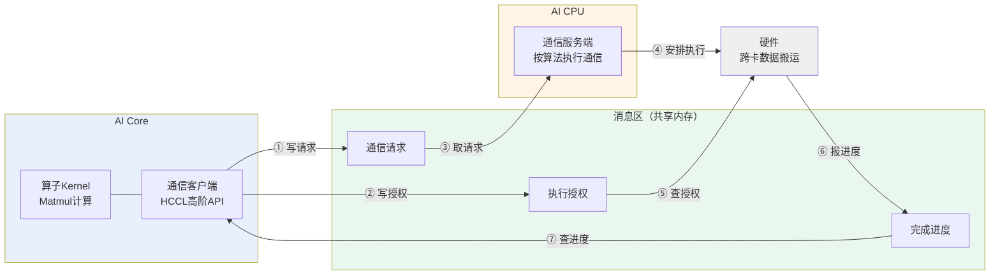
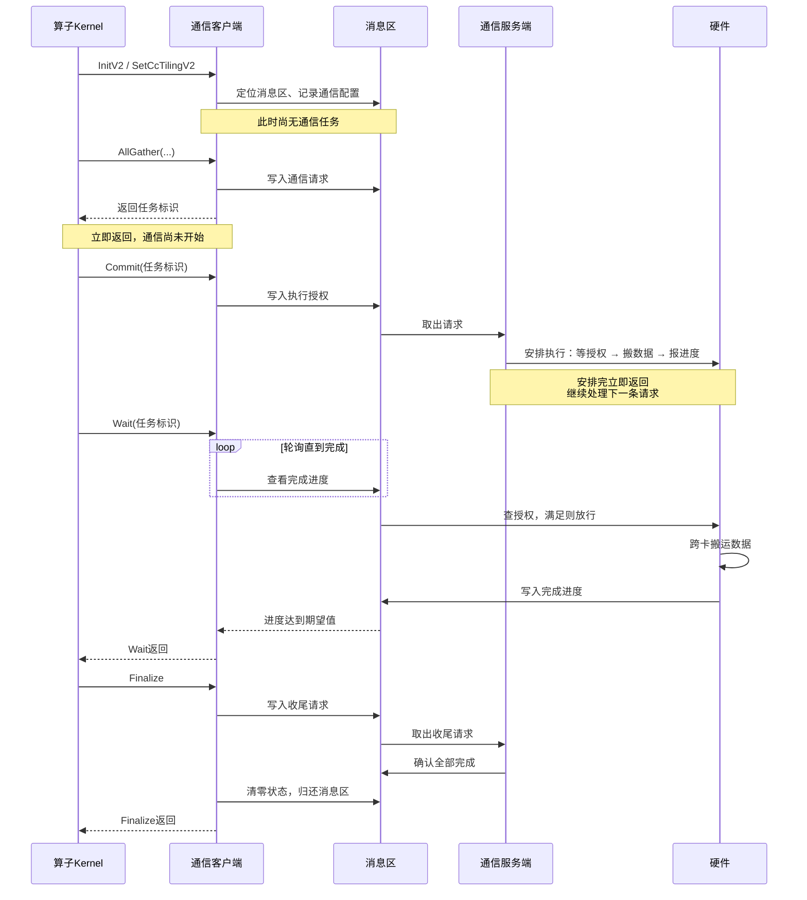
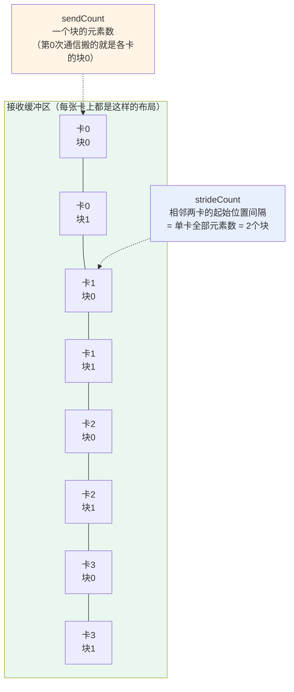
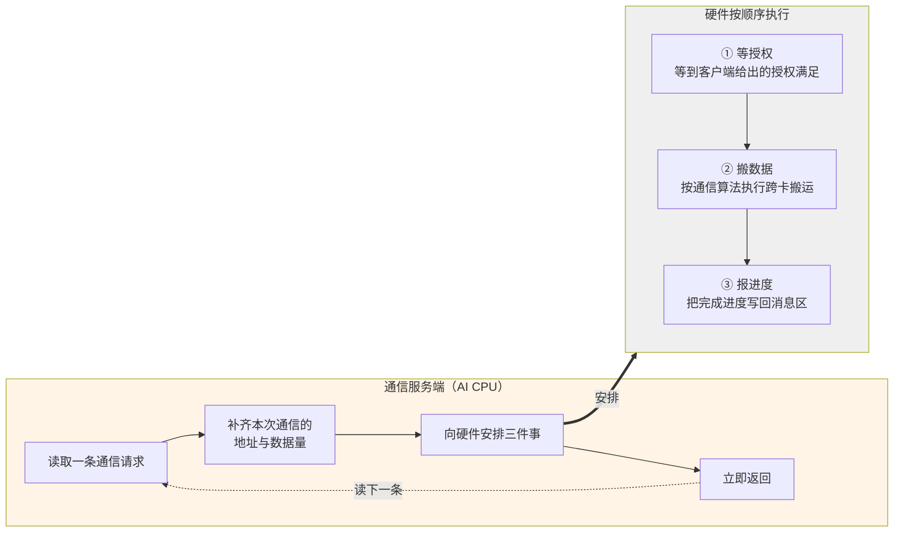

# MC2通信模型

本章介绍MC2算子中通信任务的下发与执行机制：AI Core上的算子Kernel如何把通信任务交给通信服务端、服务端如何完成通信、双方如何知晓彼此的进度。

通信与计算在宏观上如何编排（先通信后计算、先计算后通信），以及多核之间的同步，见[执行模型](执行模型.md)。

本章以AllGatherMatmul算子、AI CPU服务端为例。

## 客户端-服务端模型

MC2算子的通信采用客户端-服务端模型。

- **通信任务客户端**是HCCL高阶API，运行在AI Core上。它不执行通信，只负责把通信任务下发出去、并在需要时等待任务完成。
- **通信服务端**运行在AI CPU上，负责接收任务、按指定的通信算法完成数据搬运、回报执行进度。

服务端类型在创建通信对象时通过模板参数指定：

```cpp
Hccl<HcclServerType::HCCL_SERVER_TYPE_AICPU> hccl;   // AI CPU作为服务端
```

无论指定哪种服务端，客户端本身始终运行在AI Core上。

AI Core与AI CPU是两个并行运行的执行体，两者之间没有函数调用关系，全部协作通过一块共享内存完成，本章称之为**消息区**。消息区中有三样东西：

| 内容 | 含义 | 写入方 | 读取方 |
| --- | --- | --- | --- |
| 通信请求 | 一次通信任务的描述：做什么操作、数据在哪、有多少 | 客户端 | 服务端 |
| 执行授权 | 客户端允许服务端执行到第几轮 | 客户端 | 硬件 |
| 完成进度 | 服务端已经完成到第几轮 | 硬件 | 客户端 |

**图1** AI Core下发通信任务机制



这个模型有两个贯穿全篇的特征：

- **下发即返回。** 客户端把请求写进消息区就返回，此时通信尚未开始；服务端把任务安排给硬件后也立即返回，去处理下一条请求。双方都不阻塞等待对方。
- **等待靠轮询。** 客户端需要确认某次通信是否完成时，反复查看完成进度直到达到期望值。因为对端是另一个执行体，客户端没有被唤醒的机制。

正是"下发即返回"让通信与计算得以重叠：客户端发完请求就可以去做计算，服务端此时已经在搬数据。

## 接口全景

客户端接口分六类。

| 类别 | 接口 | 作用 |
| --- | --- | --- |
| 初始化 | `InitV2`、`SetCcTilingV2` | 建立与服务端的连接、指定通信配置的位置 |
| 任务下发 | `AllGather`、`AllReduce`、`ReduceScatter`、`AlltoAll`、`AlltoAllV`、`AlltoAllvWrite`、`BatchWrite` | 提交一个通信请求，返回任务标识 |
| 提交 | `Commit` | 授权某个任务可以执行 |
| 等待 | `Wait`、`Query` | 阻塞等待任务完成、查询已完成的轮次数 |
| 信息查询 | `GetRankId`、`GetRankDim`、`GetWindowsInAddr`、`GetWindowsOutAddr` | 查询本卡编号、通信域卡数、通信内存地址 |
| 收尾 | `Finalize` | 通知服务端无后续任务 |

其中任务下发接口统称**Prepare接口**，各自对应一种集合通信原语。完整的参数说明与产品支持情况参见[HCCL Kernel侧接口](https://gitcode.com/cann/asc-devkit)手册。

## Tiling侧生成通信配置

通信任务需要一些在Kernel运行前就必须确定的信息：用哪个通信域、用哪种通信算法、数据类型是什么。这些信息由Tiling侧生成，本章称之为**通信配置**。

### 为什么必须在Tiling阶段确定

通信资源（跨卡链路、通信内存、执行线程）的建立涉及多卡协商，耗时较长，不可能在通信过程中临时完成。因此这些资源必须在Kernel启动之前就准备好，而准备资源的依据就是通信配置。这决定了通信配置只能在Tiling阶段产生。

### 配置的组成与使用

通信配置由两部分组成，都定义在算子的TilingData结构体中：

```cpp
struct AllGatherMatmulTilingData {
    Mc2InitTiling mc2InitTiling;   // 必须是TilingData的第一个成员
    Mc2CcTiling   mc2CcTiling;     // 位置无要求；有多个通信任务时可定义多个
    // ... 算子自己的Tiling参数
};
```

- `Mc2InitTiling` 描述通信的整体配置，**必须定义为TilingData结构体的第一个成员**。
- `Mc2CcTiling` 描述一个通信任务的配置。一个算子中若有多种通信操作，可以定义多个，最多8个。

Tiling侧通过`Mc2CcTilingConfig`类生成这两部分内容：

```cpp
// ① 创建配置对象，指定通信域、通信操作类型、通信算法
const char *group = /* 通信域名称，来自算子属性 */;
uint32_t opType = HCCL_CMD_ALLGATHER;
std::string algConfig = "AllGather=level0:fullmesh";
AscendC::Mc2CcTilingConfig mc2CcTilingConfig(group, opType, algConfig);

// ② 按需设置其他通信信息（可选）
mc2CcTilingConfig.SetSkipBufferWindowCopy(0);

// ③ 生成配置，注意必须先生成 Mc2InitTiling
mc2CcTilingConfig.GetTiling(tilingData->mc2InitTiling);
mc2CcTilingConfig.GetTiling(tilingData->mc2CcTiling);
```

生成的配置随TilingData一起下发，有两个使用方：

- **Host侧**依据它申请通信资源。
- **Device侧的客户端**依据它告知服务端"这个任务使用哪份资源、按哪种算法执行"。

开发者只需要保证配置的内容正确，资源的申请与算法的执行都由框架完成。

## 一次通信任务的下发机制

一次通信任务从下发到完成经过六个阶段。下表列出每个阶段中客户端、消息区、服务端三方的状态。

| 阶段 | 客户端做什么 | 消息区状态 | 服务端做什么 |
| --- | --- | --- | --- |
| 初始化 | 建立与服务端的连接，指定通信配置 | — | — |
| 下发 | 调用Prepare接口提交请求，拿到任务标识 | 出现一条待处理请求 | 取出请求，准备执行 |
| 提交 | 调用`Commit`授权任务可以执行 | 授权计数增加 | — |
| 执行 | — | — | 把任务安排给硬件 |
| 等待 | 调用`Wait`轮询完成进度 | 完成进度更新 | 硬件搬完后回报进度 |
| 收尾 | 调用`Finalize`通知无后续任务 | 状态清零 | 确认全部执行完毕 |

**图2** 一次通信任务的完整时序



以下四点是理解这套机制的关键。

### 下发与执行是分离的

Prepare接口把请求写进消息区就返回，返回时通信还没有开始。返回值是**任务标识**，后续的`Commit`与`Wait`都凭它指定要操作哪个任务。

这个特性是通算重叠的起点：调用方拿到任务标识后可以立刻去做别的事，不必守着通信。

### 提交可以与下发合并

Prepare接口有一个`commit`模板参数：

```cpp
auto handleId = hccl.AllGather<true>(sendBuf, recvBuf, count, dataType, stride, 1);
// 等价于：
// auto handleId = hccl.AllGather<false>(...);
// hccl.Commit(handleId);
```

- `commit = true`：下发的同时给出授权，服务端可以立即执行。适用于希望通信尽早开始的场景。
- `commit = false`（默认）：下发后不授权，需要显式调用`Commit`。适用于希望推迟通信执行时机的场景。

分开调用的价值在于：服务端在收到请求后就可以开始组装通信任务，而实际的数据搬运要等到授权给出之后。这样任务组装的耗时可以被调用方的其他工作掩盖。

### 请求按发出顺序被处理

服务端按客户端发出的顺序逐条处理请求，不会乱序。因此`Wait`的调用顺序也必须与下发顺序一致，否则会等到错误的任务上。

### 收尾包含归还消息区

`Finalize`除了通知服务端"后续没有通信任务"，还会把消息区的状态清零。因为消息区属于通信域、被同一通信域内的多个MC2算子复用，本算子必须把它恢复到干净状态交给下一个算子。

这带来一条重要约束：**多核场景下必须在全核同步之后再调用`Finalize`**。否则先跑完的核清零状态时，其他还在`Wait`的核将永远等不到完成进度。详见[执行模型](执行模型.md)。

## 分块通信的数据布局参数

MC2算子把通信切成多块下发，每块调用一次Prepare接口。此时最容易出错的是**接收缓冲区的布局参数**。以`AllGather`为例：

```cpp
hccl.AllGather<true>(sendBuf, recvBuf, sendCount, dataType, strideCount, repeat);
```

| 参数 | 含义 |
| --- | --- |
| `sendCount` | 本次通信中，本卡发出的元素个数 |
| `strideCount` | 接收缓冲区中，相邻两张卡的数据起始位置相隔多少个元素 |

`strideCount`的取值取决于是否分块。

**不分块时**，一次通信搬完全部数据，各卡的数据在接收缓冲区里紧挨着排列，此时`strideCount`传0即可（含义是相邻数据块地址连续，等价于`strideCount = sendCount`）。

**分块后**情况不同：同一张卡的多个分块在接收缓冲区里是连续的，不同卡之间才隔开。因此`strideCount`应当是**单卡的全部元素数**，而不是本次通信的`sendCount`。

**图3** 分块通信的接收缓冲区排布（4卡、每卡切2块）



如图，第0次通信搬运各卡的块0，`sendCount`是一个块的元素数；但卡1的块0并不紧跟在卡0的块0之后，而是要跳过卡0的块1。所以`strideCount`必须按单卡的全部元素数来给，服务端才能把每张卡的数据放到正确位置。

若误将`strideCount`填成`sendCount`，各卡数据会互相覆盖，结果错误但不报错，这类问题较难定位，需要特别留意。

## 任务标识与repeat

Prepare接口的最后一个参数`repeat`表示**这一次下发代表几次通信**。它决定了后续`Commit`与`Wait`的调用次数：

> `Commit`的调用次数与`Wait`的调用次数都必须等于`repeat`。

因此同样的分块通信有两种组织方式。

| | 每块一个任务（repeat=1） | 一个任务（repeat=N） |
| --- | --- | --- |
| Prepare调用次数 | N次 | 1次 |
| 任务标识数量 | N个 | 1个 |
| Commit / Wait | 每个任务各1次 | 同一个任务各N次 |
| 收发地址 | 每次由调用方自己计算 | 服务端按`sendCount`自动递推 |
| 适用条件 | 任意排布 | 各次通信的收发地址等距连续 |

**方式一：每块一个任务**

```cpp
for (uint32_t i = 0; i < tileCnt; ++i) {
    auto handleId = hccl.AllGather<true>(
        sendBuf + i * tileOffset,      // 每次的收发地址自己算
        recvBuf + i * tileOffset,
        tileCount, dataType, strideCount, 1);   // repeat = 1
    handles[i] = handleId;
}
// 每个任务各Wait一次
for (uint32_t i = 0; i < tileCnt; ++i) {
    hccl.Wait(handles[i]);
    // 计算第i块
}
```

**方式二：一个任务带repeat**

```cpp
auto handleId = hccl.AllGather<true>(
    sendBuf, recvBuf, tileCount, dataType, strideCount, tileCnt);   // repeat = tileCnt
// 同一个任务Wait tileCnt次
for (uint32_t i = 0; i < tileCnt; ++i) {
    hccl.Wait(handleId);
    // 计算第i块
}
```

方式二的接口调用更少，但要求各次通信的收发地址严格等距连续，因为服务端是按`sendCount`自动递推地址的。

AllGatherMatmul采用方式一，原因有两点：接收缓冲区的落点由`strideCount`决定，不是简单的按`sendCount`递推；且主块与尾块的数据量通常不同，无法用同一个`sendCount`表达。

## 服务端如何执行通信

服务端拿到请求之后做了什么，是通信实现的下半段。

### 服务端的工作模式

服务端是一个循环：读取一条请求 → 执行 → 读取下一条，直到收到收尾请求为止。

关键在于**服务端本身不搬运数据**。它把要做的事安排给硬件，安排完立即返回去读下一条请求。因此服务端不会被硬件的搬运进度拖住，可以连续安排好几轮通信。

### 一次通信任务的三段安排

服务端为每次通信向硬件安排三件事，硬件按顺序执行：

**图4** 服务端处理一条请求



三段的作用各不相同：

- **等授权**是与客户端的同步点。这一段确保数据搬运不会早于客户端的授权发生。值得注意的是，**等待这件事是交给硬件完成的**，服务端并不停在这里，这正是服务端能连续安排多轮的原因。
- **搬数据**由通信算法展开，包含本卡数据的准备、与远端卡的握手、数据的实际搬运。
- **报进度**执行完毕后，客户端的`Wait`才会返回。

### 通信算法的角色

通信算法由Tiling侧在通信配置中指定的算法名决定，服务端据此选择对应的算法实现。算法负责：

- 按通信域的拓扑结构分级展开（例如先跨节点、再节点内）
- 把数据切成适合链路与中转内存的片
- 决定每一片从哪张卡的哪块内存读到本卡的哪个位置

算法的具体实现不在本章范围。对开发者而言，只需在Tiling侧指定合适的算法名，算法的执行完全由框架完成。

## 开发者要写的代码

以AllGatherMatmul为例，Kernel侧的通信编排骨架如下。

**步骤1：Tiling侧生成通信配置**

见[Tiling侧生成通信配置](#tiling侧生成通信配置)一节。

**步骤2：创建通信对象并初始化**

```cpp
REGISTER_TILING_DEFAULT(AllGatherMatmulTilingData);
GET_TILING_DATA_WITH_STRUCT(AllGatherMatmulTilingData, tilingData, tilingGM);

Hccl<HcclServerType::HCCL_SERVER_TYPE_AICPU> hccl;
GM_ADDR contextGM = AscendC::GetHcclContext<0>();   // 获取通信上下文

hccl.InitV2(contextGM, &tilingData);
```

`InitV2`需要通信上下文与TilingData的地址。通信上下文通过`GetHcclContext`获取。

**步骤3：指定通信配置的位置**

```cpp
if (hccl.SetCcTilingV2(offsetof(AllGatherMatmulTilingData, mc2CcTiling)) != HCCL_SUCCESS) {
    return;
}
```

传入的是`Mc2CcTiling`在TilingData结构体中的偏移，客户端据此找到通信配置并告知服务端。

**步骤4：逐块下发通信任务**

```cpp
AscendC::HcclHandle handles[MAX_TILE_CNT];
for (uint32_t i = 0; i < tileCnt; ++i) {
    handles[i] = hccl.AllGather<true>(
        aGM + i * tileAddrOffset,          // 本块的源地址
        gatherOut + i * tileAddrOffset,    // 本块的目的地址
        tileCount,                         // 本块的元素数
        dataType,
        strideCount,                       // 单卡全部元素数
        1);                                // repeat = 1
}
```

一次性把所有分块的请求都下发出去，此时通信已经开始，但代码可以继续往下走。

**步骤5：计算本卡数据**

```cpp
// 本卡的x1不需要等通信，直接参与计算
ComputeLocal();
```

这段计算与步骤4下发的通信在时间上重叠。

**步骤6：逐块等待并计算**

```cpp
for (uint32_t i = 0; i < tileCnt; ++i) {
    hccl.Wait(handles[i]);      // 等第i块数据到达
    ComputeTile(i);             // 计算第i块
}
```

`Wait`返回后第i块数据已经可用，此时第i+1块还在传输，计算与通信继续重叠。

**步骤7：全核同步后收尾**

```cpp
AscendC::CrossCoreSetFlag<0, PIPE_FIX>(EVENT_ID);
AscendC::CrossCoreWaitFlag(EVENT_ID);       // 等所有核到齐

if (AscendC::GetBlockIdx() == 0) {
    hccl.Finalize();
}
```

必须先全核同步再收尾。全核同步的原因与写法详见[执行模型](执行模型.md)。

## 约束与常见错误

| 约束 | 违反后果 |
| --- | --- |
| 单个算子的通信任务数有上限 | Prepare接口返回无效任务标识 |
| `Commit`与`Wait`的调用次数必须等于`repeat` | `Wait`报错或任务状态错乱 |
| `Wait`的调用顺序必须与下发顺序一致 | 等待到错误的任务上 |
| 未通过模板参数指定下发核时，Prepare接口只能在AIC或AIV之一上运行 | 同一个任务被重复下发 |
| 收尾前必须全核同步 | 部分核永久等待 |
| 不参与计算的核也必须调用`Wait` | 任务状态在各核之间不一致 |
| 分块通信时`strideCount`必须按单卡全部元素数给 | 各卡数据互相覆盖，结果错误但不报错 |

调测含有HCCL高阶API的算子时，可在算子编译工程中增加编译选项`-DASCENDC_DEBUG`，开启异常场景拦截能力。

## CCU模式差异

待补充。

