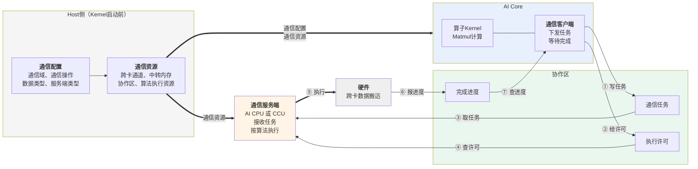
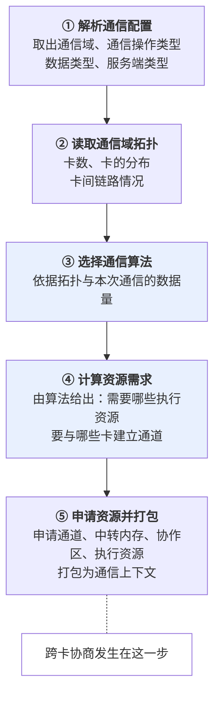
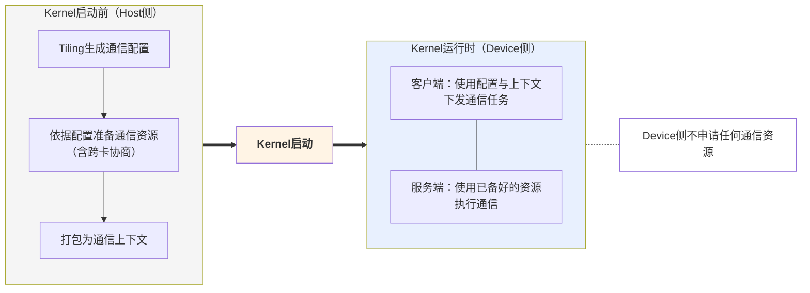
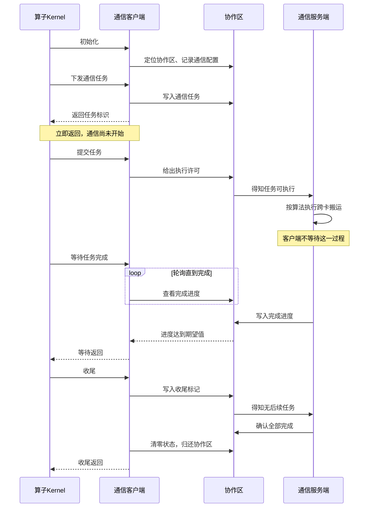
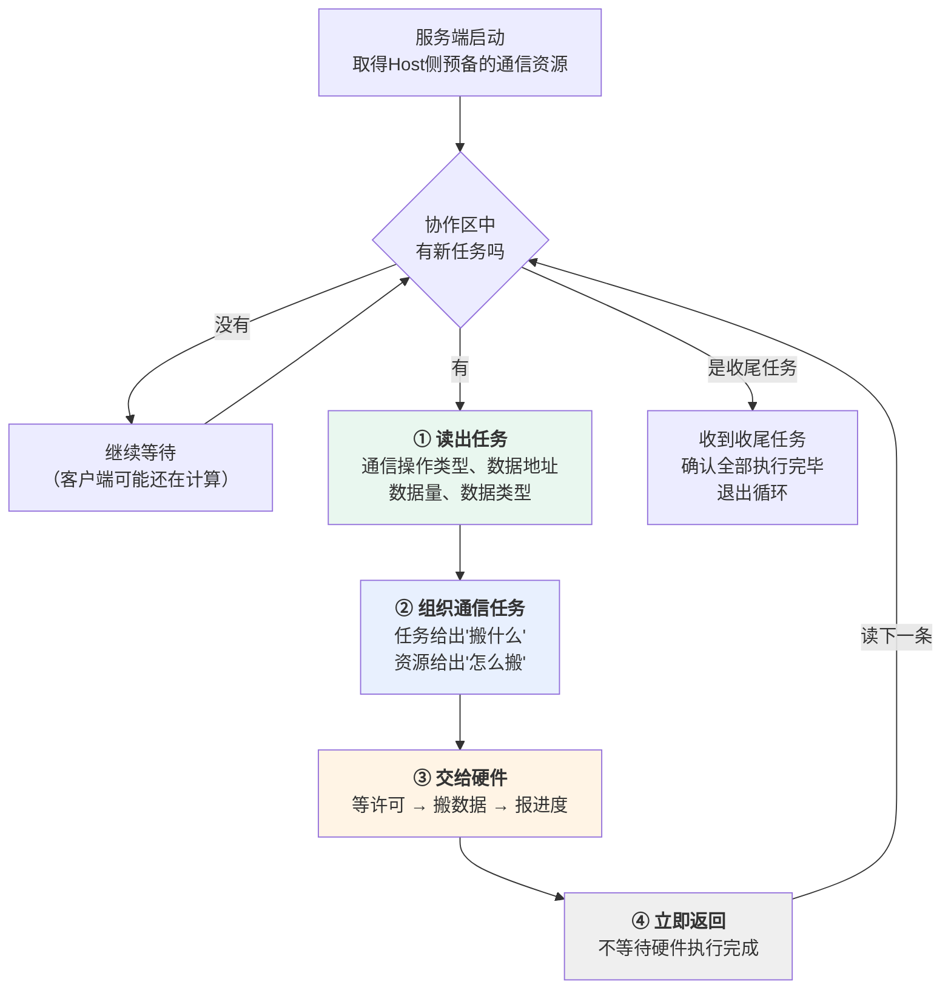
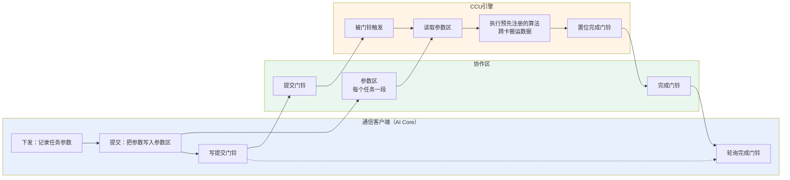
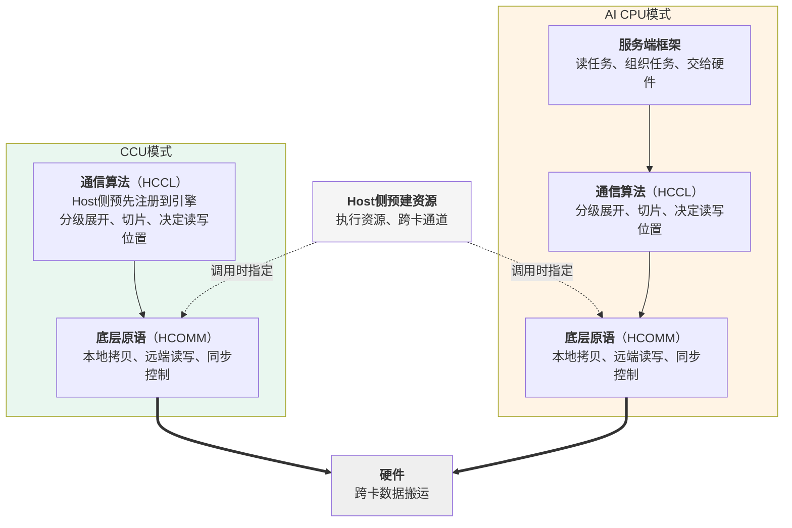

# MC2通信模型

## 概述

本章介绍MC2算子的通信是怎么组织起来的：Host侧在Kernel启动前准备了什么、AI Core侧如何把通信任务下发出去、通信服务端如何把任务变成实际的跨卡数据搬运。

本章覆盖**AI CPU模式**与**CCU模式**两种通信模式。两者共享大部分内容，正文中不区分模式的部分对两者都成立；存在差异的部分会并列展开。

本章不涉及以下内容：

| 内容 | 见 |
| --- | --- |
| 各类内存的布局与生命周期 | [内存模型](内存模型.md) |
| 通信与计算的宏观编排、多核同步 | [执行模型](执行模型.md) |
| 通信原语参数的具体填法、Kernel代码示例 | 后续"算子实现"章节 |

本章以AllGatherMatmul算子为例。

## 通信模型总览

MC2算子的通信由三个部分协作完成。

| 部分 | 时机 | 职责 |
| --- | --- | --- |
| Host侧 | Kernel启动前 | 生成通信配置、依据配置准备通信资源 |
| 通信客户端（AI Core） | Kernel运行时 | 下发通信任务、等待任务完成 |
| 通信服务端 | Kernel运行时 | 接收任务、按通信算法执行、回报进度 |

客户端就是HCCL高阶API。它运行在AI Core上，与算子的计算代码在同一个Kernel里，但**它不执行通信**，只负责把通信任务下发出去、并在需要时等待任务完成。

服务端有两种，在创建通信对象时通过模板参数指定：

```cpp
Hccl<HcclServerType::HCCL_SERVER_TYPE_AICPU> hccl;   // AI CPU模式
Hccl<HcclServerType::HCCL_SERVER_TYPE_CCU>   hccl;   // CCU模式
```

无论指定哪种服务端，客户端本身始终运行在AI Core上。

客户端与服务端是**并行运行的两个执行体**，两者之间没有函数调用关系，全部协作通过一块共享内存完成，本章称之为**协作区**。协作区中承载三类信息：

| 信息 | 含义 | 写入方 | 读取方 |
| --- | --- | --- | --- |
| 通信任务 | 一次通信的描述：做什么操作、数据在哪、有多少 | 客户端 | 服务端 |
| 执行许可 | 客户端允许服务端开始执行的标志 | 客户端 | 服务端或硬件 |
| 完成进度 | 已经完成到第几轮 | 服务端或硬件 | 客户端 |

**图1** MC2通信模型总览



这个模型有两个贯穿全篇的特征。

**下发即返回。** 客户端把任务写进协作区就返回，此时通信尚未开始；服务端把任务交给硬件后也立即返回。双方都不阻塞等待对方。

**等待靠轮询。** 客户端需要确认某次通信是否完成时，反复查看完成进度直到达到期望值。因为对端是另一个执行体，客户端没有被唤醒的机制。

正是"下发即返回"让通信与计算得以重叠：客户端发完任务就可以去做计算，服务端此时已经在搬数据。

### 两种模式的差异概览

两种模式在这个总览层面的位置完全相同，差异体现在协作区的形态与服务端的工作方式上。

| 维度 | AI CPU模式 | CCU模式 |
| --- | --- | --- |
| 服务端形态 | AI CPU核上运行的服务端软件 | 专用硬件通信引擎 |
| 协作区形态 | 消息区：任务槽位 + 授权计数 + 完成进度 | 参数区 + 门铃 |
| 服务端如何得知有新任务 | 循环轮询任务槽位 | 被客户端写门铃触发 |
| 通信算法的执行方式 | 由服务端软件执行 | 由硬件引擎执行，算法在Host侧预先注册 |
| 任务参数何时写入协作区 | 下发时 | 提交时 |

最后一行是唯一影响开发者的差异，见[下发、提交与执行的关系](#下发提交与执行的关系)。

## Host侧的通信准备

通信任务需要一批在Kernel运行前就必须确定的信息，也需要一批在Kernel运行前就必须建立好的资源。这两件事都在Host侧完成，两种模式的流程一致。

### 通信配置的生成

**为什么必须在Tiling阶段确定**

通信资源的准备（建立跨卡通道、申请通信内存）涉及多卡协商，耗时较长，不可能在通信过程中临时完成。因此这些资源必须在Kernel启动之前就准备好，而准备资源的依据就是通信配置。这决定了通信配置只能在Tiling阶段产生。

**配置的载体**

通信配置由两个结构体承载，都定义在算子的TilingData中：

```cpp
struct AllGatherMatmulTilingData {
    Mc2InitTiling mc2InitTiling;   // 必须是TilingData的第一个成员
    Mc2CcTiling   mc2CcTiling;     // 位置无要求
    // ... 算子自己的Tiling参数
};
```

- `Mc2InitTiling` 描述通信的整体配置，**必须定义为TilingData结构体的第一个成员**。
- `Mc2CcTiling` 描述一个通信任务的配置。一个算子中若有多种通信操作，可以定义多个，最多8个。

**配置项**

通信配置的内容通过`Mc2CcTilingConfig`类的构造参数与配置接口给出，按功能分为几组：

| 组 | 配置项 | 说明 |
| --- | --- | --- |
| 通信任务描述 | `groupName`、`opType`、`srcDataType`、`dstDataType`、`reduceType` | 通信域名称、通信操作类型、输入输出数据类型、归约操作类型 |
| 服务端类型 | `commEngine` | 由算子属性`comm_mode`决定，取值区分AI CPU与CCU |
| 算法配置 | `algConfig` | 通信算法配置，部分产品上为预留字段 |
| 行为开关 | `skipLocalRankCopy`、`skipBufferWindowCopy`、`stepSize` | 可选 |
| 调测 | `debugMode` | 可选，用于关闭通信或打印通信过程信息 |
| BatchWrite专用 | `queueNum`、`commBlockNum` | 仅BatchWrite场景使用 |

其中`commEngine`是唯一区分两种模式的配置项。各配置项的取值范围与产品差异请参见HCCL Tiling侧接口手册。

**生成配置的三个步骤**

```cpp
// ① 创建配置对象，指定通信域、通信操作类型、算法配置
AscendC::Mc2CcTilingConfig mc2CcTilingConfig(group, HCCL_CMD_ALLGATHER, algConfig);

// ② 按需设置其他配置项（含服务端类型）
mc2CcTilingConfig.SetCommEngine(commEngine);

// ③ 生成配置，必须先生成 Mc2InitTiling
mc2CcTilingConfig.GetTiling(tilingData->mc2InitTiling);
mc2CcTilingConfig.GetTiling(tilingData->mc2CcTiling);
```

第③步的顺序不能颠倒，因为`Mc2InitTiling`中需要记录`Mc2CcTiling`的位置。

### 通信资源的准备

**需要准备哪些资源**

| 资源 | 用途 | 两种模式的差异 |
| --- | --- | --- |
| 跨卡通道 | 本卡与其他卡之间的通信路径 | 申请粒度不同，见下文 |
| 中转内存 | 数据在跨卡搬运过程中的暂存区 | 无 |
| 协作区 | 客户端与服务端协作的共享内存 | 形态不同：消息区 / 参数区与门铃 |
| 算法执行资源 | 算法运行时需要的资源 | AI CPU模式为执行线程；CCU模式为注册到引擎上的算法 |

**资源是怎么确定并创建的**

资源的数量与形态不是固定的，取决于本次通信要用哪种通信算法 —— 不同算法需要的资源不同，需要与哪些卡建立通道也不同。因此创建资源要经过五个步骤。

**图2** 通信资源的创建流程



第③④两步是这个流程的关键。**先选算法、再由算法报出资源需求**，而不是框架按固定规则申请。以AllGather为例，若选中的是单级算法，本卡需要与通信域内所有其他卡各建一条通道；若选中的是两级算法，则先建跨节点的通道、再建节点内的通道，两层的通道数都不同。

**两种模式在第④⑤步的差异**

| | AI CPU模式 | CCU模式 |
| --- | --- | --- |
| 算法的存在形式 | 服务端软件中的代码 | 需要注册到CCU引擎上的程序 |
| 通道申请粒度 | 按算法整体申请 | 按算法程序分别申请 |
| 额外准备动作 | 申请执行线程 | 把算法注册到CCU实例上 |

CCU实例本身不是在这一步申请的，而是在**用户创建通信域时**申请，依据的是环境变量`HCCL_OP_EXPANSION_MODE`。算法注册到已有的实例上。这也是CCU模式必须在创建通信域前设置该环境变量的原因，见[概述](概述.md)。

**为什么必须提前准备**

第⑤步中，跨卡通道的建立需要各卡交换内存描述符，之后才能互相访问对端的内存。这是一个跨卡协商动作，必须在所有卡都尚未开始通信时统一完成。若放到通信过程中做，各卡的进度不一致会导致协商无法完成。

**资源的缓存与复用**

这些资源按通信域与通信任务的特征缓存。同一通信域内特征相同的算子重复执行时，上述五个步骤直接跳过，资源复用已有的。协作区也属于通信域，被同一通信域内的多个MC2算子复用 —— 这带来一条约束，见[收尾的两重含义](#收尾的两重含义)。

### 配置与资源的传递

上一节第⑤步产出的**通信上下文**，是一块设备内存，里面记录了本卡编号、通信域卡数、协作区地址，以及各通信任务对应的资源描述。它连同通信配置一起构成Device侧通信所需的全部信息。

| 内容 | 传递方式 | Device侧如何取得 |
| --- | --- | --- |
| 通信配置 | 随TilingData下发 | Kernel通过TilingData访问 |
| 通信上下文 | 填入Task的参数槽位 | Kernel通过`GetHcclContext`获取 |

Kernel侧把两者一并交给客户端完成初始化：

```cpp
GM_ADDR contextGM = AscendC::GetHcclContext<0>();   // 取得通信上下文
hccl.InitV2(contextGM, &tilingData);                // 通信上下文 + 通信配置
```

两种模式的初始化方式相同，客户端从上下文中取用的字段不同：AI CPU模式取消息区地址，CCU模式取参数区与门铃区的地址。

**图3** Kernel启动前后的分界



计算Task与服务端Task拿到的是**同一份通信上下文**，这是双方能够访问同一块协作区的前提。这一步由框架完成，算子代码不需要额外处理。

## 客户端：通信任务的下发

本节内容对两种模式一致，仅在最后一小节说明一处差异。

### 客户端的接口

客户端接口分六类。

| 类别 | 接口 | 作用 |
| --- | --- | --- |
| 初始化 | `InitV2`、`SetCcTilingV2` | 建立与服务端的连接、指定通信配置的位置 |
| 任务下发 | `AllGather`、`AllReduce`、`ReduceScatter`、`AlltoAll`、`AlltoAllV`、`AlltoAllvWrite`、`BatchWrite` | 提交一个通信任务，返回任务标识 |
| 提交 | `Commit` | 许可某个任务开始执行 |
| 等待 | `Wait`、`Query` | 阻塞等待任务完成、查询已完成的轮次数 |
| 信息查询 | `GetRankId`、`GetRankDim` 等 | 查询本卡编号、通信域卡数等 |
| 收尾 | `Finalize` | 通知服务端无后续任务 |

任务下发接口统称**Prepare接口**，各自对应一种集合通信原语。两种模式下这些接口的用法与语义完全相同。完整的参数说明与产品支持情况参见HCCL Kernel侧接口手册。

### 一次通信任务的六个阶段

一次通信任务从下发到完成经过六个阶段。下表列出每个阶段中客户端、协作区、服务端三方的状态。

| 阶段 | 客户端做什么 | 协作区状态 | 服务端做什么 |
| --- | --- | --- | --- |
| 初始化 | 建立与服务端的连接，指定通信配置 | — | — |
| 下发 | 调用Prepare接口提交任务，拿到任务标识 | 出现一条待处理任务 | 得知有新任务 |
| 提交 | 调用`Commit`许可任务执行 | 许可标志置位 | 开始执行 |
| 执行 | — | — | 按算法完成跨卡搬运 |
| 等待 | 调用`Wait`轮询完成进度 | 完成进度更新 | 完成后回报进度 |
| 收尾 | 调用`Finalize`通知无后续任务 | 状态清零 | 确认全部执行完毕后退出 |

**图4** 一次通信任务的完整时序



### 请求的处理顺序

服务端按客户端发出的顺序逐条处理任务，不会乱序。

因此**等待接口的调用顺序必须与下发顺序一致**，否则会等到错误的任务上。

### 收尾的两重含义

`Finalize`做两件事：

1. 通知服务端后续没有通信任务
2. 把协作区的状态清零

第二件事容易被忽略。因为协作区属于通信域、被同一通信域内的多个MC2算子复用，本算子必须把它恢复到干净状态交给下一个算子。

这带来一条重要约束：**多核场景下必须在全核同步之后再调用`Finalize`**。否则先跑完的核清零状态时，其他还在等待的核将永远等不到完成进度。详见[执行模型](执行模型.md)。

### 下发、提交与执行的关系

**下发不等于执行。** Prepare接口把任务信息记录下来就返回，返回时通信还没有开始。返回值是**任务标识**，后续的提交与等待都凭它指定要操作哪个任务。

真正许可服务端开始执行的是**提交**。因此下发与提交可以合并，也可以分开。Prepare接口的`commit`模板参数控制这一点：

```cpp
auto handleId = hccl.AllGather<true>(...);
// 等价于：
// auto handleId = hccl.AllGather<false>(...);
// hccl.Commit(handleId);
```

| 写法 | 行为 | 适用场景 |
| --- | --- | --- |
| `commit = true` | 下发的同时给出许可，服务端可以立即执行 | 希望通信尽早开始 |
| `commit = false`（默认） | 下发后不许可，需显式调用`Commit` | 希望推迟通信的执行时机 |

**这里是两种模式唯一影响开发者的差异。**

| | AI CPU模式 | CCU模式 |
| --- | --- | --- |
| 下发时 | 任务已写入协作区，服务端可以读到并开始组织任务 | 任务参数暂存在客户端，尚未写入协作区 |
| 提交时 | 给出许可，硬件开始搬运 | 把任务参数写入参数区，再写门铃通知引擎 |
| 分开调用的收益 | 从下发到提交这段时间里服务端已在组织任务，这段耗时被调用方的其他工作掩盖 | 无此收益，因为提交前服务端尚不知道有任务 |

无论哪种模式、哪种写法，"下发不阻塞"这一点不变。这是通算重叠的起点：调用方拿到任务标识后可以立刻去做计算，不必守着通信。

## 服务端：通信任务的执行

本节说明服务端如何把一条通信任务变成实际的跨卡数据搬运，以及这个过程为什么不会阻塞客户端。两种服务端的工作方式差异较大，分开说明；共同点在本节末尾收束。

### 两种服务端形态的对比

| | AI CPU服务端 | CCU服务端 |
| --- | --- | --- |
| 本质 | AI CPU核上运行的软件 | 专用硬件通信引擎 |
| 如何得知有新任务 | 循环轮询协作区中的任务槽位 | 被客户端写门铃触发 |
| 谁执行通信算法 | 服务端软件 | 硬件引擎，执行Host侧预先注册的算法 |
| 是否有软件循环 | 有 | 无 |
| 数据搬运的发起 | 服务端把搬运动作交给硬件 | 引擎直接发起 |

尽管形态不同，两者对客户端呈现的行为是一致的：接收任务、执行、回报进度，且都不阻塞客户端。

### AI CPU服务端：软件循环

服务端随算子一起启动，启动后进入一个循环，直到收到收尾任务才退出。一轮循环包含四个动作。

**图5** AI CPU服务端的工作循环



第②步值得说明。客户端写入的任务只描述了"这一次要搬什么" —— 通信操作类型、源地址、目的地址、数据量、数据类型。至于"怎么搬"（用哪种算法、走哪些通道、用几个线程）来自Host侧预备的通信资源。服务端把两者结合起来，才得到一个可执行的通信任务。

第③步交给硬件的任务由三段构成，硬件按顺序执行：

| 顺序 | 内容 | 作用 |
| --- | --- | --- |
| ① | 等许可 | 等到客户端通过`Commit`给出的许可，才允许往下走 |
| ② | 搬数据 | 按通信算法执行跨卡数据搬运 |
| ③ | 报进度 | 把完成进度写回协作区 |

**虽然任务里有"等许可"这一段，但等待的执行者是硬件，不是服务端。** 服务端只是把这段等待作为一条指令交下去，随后立即返回。这是第④步能够成立的原因，也是服务端可以连续处理多条任务的原因：第N轮的数据还在搬运时，第N+1轮的任务已经交付完毕、停在"等许可"这一段。

### CCU服务端：门铃触发与算法执行

CCU是硬件引擎，没有软件循环。它的工作方式是**被通知后执行**。

**图6** CCU服务端的执行流程



四个环节：

1. **触发。** 客户端把任务参数写入参数区，然后写提交门铃。引擎被门铃触发开始工作。
2. **读参数。** 引擎从参数区读出本次通信的地址、数据量等参数。
3. **执行算法。** 按Host侧预先注册在引擎上的算法完成跨卡搬运。算法内部的动作包括与对端卡交换地址、跨卡写数据、事件同步。
4. **回报。** 执行完毕后置位完成门铃，客户端的等待接口据此返回。

与AI CPU模式相比，CCU模式少了"组织通信任务"这个环节 —— 算法在注册时就已经与资源绑定，运行时只需补上参数区里的动态信息。这也是CCU模式下参数在提交时才写入的原因：参数写入与触发是同一个动作的两个步骤。

### 通信算法与底层原语

两种模式的算法层职责相同，实现形式不同。

**算法层的职责**（两种模式一致）

通信算法由HCCL提供，覆盖AllGather、AllReduce、ReduceScatter等各集合通信原语。算法负责：

- 按通信域的拓扑层级展开，例如先跨节点、再节点内
- 把数据切成适合链路与中转内存的片
- 决定每一片从哪张卡的哪块内存读到本卡的哪个位置

算法由框架依据通信域的拓扑与本次通信的数据量选择，Kernel侧不感知。

**算法靠什么完成搬运**

算法本身不直接操作硬件，而是调用一组底层原语来表达搬运与同步动作。这些原语由HCOMM提供，两种模式各有一套，但类别对应：

| 原语类别 | 作用 |
| --- | --- |
| 本地数据操作 | 卡内的数据拷贝与归约 |
| 远端数据操作 | 从对端卡读取数据、向对端卡写入数据 |
| 同步控制 | 与对端卡握手、执行单元之间的同步 |

以AllGather为例，算法的一轮执行大致是：先与对端卡握手确认双方就绪，再搬运数据，搬完后再次握手告知对端可以继续。这些动作都通过上述原语表达。

**原语与预建资源的关系**

原语的每次调用都要指定**用哪个执行资源**、**走哪条通道**。这两样正是Host侧在通信资源准备阶段建立好的（见[通信资源的准备](#通信资源的准备)）。算法只是使用它们，不申请、不释放。

**图7** 两种模式下服务端的内部分层



CCU模式少了"服务端框架"这一层，因为不需要软件循环去读任务与组织任务。

### 共同点：两个阶段的分工

无论哪种模式，Host侧准备阶段与服务端执行阶段的分工都是一致的：

| 阶段 | 确定了什么 |
| --- | --- |
| Host侧准备 | 能和哪些卡通信、通过什么路径、用什么算法 |
| 服务端执行 | 这一次搬哪些数据、按什么顺序、分几片搬 |

而且两种服务端都满足"不阻塞客户端"这一点：AI CPU服务端把等待交给硬件后立即返回；CCU引擎的执行与客户端并行，客户端只轮询门铃。

对开发者而言，只需在Tiling侧填好通信配置，算法的选择、原语的调用、资源的使用都由框架完成。

## 约束与常见错误

以下约束在两种模式下都成立。

| 约束 | 违反后果 |
| --- | --- |
| 单个算子的通信任务数有上限 | Prepare接口返回无效任务标识 |
| 提交次数与等待次数必须与`repeat`参数一致 | 等待接口报错或任务状态错乱 |
| 等待接口的调用顺序必须与下发顺序一致 | 等待到错误的任务上 |
| 未通过模板参数指定下发核时，Prepare接口只能在AIC或AIV之一上运行 | 同一个任务被重复下发 |
| 收尾前必须全核同步 | 部分核永久等待 |
| 未分配计算任务的核也必须调用等待接口 | 违反上一条契约 |

CCU模式额外要求在创建通信域前设置环境变量，见[概述](概述.md)。

调测含有HCCL高阶API的算子时，可在算子编译工程中增加编译选项`-DASCENDC_DEBUG`，开启异常场景拦截能力。
