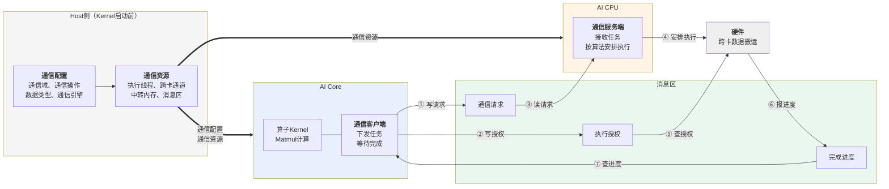
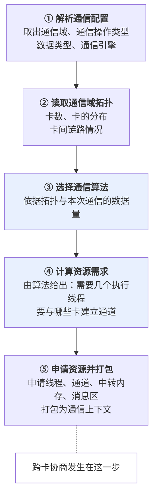
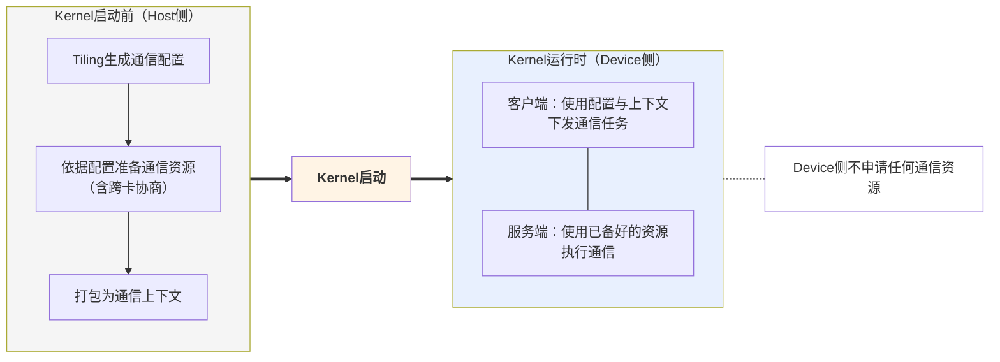
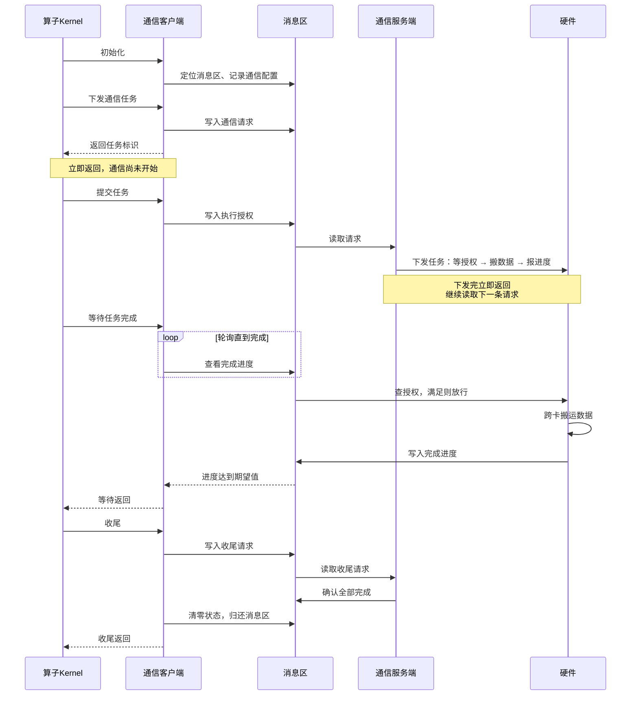
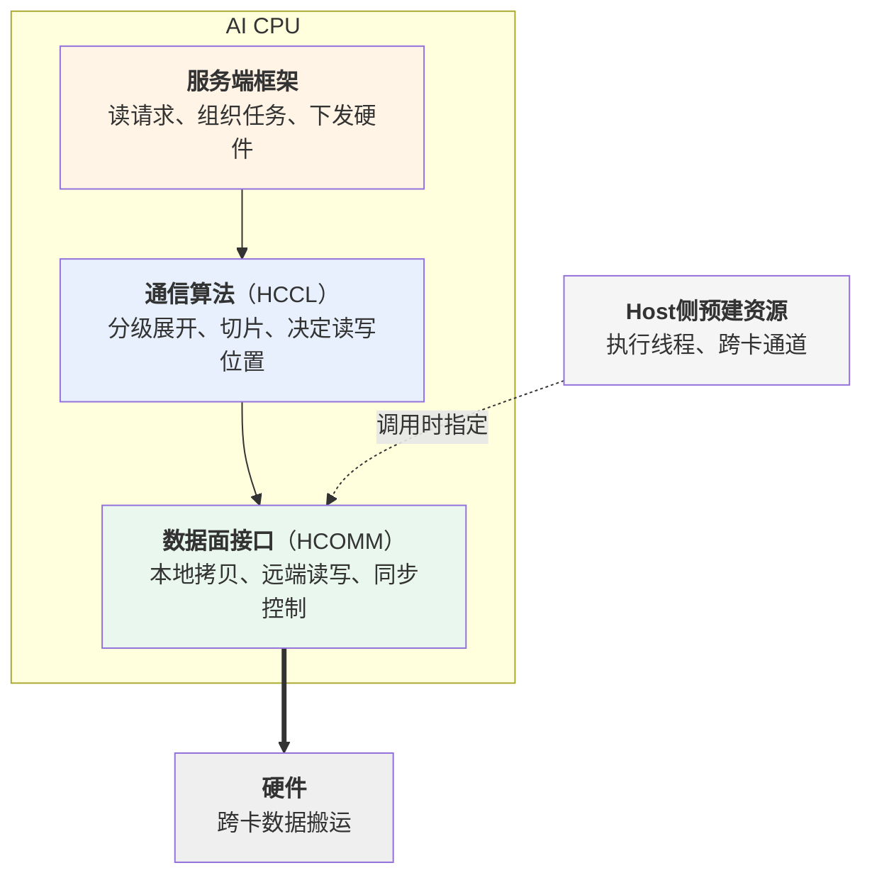
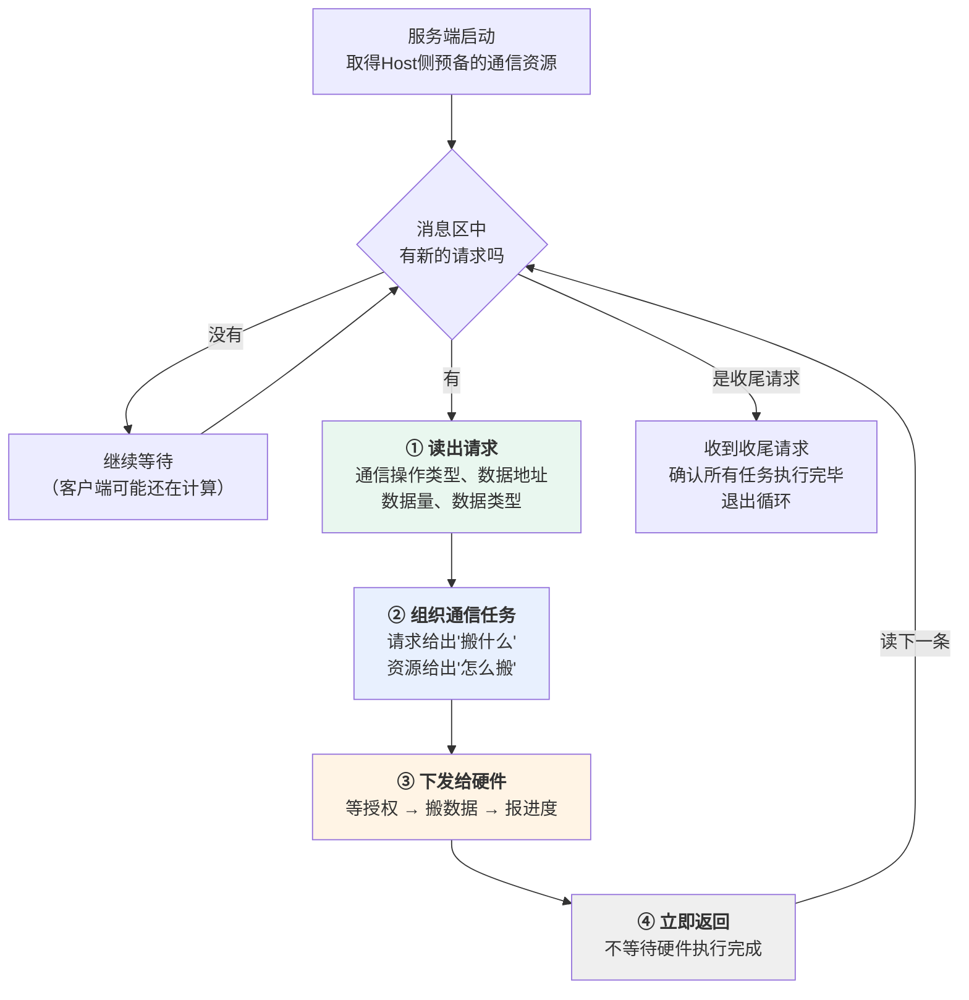

# MC2通信模型

## 概述

本章介绍MC2算子的通信是怎么组织起来的：Host侧在Kernel启动前准备了什么、AI Core侧如何下发通信任务、AI CPU侧如何把任务变成实际的跨卡数据搬运。

本章不涉及以下内容：

| 内容 | 见 |
| --- | --- |
| 各类内存的布局与生命周期 | [内存模型](内存模型.md) |
| 通信与计算的宏观编排、多核同步 | [执行模型](执行模型.md) |
| 通信配置与通信原语参数的具体填法、Kernel代码示例 | 后续"算子实现"章节 |

本章以AllGatherMatmul算子、AI CPU作为通信服务端为例。

## 通信模型总览

MC2算子的通信由三个部分协作完成。

| 部分 | 时机 | 职责 |
| --- | --- | --- |
| Host侧 | Kernel启动前 | 生成通信配置、依据配置准备通信资源 |
| 通信客户端（AI Core） | Kernel运行时 | 下发通信任务、等待任务完成 |
| 通信服务端（AI CPU） | Kernel运行时 | 接收任务、按通信算法执行、回报进度 |

客户端就是HCCL高阶API。它运行在AI Core上，与算子的计算代码在同一个Kernel里，但**它不执行通信**，只负责把通信任务下发出去、并在需要时等待任务完成。服务端类型在创建通信对象时通过模板参数指定，客户端本身始终运行在AI Core上。

客户端与服务端是**并行运行的两个执行体**，两者之间没有函数调用关系，全部协作通过一块共享内存完成，本章称之为**消息区**。消息区中有三样东西：

| 内容 | 含义 | 写入方 | 读取方 |
| --- | --- | --- | --- |
| 通信请求 | 一次通信任务的描述：做什么操作、数据在哪、有多少 | 客户端 | 服务端 |
| 执行授权 | 客户端允许服务端执行到第几轮 | 客户端 | 硬件 |
| 完成进度 | 已经完成到第几轮 | 硬件 | 客户端 |

**图1** MC2通信模型总览

这个模型有两个贯穿全篇的特征。

**下发即返回。** 客户端把请求写进消息区就返回，此时通信尚未开始；服务端把任务安排给硬件后也立即返回，去处理下一条请求。双方都不阻塞等待对方。

**等待靠轮询。** 客户端需要确认某次通信是否完成时，反复查看完成进度直到达到期望值。因为对端是另一个执行体，客户端没有被唤醒的机制。

正是"下发即返回"让通信与计算得以重叠：客户端发完请求就可以去做计算，服务端此时已经在搬数据。

## Host侧的通信准备

通信任务需要一批在Kernel运行前就必须确定的信息，也需要一批在Kernel运行前就必须建立好的资源。这两件事都在Host侧完成。

### 通信配置的生成

通信配置在Tiling阶段产生，随TilingData下发，内容包括：使用哪个通信域、做什么通信操作、输入输出的数据类型、使用哪个通信引擎，以及一些可选的行为开关与调测选项。

配置的载体是两个结构体：`Mc2InitTiling` 描述通信的整体配置，`Mc2CcTiling` 描述一个通信任务的配置。Tiling侧通过 `Mc2CcTilingConfig` 类生成这两部分内容。具体的配置项、取值范围与生成代码参见HCCL Tiling侧接口手册。

之所以必须在Tiling阶段确定：通信资源的准备涉及多卡协商、耗时较长，必须在Kernel启动之前完成，而准备资源的依据就是通信配置。

### 通信资源的准备

框架依据通信配置准备四类资源：**执行线程**（服务端用于并行处理多路搬运）、**跨卡通道**（本卡与其他卡之间的通信路径）、**中转内存**（数据搬运过程中的暂存区）、**消息区**（客户端与服务端协作的共享内存）。

资源的数量与形态不是固定的，取决于本次通信要用哪种通信算法 —— 不同算法需要的线程数不同，需要与哪些卡建立通道也不同。因此创建资源要经过五个步骤。

**图2** 通信资源的创建流程

第③④两步是关键：**先选算法、再由算法报出资源需求**，而不是框架按固定规则申请。以AllGather为例，单级算法需要与通信域内所有其他卡各建一条通道；两级算法则先建跨节点的通道、再建节点内的通道，两层的通道数与线程数都不同。

第⑤步中跨卡通道的建立需要各卡交换内存描述符，之后才能互相访问对端的内存。这是一个跨卡协商动作，必须在所有卡都尚未开始通信时统一完成 —— 这是通信资源必须提前准备的原因。

这些资源按通信域与通信任务的特征缓存。同一通信域内特征相同的算子重复执行时，上述五个步骤直接跳过，资源复用已有的。

### 配置与资源的传递

第⑤步产出的**通信上下文**是一块设备内存，里面记录了本卡编号、通信域卡数、消息区地址，以及各通信任务对应的资源描述。它连同通信配置一起构成Device侧通信所需的全部信息。

| 内容 | 传递方式 | Device侧如何取得 |
| --- | --- | --- |
| 通信配置 | 随TilingData下发 | Kernel通过TilingData访问 |
| 通信上下文 | 填入Task的参数槽位 | Kernel通过 `GetHcclContext` 获取 |

计算Task与服务端Task拿到的是**同一份通信上下文**，这是双方能够访问同一块消息区的前提。这一步由框架完成，算子代码不需要额外处理。

**图3** Kernel启动前后的分界

## 客户端：通信任务的下发

### 客户端的接口

客户端接口分六类。

| 类别 | 接口 | 作用 |
| --- | --- | --- |
| 初始化 | `InitV2`、`SetCcTilingV2` | 建立与服务端的连接、指定通信配置的位置 |
| 任务下发 | `AllGather`、`AllReduce`、`ReduceScatter`、`AlltoAll`、`AlltoAllV`、`AlltoAllvWrite`、`BatchWrite` | 提交一个通信请求，返回任务标识 |
| 提交 | `Commit` | 授权某个任务可以执行 |
| 等待 | `Wait`、`Query` | 阻塞等待任务完成、查询已完成的轮次数 |
| 信息查询 | `GetRankId`、`GetRankDim`、`GetWindowsInAddr`、`GetWindowsOutAddr` | 查询本卡编号、通信域卡数、通信内存地址 |
| 收尾 | `Finalize` | 通知服务端无后续任务 |

任务下发接口统称**Prepare接口**，各自对应一种集合通信原语。完整的参数说明与产品支持情况参见HCCL Kernel侧接口手册。

### 一次通信任务的六个阶段

| 阶段 | 客户端做什么 | 消息区状态 | 服务端做什么 |
| --- | --- | --- | --- |
| 初始化 | 建立与服务端的连接，指定通信配置 | — | — |
| 下发 | 调用Prepare接口提交请求，拿到任务标识 | 出现一条待处理请求 | 取出请求，准备执行 |
| 提交 | 调用 `Commit` 授权任务可以执行 | 授权计数增加 | — |
| 执行 | — | — | 把任务下发给硬件 |
| 等待 | 调用 `Wait` 轮询完成进度 | 完成进度更新 | 硬件搬完后回报进度 |
| 收尾 | 调用 `Finalize` 通知无后续任务 | 状态清零 | 确认全部执行完毕 |

**图4** 一次通信任务的完整时序

### 三个需要注意的机制

**下发不等于执行。** Prepare接口把请求写进消息区就返回，返回时通信还没有开始。真正允许服务端搬运数据的是**提交**。因此下发与提交既可以合并（Prepare接口的 `commit` 模板参数置为true），也可以分开调用。分开调用的价值在于：从下发到提交这段时间里，服务端已经在组织通信任务，而调用方可以去做别的事。无论哪种写法，"下发不阻塞"这一点不变 —— 这是通算重叠的起点。

**请求按发出顺序被处理。** 服务端按客户端发出的顺序逐条处理请求，不会乱序。因此等待接口的调用顺序必须与下发顺序一致，否则会等到错误的任务上。

**收尾包含归还消息区。** `Finalize` 除了通知服务端后续没有通信任务，还会把消息区的状态清零。因为消息区属于通信域、被同一通信域内的多个MC2算子复用，本算子必须把它恢复到干净状态交给下一个算子。这带来一条约束：**多核场景下必须在全核同步之后再调用 `Finalize`**，否则先跑完的核清零状态时，其他还在等待的核将永远等不到完成进度。详见[执行模型](执行模型.md)。

## 服务端：通信任务的执行

客户端把请求写进消息区之后，有三个问题还没有回答：请求被谁读走了、执行授权被谁检查、数据究竟怎么跨卡搬过去。本节自上而下回答这三个问题。

服务端内部分三层，本节的三个小节依次对应。

**图5** 服务端的内部分层

### 服务端框架：工作循环

服务端随算子一起启动，启动后进入一个循环，直到收到收尾请求才退出。

**图6** 服务端的工作循环

第②步值得说明。客户端写入的请求只描述了"这一次要搬什么" —— 通信操作类型、源地址、目的地址、数据量、数据类型。至于"怎么搬"（用哪种算法、走哪些通道、用几个线程）来自Host侧预备的通信资源。服务端把两者结合起来，才得到一个可执行的通信任务。

第④步是这个循环能持续转下去的关键：**服务端本身不搬运数据**，它把任务下发给硬件后立即返回，不等硬件执行完成。

### 下发给硬件的三段任务

上一节第③步下发给硬件的任务由三段构成，硬件按顺序执行：

| 顺序 | 内容 | 作用 |
| --- | --- | --- |
| ① | 等授权 | 等到客户端通过 `Commit` 写入的执行授权满足，才允许往下走 |
| ② | 搬数据 | 按通信算法执行跨卡数据搬运 |
| ③ | 报进度 | 把完成进度写回消息区 |

第①段是与客户端的同步点：客户端调用 `Commit` 时向消息区写入执行授权，硬件在这一段反复查看该授权，满足后才开始搬运。这与客户端调用等待接口时反复查看完成进度，构成一组对称的握手 —— 客户端写授权、硬件读授权；硬件写进度、客户端读进度。

需要注意的是，**虽然任务里有"等授权"这一段，但等待的执行者是硬件，不是服务端**。服务端只是把这段等待作为一条指令下发下去，随后立即返回。

| | 客户端（AI Core） | 服务端（AI CPU） |
| --- | --- | --- |
| 如何等待 | 自己反复查看完成进度 | 把等待作为指令下发给硬件 |
| 等待期间 | 停在等待接口中 | 已经返回，去处理下一条请求 |

因此服务端可以连续下发多轮任务：第N轮的数据还在搬运时，第N+1轮的任务已经下发完毕、停在"等授权"这一段。只要客户端的授权及时给出，通信就能连续进行。

### 搬数据：算法层与接口层

三段中的第②段"搬数据"由算法层与接口层完成。

**算法层**由HCCL提供，覆盖AllGather、AllReduce、ReduceScatter等各集合通信原语。算法负责按通信域的拓扑层级展开（例如先跨节点、再节点内）、把数据切成适合链路与中转内存的片、决定每一片从哪张卡的哪块内存读到本卡的哪个位置。算法由框架依据拓扑与数据量选择，Kernel侧不感知。

算法本身不直接操作硬件，而是调用**接口层**（即HCOMM提供的数据面接口）来表达搬运与同步动作，包括本地数据操作（卡内拷贝与归约）、远端数据操作（从对端卡读、向对端卡写）、同步控制（与对端卡握手、服务端内部多线程同步）。以AllGather为例，算法的一轮执行大致是：先与对端卡握手确认双方就绪，再从对端卡读取数据，读完后再次握手告知对端可以继续。各接口的完整说明参见HCOMM数据面API手册。

**接口层的每次调用都要指定用哪个执行线程、走哪条通道**，而这两样正是Host侧在通信资源准备阶段建立好的（见图5右侧）。算法只是使用它们，不申请、不释放。

至此可以看出Host侧准备阶段与服务端执行阶段的完整分工：

| 阶段 | 确定了什么 |
| --- | --- |
| Host侧准备 | 能和哪些卡通信、通过什么路径、用几个线程 |
| 服务端执行 | 这一次搬哪些数据、按什么顺序、分几片搬 |

## 约束与常见错误

| 约束 | 违反后果 |
| --- | --- |
| 单个算子的通信任务数有上限 | Prepare接口返回无效任务标识 |
| 提交次数与等待次数必须与 `repeat` 参数一致 | 等待接口报错或任务状态错乱 |
| 等待接口的调用顺序必须与下发顺序一致 | 等待到错误的任务上 |
| 未通过模板参数指定下发核时，Prepare接口只能在AIC或AIV之一上运行 | 同一个任务被重复下发 |
| 收尾前必须全核同步 | 部分核永久等待 |
| 未分配计算任务的核也必须调用等待接口 | 违反上一条契约 |

调测含有HCCL高阶API的算子时，可在算子编译工程中增加编译选项 `-DASCENDC_DEBUG`，开启异常场景拦截能力。

## CCU模式差异

待补充。
