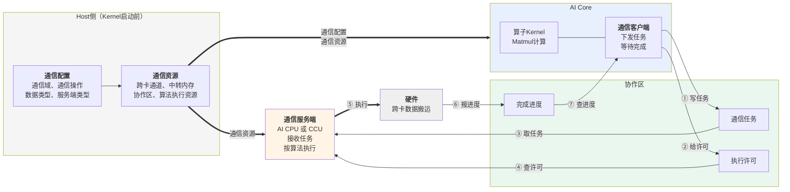
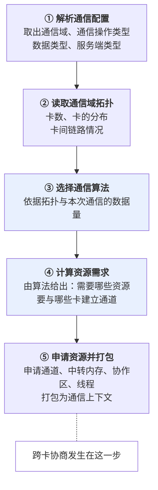
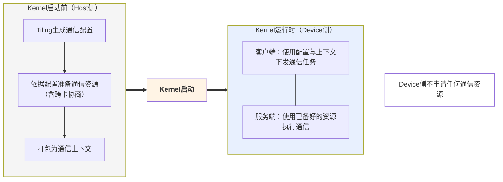
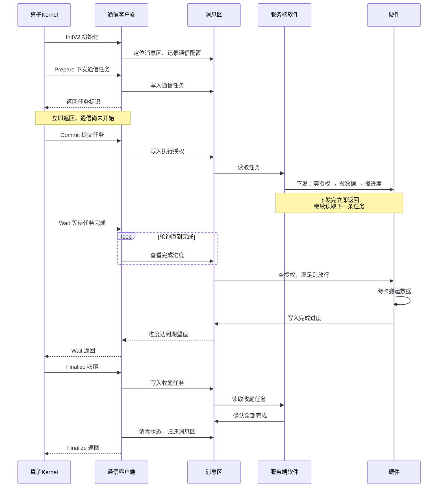
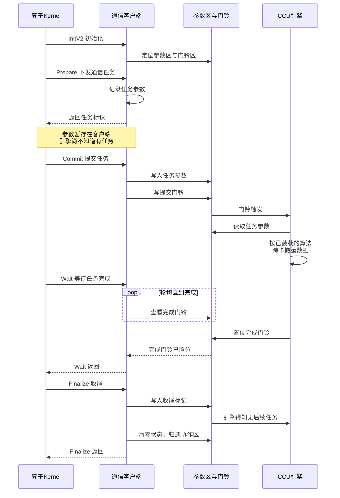
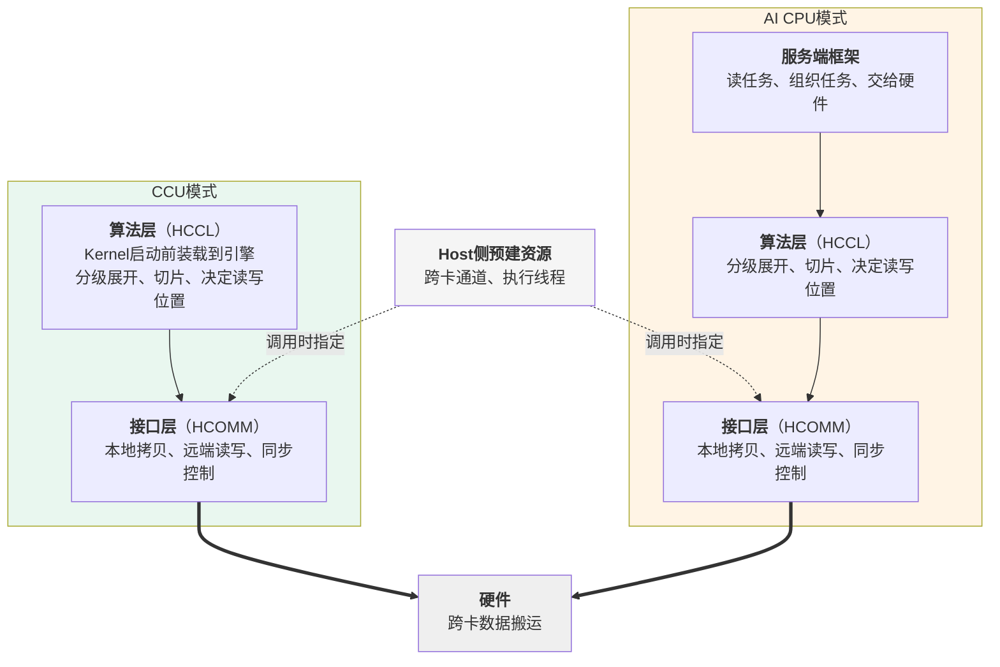
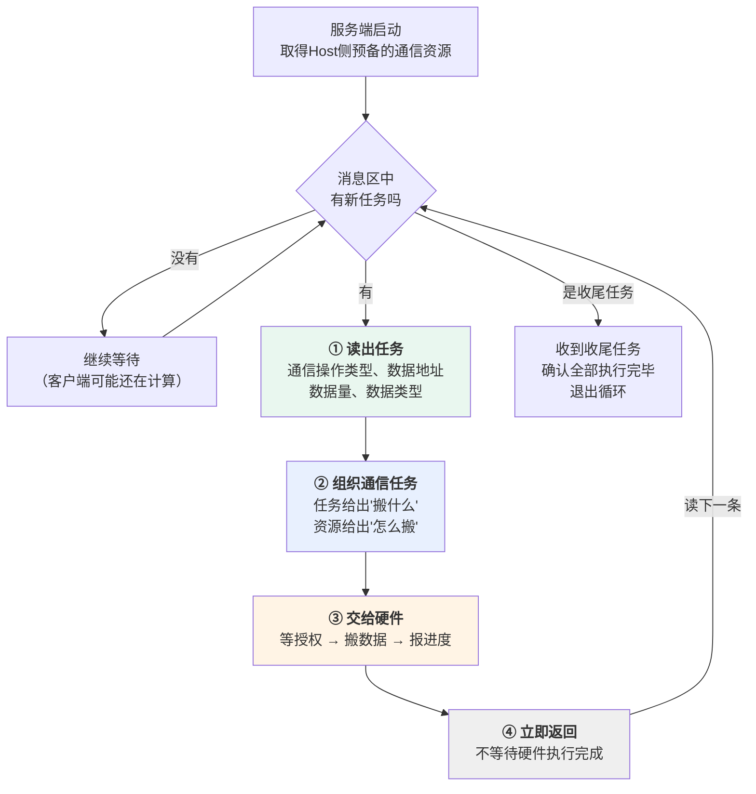

# MC2通信模型

## 概述

本章介绍MC2算子的通信是怎么组织起来的：Host侧在Kernel启动前准备了什么、AI Core侧如何下发通信任务、通信服务端如何把任务变成实际的跨卡数据搬运。

本章覆盖**AI CPU模式**与**CCU模式**两种通信模式。两者共享大部分内容，正文中不区分模式的部分对两者都成立；存在差异的部分会并列展开。

本章不涉及以下内容：

| 内容 | 见 |
| --- | --- |
| 各类内存的布局与生命周期 | [内存模型](内存模型.md) |
| 通信与计算的宏观编排、多核同步 | [执行模型](执行模型.md) |
| 通信配置与通信原语参数的具体填法、Kernel代码示例 | 后续"算子实现"章节 |

本章以AllGatherMatmul算子为例。

## 通信模型总览

MC2算子的通信由三个部分协作完成。

| 部分 | 时机 | 职责 |
| --- | --- | --- |
| Host侧 | Kernel启动前 | 生成通信配置、依据配置准备通信资源 |
| 通信客户端（AI Core） | Kernel运行时 | 下发通信任务、等待任务完成 |
| 通信服务端 | Kernel运行时 | 接收任务、按通信算法执行、回报进度 |

客户端就是HCCL高阶API。它运行在AI Core上，与算子的计算代码在同一个Kernel里，但**它不执行通信**，只负责把通信任务下发出去、并在需要时等待任务完成。

服务端有两种，在创建通信对象时通过模板参数指定：

```cpp
Hccl<HcclServerType::HCCL_SERVER_TYPE_AICPU> hccl;   // AI CPU模式
Hccl<HcclServerType::HCCL_SERVER_TYPE_CCU>   hccl;   // CCU模式
```

无论指定哪种服务端，客户端本身始终运行在AI Core上。

客户端与服务端是**并行运行的两个执行体**，两者之间没有函数调用关系，全部协作通过一块共享内存完成，本章称之为**协作区**。协作区中承载三类信息：

| 信息 | 含义 | 客户端 | 服务端侧 |
| --- | --- | --- | --- |
| 通信任务 | 一次通信的描述：做什么操作、数据在哪、有多少 | 写 | 读 |
| 执行许可 | 客户端允许服务端开始执行的标志 | 写 | 读 |
| 完成进度 | 通信执行的进展 | 读 | 写 |

三类信息的分工是固定的：**客户端写任务与许可、读进度；服务端侧读任务与许可、写进度。** 表中的"服务端侧"是个统称，因为具体由谁读写在两种模式下不同，见下文。

**图1** MC2通信模型总览



这个模型有两个贯穿全篇的特征。

**下发即返回。** 客户端把任务写进协作区就返回，此时通信尚未开始；服务端把任务交给硬件后也立即返回。双方都不阻塞等待对方。

**等待靠轮询。** 客户端需要确认某次通信是否完成时，反复查看完成进度直到达到期望值。因为对端是另一个执行体，客户端没有被唤醒的机制。

正是"下发即返回"让通信与计算得以重叠：客户端发完任务就可以去做计算，服务端此时已经在搬数据。

### 两种模式的差异概览

两种模式在上述总览层面的位置完全相同：都是客户端下发、服务端执行、通过协作区协作。差异体现在服务端的形态与协作区的具体实现上。

| 维度 | AI CPU模式 | CCU模式 |
| --- | --- | --- |
| 服务端形态 | AI CPU核上运行的服务端软件 | 专用硬件通信引擎 |
| 谁执行通信算法 | AI CPU上的服务端软件 | 硬件引擎 |
| 算法何时就位 | 运行时由软件逐条执行 | Kernel启动前装载到引擎上 |
| 服务端如何得知有新任务 | 循环轮询协作区 | 被客户端写门铃触发 |


"算法何时就位"这一行决定了运行时有无软件参与：AI CPU模式下每处理一条任务都要软件执行一遍算法；CCU模式下算法在Kernel启动前就已装载到引擎上，运行时没有软件参与。这是CCU不占用AI CPU资源的原因。

协作区三类信息的具体形态、以及各自实际由谁读写，两种模式下都不同，分别见[AI CPU服务端](#ai-cpu服务端软件循环与三段任务)与[CCU服务端](#ccu服务端门铃触发与算法执行)两节。

## Host侧的通信准备

通信任务需要一批在Kernel运行前就必须确定的信息，也需要一批在Kernel运行前就必须建立好的资源。这两件事都在Host侧完成，两种模式的流程一致。

### 通信配置的生成

通信配置在Tiling阶段产生，随TilingData下发，内容包括：使用哪个通信域、做什么通信操作、输入输出的数据类型、**使用哪种服务端**，以及一些可选的行为开关与调测选项。其中服务端类型由算子属性`comm_mode`决定，是唯一区分两种模式的配置项。

配置的载体是两个结构体：`Mc2InitTiling` 描述通信的整体配置，`Mc2CcTiling` 描述一个通信任务的配置。Tiling侧通过 `Mc2CcTilingConfig` 类生成这两部分内容。具体的配置项、取值范围与生成代码参见HCCL Tiling侧接口手册。

之所以必须在Tiling阶段确定：通信资源的准备涉及多卡协商、耗时较长，必须在Kernel启动之前完成，而准备资源的依据就是通信配置。

### 通信资源的准备

框架依据通信配置准备四类资源：**跨卡通道**（本卡与其他卡之间的通信路径）、**中转内存**（数据搬运过程中的暂存区）、**协作区**（客户端与服务端协作的共享内存）、**执行线程**（AI CPU模式下服务端用于并行处理多路搬运；CCU模式不使用）。

资源的数量与形态不是固定的，取决于本次通信要用哪种通信算法 —— 不同算法需要的资源不同，需要与哪些卡建立通道也不同。因此创建资源要经过五个步骤。

**图2** 通信资源的创建流程



第③④两步是关键：**先选算法、再由算法报出资源需求**，而不是框架按固定规则申请。以AllGather为例，单级算法需要与通信域内所有其他卡各建一条通道；两级算法则先建跨节点的通道、再建节点内的通道，两层的通道数都不同。

第⑤步中跨卡通道的建立需要各卡交换内存描述符，之后才能互相访问对端的内存。这是一个跨卡协商动作，必须在所有卡都尚未开始通信时统一完成 —— 这是通信资源必须提前准备的原因。

这些资源按通信域与通信任务的特征缓存。同一通信域内特征相同的算子重复执行时，上述五个步骤直接跳过，资源复用已有的。

**CCU模式在第⑤步多一个动作：把算法装载到CCU引擎上。** 因为CCU模式下算法要由硬件引擎执行，必须先装载到引擎中。

这里涉及两个不同的时机，容易混淆：

| 时机 | 发生什么 |
| --- | --- |
| 用户创建通信域时 | 申请CCU引擎实例。是否申请取决于环境变量 `HCCL_OP_EXPANSION_MODE` |
| 算子的资源准备阶段（第⑤步） | 把算法装载到已有的引擎实例上 |

**CCU引擎实例不在图2的流程中申请**，它在用户创建通信域时就已备好。因为通信域的创建早于算子调用，所以该环境变量必须在创建通信域之前设置 —— 若那时未申请引擎实例，之后算子想用也没有实例可供装载。详见[概述](概述.md)。

### 配置与资源的传递

第⑤步产出的**通信上下文**是一块设备内存，里面记录了本卡编号、通信域卡数、协作区地址，以及各通信任务对应的资源描述。它连同通信配置一起构成Device侧通信所需的全部信息。

| 内容 | 传递方式 | Device侧如何取得 |
| --- | --- | --- |
| 通信配置 | 随TilingData下发 | Kernel通过TilingData访问 |
| 通信上下文 | 填入Task的参数槽位 | Kernel通过 `GetHcclContext` 获取 |

计算Task与服务端Task拿到的是**同一份通信上下文**，这是双方能够访问同一块协作区的前提。这一步由框架完成，算子代码不需要额外处理。

两种模式的传递方式相同，客户端从上下文中取用的字段不同：AI CPU模式取消息区地址，CCU模式取参数区与门铃区的地址。

**图3** Kernel启动前后的分界



## 客户端：通信任务的下发

本节内容对两种模式一致，仅最后一小节说明一处差异。

### 客户端的接口

客户端接口分六类。

| 类别 | 接口 | 作用 |
| --- | --- | --- |
| 初始化 | `InitV2`、`SetCcTilingV2` | 建立与服务端的连接、指定通信配置的位置 |
| 任务下发 | `AllGather`、`AllReduce`、`ReduceScatter`、`AlltoAll`、`AlltoAllV`、`AlltoAllvWrite`、`BatchWrite` | 提交一个通信任务，返回任务标识 |
| 提交 | `Commit` | 许可某个任务开始执行 |
| 等待 | `Wait`、`Query` | 阻塞等待任务完成、查询已完成的轮次数 |
| 信息查询 | `GetRankId`、`GetRankDim` 等 | 查询本卡编号、通信域卡数等 |
| 收尾 | `Finalize` | 通知服务端无后续任务 |

任务下发接口统称**Prepare接口**，各自对应一种集合通信原语。两种模式下这些接口的用法与语义完全相同。完整的参数说明与产品支持情况参见HCCL Kernel侧接口手册。

### 一次通信任务的六个阶段

客户端侧的六个阶段在两种模式下相同，服务端的响应时机不同。

| 阶段 | 客户端做什么 | AI CPU模式下服务端做什么 | CCU模式下服务端做什么 |
| --- | --- | --- | --- |
| 初始化 | `InitV2` 建立与服务端的连接 | — | — |
| 下发 | Prepare接口提交任务，拿到任务标识 | 读到任务，开始组织 | 尚不知道有任务 |
| 提交 | `Commit` 许可任务执行 | 硬件得到许可，开始搬运 | 被门铃触发，开始执行 |
| 执行 | — | 按算法完成跨卡搬运 | 按算法完成跨卡搬运 |
| 等待 | `Wait` 轮询完成进度 | 完成后回报进度 | 完成后回报进度 |
| 收尾 | `Finalize` 通知无后续任务 | 确认全部完成后退出 | 确认全部完成后退出 |

两种模式的时序分别如下。

**图4** AI CPU模式下一次通信任务的时序



**图5** CCU模式下一次通信任务的时序



对比两张图可以看出两处结构差异：

- **AI CPU模式有一层软件中转。** 服务端软件读任务、组织任务、把三段动作下发给硬件，等待与搬运由硬件完成。因此图4中有"服务端软件"与"硬件"两个参与方。
- **CCU模式没有软件参与。** 客户端写完参数与门铃，引擎直接执行。因此图5中只有"CCU引擎"一个参与方。

### 三个需要注意的机制

**任务按发出顺序被处理。** 服务端按客户端发出的顺序逐条处理任务，不会乱序。因此等待接口的调用顺序必须与下发顺序一致，否则会等到错误的任务上。

**收尾包含归还协作区。** `Finalize` 除了通知服务端后续没有通信任务，还会把协作区的状态清零。因为协作区属于通信域、被同一通信域内的多个MC2算子复用，本算子必须把它恢复到干净状态交给下一个算子。这带来一条约束：**多核场景下必须在全核同步之后再调用 `Finalize`**，否则先跑完的核清零状态时，其他还在等待的核将永远等不到完成进度。详见[执行模型](执行模型.md)。

**下发不等于执行。** Prepare接口把任务信息记录下来就返回，返回时通信还没有开始。真正许可服务端执行的是**提交**。因此下发与提交既可以合并（Prepare接口的 `commit` 模板参数置为true），也可以分开调用。无论哪种写法，"下发不阻塞"这一点不变 —— 这是通算重叠的起点。

**两种模式在这里有一处差异**，也是两者对开发者唯一的行为差异：

| | AI CPU模式 | CCU模式 |
| --- | --- | --- |
| 下发时 | 任务已写入协作区，服务端可以读到并开始组织任务 | 任务参数暂存在客户端，尚未写入协作区 |
| 提交时 | 给出许可，硬件开始搬运 | 把任务参数写入参数区，再写门铃通知引擎 |
| 分开调用的收益 | 从下发到提交这段时间里服务端已在组织任务，这段耗时被调用方的其他工作掩盖 | 无此收益，因为提交前服务端尚不知道有任务 |

因此在CCU模式下，`commit` 置为true与分开调用的效果基本相同。

## 服务端：通信任务的执行

本节说明服务端如何把一条通信任务变成实际的跨卡数据搬运。两种服务端的工作方式差异较大，分开说明；共同点在本节末尾收束。

**图6** 两种模式下服务端的内部分层



**CCU模式少了"服务端框架"这一层**，因为不需要软件循环去读任务、组织任务。算法层与接口层的职责两种模式相同，见本节末尾。

### AI CPU服务端：工作循环与三段任务

服务端随算子一起启动，启动后进入一个循环，直到收到收尾任务才退出。

**图7** AI CPU服务端的工作循环



第②步值得说明。客户端写入的任务只描述了"这一次要搬什么" —— 通信操作类型、源地址、目的地址、数据量、数据类型。至于"怎么搬"（用哪种算法、走哪些通道、用几个线程）来自Host侧预备的通信资源。服务端把两者结合起来，才得到一个可执行的通信任务。

第③步交给硬件的任务由三段构成，硬件按顺序执行：

| 顺序 | 内容 | 作用 |
| --- | --- | --- |
| ① | 等授权 | 等到客户端通过 `Commit` 写入的执行授权满足，才允许往下走 |
| ② | 搬数据 | 按通信算法执行跨卡数据搬运 |
| ③ | 报进度 | 把完成进度写回消息区 |

第①段是与客户端的同步点：客户端调用 `Commit` 时向消息区写入执行授权，硬件在这一段反复查看该授权，满足后才开始搬运。这与客户端调用等待接口时反复查看完成进度，构成一组对称的握手 —— 客户端写授权、硬件读授权；硬件写进度、客户端读进度。

需要注意的是，**虽然任务里有"等授权"这一段，但等待的执行者是硬件，不是服务端**。服务端只是把这段等待作为一条指令交下去，随后立即返回。

| | 客户端（AI Core） | 服务端软件（AI CPU） |
| --- | --- | --- |
| 如何等待 | 自己反复查看完成进度 | 把等待作为指令交给硬件 |
| 等待期间 | 停在等待接口中 | 已经返回，去处理下一条任务 |

这是第④步能够成立的原因，也是服务端可以连续处理多条任务的原因：第N轮的数据还在搬运时，第N+1轮的任务已经交付完毕、停在"等授权"这一段。只要客户端的授权及时给出，通信就能连续进行。

### CCU服务端：门铃触发与算法执行

CCU是硬件引擎，没有软件循环。它的工作方式是**被通知后执行**，四个环节：

| 环节 | 内容 |
| --- | --- |
| ① 触发 | 客户端把任务参数写入参数区，然后写提交门铃。引擎被门铃触发开始工作 |
| ② 读参数 | 引擎从参数区读出本次通信的地址、数据量等参数 |
| ③ 执行 | 按Kernel启动前装载在引擎上的算法完成跨卡搬运 |
| ④ 回报 | 置位完成门铃，客户端的等待接口据此返回 |

与AI CPU模式相比，CCU模式少了"组织通信任务"这个环节 —— 算法在装载时就已经与资源绑定，运行时只需补上参数区里的动态信息。这也是CCU模式下参数在提交时才写入的原因：**写参数与敲门铃是配套动作**，参数没写完就触发，引擎会读到不完整的参数。

引擎的执行与客户端并行，客户端只轮询完成门铃，因此同样不存在"客户端等服务端"的阻塞。

### 共同点：算法层、接口层与两阶段分工

两种模式的算法层与接口层职责相同，实现形式不同。

**算法层**由HCCL提供，覆盖AllGather、AllReduce、ReduceScatter等各集合通信原语。算法负责按通信域的拓扑层级展开（例如先跨节点、再节点内）、把数据切成适合链路与中转内存的片、决定每一片从哪张卡的哪块内存读到本卡的哪个位置。算法由框架依据拓扑与数据量选择，Kernel侧不感知。

算法本身不直接操作硬件，而是调用**接口层**（即HCOMM提供的通信原语）来表达搬运与同步动作，包括本地数据操作（卡内拷贝与归约）、远端数据操作（从对端卡读、向对端卡写）、同步控制（与对端卡握手、执行单元之间的同步）。以AllGather为例，算法的一轮执行大致是：先与对端卡握手确认双方就绪，再搬运数据，搬完后再次握手告知对端可以继续。各接口的完整说明参见HCOMM数据面API手册。

**接口层的每次调用都要指定走哪条通道**，而通道正是Host侧在通信资源准备阶段建立好的（见图6右侧）。算法只是使用它们，不申请、不释放。

至此可以看出Host侧准备阶段与服务端执行阶段的完整分工，这一分工在两种模式下一致：

| 阶段 | 确定了什么 |
| --- | --- |
| Host侧准备 | 能和哪些卡通信、通过什么路径、用什么算法 |
| 服务端执行 | 这一次搬哪些数据、按什么顺序、分几片搬 |

