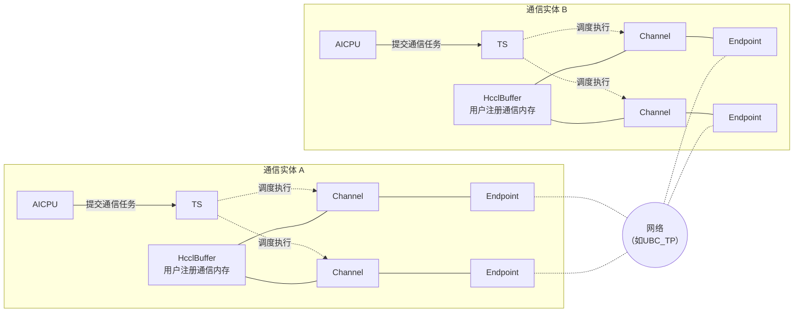

# 直驱模式通信模型

本文介绍 AICPU_TS 与 CCU 通信引擎在 Ascend 950 上直接执行通信任务时的通信模型，说明通信的发起方、参与通信的实体、通信协议，以及 Channel 与 Endpoint 等概念。通信的发起方与执行方分离的形态见[代理模式通信模型](./proxy_comm_model.md)。

## AICPU_TS 通信模型

AICPU_TS 通信模型属于网络语义通信模型：通信任务由 AICPU 提交，算子开发者基于 Channel 访问远端通信实体的通信内存，或与远端通信实体同步。远端通信内存不映射到本端地址空间。

AICPU_TS 在 Ascend 950 上支持 UBC_TP、UBC_CTP、UBoE、ROCE 通信协议，协议在创建 Channel 时由 Endpoint 决定。

**图1** AICPU_TS 通信模型



- 通信实体：通信域内的通信成员（rank），是 Channel 的两端。通信任务由通信实体上的 AICPU 提交给 TS，再由 TS 调度至执行器执行，不占用计算核。

- 通信内存：通信实体上的一块内存可以注册给通信域，表示这块内存可以被通信域内的其他通信实体访问，包括 HcclBuffer 与用户注册通信内存，详见[通信内存模型](./memory_model.md)。

- Endpoint：表示与其他通信实体通信时使用的端口（如网卡的 NetDevice 等）。
  - Endpoint 包含地址与协议等属性，一个 Endpoint 可能包含多个物理口（比如 Bonding 场景）。
  - 每个通信实体可以包含多个 Endpoint。

- Channel：通信实体基于特定 Endpoint 与其他通信实体特定 Endpoint 之间建立的通信通道，是本端访问远端通信内存以及与对端同步的入口。
  - 本端通信实体的 Channel 与远端通信实体的 Channel 具有一对一的关联关系，一对 Endpoint 之间可以建立多个 Channel。
  - 创建 Channel 时，本端与远端需要同步调用 Channel 创建接口。
  - 创建 Channel 时，本端注册的内存信息会与远端注册的内存信息进行交换，控制面也提供了基于 Channel 查询远端内存信息（地址与大小）的接口。
  - `Write`、`Read` 等通信操作基于 Channel 由一侧通信实体单边发起，对端不需要对称调用；通信操作为异步，写后需通过 Notify 或 Fence 确认对端数据就绪。

  Channel 的内部元素如下图所示。Channel 关联一个或多个连接实例，连接实例的具体形态由协议决定（如 RoCE 的 QP、UB 的 jetty 等），Channel 建立时对应连接实例会建链；Channel 还包含多个 Notify 实例，用于通信实体之间的同步，与远端 Channel 中的 Notify 按序号对应。

  **图2** AICPU_TS Channel 模型

  ```mermaid
  flowchart LR
      subgraph A2["通信实体 A"]
          subgraph CA["Channel"]
              direction LR
              NA["Notify 0<br/>Notify 1<br/>Notify 2"]
              QA1["连接实例"]
              QA2["连接实例"]
          end
      end
      subgraph B2["通信实体 B"]
          subgraph CB["Channel"]
              direction LR
              QB1["连接实例"]
              QB2["连接实例"]
              NB["Notify 0<br/>Notify 1<br/>Notify 2"]
          end
      end
      QA1 -.- QB1
      QA2 -.- QB2
  ```

- Notify：用于同步操作的抽象概念，在不同通信引擎下可能由不同实体实现。
  - 创建 Channel 时可以指定 Channel 包含的 Notify 实例数量。
  - 本端可以通过 Channel 向远端通信实体对应 Channel 中的某个 Notify（使用序号指定）发送同步信号。
  - 本端可以基于 Channel 的某个 Notify，等待来自远端通信实体的同步信号，等到同步信号后才可以执行后续操作。
  - 使用的 Notify 序号不得超过创建 Channel 时指定的数量。

## CCU 通信模型

CCU 通信模型属于网络语义通信模型：算子开发者基于 Channel 访问远端通信实体的通信内存，或与远端通信实体同步。与其他网络语义通信模型的区别是，CCU 支持将本地 CcuBuffer 数据写到通信对端内存，或读取通信对端内存到本地 CcuBuffer。

**图3** CCU 通信模型


- 通信实体：通信域内的通信成员（rank），是 Channel 的两端。通信任务由通信实体上的 CCU 执行。

- 通信内存：通信实体上的一块内存可以注册给通信域，表示这块内存可以被通信域内的其他通信实体访问。

- CcuBuffer：CCU 片上缓存分片，是 CCU 通信操作的本地操作数——本端可以将 CcuBuffer 中的数据写到对端通信内存，也可以将对端通信内存的数据读取到本端 CcuBuffer。

- Endpoint：表示与其他通信实体通信时使用的端口（如网卡的 NetDevice 等）。
  - Endpoint 包含地址与协议等属性，一个 Endpoint 可能包含多个物理口（比如 Bonding 场景）。
  - 每个通信实体可以包含多个 Endpoint。

- Channel：通信实体基于特定 Endpoint 与其他通信实体特定 Endpoint 之间建立的通信通道，是本端访问远端通信内存以及与对端同步的入口。
  - 本端通信实体的 Channel 与远端通信实体的 Channel 具有一对一的关联关系，一对 Endpoint 之间可以建立多个 Channel。
  - 创建 Channel 时，本端与远端需要同步调用 Channel 创建接口。
  - 创建 Channel 时，本端注册的内存信息会与远端注册的内存信息进行交换，控制面也提供了基于 Channel 查询远端内存信息（地址与大小）的接口。

  Channel 的内部元素如下图所示。Channel 包含多个 Notify 实例与多个 Variable 实例，分别用于与对端同步信号和同步数据。

  **图4** CCU Channel 模型

  

- Notify：用于同步操作的抽象概念。
  - Channel 可以包含多个 Notify 实例，用于通信实体之间的同步操作。
  - 本端可以通过 Channel 向对端某个 Notify（使用序号指定）发送同步信号。
  - 本端可以基于 Channel 的某个 Notify，等待来自对端的同步信号，等到同步信号后才返回。

- Variable：Channel 可以包含多个 Variable 实例，用于与对端同步 Variable 中的数据。
