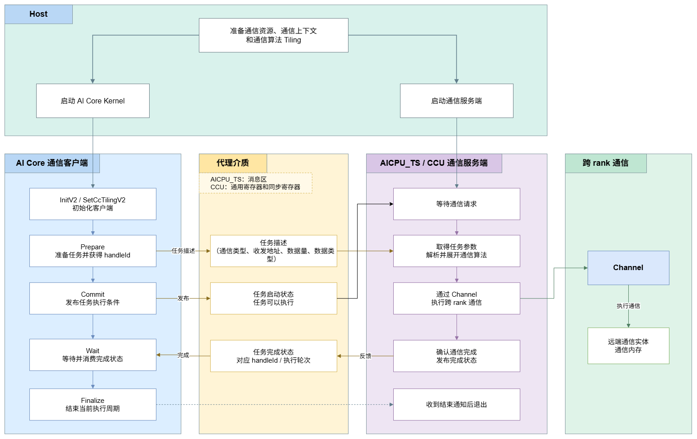
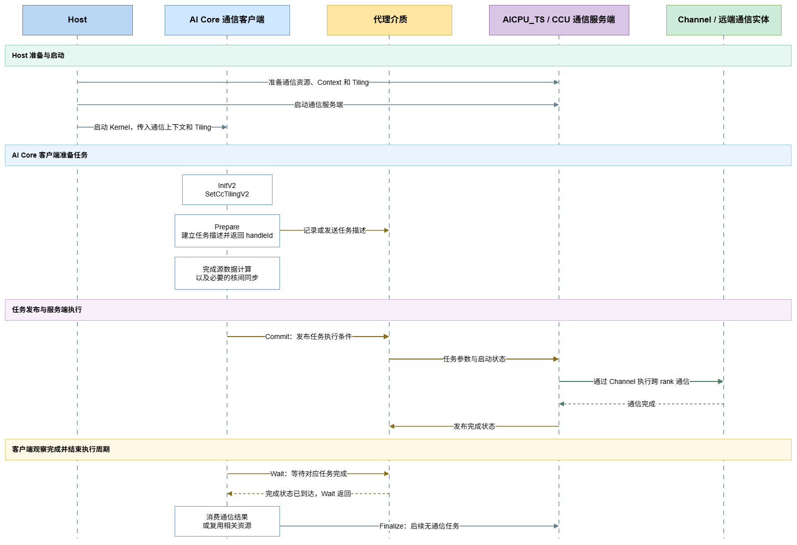

# 代理模式执行模型

本文介绍代理模式下通信任务从准备、发布到完成的执行过程。在代理模式下，AI Core 作为通信客户端发起通信任务，AICPU_TS 或 CCU 作为通信服务端执行通信任务。本文重点说明通信客户端与通信服务端之间的任务传递、执行和完成关系。

Channel、Endpoint 和通信实体之间的关系参见[代理模式通信模型](./proxy_comm_model.md)，通信地址、访问授权和通信数据的一致性参见[内存模型](./memory_model.md)。

## 模型概述

代理模式将通信任务的发起方与执行方分离。Host 侧在 Kernel 启动前准备通信资源和通信上下文，并启动 AI Core 计算任务和通信服务端。Kernel 执行期间，AI Core 客户端负责描述通信任务、确定任务何时可以执行以及等待任务完成；通信服务端负责取得任务参数、展开通信算法、通过 Channel 执行通信操作并反馈完成状态。

代理执行模型包含以下两类服务端：

- AICPU_TS 服务端：AI Core 与 AICPU_TS 通过消息区传递任务参数、任务发布状态和完成状态。
- CCU 服务端：AI Core 与 CCU 通过 CCU 通用寄存器传递任务参数，通过同步寄存器传递任务启动和完成状态。

基于 HCCL 高阶 API 开发时，上述差异由 API 封装，用户通过相同的 Prepare、`Commit`、`Wait` 和 `Finalize` 接口管理任务。采用自定义客户端与服务端协议时，用户基于 HCOMM 和 CCU 接口自行实现任务格式和同步机制。

## 代理执行机制

**图1** 代理模式执行机制

代理模式包含以下参与方：

| 参与方 | 职责 |
| --- | --- |
| Host | 申请通信资源，准备通信上下文和通信算法 Tiling，启动通信服务端和 AI Core Kernel |
| AI Core 客户端 | 准备通信任务，发布任务执行条件，等待完成状态，并在任务完成后消费结果或复用资源 |
| 代理介质 | 在客户端与服务端之间传递任务参数、任务启动状态和完成状态 |
| AICPU_TS 或 CCU 服务端 | 取得并解析任务参数，展开通信算法，通过 Channel 执行通信任务并发布完成状态 |
| Channel | 确定跨 rank 通信对端、通信路径和远端内存访问关系 |

通信任务按以下流程执行：

1. Host 侧准备通信资源和通信上下文，启动通信服务端和 AI Core Kernel。
2. AI Core 客户端初始化通信对象，设置通信算法 Tiling，并调用集合通信 Prepare 接口准备任务。Prepare 接口记录通信类型、收发地址、数据量和数据类型等任务参数，并返回标识该任务的 `handleId`。
3. AI Core 客户端完成源数据生产以及必要的核间同步后，调用 `Commit` 发布任务执行条件。服务端从该发布点开始执行任务，任务完成状态由客户端通过 `Wait` 确认。
4. 通信服务端取得任务参数和执行条件，根据通信算法使用的 Channel 展开并执行跨 rank 通信操作。
5. 通信任务完成后，服务端通过代理介质发布对应任务的完成状态。
6. AI Core 客户端调用 `Wait` 等待并消费完成状态。`Wait` 返回后，客户端可以读取该任务的输出数据；所有使用者完成访问后，可以复用相应的源内存、目的内存和任务资源。
7. AI Core 客户端完成当前执行周期的全部通信任务后，调用 `Finalize` 通知服务端结束当前执行周期。

代理介质承载通信任务参数和执行状态，Channel 对应的通信通路承载跨 rank 用户数据。

## 基于 HCCL 高阶 API 的执行流程

HCCL 高阶 API 为 AI Core 侧的集合通信任务客户端接口，MC2 算子是该接口的典型使用场景。用户在 AI Core Kernel 中管理通信任务的准备、发布和完成时机，服务端任务传递与完成反馈的具体实现由 API 封装。

**图2** HCCL 高阶 API 单任务执行时序

### 初始化

Host 侧在 Kernel 启动前准备通信上下文和通信算法 Tiling。AI Core 客户端在 Kernel 中按以下顺序完成初始化：

1. 创建 `Hccl` 对象，通过 [`HcclServerType`](https://gitcode.com/cann/asc-devkit/blob/master/docs/zh/api/SIMD-API/adv_api/HCCL_communication/HCCL_Kernel/HCCL_template_params.md) 模板参数选择通信服务端，并可通过 `HcclServerConfig` 指定负责向服务端下发任务的 AI Core 类型和 block。
2. 调用 [`InitV2`](https://gitcode.com/cann/asc-devkit/blob/master/docs/zh/api/SIMD-API/adv_api/HCCL_communication/HCCL_Kernel/InitV2.md) 传入通信上下文和初始化 Tiling。
3. 调用 [`SetCcTilingV2`](https://gitcode.com/cann/asc-devkit/blob/master/docs/zh/api/SIMD-API/adv_api/HCCL_communication/HCCL_Kernel/SetCcTilingV2.md) 设置对应集合通信算法的 Tiling 地址。

### 任务准备与发布

用户调用 [`AllGather`](https://gitcode.com/cann/asc-devkit/blob/master/docs/zh/api/SIMD-API/adv_api/HCCL_communication/HCCL_Kernel/AllGather.md)、[`AllReduce`](https://gitcode.com/cann/asc-devkit/blob/master/docs/zh/api/SIMD-API/adv_api/HCCL_communication/HCCL_Kernel/AllReduce.md) 或 [`ReduceScatter`](https://gitcode.com/cann/asc-devkit/blob/master/docs/zh/api/SIMD-API/adv_api/HCCL_communication/HCCL_Kernel/ReduceScatter.md) 等 Prepare 接口准备通信任务。一次 Prepare 调用返回一个 `handleId`，后续通过该 `handleId` 发布和等待对应任务。

Prepare 接口建立任务描述，`Commit` 发布该任务的数据传输执行条件。两类服务端对任务描述的处理方式不同：

- 使用 AICPU_TS 服务端时，Prepare 接口将任务描述写入消息区，AICPU_TS 读取并解析任务，在收到任务发布状态后执行该任务对应的数据传输。
- 使用 CCU 服务端时，Prepare 接口记录任务描述；AI Core 调用 `Commit` 时，客户端选择可用任务槽位，将本轮任务参数写入该槽位对应的通用寄存器，并置起启动同步寄存器。

源数据准备完成后，用户调用 [`Commit`](https://gitcode.com/cann/asc-devkit/blob/master/docs/zh/api/SIMD-API/adv_api/HCCL_communication/HCCL_Kernel/Commit.md) 发布任务。`Commit` 是客户端向服务端发布“任务可以执行”这一条件的接口边界。若 Prepare 接口的模板参数 `commit` 取值为 `true`，Prepare 接口会同时完成任务发布。

调用 `Commit` 前，用户必须保证该任务使用的源数据已经生成完成，并保证负责发布任务的 AI Core 可以观察到源数据已经就绪。如果源数据由其他 AI Core 生成，用户需要根据算子编排先完成计算核之间的数据生产同步，再调用 `Commit`。

`Commit` 返回后，服务端可能正在读取源内存或写入目的内存。在对应的 `Wait` 返回前，该轮通信使用的源内存和目的内存区域必须保持有效，源内存区域保持内容不变，目的内存区域交由通信服务端写入。用户可以同时执行访问其他内存区域的计算。

### 任务完成与结束

用户调用 [`Wait`](https://gitcode.com/cann/asc-devkit/blob/master/docs/zh/api/SIMD-API/adv_api/HCCL_communication/HCCL_Kernel/Wait.md) 阻塞当前 AI Core，直到 `handleId` 对应的一轮通信任务完成。两类服务端向用户提供相同的完成语义：`Wait` 返回表示对应的一轮通信已经完成，底层完成状态由 HCCL 高阶 API 管理。

`Wait` 返回后，当前任务的通信输出可以由客户端读取或用于后续计算。

完成当前执行周期的全部通信任务后，用户调用 [`Finalize`](https://gitcode.com/cann/asc-devkit/blob/master/docs/zh/api/SIMD-API/adv_api/HCCL_communication/HCCL_Kernel/Finalize.md) 通知服务端退出：

- `Finalize<true>` 为默认形式，客户端等待最后一个通信任务完成后结束当前执行周期。
- `Finalize<false>` 只发送结束通知，不等待已下发任务完成，不表示输出数据已经可用，也不保证接口返回时对端已经收到数据。

> [!CAUTION]注意
> - `Finalize` 结束当前 `Hccl` 对象的执行周期。后续通信需要重新创建并初始化 `Hccl` 对象。
> - `Wait` 和具有同步语义的 `Finalize` 确认通信任务完成。AI Core 之间的计算进度和代码执行位置通过核间同步接口确认。
> - 多个 AI Core 参与同一个通信执行周期时，需要在 `Finalize` 前使用 `SyncAll`、`CrossCoreSetFlag` 和 `CrossCoreWaitFlag` 等适当的核间同步接口，确保所有参与核均已完成任务准备、发布和等待，再由服务端结束当前执行周期。

## AICPU_TS 与 CCU 服务端的执行差异

HCCL 高阶 API 向用户提供统一的任务生命周期，两类服务端的差异主要体现在代理介质和内部任务推进方式。

| 执行阶段 | AICPU_TS 服务端 | CCU 服务端 |
| --- | --- | --- |
| 任务描述 | Prepare 将任务参数写入消息区 | Prepare 记录任务参数，`Commit` 时写入任务槽位对应的通用寄存器 |
| 任务发布 | `Commit` 更新消息区中的任务发布状态 | `Commit` 置起任务槽位对应的启动同步寄存器 |
| 服务端执行 | AICPU_TS 读取并解析消息区中的任务，通过 Channel 执行通信 | CCU 指令流等待启动状态，读取通用寄存器并通过 Channel 执行通信 |
| 完成反馈 | AICPU_TS 更新消息区中的完成轮次 | CCU 置起任务槽位对应的完成同步寄存器 |
| 客户端完成接口 | `Wait` 等待对应完成轮次 | `Wait` 等待对应完成轮次 |

HCCL 高阶 API 负责读写消息区或 CCU 寄存器，并管理任务发布和完成协议，用户通过统一接口控制任务生命周期。

## 自定义客户端与服务端协议

采用自定义代理协议时，用户可以基于已有的 HCOMM 和 CCU 接口设计 AI Core 客户端与 AICPU_TS 或 CCU 服务端之间的任务格式和同步机制。暂无实现。
