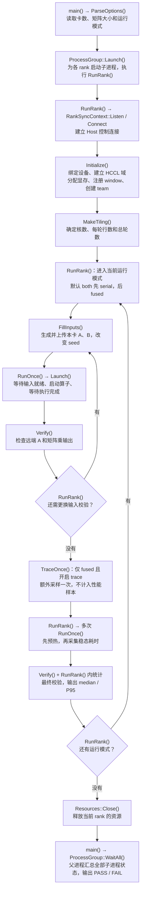
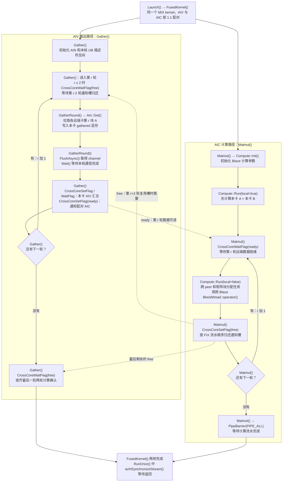

# AIN 与 Blaze AllGatherMatmul 代码执行流程

本文面向初次阅读实现的开发者，说明程序如何准备数据，以及 AIV 搬运与 AIC 计算如何配合。
对应源码：`code/master/asc-comm/examples/aicore/ain/02_all_gather_matmul`，版本 `00f41af2620925d0f033a4f30da3ba1f698e80e3`。
图中保留实际函数名，省略参数、异常路径和底层资源细节。流程图使用 Mermaid，可在支持 Mermaid 的 Markdown 预览器中查看。

## 先理解输入和输出

每张卡持有自己的 A 和 B。AllGatherMatmul 要把各卡的 A 按来源顺序拼起来，再乘当前卡自己的 B。
以四卡中的 0 号卡为例：

```text
本卡已有：A0[M,K]、B0[K,N]
远端输入：A1[M,K]、A2[M,K]、A3[M,K]

输出 C0[4*M,N]：
┌─────────┐
│ A0 × B0 │
│ A1 × B0 │
│ A2 × B0 │
│ A3 × B0 │
└─────────┘
```

各卡独立得到自己的输出，B 可以不同。实现将结果直接写到 C 中对应的行段，无需结束后再重排。

| 名称 | 初学者可以怎样理解 | 本实现中的职责 |
| --- | --- | --- |
| Host | 运行程序的 CPU 侧 | 分配资源、启动设备任务、校验结果、统计时间 |
| rank | 通信组内的参与者编号 | 每个 rank 由一个进程管理一张卡；不一定等于 device ID |
| AIV | 搬运侧的执行核 | 调用 AIN Get，从远端显存读取 A |
| AIC | 矩阵计算核 | 调用 Blaze BlockMmad 执行矩阵乘 |
| GM | 设备显存 | 保存输入、接收数据和输出 |
| tileM | 每轮通信处理的行数 | 把各远端 A 沿 M 方向切块 |

## 图一 程序整体执行流程

从 `main()` 开始阅读。每个子进程进入 `RunRank()`，完成一张卡的初始化、运行和清理。



### 图一的阅读要点

1. **Initialize 只准备资源。** 真正的矩阵数据搬运和计算由 `Launch()` 提交的设备任务完成。
2. **RunOnce 是单次执行边界。** 输入准备后先做 Host barrier，再记录起始 event、调用 `Launch()`、记录结束 event，随后等待 stream 完成并汇集各 rank 的时间。前后同步还保护远端输入的生命周期，避免快 rank 提前改写 A。
3. **校验和性能测量分开。** 先改变输入做正确性验证，再预热和计时；`TraceOnce()` 是额外诊断调用，不混入性能样本。每轮取最大 rank 的 event 耗时，再统计 median/P95。
4. 图中 `TraceOnce()` 未启用时直接跳过。父进程在启动子进程后就进入 `WaitAll()` 等待；图末端表示最终汇总完成，并非等所有资源释放后才开始调用它。

`Launch()` 根据 mode 选择实际入口：

| mode | 调用路径 | 含义 |
| --- | --- | --- |
| fused | `FusedKernel()` | 同一个 MIX kernel 内并行搬运和计算，详见图二 |
| serial | `GatherKernel()` → `MatmulKernel()` | 同一 stream 上全部搬完，再开始计算 |
| hccl | `HcclAllGather()` → `MatmulKernel()` | 使用普通 HCCL AllGather 的串行对照 |
| comm | `GatherKernel()` | 只检查 AIN 通信 |
| matmul | `MatmulKernel()` | Host 预填接收区，只检查 Blaze 计算 |

默认 `both` 不是另一种 kernel，而是 `RunRank()` 依次运行 serial 和 fused。

## 图二 融合 kernel 内部执行流程

`Launch()` 启动 `FusedKernel()` 后，AIV 执行 `Gather()`，AIC 执行 `Matmul()`。
下面画的是一张卡内的两条并行路径；每张参与卡都执行相同流程。实线表示各路径内的推进顺序，虚线表示跨核通知依赖。



### 图二的阅读要点

**一轮会处理所有远端卡的同一段行，不是一轮只处理一张卡。** 例如四卡、`M=1024`、`tileM=256`：在 0 号卡上，第 0 轮读取 A1/A2/A3 的第 0～255 行，第 1 轮读取它们的第 256～511 行，总共四轮。不同 peer 分配给不同 AIV；核数不足时，一个 AIV 可以负责多个 peer。

**本地计算不依赖远端数据。** AIC 一开始就能执行 `Compute::Run(local=true)`，同时 AIV 读取第一轮远端 A。随后，AIC 计算已到齐的块，AIV 拉取后续块。

| 示意阶段 | AIV 搬运侧 | AIC 计算侧 |
| --- | --- | --- |
| 开始 | `GatherRound(0)`：拉取第 0 块 | `Compute::Run(local=true)`：算本地部分 |
| 后续 | `GatherRound(1)`：拉取第 1 块 | `Compute::Run(local=false)`：算远端第 0 块 |
| 后续 | `GatherRound(2)`：拉取第 2 块 | `Compute::Run(local=false)`：算远端第 1 块 |
| 收尾 | 最后一轮搬运完成，等待剩余 free | 计算最后一块并完成结果写回 |

这是依赖关系示意，不是等长时间片。通信或计算较慢时，另一侧会在相应等待点停住，实际超前程度受双槽通知约束。

**ready 和 free 的用途不同。**

- `ready`：本轮各远端数据已经到达本卡，AIC 可以读取。每个 AIV 先等自己负责的 channel，再参加本卡 AIV barrier，之后才通知配对 AIC。
- `free`：AIC 已按流水顺序处理该轮，允许后续复用对应的通知槽。前两轮不等 free，从第 2 轮开始等待第 r-2 轮的确认。
- 两个槽交替复用的是通知。`gathered` 实际分配完整的 `[P,M,K]` 空间，各轮写不同的行，**不是两个 GM 数据缓冲区反复覆盖**。
- 没分到搬运或计算任务的核仍参加必要的通知交接，避免对端一直等不到信号。

**Compute::Run 负责把“大矩阵乘”拆成核上的小任务。** 它把 peer、M 方向 tile、N 方向 tile 展开为任务序号，各 AIC 按核号跨步领取，再由 Blaze `BlockMmad` 完成块内计算。B 始终是当前卡自己的 B；C 直接写入源 rank 对应的行段。本地部分直接读原始 A，不依赖 gathered 的自身槽。

## 对照源码的推荐阅读顺序

源码链接指向本示例目录中的文件，行号对应上述版本。

| 顺序 | 文件与函数 | 先关注什么 |
| --- | --- | --- |
| 1 | [main.asc](./main.asc) 的 `main()`、`RunRank()`，第 352、296 行 | 程序入口、每卡进程与测试循环 |
| 2 | 同文件 `Initialize()`，第 87 行 | A/B/C、接收区、window 和 team 的准备 |
| 3 | 同文件 `RunOnce()`、`Launch()`，第 235、160 行 | Host 如何提交一次设备任务 |
| 4 | [kernel.h](./kernel.h) 的 `FusedKernel()`，第 212 行 | 一个入口如何分成 AIV/AIC 两路 |
| 5 | 同文件 `Gather()`、`GatherRound()`，第 71、45 行 | 分块读取、通信完成等待及 ready/free |
| 6 | 同文件 `Matmul()`、`Compute::Run()`，第 179、136 行 | 本地优先、按轮消费远端数据与块计算 |
| 7 | [tiling.h](./tiling.h) 的 `MakeTiling()`，第 50 行 | 每轮行数和边界条件如何确定 |
