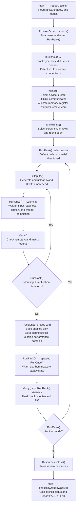
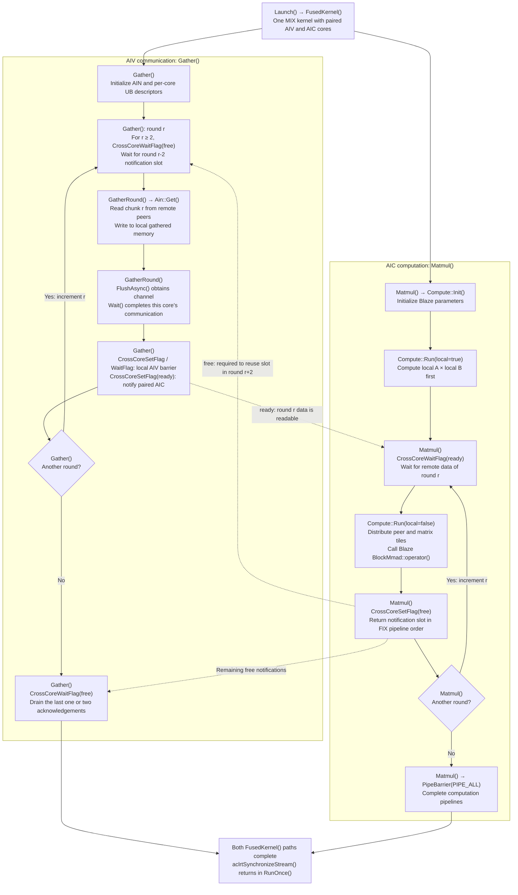

# AIN and Blaze AllGatherMatmul Execution Flow

English | [简体中文](ain_blaze_agmm_flow.md)

## Overview

This guide describes the Host execution flow, AIV communication path, AIC computation path,
and their synchronization. See the [sample README](README_en.md) for build instructions,
arguments, and constraints. Source links refer to this sample directory.
The Mermaid diagrams retain function names but omit arguments, exception paths, and resource details.
Use a Markdown viewer with Mermaid support to display them.

## Inputs and Outputs

Each device holds its own A and B. AllGatherMatmul concatenates A from all ranks in source-rank
order and multiplies the result by the current rank's B. For rank 0 in a four-rank group:

```text
Local inputs:  A0[M,K], B0[K,N]
Remote inputs: A1[M,K], A2[M,K], A3[M,K]
Output C0[4*M,N]: [A0 @ B0; A1 @ B0; A2 @ B0; A3 @ B0]
```

B may differ between ranks. Each rank writes directly to the corresponding output rows;
no final reordering is required.

| Term | Definition | Responsibility |
| --- | --- | --- |
| Host | CPU side | Allocate resources, launch kernels, verify outputs, and collect timings |
| rank | Participant in the communication group | One process manages one device; rank need not equal device ID |
| AIV | Communication core | Read remote A through AIN Get |
| AIC | Matrix computation core | Execute Blaze BlockMmad |
| GM | Device memory | Store inputs, received data, and outputs |
| tileM | Rows per communication round | Partition each remote A along M |

## Host Execution Flow

Start at `main()`. Each child process enters `RunRank()` to initialize, run, and release one rank.



### Host Execution and Synchronization

1. `Initialize()` prepares resources. `Launch()` submits the device communication and computation.
2. `RunOnce()` is one execution boundary: a Host barrier precedes the start event, followed by
   `Launch()`, the end event, stream synchronization, and timing collection across ranks.
   Synchronization also prevents a faster rank from changing A while peers still use it.
3. Verification with changed inputs precedes warmup and measurement. `TraceOnce()` is a separate
   diagnostic call. For each measured iteration, the maximum rank event duration is collected;
   median and P95 are calculated from those maxima.
4. Disabled tracing is skipped. The parent enters `WaitAll()` after launching children;
   the last diagram node represents completion of that wait, not its initial invocation.

| Mode | Entry points | Behavior |
| --- | --- | --- |
| fused | `FusedKernel()` | Communication and computation overlap in one MIX kernel |
| serial | `GatherKernel()` → `MatmulKernel()` | Finish communication before computation on the same stream |
| hccl | `HcclAllGather()` → `MatmulKernel()` | Ordinary HCCL AllGather followed by computation |
| comm | `GatherKernel()` | Verify AIN communication only |
| matmul | `MatmulKernel()` | Verify Blaze with Host-filled gathered input |

`both` is not a separate kernel: `RunRank()` executes serial and fused in sequence.

## Fused Kernel Execution Flow

`Launch()` starts `FusedKernel()`: AIV executes `Gather()` while AIC executes `Matmul()`.
Each participating device follows the same two paths. Solid edges show local execution order;
dashed edges show cross-core notification dependencies.



### Chunking and Cross-Core Synchronization

Each round reads the same row range from **all remote peers**, rather than one peer per round.
With four ranks, `M=1024`, and `tileM=256`, rank 0 reads rows 0–255 of A1/A2/A3 in round 0,
then rows 256–511 in round 1, for four rounds in total. Different AIV cores own different peers;
a core may own multiple peers if there are fewer cores than peers.

Local computation needs no remote data. `Compute::Run(local=true)` can overlap the first Get round.
Subsequent remote computation consumes completed chunks while AIV fetches later chunks.

| Stage | AIV | AIC |
| --- | --- | --- |
| Start | `GatherRound(0)` | `Compute::Run(local=true)` |
| Next | `GatherRound(1)` | `Compute::Run(local=false)` for round 0 |
| Next | `GatherRound(2)` | `Compute::Run(local=false)` for round 1 |
| Finish | Complete communication and drain free notifications | Compute the last chunk and finish output writes |

These are dependencies, not equal-duration time slots. A slower path causes waits on the other path;
the two notification slots bound how far communication can advance.

- `ready` indicates that remote data for a round has arrived. Each AIV waits for its own channels,
  joins the local AIV barrier, then notifies its paired AIC.
- `free` allows reuse of the notification slot after AIC has processed the round in pipeline order.
  The first two rounds do not wait for free; round r ≥ 2 consumes the acknowledgement for round r-2.
- The alternating slots are **notifications, not two repeatedly overwritten GM buffers**.
  `gathered` holds the full `[P,M,K]` region; rounds write different rows.
- Cores without communication or computation tasks still participate in notification handoffs.

`Compute::Run()` flattens peer, M-tile, and N-tile indices into tasks, distributed across AIC cores
by core index and stride. Blaze `BlockMmad` computes each tile. B always belongs to the current rank,
and C is written directly to the source rank's output rows. Local computation reads the original A,
not the unused self slot in `gathered`.

## Recommended Source Reading Order

| Order | File and functions | Focus |
| --- | --- | --- |
| 1 | [main.asc](main.asc): `main()`, `RunRank()` | Entry point, per-rank processes, test loop |
| 2 | `Initialize()` in the same file | A/B/C, receive memory, windows, and team |
| 3 | `RunOnce()`, `Launch()` in the same file | Submission of one device invocation |
| 4 | [kernel.h](kernel.h): `FusedKernel()` | Dispatch to the AIV and AIC paths |
| 5 | `Gather()`, `GatherRound()` in the same file | Chunk reads, completion, ready/free |
| 6 | `Matmul()`, `Compute::Run()` in the same file | Local-first computation and remote chunks |
| 7 | [tiling.h](tiling.h): `MakeTiling()` | Chunk sizes and boundary conditions |
