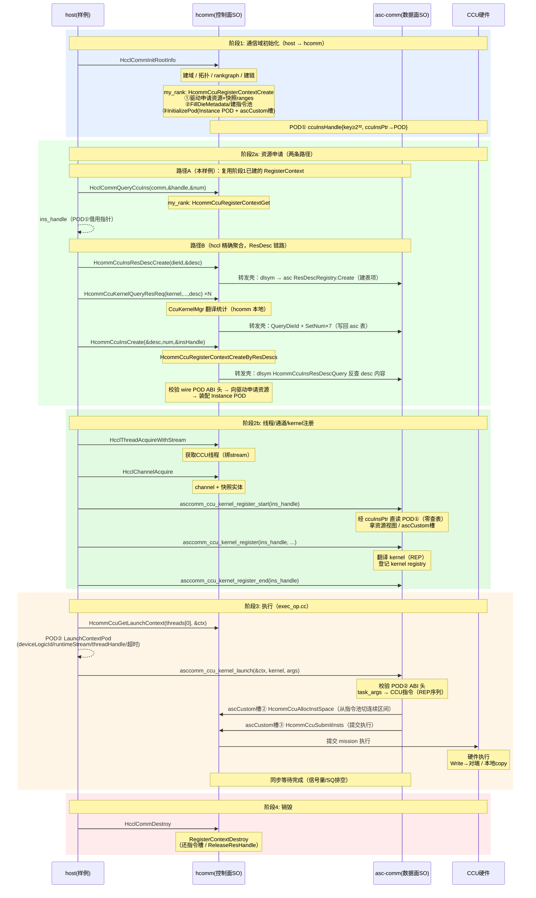

# CCU 样例执行时序：asc-comm ↔ hcomm 交互

以 `ccu_all_to_all` 样例为例，描述数据面（asc-comm）与控制面（hcomm）从通信域初始化到算子执行、销毁的完整交互时序。

## 参与方

| 参与方 | 角色 |
|--------|------|
| host（样例进程） | 驱动整个流程：初始化通信域、准备资源、触发执行 |
| hcomm（控制面 SO） | 资源管理：建域/拓扑/建链、RegisterContext 资源申请与 POD 装配、指令槽管理与硬件提交 |
| asc-comm（数据面 SO） | 执行语义：读 POD、kernel 注册与翻译（REP 指令）、launch |
| CCU 硬件 | 实际执行搬运/归约（经 mission/CKE/XN） |

## 时序图



<details>
<summary>纯文本版（终端/不支持 Mermaid 的环境查看）</summary>

```text
 host(样例)          hcomm(控制面SO)                asc-comm(数据面SO)           CCU硬件
    │                      │                             │                       │
═══│═══ 阶段1: 通信域初始化（host→hcomm）═══════════════════════════════════════│═══
    │ HcclCommInitRootInfo │                             │                       │
    │─────────────────────>│ 建域/拓扑/rankgraph/建链     │                       │
    │                      │ my_rank: RegisterContextCreate                     │
    │                      │  ├─ 驱动申请资源+快照ranges │                       │
    │                      │  ├─ FillDieMetadata/指令池  │                       │
    │                      │  └─ InitializePod ──────────│───── POD① ──────────>│
    │                      │    (Instance POD+ascCustom槽)                       │
    │                      │    ccuInsHandle{key≥2³², ccuInsPtr→POD}            │
    │                      │                             │                       │
═══│═══ 阶段2a: 资源申请——路径A(样例) ═════════════════════════════════════════│═══
    │ QueryCcuInstance ──────>│ HcclCommQueryCcuIns →       │                       │
    │<─── ins_handle(POD①指针)│  HcommCcuRegisterContextGet │                       │
    │  (路径B: hccl ResDesc 聚合链路含转发壳，见下文"资源申请的两条路径")            │
    │                      │                             │                       │
═══│═══ 阶段2b: 线程/通道/kernel注册 ════════════════════════════════════════════│═══
    │ HcclThreadAcquireWithStream ──>│ (CCU线程,绑stream)  │                       │
    │ HcclChannelAcquire ────>│ (channel+快照实体)         │                       │
    │ asccomm_ccu_kernel_register_start(ins_handle) ──────>│                      │
    │                      │   asc 经 ccuInsPtr 直读POD① │                       │
    │                      │   (零查表!拿资源视图/ascCustom槽)                   │
    │ asccomm_ccu_kernel_register(ins_handle,...) ────────>│ 翻译kernel(REP)      │
    │ asccomm_ccu_kernel_register_end(ins_handle) ────────>│ 登记kernel registry  │
    │                      │                             │                       │
═══│═══ 阶段3: 执行（exec_op.cc）═══════════════════════════════════════════════│═══
    │ HcommCcuGetLaunchContext(threads[0], &ctx) ─────>│                          │
    │<─── POD② LaunchContextPod(deviceLogicId/runtimeStream│/threadHandle/超时)   │
    │                      │                             │                       │
    │ asccomm_ccu_kernel_launch(&ctx, kernel, args) ──────>│                      │
    │                      │   校验POD② ABI头            │                       │
    │                      │   task_args→CCU指令(REP序列) │                       │
    │                      │<── ascCustom槽② AllocInstSpace(从指令池切槽)        │
    │                      │<── ascCustom槽③ SubmitInsts(提交执行) ─────────────>│ 硬件执行
    │                      │                             │   Write→对端/本地copy │
    │                      │   同步等待完成(信号量/SQ排空) │                       │
    │                      │                             │                       │
═══│═══ 阶段4: 销毁 ════════════════════════════════════════════════════════════│═══
    │ HcclCommDestroy ─────>│ RegisterContextDestroy      │                       │
    │                      │  (还指令槽/ReleaseResHandle) │                       │
```

</details>

## 关键设计点

1. **POD①（`CcuInsHandle`）**：阶段 1 一次性装配（`HcommCcuRegisterContextCreate`），
   阶段 2 asc 经 `ccuInsPtr` **直接读指针**拿资源视图（Instance POD：资源 ranges、die 元数据、
   ascCustom 槽位）——不回 hcomm 查表，"新上下文活在句柄里"。
2. **POD②（`HcommCcuLaunchContextPod`）**：每次执行时 hcomm 现场打包（借用的 runtimeStream、
   设备逻辑号、线程句柄、超时、主从属性）——见 `exec_op.cc` 的 `HcommCcuGetLaunchContext` 调用。
   `runtimeStream` 仅在本次同步 launch 返回前有效。
3. **反向回调（asc→hcomm）**：launch 过程中 asc 通过 POD① 的 `ascCustom` 槽位回调 hcomm
   （槽① `HcommCcuAllocInstSpace` 从指令池切连续区间、槽③ `HcommCcuSubmitInsts` 提交硬件执行）——
   **数据面不懂硬件提交细节，控制面不碰指令翻译**，职责分离。
4. **同步语义**：`asccomm_ccu_kernel_launch` 为同步接口，内部等待任务完成（信号量/SQ 排空）。

## 转发壳（forwarding stub）是什么

hcomm 侧与 asc 侧**同名**的 C 函数，函数体只做一件事：`dlsym` 找到 asc 的权威实现并转调：

```cpp
// hcomm 侧 ccu_res_c_adpt.cc（示意）
CcuResult HcommCcuInsResDescCreate(uint32_t dieId, HcommCcuResDescHandle* resDesc)
{
    auto target = GetAscExport("HcommCcuInsResDescCreate");   // dlsym(RTLD_DEFAULT, ...)
    return target(dieId, resDesc);                             // 真正实现在 asc 的 ResDescRegistry
}
```

**为什么需要壳**（而不是 hccl 直接调 asc）：

| 约束 | 说明 |
|------|------|
| 接口契约由 hcomm 头承载 | 调用方（hccl/样例）include 的是 hcomm 的 `ccu_res.h`，链接期解析 hcomm 的符号——hcomm 必须提供函数体 |
| 编译期禁止依赖 asc | hcomm 链接带 `-Wl,--no-undefined` 且不链接 asc SO，**编译期拿不到 asc 符号**，只能运行时 `dlsym` |
| 单一权威表 | ResDesc 表只在 asc 一份；若无壳，hcomm 本地 `CcuResDescMgr` 表与 asc 表同名双实现，`dlsym` 按加载顺序（hcomm 先）解析到谁就用谁的表 → 同一 handle 两侧查不到（表分裂） |

目前是转发壳的接口（ResDesc 五件套）：`HcommCcuInsResDesc{Create,Destroy,QueryDieId,QueryNum,SetNum}`。
注意壳**不在 `hcomm.map` 导出**（避免 `dlsym` 解析回 hcomm 自己形成递归，见交接文档 §12.8）；
hccl 的 `dlsym` 直接命中 asc 实现，hcomm 内部调用经壳转发——两股流量都收敛到 asc 权威表。

## 资源申请的两条路径（详细链路）

### 路径 A：复用通信域实例（本样例）

阶段 1 `HcclCommInitRootInfo` 时，hcomm 的 `my_rank` 已按默认类型建好 RegisterContext（含 POD①）。
算子侧只是**取回句柄**，零申请：

```text
样例: HcclCommQueryCcuIns(comm, &handle, &num)
  └─ hcomm: my_rank::QueryCcuRegisterContext
       └─ HcommCcuRegisterContextGet(handle, &pod)   ← RegisterContextRegistry 查表返回借用指针
```

### 路径 B：ResDesc 精确聚合（hccl 通用链路）

多个 kernel 的诉求先聚合进"申请单"（ResDesc，存 asc 表），再一次性创建实例：

```text
① hccl: HcommCcuInsResDescCreate(dieId, &desc)
     └─ hcomm 转发壳 ─dlsym─▶ asc: ResDescRegistry::Create     （asc 表建空白单据）

② hccl: HcommCcuKernelQueryResReq(kernelFunc, args, num, desc)   ×N（逐 kernel 累加）
     └─ hcomm 本地实现（非壳）:
          ├─ HcommCcuInsResDescQueryDieId(desc, &dieId)          ─壳─▶ asc 表反查 dieId
          ├─ CcuKernelMgr::GetKernelResourceRequest(...)          ← homm 本地翻译链（统计）
          └─ HcommCcuInsResDescSetNum(desc, wireType, num) ×7     ─壳─▶ asc 表写回数量
             （wire 索引：LOOP/MS/CKE/XN/GSA/INS/MISSION，两侧同索引）

③ hccl: HcommCcuInsCreate(&desc, num, &insHandle)
     └─ hcomm: HcommCcuRegisterContextCreateByResDescs
          ├─ dlsym "HcommCcuInsResDescQuery"                     ─▶ asc 表值拷贝回 desc 内容
          ├─ 校验 wire POD ABI 头（magic "CRDS"/version/size）
          └─ RegisterContextRegistry::CreateByResDescs
               ├─ 驱动申请资源（CcuAllocResHandleByResDescs）     ← 资源申请发生在 hcomm
               ├─ 快照 ranges / 填 die 元数据 / 建指令池
               └─ InitializePod → POD① + ccuInsPtr

④ hccl: HcommCcuInsResDescDestroy(desc)                           （单据用完即弃）
```

> ResDesc POD **定义**在两仓各有一份同布局副本（共享头 `hcomm_ccu_resource.h`，靠 ABI 头校验），
> 但运行时**表**只在 asc 一份；**向驱动申请资源**只发生在 hcomm（阶段③内）。

## 跨 SO 交接物清单

| 交接物 | 方向 | 载体 | 生命周期 |
|--------|------|------|----------|
| Instance POD①（资源视图+ascCustom 槽） | hcomm → asc | `CcuInsHandle.ccuInsPtr` 借用指针 | 通信域级（RegisterContext 生命周期） |
| LaunchContextPod②（stream/设备/超时） | hcomm → asc | 值传递（栈上 POD） | 单次 launch |
| `AllocInstSpace`/`SubmitInsts`/`GetChannelEntity` | asc → hcomm | POD① 内 `ascCustom[0..2]` 函数指针 | 随 POD① |
| ResDesc 描述符（hccl 链路） | hccl →（hcomm 转发壳）→ asc | `HcommCcuResDescHandle`（asc 侧 ResDescRegistry 权威表） | 创建→聚合→消费即弃 |
